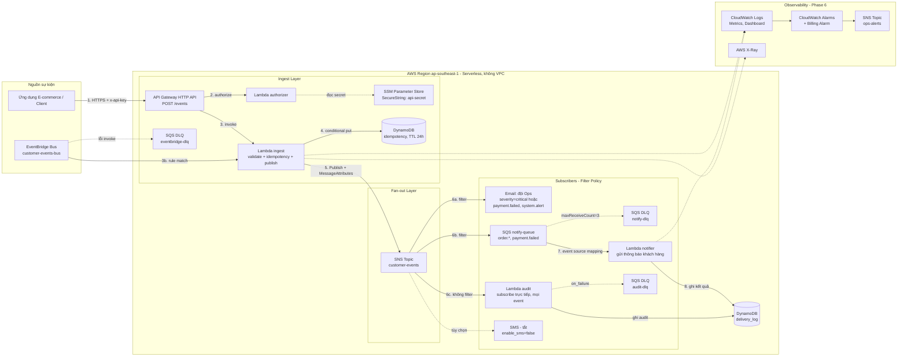

# Phase 1: Enterprise Architecture & Design — Customer Logic Workflow

> **Phiên bản:** 1.0 · **Region:** `ap-southeast-1` · **IaC:** Terraform · **Runtime:** Python 3.12 (arm64) · **Budget:** Portfolio tối giản · **SMS:** tắt (feature flag)

## 0. Các quyết định đã chốt từ Phase 0

| Hạng mục | Quyết định |
|---|---|
| IaC | Terraform (module hóa, `envs/dev`, `envs/prod`) |
| Tech stack | Python 3.12, `boto3`, `pydantic`, `aws-lambda-powertools`, `pytest`, `moto` |
| Event source | API Gateway HTTP API + EventBridge custom bus |
| Kênh nhận | Email (SNS), SQS + Lambda (worker), Lambda subscriber trực tiếp (audit). **SMS: tắt** |
| Domain mẫu | E-commerce: `order.created`, `order.shipped`, `payment.failed`, `system.alert` |
| Budget | Portfolio tối giản: 100% serverless, không VPC, không NAT Gateway |
| CI/CD | GitHub Actions + OIDC |
| Local dev | SAM Local + AWS Emulator (`aws/aws-emulator`) + moto |

---

## 1. Yêu cầu chức năng (Functional Requirements)

| ID | Yêu cầu |
|---|---|
| FR-01 | Hệ thống nhận sự kiện nghiệp vụ qua **HTTPS API** (`POST /events`) và qua **EventBridge** (sự kiện nội bộ, ví dụ `system.alert`). |
| FR-02 | Mỗi sự kiện được **validate schema** (JSON) trước khi phát hành. Sự kiện sai trả về `400`, không đi tiếp. |
| FR-03 | Lambda `ingest` **publish** sự kiện lên **SNS Topic** kèm `MessageAttributes` (`event_type`, `severity`). |
| FR-04 | SNS **fan-out** tới nhiều subscriber, mỗi subscriber có **Filter Policy** riêng: Email (đội vận hành), SQS (worker gửi thông báo khách hàng), Lambda (audit). |
| FR-05 | Cùng một `event_id` gửi nhiều lần chỉ được xử lý **một lần** (idempotency). |
| FR-06 | Mọi lần gửi được ghi vào bảng **delivery log** (`SENT`, `FAILED`, `SKIPPED_DUPLICATE`) để tra cứu. |
| FR-07 | Message xử lý thất bại nhiều lần được chuyển sang **Dead Letter Queue (DLQ)** để điều tra và replay. |
| FR-08 | Kênh SMS được thiết kế sẵn nhưng **tắt mặc định** (`enable_sms = false`). |

### Schema sự kiện chuẩn (Event Contract)

```json
{
  "event_id": "7f3c1e52-9b1a-4c0e-8d52-1b2a3c4d5e6f",
  "event_type": "order.created",
  "severity": "info",
  "customer_id": "cus_10293",
  "occurred_at": "2026-11-23T08:15:30Z",
  "payload": { "order_id": "ord_5521", "total": 450000, "currency": "VND" }
}
```

| Trường | Kiểu | Ràng buộc |
|---|---|---|
| `event_id` | UUID v4 | Bắt buộc, dùng làm **idempotency key** |
| `event_type` | enum | `order.created` · `order.shipped` · `payment.failed` · `system.alert` |
| `severity` | enum | `info` · `warning` · `critical` |
| `customer_id` | string | Bắt buộc, trừ `system.alert` |
| `occurred_at` | ISO 8601 UTC | Bắt buộc |
| `payload` | object | Tối đa 200 KB (giới hạn message SNS/SQS là 256 KB) |

---

## 2. Yêu cầu phi chức năng (NFRs)

| Nhóm | Mục tiêu (SLO) | Cách đáp ứng |
|---|---|---|
| **Availability** | ≥ 99,9% cho đường ingest | Toàn bộ dịch vụ managed, tự chạy đa AZ trong region (API Gateway, Lambda, SNS, SQS, DynamoDB) |
| **Latency** | API ingest p95 < 300 ms. End-to-end (ingest → worker xử lý) p95 < 5 giây | Lambda arm64, không cold-start nặng (Python, bundle nhỏ), SQS long polling |
| **Throughput** | Ổn định 50 req/s, burst 200 req/s | Throttling ở API Gateway stage, SQS làm bộ đệm hấp thụ spike |
| **Durability / Delivery** | **At-least-once**, không mất sự kiện sau khi trả `202` | SNS → SQS + DLQ, `retention = 14 ngày` |
| **Idempotency** | Gửi trùng không tạo thông báo trùng | DynamoDB conditional write + TTL 24 giờ |
| **Security** | Mã hóa at-rest và in-transit, Least Privilege, không secret trong code | KMS/SSE, TLS 1.2+, IAM role theo từng Lambda, SSM SecureString |
| **Privacy / Compliance** | Tối thiểu hóa PII, log đã mask email và số điện thoại | Mask trong lớp logging; tham chiếu Nghị định 13/2023/NĐ-CP về bảo vệ dữ liệu cá nhân và nguyên tắc GDPR |
| **Observability** | Truy vết được 1 sự kiện xuyên suốt các thành phần | `correlation_id` = `event_id`, log JSON, X-Ray |
| **Cost** | Dev ≤ ~1 USD/tháng, nằm trong Free Tier | Serverless, on-demand, không VPC/NAT/WAF |
| **RPO / RTO** | RPO = 0 cho event đã nhận (đã vào SNS/SQS). RTO < 30 phút (tái tạo toàn bộ bằng `terraform apply`) | IaC 100%, PITR DynamoDB ở prod |

---

## 3. Sơ đồ kiến trúc

> **Lưu ý về VPC/Subnet:** Dự án này **cố ý không dùng VPC**. Mọi dịch vụ đều được truy cập qua endpoint AWS có xác thực IAM và TLS. Đưa Lambda vào VPC không tăng bảo mật mà còn buộc phải trả ~32 USD/tháng cho NAT Gateway hoặc cấu hình VPC Endpoint. Xem **ADR-004**.



### Luồng dữ liệu (Happy path)

1. Client gọi `POST /events` kèm header `x-api-key`.
2. API Gateway gọi **Lambda authorizer**. Authorizer so khớp secret lấy từ **SSM SecureString** (cache 5 phút).
3. API Gateway gọi **Lambda ingest**. Với nguồn EventBridge, rule khớp `source = customer.workflow` sẽ gọi cùng Lambda này.
4. `ingest` validate schema, rồi **conditional put** `event_id` vào bảng `idempotency`. Nếu đã tồn tại thì trả `200 duplicate` và dừng.
5. `ingest` **publish** lên SNS Topic kèm `MessageAttributes` (`event_type`, `severity`), rồi trả `202 Accepted`.
6. SNS fan-out theo **Filter Policy**: Email (Ops), SQS `notify-queue`, Lambda `audit`.
7. Lambda `notifier` đọc batch từ SQS, xử lý từng message và trả `batchItemFailures` cho message lỗi (partial batch response).
8. Kết quả ghi vào `delivery_log`. Message lỗi quá 3 lần được chuyển sang `notify-dlq`.

### Bảng Filter Policy

| Subscriber | Protocol | Filter Policy (theo `MessageAttributes`) |
|---|---|---|
| Ops email | `email` | `severity = ["critical"]` **hoặc** `event_type = ["payment.failed","system.alert"]` |
| `notify-queue` | `sqs` | `event_type = [{"prefix": "order."}, "payment.failed"]` |
| Lambda `audit` | `lambda` | Không filter (nhận tất cả) |
| SMS | `sms` | **Không tạo** khi `enable_sms = false` |

---

## 4. Architecture Decision Records (ADR)

### ADR-001: AWS Lambda thay vì ECS Fargate
- **Bối cảnh:** Tải sự kiện ngắn, rời rạc, có thể bằng 0 trong nhiều giờ.
- **Quyết định:** Dùng **Lambda (arm64, Python 3.12)**.
- **Lý do:** Scale-to-zero, tính phí theo từng lần gọi, nằm trong Free Tier (1 triệu request và 400.000 GB-giây mỗi tháng). Fargate chạy liên tục nên tốn tiền khi idle.
- **Đánh đổi:** Cold start (~200–500 ms với Python), giới hạn 15 phút. Cả hai đều chấp nhận được với bài toán này.

### ADR-002: SNS fan-out + SQS buffering, không chỉ SNS→Lambda trực tiếp
- **Quyết định:** Kênh **khách hàng** đi qua `SNS → SQS → Lambda`. Kênh **audit** subscribe Lambda trực tiếp. Hai pattern được dùng cùng nhau để so sánh.
- **Lý do:** SQS hấp thụ spike, cho phép retry có kiểm soát (`maxReceiveCount`), có DLQ và hỗ trợ partial batch. SNS→Lambda trực tiếp đơn giản hơn nhưng khó kiểm soát throttling.
- **Vì sao không dùng EventBridge làm hub chính?** Đề bài yêu cầu SNS. EventBridge vẫn được dùng làm **nguồn sự kiện** vì rule routing và schedule rất hữu ích.

### ADR-003: DynamoDB (On-Demand) thay vì RDS
- **Quyết định:** DynamoDB cho `idempotency` và `delivery_log`.
- **Lý do:** Truy cập theo key (`event_id`), TTL native cho idempotency, không cần quản lý connection (không cần RDS Proxy), on-demand nên chi phí gần 0 khi không dùng. RDS tối thiểu ~12–15 USD/tháng và cần VPC.

### ADR-004: Không dùng VPC (ngoại lệ có chủ đích)
- **Quyết định:** Lambda chạy ngoài VPC.
- **Lý do:** Không có tài nguyên nào cần nằm trong VPC (không RDS, không EC2). Mọi lời gọi AWS API đều qua TLS + IAM. NAT Gateway (~32 USD/tháng) vi phạm mục tiêu budget.
- **Rủi ro còn lại:** Lambda có đường ra Internet. **Giảm thiểu:** IAM Least Privilege, không có code gọi ra ngoài.
- **Lộ trình prod-grade:** Đặt Lambda trong Private Subnet + VPC Endpoint (SNS, SQS, DynamoDB Gateway Endpoint, SSM). Đây là biến thể `envs/prod` nếu cần.

### ADR-005: HTTP API + Lambda authorizer, không dùng WAF ở dev
- **Quyết định:** Dùng **HTTP API** (rẻ hơn REST API ~70%) với **Lambda authorizer** kiểm tra secret lưu ở **SSM SecureString** (miễn phí, đúng quy tắc không hardcode secret).
- **Lý do không WAF:** AWS WAF tốn khoảng 5 USD/tháng cho Web ACL cộng phí rule. Thay thế ở dev: **throttling ở stage** (`rate=50`, `burst=200`).
- **Prod:** Có biến `enable_waf` để bật WAF (rate-based rule + managed rule group) khi cần.

### ADR-006: Chiến lược mã hóa theo môi trường
| Thành phần | `dev` (miễn phí) | `prod` |
|---|---|---|
| SNS Topic | AWS managed key `alias/aws/sns` | **KMS CMK** (bật rotation) |
| SQS | **SSE-SQS** (`sqs_managed_sse_enabled`) | SSE-SQS hoặc CMK |
| DynamoDB | AWS owned key (mặc định) | **KMS CMK** |
| SSM Parameter | SecureString (key `alias/aws/ssm`) | SecureString + CMK |

> **Lý do dùng SSE-SQS cho SQS nhận từ SNS:** SNS không thể dùng key `alias/aws/sqs` để ghi vào SQS vì không sửa được key policy của AWS managed key. SSE-SQS vừa miễn phí vừa tương thích. Một biến `use_cmk` điều khiển toàn bộ việc chuyển đổi (Phase 3).

### ADR-007: SMS là feature flag, mặc định tắt
- Biến `enable_sms = false`. Khi bật, Terraform mới tạo subscription `sms`, đặt `MonthlySpendLimit` thấp và yêu cầu số điện thoại đã xác minh (SMS Sandbox).
- **Lý do:** Tránh phát sinh chi phí và thủ tục đăng ký origination identity.

### ADR-008: Terraform + Python 3.12 + arm64
- Terraform: chuẩn doanh nghiệp, module hóa, remote state trên S3.
- Python: **AWS Lambda Powertools** cung cấp sẵn logging JSON, tracing, idempotency, batch processing.
- **arm64 (Graviton):** giá rẻ hơn khoảng 20% và hiệu năng tốt hơn x86.

### ADR-009: Idempotency bằng DynamoDB conditional write
- Dùng `PutItem` với `ConditionExpression = attribute_not_exists(event_id)` và TTL 24 giờ.
- **Đánh đổi:** Cần xử lý trường hợp ghi idempotency xong nhưng publish SNS lỗi. Giải pháp: ghi trạng thái `IN_PROGRESS`/`COMPLETED` và cho phép retry khi `IN_PROGRESS` quá hạn (chi tiết ở Phase 4).

---

## 5. Well-Architected Review

| Pillar | Đánh giá | Chi tiết |
|---|---|---|
| **Operational Excellence** | ✅ | 100% Terraform, tagging chuẩn, log JSON có `correlation_id`, runbook (Phase 6), CI/CD tự động |
| **Security** | ✅ / ⚠️ | IAM role riêng từng Lambda, mã hóa at-rest/in-transit, secret ở SSM. **Ngoại lệ:** không VPC, không WAF ở dev (ADR-004, ADR-005) |
| **Reliability** | ✅ | Decoupling bằng SNS/SQS, DLQ ở mọi điểm async, idempotency, retry có `maxReceiveCount`, DynamoDB PITR ở prod |
| **Performance Efficiency** | ✅ | arm64, event-driven, SQS batch (`batch_size=10`), `ReportBatchItemFailures` |
| **Cost Optimization** | ✅ | Serverless, on-demand, log retention 7 ngày ở dev, Billing Alarm, ước tính ~0–1 USD/tháng ở dev |
| **Sustainability** | ✅ | Scale-to-zero, không tài nguyên idle, Graviton tiết kiệm năng lượng |

---

## 6. Ước tính chi phí hàng tháng

> Các con số dưới đây là **ước tính gần đúng** để định hướng. Giá thực tế phụ thuộc region và thay đổi theo thời gian. Hãy kiểm tra lại bằng **AWS Pricing Calculator** trước khi triển khai.

### Dev (khoảng 10.000 event/tháng, test thủ công)

| Dịch vụ | Free Tier / Lý do | Ước tính |
|---|---|---|
| Lambda (4 hàm, arm64) | 1 triệu request + 400.000 GB-giây miễn phí vĩnh viễn | ~0 USD |
| API Gateway HTTP API | 1 triệu request miễn phí trong 12 tháng đầu | ~0 USD |
| SNS | 1 triệu publish và 1.000 email miễn phí | ~0 USD |
| SQS | 1 triệu request miễn phí | ~0 USD |
| DynamoDB On-Demand | 25 GB lưu trữ miễn phí, tải rất nhỏ | ~0 USD |
| CloudWatch Logs (retention 7 ngày) | 5 GB ingest miễn phí | ~0 USD |
| X-Ray | 100.000 trace miễn phí | ~0 USD |
| SSM Parameter (Standard) | Miễn phí | 0 USD |
| S3 + DynamoDB (Terraform state) | Dung lượng rất nhỏ | ~0 USD |
| CloudWatch Alarms | 10 alarm miễn phí | ~0 USD |
| KMS | Dùng key AWS managed | 0 USD |
| **Tổng dev** | | **≈ 0–1 USD/tháng** |

### Prod simulation (khoảng 1 triệu event/tháng, ~3 triệu lượt delivery)

| Dịch vụ | Ước tính |
|---|---|
| API Gateway HTTP API | ~1–1,5 USD |
| Lambda (4 hàm) | ~1–2 USD |
| SNS (publish + delivery) | ~0,5–1 USD |
| SQS (+ DLQ) | ~1–1,5 USD |
| DynamoDB On-Demand (ghi idempotency + delivery log) | ~2–4 USD |
| KMS CMK (1–2 key) + request | ~1–3 USD |
| CloudWatch Logs, Alarms, Dashboard | ~2–5 USD |
| X-Ray | ~0–1 USD |
| WAF (tùy chọn) | +6–10 USD |
| **Tổng prod** | **≈ 10–20 USD/tháng** (chưa gồm WAF và SMS) |

**Rủi ro chi phí cần kiểm soát:**
- **SMS:** đang tắt. Khi bật, bắt buộc đặt `MonthlySpendLimit`.
- **Log retention:** luôn đặt retention rõ ràng, không dùng "Never expire".
- **Vòng lặp vô hạn** (Lambda tự trigger chính nó): đặt `reserved_concurrent_executions` và alarm (Phase 3 và 6).
- **Billing Alarm** ở các ngưỡng 5, 10 và 20 USD (Phase 6).

---

## 7. Checklist Audit (đối chiếu `enterprise-checklist.md`)

| Hạng mục | Trạng thái | Ghi chú |
|---|---|---|
| 100% IaC, không ClickOps | ✅ | Terraform |
| Tagging chuẩn (`Project`, `Environment`, `Owner`, `CostCenter`, `ManagedBy`) | ✅ | Dùng `default_tags` trong provider (Phase 3) |
| Structured logging JSON | ✅ | Powertools Logger (Phase 4) |
| Runbook | ⏳ | Phase 6 |
| Encryption at rest (SNS/SQS/DynamoDB) | ✅ | Theo ADR-006. CMK + rotation ở prod |
| Encryption in transit (TLS 1.2+) | ✅ | HTTP API chỉ HTTPS. Thêm policy `aws:SecureTransport` cho SNS/SQS |
| Network isolation (Private Subnet) | ⚠️ **Ngoại lệ** | Không VPC, ADR-004. Có lộ trình nâng cấp |
| Secrets Management | ✅ | SSM SecureString |
| Edge protection (WAF) | ⚠️ **Ngoại lệ (dev)** | Throttling thay thế. `enable_waf` cho prod, ADR-005 |
| Multi-AZ | ✅ | Managed service tự đa AZ |
| Asynchronous decoupling | ✅ | SNS + SQS |
| DLQ cho mọi async trigger | ✅ | `notify-dlq`, `audit-dlq`, `eventbridge-dlq`, SNS subscription DLQ |
| Idempotency & retries | ✅ | ADR-009, `maxReceiveCount=3`, backoff của SDK |
| Backup (PITR) | ⚠️ | Bật ở prod. Tắt ở dev để tiết kiệm (dữ liệu test) |
| ARM64 | ✅ | `architectures = ["arm64"]` |
| Log retention | ✅ | 7 ngày dev, 30 ngày prod |
| Budget alerts | ⏳ | Phase 6 |
| Zero static credentials / OIDC | ⏳ | Phase 5 |
| Least privilege IAM | ⏳ | Thiết kế ở Phase 3: mỗi Lambda một role, ARN cụ thể, không dùng `*` |
| Confused deputy (`aws:SourceArn`) | ⏳ | Áp dụng trên SQS policy (cho SNS) và Lambda permission, Phase 3 |
| Remote state + locking | ⏳ | S3 backend, Phase 3 |
| Canary / auto-rollback | ⚠️ | Chỉ ở prod (Lambda alias + CodeDeploy), cân nhắc ở Phase 5 |

**Kết luận audit:** Không có lỗ hổng bảo mật ở mức thiết kế. Các ngoại lệ (VPC, WAF ở dev, PITR ở dev) đều có ADR giải thích và có lộ trình nâng cấp cho prod.

---

## 8. Checklist xác minh Phase 1

Phase 1 **chưa tạo tài nguyên AWS nào**, nên chi phí phát sinh là **0 USD** và chưa cần lệnh teardown (sẽ có ở Phase 6). Bạn hãy rà soát:

- [ ] Event schema và 4 loại `event_type` phù hợp domain E-commerce.
- [ ] Bảng Filter Policy đúng ý định về việc kênh nào nhận loại sự kiện nào.
- [ ] Chấp nhận ngoại lệ **không VPC** và **không WAF ở dev** (ADR-004, ADR-005).
- [ ] Chấp nhận mô hình mã hóa theo môi trường (ADR-006).
- [ ] Mục tiêu NFR và ngân sách (~0–1 USD/tháng ở dev) phù hợp.

## 9. Sản phẩm bàn giao của Phase 1

- Danh sách FR/NFR và Event Contract.
- Sơ đồ kiến trúc Mermaid và luồng dữ liệu.
- 9 ADR.
- Well-Architected Review (6 pillars).
- Ước tính chi phí dev và prod.
- Checklist Audit đối chiếu `enterprise-checklist.md`.

**Phase 2 tiếp theo:** Cấu trúc repo, chiến lược branching, thiết lập môi trường local (AWS SSO, SAM Local, AWS Emulator/moto, pre-commit với `tflint`, `checkov`, `ruff`, `gitleaks`).
