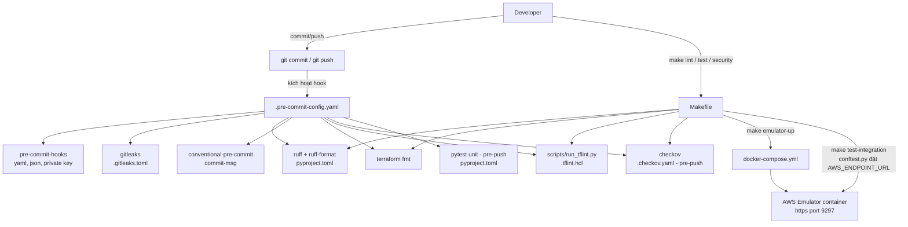

# Phase 2: Repository & Environment Setup — Customer Logic Workflow

> **Mục tiêu:** Dựng "khung" repo chuẩn doanh nghiệp: cấu trúc thư mục, quy trình Git, và máy local sẵn sàng (AWS SSO, Docker/AWS Emulator, pre-commit hooks) **trước khi** viết bất kỳ dòng Terraform hay Lambda nào.
> **Chi phí AWS của Phase này:** 0 USD (chỉ cài công cụ và cấu hình local).
> **Quy ước:** Tên repo `customer-logic-workflow`. Mọi đường dẫn bên dưới tính từ thư mục gốc repo.
> **Thay đổi v1.1:** Công cụ test integration local đổi từ LocalStack sang **AWS Emulator** (`github.com/aws/aws-emulator`). Thông tin về emulator lấy từ README và User Guide của AWS tại thời điểm viết, chưa được chạy thử trên máy bạn. Xem File 13A, 13B, 20, 21 và mục 5 (giới hạn) và 6.6 (thăm dò dịch vụ).

---

## 1. Cấu trúc repo (Monorepo)

**Vì sao monorepo?** Dự án có 1 team, hạ tầng và code Lambda thay đổi cùng nhau (ví dụ thêm filter policy kéo theo sửa handler). Một PR duy nhất chứa cả hai giúp review và rollback nhất quán. Khi lớn lên có thể tách `infra` thành repo riêng.

```text
customer-logic-workflow/
├── .github/
│   ├── workflows/                 # ci.yml, cd.yml (Phase 5)
│   ├── CODEOWNERS
│   ├── dependabot.yml
│   └── pull_request_template.md
├── docs/                          # phase-1..6 guides
├── infra/
│   ├── bootstrap/                 # S3 remote state + khóa state (Phase 3)
│   ├── modules/                   # module tái sử dụng (Phase 3)
│   │   ├── kms/  sns/  sqs/  dynamodb/  lambda/
│   │   └── apigw/  eventbridge/  iam/  observability/
│   └── envs/
│       ├── dev/                   # main.tf, providers.tf, variables.tf, outputs.tf, backend.tf
│       └── prod/
├── src/                           # mã nguồn Lambda (Phase 4)
│   ├── authorizer/
│   ├── ingest/
│   ├── notifier/
│   ├── audit/
│   ├── common/                    # logging, models dùng chung
│   └── requirements.txt
├── tests/
│   ├── unit/                      # moto, không cần Docker
│   ├── integration/               # AWS Emulator (conftest.py)
│   └── events/                    # payload mẫu cho SAM Local
├── scripts/
│   ├── run_tflint.py
│   ├── emulator-env.ps1
│   └── protect-main.ps1
├── .checkov.yaml
├── .editorconfig
├── .env.example
├── .gitattributes
├── .gitignore
├── .gitleaks.toml
├── .pre-commit-config.yaml
├── .tflint.hcl
├── Dockerfile.emulator
├── docker-compose.yml
├── Makefile
├── pyproject.toml
└── requirements-dev.txt
```

| Thư mục | Vai trò | Phase tạo nội dung |
|---|---|---|
| `infra/bootstrap` | Tạo S3 bucket chứa Terraform state (chạy 1 lần, state local) | 3 |
| `infra/modules/*` | Module Terraform nhỏ, mỗi module làm một việc | 3 |
| `infra/envs/{dev,prod}` | "Root module" mỗi môi trường, gọi các module và truyền biến | 3 |
| `src/*` | Mỗi Lambda một thư mục, `common` chứa code dùng chung | 4 |
| `tests/*` | Unit, integration và event mẫu | 4 |
| `.github/workflows` | Pipeline CI/CD | 5 |

---

## 2. Chiến lược Git Branching

**Chọn: Trunk-Based Development.** Chỉ có một nhánh dài hạn là `main`. Mọi thay đổi đi qua nhánh ngắn hạn và Pull Request (PR).

| Quy tắc | Nội dung |
|---|---|
| Nhánh dài hạn | Duy nhất `main` (luôn deploy được). **Không** có nhánh `dev`/`prod`. Môi trường được tách bằng thư mục `infra/envs/*` và GitHub Environments |
| Đặt tên nhánh | `feat/<mô-tả>`, `fix/<mô-tả>`, `chore/<mô-tả>`, `docs/<mô-tả>` |
| Vòng đời nhánh | Tối đa 1–2 ngày, PR nhỏ (khoảng ≤ 400 dòng) |
| Commit message | **Conventional Commits**: `feat(sns): add filter policy for ops email` (được ép bởi hook `commit-msg`) |
| Cách merge | **Squash merge** để lịch sử `main` tuyến tính, mỗi PR một commit |
| Release | Merge vào `main` → tự deploy `dev` → **manual approval** → deploy `prod` (Phase 5) |

**Vì sao không dùng GitFlow?** GitFlow (nhiều nhánh `develop`, `release/*`) làm tăng chi phí merge và dễ lệch giữa môi trường. Với IaC, điều ta cần là *cùng một commit* được promote qua các môi trường.

### Quy tắc bảo vệ nhánh `main`

| Quy tắc | Giá trị | Lý do |
|---|---|---|
| Bắt buộc PR | Có | Không push trực tiếp |
| Số approval tối thiểu | 1 (đặt 0 nếu làm một mình, xem script bên dưới) | Four-eyes principle |
| Require status checks | `lint`, `unit-test`, `security-scan`, `terraform-plan` (strict) | Chỉ merge khi CI xanh và nhánh cập nhật |
| Require conversation resolution | Có | Không bỏ sót góp ý review |
| Linear history | Có | Phù hợp squash merge |
| Force push / xóa nhánh | Cấm | Bảo toàn lịch sử |
| Áp dụng cho cả admin | Có | Không ai né quy trình |

> **Lưu ý:** Tên 4 status check ở trên là tên **job** sẽ được tạo trong workflow CI ở Phase 5. Branch protection kiểu cổ điển yêu cầu repo **public** hoặc tài khoản GitHub Pro/Team. Repo private trên gói Free sẽ không áp dụng được. Với dự án portfolio, hãy dùng repo public (không chứa secret nào, nhờ gitleaks).

---

## 3. Dependency / Call Graph của bộ công cụ

Phase 2 không có code ứng dụng, nhưng có một "chuỗi gọi" giữa các file cấu hình và công cụ. Hiểu chuỗi này giúp bạn biết khi nào file nào chạy.



### Contract Table

| Caller → Callee | Inputs / Tham số truyền | Outputs / Giá trị trả về | Vì sao có phụ thuộc này |
|---|---|---|---|
| `git commit` → `.pre-commit-config.yaml` | Danh sách file đã staged | Exit code `0` (cho commit) hoặc `≠ 0` (chặn commit) | Chặn lỗi sớm, trước khi lên CI |
| `git commit` (commit-msg) → `conventional-pre-commit` | File chứa commit message | Pass/Fail theo định dạng Conventional Commits | Lịch sử sạch, có thể sinh changelog tự động |
| hook `ruff` → `pyproject.toml` | Các file `*.py` staged | File đã sửa hoặc danh sách lỗi | Một nguồn cấu hình duy nhất cho lint/format |
| hook `gitleaks` → `.gitleaks.toml` | Diff của commit | Danh sách secret bị phát hiện | Ngăn lộ key trước khi vào lịch sử Git |
| hook `tflint` → `scripts/run_tflint.py` → `.tflint.hcl` | Đường dẫn tuyệt đối tới config | Lỗi cú pháp, lỗi quy ước AWS | `tflint --recursive` cần đường dẫn config tuyệt đối, script lo việc đó cho mọi hệ điều hành |
| hook `checkov` → `.checkov.yaml` | Thư mục `infra/` | Danh sách check Passed/Failed | Quét cấu hình sai (shift-left security) |
| `make test-integration` → `docker-compose.yml` → `Dockerfile.emulator` | `EMULATOR_ARCH` (x86_64 hoặc aarch64) | Container `aws-emulator` chạy ở `https://127.0.0.1:9297`, ghi credential và `ca.pem` vào `~/.aws/emulator/9297/` | Test với SNS/SQS/DynamoDB giả lập, không tốn tiền AWS, không cần AWS account |
| `tests/integration/conftest.py` → emulator | Đọc `ca.pem` và `emulator_credentials` do emulator sinh ra; gọi `GET /__admin/health` | Fixture `autouse` đặt `AWS_ENDPOINT_URL`, `AWS_CA_BUNDLE`... trong tiến trình pytest | Chờ emulator sẵn sàng và cô lập cấu hình trỏ vào emulator khỏi phần còn lại của máy |
| `pytest` (integration) → emulator | `AWS_ENDPOINT_URL=https://127.0.0.1:9297`, credential sinh theo từng lần chạy, SigV4 | Response từ dịch vụ giả lập (hoặc HTTP 501 `NotImplemented` nếu thao tác chưa được hỗ trợ) | `boto3` tự đọc `AWS_ENDPOINT_URL` và `AWS_CA_BUNDLE`, code ứng dụng không cần sửa |
| `make tf-plan` → AWS | `AWS_PROFILE=clw-dev` | Bản kế hoạch thay đổi | Dùng SSO tạm thời, không có Access Key lâu dài |

### Execution Trace

**Kịch bản 1 — Happy path: commit hợp lệ**

1. Bạn sửa `infra/modules/sns/main.tf`, rồi chạy `git add . && git commit -m "feat(sns): add topic policy"`.
2. Hook `pre-commit` chạy lần lượt: kiểm tra YAML/JSON → `gitleaks` quét diff → `ruff` (không có file `.py` nên bỏ qua) → `terraform fmt -check` (file `.tf` có đổi nên chạy) → `run_tflint.py`. Tất cả trả `0`.
3. Hook `commit-msg` kiểm tra thông điệp `feat(sns): ...` đúng chuẩn, trả `0`.
4. Commit được tạo. Khi `git push`, hook `pre-push` chạy tiếp `checkov` và `pytest`. Cả hai pass, đẩy code lên GitHub.

**Kịch bản 2 — Error path: lộ secret và commit sai định dạng**

1. Bạn lỡ dán private key vào `config.txt` rồi commit. `detect-private-key` và `gitleaks` trả exit code `1`, **commit bị chặn**, terminal in ra file và dòng vi phạm.
2. Bạn xóa file, commit lại với message `fixed stuff`. Hook `commit-msg` từ chối và nhắc các loại hợp lệ (`feat`, `fix`, `docs`...). Bạn sửa thành `fix: remove leaked file`.
3. Nếu `checkov` phát hiện một S3 bucket không mã hóa khi push, push bị chặn. Bạn sửa Terraform (hoặc thêm một `skip` có lý do trong `.checkov.yaml`), rồi push lại.

---

## 4. Từng file cấu hình

### File 1: `.gitignore`

**Overview:** Ngăn đưa vào Git những thứ không được commit: Terraform state (chứa dữ liệu nhạy cảm), thư mục `.terraform`, `.env`, cache Python, build artifact. File này là tuyến phòng thủ đầu tiên, đứng trước cả gitleaks.

```gitignore
# ---- Terraform ----
**/.terraform/*
*.tfstate
*.tfstate.*
crash.log
crash.*.log
*.secret.tfvars
.terraformrc
terraform.rc
*.tfplan
tfplan
# Lưu ý: .terraform.lock.hcl PHẢI được commit để khóa phiên bản provider

# ---- Python ----
__pycache__/
*.py[cod]
.venv/
venv/
.pytest_cache/
.ruff_cache/
.coverage
htmlcov/
*.egg-info/

# ---- Build artifact ----
build/
dist/
.aws-sam/
*.zip

# ---- Biến môi trường (chỉ commit .env.example) ----
.env
.env.*
!.env.example

# ---- IDE / OS ----
.idea/
.vscode/
.DS_Store
Thumbs.db

```

**Giải thích chi tiết:**
- `*.tfstate` và `*.tfstate.*`: state chứa mọi thuộc tính tài nguyên (có thể có secret dạng plain text). State thật nằm ở S3 (Phase 3), không bao giờ ở Git.
- `*.secret.tfvars`: tôi **không** ignore toàn bộ `*.tfvars` vì file tfvars theo môi trường (ví dụ tên bucket, region) không chứa secret và nên được review qua PR. Chỉ file có hậu tố `.secret.tfvars` bị chặn.
- `.terraform.lock.hcl` **không** bị ignore: file này khóa phiên bản provider, giúp CI và máy bạn dùng đúng cùng một bản.
- `.env.*` kèm `!.env.example`: chặn mọi file `.env` biến thể nhưng vẫn cho phép file mẫu không chứa giá trị thật.
- `*.zip`: gói deploy Lambda sinh ra lúc build, không cần lưu trong Git.

---

### File 2: `.gitattributes`

**Overview:** Ép mọi file text dùng ký tự xuống dòng `LF`. Trên Windows, Git mặc định có thể chuyển sang `CRLF` làm hỏng shell script và gây diff nhiễu khi CI chạy trên Linux.

```gitattributes
* text=auto eol=lf
*.ps1 text eol=crlf
*.png binary
*.jpg binary
```

**Giải thích chi tiết:**
- `* text=auto eol=lf`: Git tự nhận diện file text và chuẩn hóa về `LF` trong working tree lẫn repo.
- `*.ps1 ... eol=crlf`: PowerShell 5.1 trên Windows đọc script tốt nhất với `CRLF`, nên ngoại lệ này tránh lỗi lạ khi chạy `protect-main.ps1`.

---

### File 3: `.editorconfig`

**Overview:** Thống nhất quy ước thụt dòng, mã hóa và newline giữa các IDE. File này bổ sung cho `ruff format` và `terraform fmt` (hai công cụ ấy mới là "nguồn sự thật" khi format).

```ini
root = true

[*]
charset = utf-8
end_of_line = lf
insert_final_newline = true
trim_trailing_whitespace = true
indent_style = space
indent_size = 2

[*.py]
indent_size = 4

[*.md]
trim_trailing_whitespace = false
```

**Giải thích chi tiết:**
- `indent_size = 2` là mặc định cho `.tf`, `.yml`, `.json`; riêng Python dùng 4 theo PEP 8.
- Markdown giữ khoảng trắng cuối dòng vì hai dấu cách cuối dòng là cú pháp xuống dòng cứng.

---

### File 4: `pyproject.toml`

**Overview:** Cấu hình tập trung cho Python: `ruff` (lint và format) và `pytest`. Được gọi bởi hook `ruff`, `make lint`, `make test` và CI (Phase 5).

```toml
[project]
name = "customer-logic-workflow"
version = "0.1.0"
description = "He thong thong bao serverless: Lambda + SNS + SQS + DynamoDB"
requires-python = ">=3.12"

[tool.ruff]
line-length = 100
target-version = "py312"
src = ["src", "tests", "scripts"]

[tool.ruff.lint]
select = [
  "E",   # pycodestyle errors
  "F",   # pyflakes
  "I",   # isort
  "B",   # flake8-bugbear
  "UP",  # pyupgrade
  "S",   # flake8-bandit (bảo mật)
  "C4",  # flake8-comprehensions
  "SIM", # flake8-simplify
  "N",   # pep8-naming
]

[tool.ruff.lint.per-file-ignores]
"tests/**" = ["S101"]            # cho phép assert trong test
"scripts/**" = ["S603", "S607"]  # script dev gọi subprocess có chủ đích

[tool.pytest.ini_options]
pythonpath = ["src"]
testpaths = ["tests"]
addopts = "-ra --strict-markers"
markers = [
  "integration: test cần AWS Emulator (chạy bằng make test-integration)",
]
```

**Giải thích chi tiết:**
- `select` bật nhóm `S` (bandit) để bắt lỗi bảo mật phổ biến như `eval`, mật khẩu hardcode, `subprocess` không an toàn. Đây là "shift-left security" cho Python.
- `per-file-ignores`: `assert` là cách viết test chuẩn của pytest nên miễn `S101` cho `tests/`. Script `scripts/` gọi `subprocess` với tham số cố định, có chủ đích nên miễn `S603/S607`.
- `pythonpath = ["src"]`: cho phép test `import ingest...` mà không cần cài package.
- `--strict-markers`: gõ sai tên marker sẽ báo lỗi thay vì lặng lẽ bỏ qua. Ngưỡng coverage sẽ được thêm ở Phase 4, khi đã có code để đo.

---

### File 5: `src/requirements.txt`

**Overview:** Dependency **runtime** của Lambda (sẽ được đóng gói cùng code ở Phase 3/4). Giữ file này gọn vì mỗi MB thêm vào làm tăng cold start.

```text
aws-lambda-powertools[tracer,parser]>=3.0,<4.0
```

**Giải thích chi tiết:**
- **Powertools for AWS Lambda** cung cấp logging JSON có cấu trúc, tracing X-Ray, idempotency và batch processing, khớp với kế hoạch Phase 4.
- Extra `[parser]` kéo theo `pydantic` v2 để validate Event Contract. Extra `[tracer]` kéo theo `aws-xray-sdk`.
- **Không** liệt kê `boto3`: runtime Lambda đã có sẵn `boto3`, đóng gói thêm chỉ tốn dung lượng. Bản `boto3` dành cho test local nằm ở `requirements-dev.txt`.
- Khoảng phiên bản `>=3.0,<4.0` cho phép nhận bản vá nhưng chặn bản major có thể phá API. Dependabot sẽ đề xuất nâng cấp có kiểm soát.

---

### File 6: `requirements-dev.txt`

**Overview:** Dependency cho **phát triển và test local**. Kế thừa runtime qua `-r src/requirements.txt`.

```text
-r src/requirements.txt
boto3>=1.35,<2.0
moto[dynamodb,sns,sqs,ssm,events]>=5.0,<6.0
pytest>=8.3,<9.0
pytest-cov>=5.0,<7.0
ruff>=0.8,<1.0
pip-audit>=2.7,<3.0
```

**Giải thích chi tiết:**
- `moto` giả lập SNS, SQS, DynamoDB, SSM, EventBridge ngay trong tiến trình Python, nên unit test chạy được mà không cần Docker hay mạng.
- `pip-audit` quét lỗ hổng đã biết trong dependency (dùng ở CI).
- **Cố ý không** đưa `checkov` và `pre-commit` vào đây. Hai công cụ này có nhiều dependency ghim chặt phiên bản, dễ xung đột với `boto3`/`moto`. Hãy cài chúng bằng `pipx` (môi trường cô lập), xem mục 6.2.

---

### File 7: `.pre-commit-config.yaml`

**Overview:** "Cổng kiểm soát" trước khi code rời máy bạn. Khi `git commit`, nhóm hook nhẹ (secret, format, lint) chạy. Khi `git push`, nhóm hook nặng hơn (`checkov`, unit test) chạy. File này gọi `pyproject.toml`, `.gitleaks.toml`, `.checkov.yaml` và `scripts/run_tflint.py`.

```yaml
minimum_pre_commit_version: "3.5.0"
default_install_hook_types: [pre-commit, commit-msg, pre-push]
default_stages: [pre-commit]

repos:
  - repo: https://github.com/pre-commit/pre-commit-hooks
    rev: v5.0.0
    hooks:
      - id: check-yaml
        args: [--allow-multiple-documents]
      - id: check-json
      - id: end-of-file-fixer
      - id: trailing-whitespace
        args: [--markdown-linebreak-ext=md]
      - id: check-merge-conflict
      - id: detect-private-key
      - id: detect-aws-credentials
        args: [--allow-missing-credentials]
      - id: check-added-large-files
        args: [--maxkb=500]

  - repo: https://github.com/gitleaks/gitleaks
    rev: v8.21.2
    hooks:
      - id: gitleaks

  - repo: https://github.com/astral-sh/ruff-pre-commit
    rev: v0.8.0
    hooks:
      - id: ruff
        args: [--fix, --exit-non-zero-on-fix]
      - id: ruff-format

  - repo: https://github.com/compilerla/conventional-pre-commit
    rev: v3.6.0
    hooks:
      - id: conventional-pre-commit
        stages: [commit-msg]
        args: [feat, fix, docs, style, refactor, perf, test, build, ci, chore, revert]

  - repo: local
    hooks:
      - id: terraform-fmt
        name: terraform fmt
        entry: terraform fmt -check -recursive -diff infra
        language: system
        files: \.tf$
        pass_filenames: false

      - id: tflint
        name: tflint
        entry: python scripts/run_tflint.py
        language: python
        files: \.(tf|hcl)$
        pass_filenames: false

      - id: checkov
        name: checkov (IaC security)
        entry: checkov --config-file .checkov.yaml
        language: system
        files: \.tf$
        pass_filenames: false
        stages: [pre-push]

      - id: pytest-unit
        name: pytest (unit)
        entry: python -m pytest -m "not integration" -q
        language: system
        types: [python]
        pass_filenames: false
        stages: [pre-push]
```

**Giải thích chi tiết:**
- `default_install_hook_types`: chỉ cần chạy `pre-commit install` một lần là cài đủ ba loại hook (commit, commit-msg, push).
- **Phân tầng theo tốc độ:** các hook chạy dưới ~5 giây nằm ở `pre-commit` để không làm bạn nản; `checkov` và `pytest` (chậm hơn) nằm ở `pre-push`. Cả hai vẫn chạy lại ở CI nên không có lỗ hổng.
- `detect-private-key` + `gitleaks`: hai lớp quét secret bổ trợ nhau (một bên tìm khóa PEM, một bên có hàng trăm mẫu token/API key).
- `--exit-non-zero-on-fix`: nếu `ruff` tự sửa file, commit bị dừng một lần để bạn xem lại và `git add` thay đổi.
- Hook `local` với `language: system` dùng chính `terraform`/`checkov` đã cài trên máy, nên phiên bản khớp với bạn và không cần đoán `rev`.
- `tflint` dùng `language: python` vì `scripts/run_tflint.py` cần chạy giống nhau trên Windows, macOS và Linux (xem File 11).
- **Lưu ý `rev`:** sau khi tạo file, chạy `pre-commit autoupdate` để nâng các `rev` lên bản mới nhất, rồi commit kết quả.

---

### File 8: `.tflint.hcl`

**Overview:** Cấu hình `tflint`, trình kiểm tra Terraform. Được gọi bởi `scripts/run_tflint.py`. Bắt lỗi mà `terraform validate` không thấy, ví dụ kiểu instance không tồn tại hoặc biến khai báo mà không dùng.

```hcl
config {
  call_module_type = "local"
}

plugin "terraform" {
  enabled = true
  preset  = "recommended"
}

plugin "aws" {
  enabled = true
  version = "0.38.0"
  source  = "github.com/terraform-linters/tflint-ruleset-aws"
}
```

**Giải thích chi tiết:**
- `call_module_type = "local"`: kiểm tra cả các module nội bộ trong `infra/modules/*` được gọi từ `envs/*`.
- Plugin `terraform` với preset `recommended`: bắt biến/output không dùng, thiếu `description`, cú pháp lỗi thời.
- Plugin `aws`: biết các giá trị hợp lệ của AWS (runtime Lambda, kiểu dữ liệu...) nên báo lỗi sớm.
- Phiên bản plugin được **ghim cứng** để kết quả lint lặp lại được. Nếu `tflint --init` báo không tìm thấy phiên bản, hãy xem bản mới nhất tại trang releases của `tflint-ruleset-aws` rồi cập nhật.

---

### File 9: `.checkov.yaml`

**Overview:** Cấu hình `checkov`, công cụ quét bảo mật IaC. Được gọi bởi hook `pre-push`, `make security` và CI. Mọi mục bỏ qua ở đây đều **có lý do ghi rõ và gắn với một ADR** ở Phase 1.

```yaml
directory:
  - infra
framework:
  - terraform
quiet: true
compact: true
download-external-modules: false
skip-check:
  # ADR-004: Lambda cố ý không đặt trong VPC để tránh chi phí NAT Gateway
  - CKV_AWS_117
  # Bỏ code signing cho Lambda: dự án portfolio, chưa có pipeline ký code
  - CKV_AWS_272
  # Retention log 1 năm trái với chính sách FinOps: 7 ngày (dev) và 30 ngày (prod)
  - CKV_AWS_338
  # Log group và biến môi trường Lambda dùng khóa AWS managed ở dev (ADR-006)
  - CKV_AWS_158
  - CKV_AWS_173
```

**Giải thích chi tiết:**
- `framework: terraform`: chỉ quét Terraform. Quét GitHub Actions sẽ được thêm ở Phase 5.
- `download-external-modules: false`: không tải module từ Internet khi quét. Mọi module trong dự án là module nội bộ, giảm rủi ro chuỗi cung ứng.
- **Nguyên tắc skip:** chỉ bỏ check khi có quyết định kiến trúc (ADR) làm căn cứ, và ghi lý do ngay trong file. Không dùng skip để "cho pass". Phase 3 sẽ kiểm tra lại các skip này; ở `prod` có thể gỡ `CKV_AWS_158/173` khi đã dùng KMS CMK.
- Nếu không có `directory`, `checkov` sẽ quét thư mục hiện tại (cả `.venv`), rất chậm. Vì vậy ta chỉ định rõ `infra`.

---

### File 10: `.gitleaks.toml`

**Overview:** Cấu hình `gitleaks`. Dùng bộ luật mặc định (hàng trăm mẫu secret) và chỉ cho phép đúng một ngoại lệ: file `.env.example`.

```toml
title = "customer-logic-workflow gitleaks config"

[extend]
useDefault = true

[allowlist]
description = "Chi cho phep file mau, khong chua gia tri that"
paths = [
  '''(^|/)\.env\.example$''',
]
```

**Giải thích chi tiết:**
- `useDefault = true`: kế thừa toàn bộ luật chuẩn của gitleaks, không phải tự viết regex.
- Allowlist chỉ trỏ vào **một đường dẫn cụ thể** (`.env.example`). Tôi cố ý **không** miễn trừ `docs/*.md` hay `tests/*` vì làm vậy sẽ tạo chỗ ẩn cho secret thật.

---

### File 11: `scripts/run_tflint.py`

**Overview:** Script bao bọc (wrapper) chạy `tflint` đúng cách cho toàn bộ `infra/`. Được gọi bởi hook `tflint` và `make lint`. Tồn tại vì `tflint --recursive` đổi thư mục làm việc sang từng module, nên **đường dẫn config phải là tuyệt đối**, và script Python tính đường dẫn này giống nhau trên mọi hệ điều hành.

```python
"""Chạy tflint cho toàn bộ thư mục infra với cấu hình ở gốc repo."""

from __future__ import annotations

import subprocess
import sys
from pathlib import Path

ROOT = Path(__file__).resolve().parent.parent
CONFIG = ROOT / ".tflint.hcl"
INFRA = ROOT / "infra"


def run(cmd: list[str]) -> int:
    """Chạy một lệnh trong thư mục infra và trả về exit code."""
    return subprocess.run(cmd, cwd=INFRA, check=False).returncode


def main() -> int:
    if not INFRA.exists():
        print("Chưa có thư mục infra/, bỏ qua tflint.")
        return 0

    init_code = run(["tflint", "--init", f"--config={CONFIG}"])
    if init_code != 0:
        return init_code

    return run(["tflint", "--recursive", f"--config={CONFIG}"])


if __name__ == "__main__":
    sys.exit(main())
```

**Giải thích chi tiết:**
- `ROOT = Path(__file__).resolve().parent.parent`: xác định gốc repo bất kể bạn chạy lệnh từ thư mục nào.
- Thứ tự **`--init` rồi mới `--recursive`**: `--init` tải plugin AWS đã ghim trong `.tflint.hcl`; thiếu bước này `tflint` sẽ báo lỗi plugin.
- `check=False` và trả về exit code: để hook/Make quyết định pass hay fail theo mã thoát của `tflint`, thay vì để Python ném exception.
- Nếu chưa có `infra/` (đầu Phase 2), script trả `0` để pipeline không đỏ vô cớ.

---

### File 12: `scripts/protect-main.ps1`

**Overview:** Bật branch protection cho `main` bằng GitHub API (**không ClickOps**), theo bảng quy tắc ở mục 2. Chạy **một lần** sau khi tạo repo trên GitHub. Yêu cầu đã chạy `gh auth login`.

```powershell
<#
.SYNOPSIS
  Bật branch protection cho nhánh main bằng GitHub API.
.PARAMETER Repo
  Tên repo dạng owner/repo, ví dụ: my-user/customer-logic-workflow
.PARAMETER Reviews
  Số approval tối thiểu. Dùng 0 nếu bạn làm một mình (không thể tự approve PR của chính mình).
#>
param(
  [Parameter(Mandatory = $true)]
  [string]$Repo,

  [ValidateRange(0, 6)]
  [int]$Reviews = 1
)

$ErrorActionPreference = "Stop"

$protection = @{
  required_status_checks = @{
    strict   = $true
    contexts = @("lint", "unit-test", "security-scan", "terraform-plan")
  }
  enforce_admins = $true
  required_pull_request_reviews = @{
    required_approving_review_count = $Reviews
    dismiss_stale_reviews           = $true
    require_code_owner_reviews      = ($Reviews -gt 0)
  }
  restrictions                      = $null
  required_linear_history           = $true
  allow_force_pushes                = $false
  allow_deletions                   = $false
  required_conversation_resolution  = $true
}

$json = $protection | ConvertTo-Json -Depth 6

$json | gh api --method PUT "repos/$Repo/branches/main/protection" --input -

Write-Host "Đã bật branch protection cho $Repo (main), reviews tối thiểu = $Reviews"
```

**Giải thích chi tiết:**
- `contexts`: 4 tên job CI phải **khớp từng ký tự** với `jobs.<id>` trong workflow ở Phase 5, nếu không PR sẽ treo vì chờ check không bao giờ xuất hiện.
- `-Reviews 0` dành cho dự án một người: GitHub không cho tác giả tự approve PR của mình, nên `1` sẽ khiến bạn không thể merge. Khi nào có đồng đội, chạy lại với `-Reviews 1`. Script là idempotent (PUT ghi đè toàn bộ cấu hình).
- `enforce_admins = $true`: chính chủ repo cũng phải qua PR và CI, không có "đường tắt".
- `require_code_owner_reviews` gắn với `CODEOWNERS` (File 16) và chỉ bật khi có yêu cầu approval.
- Truyền JSON qua `--input -` (stdin) để tránh lỗi trích dẫn (quoting) trong PowerShell.

---

### File 13A: `Dockerfile.emulator`

**Overview:** Dựng image **AWS Emulator** (repo `aws/aws-emulator`) trên máy bạn. Tài liệu chính thức nêu rõ họ **không publish image dựng sẵn** và trên Windows chỉ chạy được qua Docker (bản chạy native chỉ có cho Linux). File này được gọi bởi `docker-compose.yml` (File 13B) thông qua `build:`.

```dockerfile
FROM public.ecr.aws/amazonlinux/amazonlinux:2023-minimal

# x86_64 (mặc định) hoặc aarch64 nếu máy dùng CPU Arm
ARG EMULATOR_ARCH=x86_64

ADD https://downloads.aws.com/aws-emulator/packages/aws-emulator/LTS/latest/aws-emulator-${EMULATOR_ARCH}.rpm /tmp/aws-emulator.rpm

RUN rpm -i /tmp/aws-emulator.rpm \
    && rm /tmp/aws-emulator.rpm \
    && mkdir -p /home/emulator \
    && chown 1000:1000 /home/emulator

USER 1000

ENV HOME=/home/emulator \
    EMULATOR_BIND_ADDRESS=0.0.0.0

ENTRYPOINT ["aws-emulator"]
```

**Giải thích chi tiết:**
- **Nguồn:** Dockerfile này dựa trên mẫu trong tài liệu chính thức của AWS Emulator. Hãy **đối chiếu với README/User Guide hiện hành** trước khi build, vì đường dẫn gói hoặc tên biến có thể thay đổi giữa các bản.
- `ADD <url>`: tải gói `.rpm` từ domain tải xuống chính thức của AWS ngay lúc `docker build`. Kênh `LTS/latest` là con trỏ **di động**: mỗi lần build có thể ra bản khác nhau. Muốn tái lập được, hãy ghi lại phiên bản (`docker run --rm aws-emulator --version`) hoặc lưu image đã build.
- `USER 1000`: chạy bằng user không phải root (Least Privilege), thư mục `/home/emulator` được `chown` để ghi được chứng chỉ và credential sinh ra khi khởi động.
- `EMULATOR_BIND_ADDRESS=0.0.0.0`: trong container phải lắng nghe mọi interface thì cổng được publish mới truy cập được. Việc giới hạn chỉ cho máy bạn được thực hiện ở tầng `ports` (`127.0.0.1:...`) trong compose.
- `ENTRYPOINT ["aws-emulator"]`: tham số như `-p 9297` được truyền qua `command` trong compose.

---

### File 13B: `docker-compose.yml`

**Overview:** Khởi động AWS Emulator với cấu hình an toàn và lặp lại được. Được gọi bởi `make emulator-up` và `make emulator-down`. Gọi `Dockerfile.emulator` để build image, mount thư mục `~/.aws/emulator` để **chia sẻ credential và chứng chỉ do emulator sinh ra** về máy host cho `boto3`/AWS CLI dùng.

```yaml
services:
  emulator:
    build:
      context: .
      dockerfile: Dockerfile.emulator
      args:
        EMULATOR_ARCH: ${EMULATOR_ARCH:-x86_64}
    image: aws-emulator
    container_name: clw-aws-emulator
    command: ["-p", "9297"]
    mem_limit: 2g
    memswap_limit: 2g
    ports:
      - "127.0.0.1:9297:9297"
    environment:
      EMULATOR_TELEMETRY: "off"
    volumes:
      - ${USERPROFILE:-${HOME}}/.aws/emulator:/home/emulator/.aws/emulator
```

**Giải thích chi tiết:**
- `command: ["-p", "9297"]`: cổng mặc định theo tài liệu. Endpoint là **HTTPS** `https://127.0.0.1:9297` (chứng chỉ tự ký), một endpoint phục vụ mọi dịch vụ.
- `127.0.0.1:9297:9297`: chỉ mở cổng cho máy bạn. Tài liệu cũng cố ý dùng tiền tố `127.0.0.1`; bỏ tiền tố sẽ làm emulator lộ ra mạng LAN, mà emulator **không** dành cho môi trường có kẻ tấn công.
- `mem_limit: 2g` và `memswap_limit: 2g`: tài liệu nêu container sẽ thoát với mã `137` (hết bộ nhớ) khi vượt 2 GiB. Giới hạn này khớp với khuyến nghị và ngăn nó chiếm hết RAM máy.
- `EMULATOR_TELEMETRY: "off"`: telemetry **bật mặc định**, tắt bằng biến này để không gửi dữ liệu sử dụng ra ngoài.
- `volumes`: emulator ghi `emulator_credentials`, `config`, `ca.pem` vào `~/.aws/emulator/9297/`. Mỗi lần khởi động nó sinh **cặp access key mới**, chỉ có hiệu lực trong lần chạy đó, nên không có credential lâu dài nào bị lưu. `${USERPROFILE:-${HOME}}` chạy được trên cả Windows lẫn Linux/macOS.
- **Không** có `healthcheck` trong compose, vì image tối giản có thể không có `curl`. Việc chờ sẵn sàng do fixture trong `tests/integration/conftest.py` (File 20) đảm nhận bằng Python.
- **Trạng thái nằm trong bộ nhớ**: dừng container là mất hết tài nguyên đã tạo, nên mỗi lần test phải tự dựng lại tài nguyên bằng fixture (có lợi: test luôn sạch).

---

### File 14: `Makefile`

**Overview:** "Bảng điều khiển" duy nhất cho mọi tác vụ lặp lại; CI ở Phase 5 cũng gọi các target này nên máy bạn và pipeline chạy **cùng một lệnh**. Gọi `ruff`, `terraform`, `tflint` (qua script), `checkov`, `pytest`, `docker compose`.

```make
.RECIPEPREFIX := >
.DEFAULT_GOAL := help
SHELL := bash

PYTHON ?= python
ENV ?= dev
TF_DIR := infra/envs/$(ENV)
AWS_PROFILE ?= clw-$(ENV)

.PHONY: help setup fmt lint test test-integration security tf-init tf-plan emulator-build emulator-up emulator-down clean

help: ## Hiển thị danh sách lệnh
> @grep -E '^[a-zA-Z_-]+:.*## ' $(MAKEFILE_LIST) | awk 'BEGIN {FS = ":.*## "}; {printf "  %-18s %s\n", $$1, $$2}'

setup: ## Cài dependency Python và pre-commit hooks
> $(PYTHON) -m pip install -r requirements-dev.txt
> pre-commit install --install-hooks

fmt: ## Tự động format code Python và Terraform
> ruff check --fix src tests scripts
> ruff format src tests scripts
> terraform fmt -recursive infra

lint: ## Kiểm tra lint, không sửa file
> ruff check src tests scripts
> ruff format --check src tests scripts
> terraform fmt -check -recursive infra
> $(PYTHON) scripts/run_tflint.py

test: ## Unit test (moto, không cần Docker)
> $(PYTHON) -m pytest -m "not integration"

test-integration: emulator-up ## Integration test với AWS Emulator
> $(PYTHON) -m pytest -m integration

security: ## Quét bảo mật: IaC, secret, dependency
> checkov --config-file .checkov.yaml
> pre-commit run gitleaks --all-files
> pip-audit -r src/requirements.txt

tf-init: ## Terraform init cho ENV (mặc định dev)
> AWS_PROFILE=$(AWS_PROFILE) terraform -chdir=$(TF_DIR) init

tf-plan: ## Terraform plan cho ENV (mặc định dev)
> AWS_PROFILE=$(AWS_PROFILE) terraform -chdir=$(TF_DIR) plan

emulator-build: ## Build image AWS Emulator (không có image dựng sẵn)
> docker compose build emulator

emulator-up: ## Khởi động AWS Emulator (build nếu chưa có image)
> $(PYTHON) -c "from pathlib import Path; (Path.home() / '.aws' / 'emulator').mkdir(parents=True, exist_ok=True)"
> docker compose up -d --build emulator

emulator-down: ## Dừng AWS Emulator (trạng thái trong RAM sẽ mất)
> docker compose down

clean: ## Xóa cache và file build
> rm -rf .pytest_cache .ruff_cache .coverage htmlcov build dist
```

**Giải thích chi tiết:**
- `.RECIPEPREFIX := >`: dùng ký tự `>` thay cho Tab ở đầu dòng lệnh. Tab dễ bị IDE đổi thành dấu cách làm Make báo lỗi khó hiểu.
- `SHELL := bash`: thống nhất cú pháp shell. Trên Windows, hãy chạy `make` trong **Git Bash** hoặc **WSL2**.
- **Không** có biến môi trường AWS Emulator nào trong Makefile hay `.env`: fixture `tests/integration/conftest.py` (File 20) tự đặt `AWS_ENDPOINT_URL`, đường dẫn credential, CA bundle... **chỉ trong tiến trình pytest** và gỡ sau khi test xong. Nhờ vậy bạn không thể vô tình trỏ `terraform` hay AWS CLI thật vào emulator, hoặc ngược lại.
- `emulator-up`: dòng `python -c ...mkdir` tạo sẵn thư mục `~/.aws/emulator` bằng Python để chạy giống nhau trên mọi hệ điều hành. Việc chờ emulator sẵn sàng do fixture đảm nhận.
- `ENV ?= dev` + `AWS_PROFILE ?= clw-$(ENV)`: `make tf-plan ENV=prod` tự chuyển sang profile `clw-prod`. Biến `AWS_PROFILE` chỉ truyền vào đúng lệnh `terraform`, không export toàn cục.
- `test-integration: emulator-up`: khai báo phụ thuộc để container luôn được khởi động trước khi chạy test. (Target này có test thật từ Phase 4; trước đó `pytest -m integration` sẽ báo "no tests collected".)
- `security` dùng `pre-commit run gitleaks --all-files` để quét **cả lịch sử file hiện có**, không chỉ diff mới.

---

### File 15: `.env.example`

**Overview:** File mẫu biến môi trường cho phát triển local. Bạn sao chép thành `.env` (đã bị `.gitignore` chặn). **Không chứa giá trị bí mật nào.** `docker compose` tự động đọc `.env` ở thư mục gốc.

```bash
# Sao chép file này thành .env rồi điều chỉnh. KHÔNG commit file .env.

# --- AWS (đăng nhập bằng SSO, không dùng Access Key) ---
AWS_PROFILE=clw-dev
AWS_REGION=ap-southeast-1
AWS_DEFAULT_REGION=ap-southeast-1

# --- Ứng dụng ---
ENVIRONMENT=dev
LOG_LEVEL=DEBUG
POWERTOOLS_SERVICE_NAME=customer-logic-workflow
POWERTOOLS_METRICS_NAMESPACE=CustomerLogicWorkflow

# --- AWS Emulator (docker compose đọc file .env này) ---
# Dùng aarch64 nếu máy chạy CPU Arm
EMULATOR_ARCH=x86_64
```

**Giải thích chi tiết:**
- `AWS_PROFILE`: trỏ tới profile SSO, credential ngắn hạn tự làm mới, **không có Access Key lâu dài** trên máy.
- Biến `POWERTOOLS_*`: cấu hình chuẩn của Powertools (tên service trong log, namespace metric), dùng ở Phase 4 và 6.
- `EMULATOR_ARCH`: chọn gói `.rpm` phù hợp CPU khi build image (File 13A). AWS Emulator **không cần AWS account, token hay license key**, nên file này không chứa thông tin xác thực nào cho emulator.
- Biến `AWS_PROFILE` ở trên chỉ dành cho AWS thật (SSO). Khi test integration, fixture sẽ gỡ biến này trong tiến trình pytest để không bao giờ dùng nhầm credential thật với emulator.

---

### File 16: `.github/CODEOWNERS`

**Overview:** Khai báo ai phải review thay đổi, kết hợp với tùy chọn `require_code_owner_reviews` của branch protection. Tên GitHub của bạn là dữ liệu riêng, nên file được **sinh bằng lệnh** thay vì ghi cứng, rồi commit.

```powershell
# Chạy một lần tại thư mục gốc repo (đã chạy gh auth login)
New-Item -ItemType Directory -Force .github | Out-Null
$owner = gh api user --jq .login
"* @$owner" | Set-Content -Path .github/CODEOWNERS -Encoding utf8
```

**Giải thích chi tiết:**
- Dòng `* @<username>` nghĩa là mọi file đều cần chủ sở hữu duyệt. Khi có đội, hãy chia theo thư mục (ví dụ `/infra/ @org/platform-team`, `/src/ @org/backend-team`).
- `gh api user --jq .login` lấy đúng username từ tài khoản đang đăng nhập nên không cần nhập tay.

---

### File 17: `.github/pull_request_template.md`

**Overview:** Mẫu mô tả PR, tự hiện khi mở PR, giúp người review thấy ngay tác động về hạ tầng, bảo mật, chi phí.

```markdown
## Mô tả
<!-- Thay đổi này làm gì và vì sao? -->

## Loại thay đổi
- [ ] feat (tính năng mới)
- [ ] fix (sửa lỗi)
- [ ] infra (thay đổi Terraform)
- [ ] chore / docs / ci

## Tác động
- [ ] `terraform plan` đã được xem xét (không có thay đổi hủy tài nguyên ngoài ý muốn)
- [ ] Không thêm `*` vào IAM policy, quyền được giới hạn theo ARN
- [ ] Không có secret trong code, log hoặc tfvars
- [ ] Đã cân nhắc chi phí (tài nguyên mới có tính phí cố định không?)

## Kiểm thử
- [ ] Unit test đã thêm/cập nhật và `make test` pass
- [ ] `make lint` và `make security` pass

## Liên quan
<!-- Issue, ADR, tài liệu phase -->
```

**Giải thích chi tiết:**
- Checklist "Tác động" phản chiếu trực tiếp các nguyên tắc Core Rules (Least Privilege, không secret, FinOps) để chúng trở thành thói quen review.
- Mục `terraform plan` sẽ được tự động đăng lên PR ở Phase 5; template nhắc người review đọc nó.

---

### File 18: `.github/dependabot.yml`

**Overview:** Tự động mở PR nâng cấp dependency (Python, GitHub Actions, Terraform provider) theo lịch hàng tuần. Là một lớp quét dependency liên tục, bổ sung cho `pip-audit` ở CI.

```yaml
version: 2
updates:
  - package-ecosystem: "github-actions"
    directory: "/"
    schedule:
      interval: "weekly"
    commit-message:
      prefix: "chore(deps)"

  - package-ecosystem: "pip"
    directories:
      - "/"
      - "/src"
    schedule:
      interval: "weekly"
    commit-message:
      prefix: "chore(deps)"

  - package-ecosystem: "terraform"
    directories:
      - "/infra/bootstrap"
      - "/infra/envs/dev"
      - "/infra/envs/prod"
    schedule:
      interval: "weekly"
    commit-message:
      prefix: "chore(deps)"
```

**Giải thích chi tiết:**
- `commit-message.prefix: "chore(deps)"`: PR của Dependabot tuân thủ Conventional Commits, không bị hook `commit-msg` hay CI chặn.
- Các thư mục Terraform sẽ chỉ có tác dụng sau Phase 3; trước đó Dependabot có thể ghi cảnh báo "không tìm thấy manifest" và có thể bỏ qua.
- Dependabot **không** tự merge, mọi nâng cấp vẫn phải qua CI và review.

---

### File 19: `tests/unit/test_smoke.py`

**Overview:** Test "khói" đầu tiên, chứng minh pipeline test hoạt động ngay từ đầu (hook `pytest-unit`, `make test`). Từ Phase 4 sẽ có test thật bên cạnh.

```python
"""Smoke test: xác nhận pipeline test chạy được và runtime đủ phiên bản."""

import sys


def test_python_version_is_312_or_newer() -> None:
    assert sys.version_info >= (3, 12)
```

**Giải thích chi tiết:**
- Lambda của dự án chạy `python3.12`; kiểm tra phiên bản ngay trong test giúp phát hiện sớm việc máy local dùng Python quá cũ.
- Nếu không có ít nhất một test, `pytest` thoát với mã `5` ("no tests collected") và làm hook `pre-push` thất bại vô cớ.

---

### File 20: `tests/integration/conftest.py`

**Overview:** Fixture dùng chung cho mọi integration test. Được pytest nạp tự động khi chạy `make test-integration`. Việc của nó: (1) chờ AWS Emulator sẵn sàng, (2) đặt các biến môi trường để `boto3` trỏ vào emulator, (3) tự gắn marker `integration` cho mọi test trong thư mục này, (4) gỡ các biến đó khi kết thúc. Nó đọc các file (`ca.pem`, `emulator_credentials`) mà emulator ghi ra qua thư mục được mount trong `docker-compose.yml`.

```python
"""Fixture tích hợp: trỏ boto3 vào AWS Emulator chạy cục bộ."""

from __future__ import annotations

import os
import ssl
import time
import urllib.request
from collections.abc import Iterator
from pathlib import Path

import pytest

PORT = int(os.environ.get("EMULATOR_PORT", "9297"))
REGION = os.environ.get("EMULATOR_REGION", "us-east-1")
ENDPOINT = f"https://127.0.0.1:{PORT}"
EMULATOR_DIR = Path.home() / ".aws" / "emulator" / str(PORT)
HEALTH_TIMEOUT_SECONDS = 90


def pytest_collection_modifyitems(items: list[pytest.Item]) -> None:
    """Tự gắn marker `integration` cho mọi test nằm dưới tests/integration."""
    for item in items:
        if "integration" in Path(str(item.path)).parts:
            item.add_marker(pytest.mark.integration)


def _wait_until_healthy() -> None:
    """Chờ endpoint /__admin/health trả 200 (qua HTTPS, tin cậy ca.pem của emulator)."""
    ca_file = EMULATOR_DIR / "ca.pem"
    deadline = time.monotonic() + HEALTH_TIMEOUT_SECONDS
    while time.monotonic() < deadline:
        if ca_file.exists():
            try:
                context = ssl.create_default_context(cafile=str(ca_file))
                url = f"{ENDPOINT}/__admin/health"
                with urllib.request.urlopen(url, context=context, timeout=3) as response:  # noqa: S310
                    if response.status == 200:
                        return
            except OSError:
                pass
        time.sleep(1)
    pytest.exit(
        f"AWS Emulator chưa sẵn sàng tại {ENDPOINT}. "
        "Hãy chạy `make emulator-up` và kiểm tra log container.",
        returncode=2,
    )


@pytest.fixture(scope="session", autouse=True)
def emulator_env() -> Iterator[None]:
    """Đặt biến môi trường trỏ boto3 vào emulator, chỉ trong tiến trình pytest."""
    _wait_until_healthy()

    patch = pytest.MonkeyPatch()
    for name in ("AWS_ACCESS_KEY_ID", "AWS_SECRET_ACCESS_KEY", "AWS_SESSION_TOKEN", "AWS_PROFILE"):
        patch.delenv(name, raising=False)

    patch.setenv("AWS_ENDPOINT_URL", ENDPOINT)
    patch.setenv("AWS_SHARED_CREDENTIALS_FILE", str(EMULATOR_DIR / "emulator_credentials"))
    patch.setenv("AWS_CONFIG_FILE", str(EMULATOR_DIR / "config"))
    patch.setenv("AWS_CA_BUNDLE", str(EMULATOR_DIR / "ca.pem"))
    patch.setenv("AWS_EC2_METADATA_DISABLED", "true")
    patch.setenv("AWS_DISABLE_HOST_PREFIX_INJECTION", "true")
    patch.setenv("AWS_REGION", REGION)
    patch.setenv("AWS_DEFAULT_REGION", REGION)

    yield

    patch.undo()
```

**Giải thích chi tiết:**
- `pytest_collection_modifyitems`: tự thêm marker `integration` cho test dưới `tests/integration/`, nên `make test` (lọc `-m "not integration"`) không bao giờ vô tình chạy chúng khi chưa có emulator.
- `_wait_until_healthy`: gọi `GET https://127.0.0.1:9297/__admin/health` và mong nhận HTTP `200`. Dùng `ca.pem` do emulator sinh ra để tin cậy chứng chỉ tự ký, **không tắt xác minh TLS**. Thư viện chuẩn `urllib` đủ dùng nên không cần thêm dependency. `# noqa: S310` là chủ ý: URL cố định `https://127.0.0.1`, không lấy từ đầu vào bên ngoài.
- Nếu hết 90 giây vẫn chưa sẵn sàng, `pytest.exit(..., returncode=2)` dừng cả phiên với thông báo rõ ràng, thay vì để hàng loạt test lỗi kết nối khó hiểu.
- `patch.delenv(...)` gỡ credential AWS thật (nếu có trong shell) **trước khi** trỏ vào emulator, để không bao giờ gửi credential thật tới endpoint giả lập (và ngược lại).
- `AWS_SHARED_CREDENTIALS_FILE` và `AWS_CONFIG_FILE` trỏ tới file do emulator sinh ra cho **đúng lần chạy này**. Emulator dùng account `000000000000` và yêu cầu ký SigV4 mặc định.
- `AWS_DISABLE_HOST_PREFIX_INJECTION=true`: theo tài liệu, một số API (ví dụ CloudWatch Logs `StartLiveTail`) thêm host prefix sẽ không phân giải được với `127.0.0.1`.
- **Region mặc định `us-east-1`** vì tài liệu chỉ nêu đã xác minh với `us-east-1` và `us-west-2`, và khuyến nghị dùng **một region** cho mỗi emulator. Code ứng dụng đọc region từ biến môi trường, **không hardcode** `ap-southeast-1`, nên cùng một code chạy được cả trên emulator lẫn AWS thật. Muốn thử region khác, đặt `EMULATOR_REGION`.
- `patch.undo()` trả môi trường về nguyên trạng sau phiên test.

---

### File 21: `scripts/emulator-env.ps1`

**Overview:** Dành cho lúc bạn muốn dùng **AWS CLI hoặc script tay** với emulator (thăm dò dịch vụ, debug). Chạy bằng cách *dot-source* để các biến môi trường nằm trong shell PowerShell hiện tại. Cùng bộ biến với `conftest.py`, nhưng áp dụng cho cả shell cho tới khi bạn đóng nó.

```powershell
<#
.SYNOPSIS
  Trỏ shell PowerShell hiện tại vào AWS Emulator đang chạy cục bộ.
.DESCRIPTION
  Phải chạy bằng dot-source (có dấu chấm và khoảng trắng phía trước) thì biến môi trường
  mới ở lại trong shell. Đóng shell là quay về AWS thật.
.EXAMPLE
  . .\scripts\emulator-env.ps1
  aws sts get-caller-identity
#>
param(
  [int]$Port = 9297,
  [string]$Region = "us-east-1"
)

$dir = Join-Path $env:USERPROFILE ".aws\emulator\$Port"

foreach ($name in @("emulator_credentials", "config", "ca.pem")) {
  if (-not (Test-Path (Join-Path $dir $name))) {
    throw "Không thấy '$name' trong $dir. Emulator đã chạy chưa? Hãy chạy: make emulator-up"
  }
}

Remove-Item Env:AWS_ACCESS_KEY_ID, Env:AWS_SECRET_ACCESS_KEY, Env:AWS_SESSION_TOKEN, Env:AWS_PROFILE -ErrorAction SilentlyContinue

$env:AWS_ENDPOINT_URL                  = "https://127.0.0.1:$Port"
$env:AWS_SHARED_CREDENTIALS_FILE       = Join-Path $dir "emulator_credentials"
$env:AWS_CONFIG_FILE                   = Join-Path $dir "config"
$env:AWS_CA_BUNDLE                     = Join-Path $dir "ca.pem"
$env:AWS_EC2_METADATA_DISABLED         = "true"
$env:AWS_DISABLE_HOST_PREFIX_INJECTION = "true"
$env:AWS_REGION                        = $Region
$env:AWS_DEFAULT_REGION                = $Region

Write-Host "Shell này đang trỏ vào AWS Emulator tại $($env:AWS_ENDPOINT_URL) (region $Region)."
Write-Host "Đóng shell này để quay về AWS thật. KHÔNG chạy terraform apply trong shell này."

```

**Giải thích chi tiết:**
- Kiểm tra sự tồn tại của 3 file do emulator sinh ra, nếu thiếu thì báo lỗi ngay thay vì để AWS CLI báo lỗi credential khó hiểu.
- `Remove-Item Env:AWS_*`: gỡ credential AWS thật ra khỏi shell này trước khi trỏ vào emulator.
- Lưu ý từ tài liệu: `AWS_CONFIG_FILE` **thay thế** file `~/.aws/config` của bạn trong shell này, nên profile SSO `clw-dev` sẽ không dùng được ở đó. Đây là lý do nên mở một cửa sổ PowerShell **riêng** cho emulator.
- Cảnh báo cuối script nhắc không chạy `terraform apply` ở đây: Terraform với emulator không nằm trong phạm vi hỗ trợ đã xác nhận.
- Không dùng `$ErrorActionPreference = "Stop"` vì script được dot-source, thiết lập đó sẽ rò sang toàn bộ shell của bạn.

---

## 5. Giới hạn của AWS Emulator và ảnh hưởng tới chiến lược test

Những điểm sau lấy từ tài liệu chính thức của AWS Emulator tại thời điểm viết; hãy đối chiếu lại README/User Guide hiện hành trước khi dựa vào chúng.

| Giới hạn | Ảnh hưởng tới dự án | Cách xử lý |
|---|---|---|
| **Không dùng để test bảo mật**: IAM và resource policy không được đánh giá như AWS thật | Không thể chứng minh Least Privilege bằng emulator | Kiểm tra IAM bằng `checkov`, review `terraform plan`, và smoke test trên môi trường `dev` thật (Phase 5) |
| Danh sách dịch vụ hỗ trợ **không được công bố trên các trang đã đọc**. Thao tác chưa cài đặt trả HTTP `501 NotImplemented` | Chưa chắc SNS, SQS, DynamoDB, SSM, EventBridge hỗ trợ đủ thao tác ta cần (ví dụ SNS subscription filter policy, SNS→SQS fan-out, DynamoDB TTL) | Chạy **bước thăm dò** ở mục 6.6 trước Phase 4; test nào emulator chưa hỗ trợ thì dùng `moto` (unit) hoặc để cho smoke test trên AWS thật |
| Độ trung thực (fidelity) thấp hơn ở data plane so với control plane | Hành vi retry/visibility timeout/redrive của SQS có thể khác AWS thật | Test logic nghiệp vụ bằng unit test (`moto`); coi integration test là kiểm tra "nối dây" |
| **Một account, một region** cho mỗi emulator | Không mô phỏng được đa region | Dùng một region (`us-east-1`), code không hardcode region |
| **Trạng thái nằm trong RAM**, mất khi dừng; chưa kiểm chứng cho tải lớn hoặc chạy lâu | Mỗi lần chạy phải dựng lại tài nguyên | Fixture tạo tài nguyên đầu mỗi phiên test (Phase 4) |
| **Terraform chưa được tài liệu hóa** với emulator | Không thể `terraform apply` vào emulator | Hạ tầng được kiểm tra bằng `fmt`, `validate`, `plan`, `checkov`, rồi deploy thẳng lên `dev` |
| Trên Windows chỉ chạy qua **Docker** (native chỉ có Linux), tối đa **2 GiB RAM** | Cần Docker Desktop và đủ RAM | Compose giới hạn `mem_limit: 2g` |
| Telemetry **bật mặc định** | Dữ liệu sử dụng có thể gửi ra ngoài | Compose đặt `EMULATOR_TELEMETRY=off` |

**Phân vai các tầng test (cập nhật):**

| Tầng | Công cụ | Chạy ở đâu | Kiểm tra gì |
|---|---|---|---|
| Unit | `pytest` + `moto` | Máy local và CI, không cần Docker | Logic handler/service/repository |
| Integration | `pytest` + **AWS Emulator** | Máy local (tùy chọn ở CI) | Nối dây giữa Lambda code và SNS/SQS/DynamoDB |
| Smoke / E2E | `curl` vào API thật | Môi trường `dev` trên AWS (Phase 5) | IAM thật, SNS→SQS→Lambda thật, email |

---

## 6. Thiết lập môi trường Local (PowerShell trên Windows 11)

### 6.0. Chuẩn bị thư mục repo (làm trước tiên)

Mọi lệnh trong mục 6 đều chạy từ **thư mục gốc của repo** (thư mục chứa `Makefile`, `pyproject.toml`, `requirements-dev.txt`, `src/`, `infra/`). Hãy tạo thư mục này ở nơi bạn muốn rồi đứng trong đó:

```powershell
mkdir customer-logic-workflow
cd customer-logic-workflow
```

Thư mục **chưa cần là repo Git** ở bước này (Git được khởi tạo ở mục 6.5). Bạn cần có file trước khi chạy các mục sau, theo hai mức:

| Khi nào | File cần có | Lý do |
|---|---|---|
| **Trước mục 6.3** | `requirements-dev.txt` (File 6) và `src/requirements.txt` (File 5) | `pip install -r requirements-dev.txt` đọc hai file này |
| **Trước mục 6.5** | Toàn bộ 21 file ở mục 4 (`.gitignore`, `.pre-commit-config.yaml`, `Makefile`, `pyproject.toml`, `scripts/`, `.github/`, ...) | `pre-commit install` đọc `.pre-commit-config.yaml`; `git add .` cần có đủ file để commit đầu tiên |

Nên tạo **đủ toàn bộ file ngay từ đầu** cho đỡ nhầm. Sao chép nội dung từ mục 4 của tài liệu này.

Kiểm tra bạn đang ở đúng thư mục (phải liệt kê được cả 3 file):

```powershell
Get-ChildItem requirements-dev.txt, pyproject.toml, Makefile
```

### 6.1. Cài công cụ

```powershell
winget install --id Git.Git -e
winget install --id GitHub.cli -e
winget install --id Python.Python.3.12 -e
winget install --id Hashicorp.Terraform -e
winget install --id TerraformLinters.tflint -e
winget install --id Amazon.AWSCLI -e
winget install --id Amazon.SAM-CLI -e
winget install --id Docker.DockerDesktop -e
winget install --id ezwinports.make -e
```

> **Quan trọng: toàn dự án chỉ dùng Python 3.12** (Lambda chạy `python3.12`, layer và CI cũng 3.12). Máy bạn có thể còn các bản Python khác (ví dụ 3.13 hoặc 3.14 mới nhất), nhiều thư viện chưa có bản dựng sẵn cho các bản mới đó. Vì vậy mọi lệnh Python ở mục 6.2 và 6.3 đều gọi **tường minh** bằng `py -3.12`, không dùng lệnh `python` trần.

Đóng và mở lại PowerShell, rồi kiểm tra Python 3.12 đã có (kết quả phải có dòng `-V:3.12`) và các công cụ khác:

```powershell
py -0p
py -3.12 --version
```

```powershell
git --version
gh --version
terraform version
tflint --version
aws --version
sam --version
docker compose version
make --version
```

> **Ghi chú:** Nếu `winget` không tìm thấy một ID nào đó, dùng `winget search <tên>` để tìm ID hiện hành. Nên chạy `make` trong **Git Bash** (cài cùng Git) hoặc **WSL2**. Docker Desktop cần bật WSL2 backend và có thể yêu cầu khởi động lại máy.

### 6.2. Cài công cụ cô lập bằng pipx (`pre-commit`, `checkov`)

```powershell
py -3.12 -m pip install --user pipx
py -3.12 -m pipx ensurepath
```

Đóng và mở lại PowerShell, rồi cài hai công cụ bằng **đúng Python 3.12**:

```powershell
pipx install pre-commit --python (py -3.12 -c "import sys; print(sys.executable)")
pipx install checkov --python (py -3.12 -c "import sys; print(sys.executable)")
pre-commit --version
```

**Lỗi đã gặp với `checkov` trên Windows** (`ModuleNotFoundError: No module named 'checkov'` khi chạy `checkov --version`): `checkov` phát hành một file `checkov.cmd` là script Python gói trong vỏ batch, mà script này gọi `python` **trong PATH** (Python hệ thống) chứ không gọi Python trong môi trường riêng của pipx, nên báo không tìm thấy module. Gỡ rồi cài lại **không** sửa được. Cách sửa là thay file lỗi bằng một shim gọi thẳng Python của môi trường pipx. Kiểm tra trước rằng checkov chạy được khi gọi trực tiếp:

```powershell
& "$env:USERPROFILE\AppData\Local\pipx\pipx\venvs\checkov\Scripts\python.exe" -m checkov.main --version
```

Lệnh trên in ra phiên bản thì tạo shim:

```powershell
$shim = "$env:USERPROFILE\.local\bin\checkov.cmd"
Remove-Item $shim -Force
Set-Content -Path $shim -Encoding ascii -Value '@echo off', '"%USERPROFILE%\AppData\Local\pipx\pipx\venvs\checkov\Scripts\python.exe" -m checkov.main %*'
```

Mở **cửa sổ PowerShell mới** rồi kiểm tra:

```powershell
checkov --version
```

> **Ghi chú:** chạy `pipx upgrade checkov` hoặc `pipx reinstall checkov` sẽ tạo lại `checkov.cmd` lỗi; khi đó chạy lại đoạn tạo shim. Hook `checkov` (pre-push), `make security` và các lệnh `checkov --config-file ...` trong tài liệu đều gọi lệnh `checkov` trong PATH nên dùng shim này. Trên GitHub Actions (Linux), `pip install checkov` không gặp vấn đề này.

### 6.3. Tạo virtualenv cho dự án

Chạy ở **thư mục gốc của repo** (đã chuẩn bị ở mục 6.0). Bước này **không cần Git**, chỉ cần `requirements-dev.txt` và `src/requirements.txt` đã tồn tại. Virtualenv được tạo trước 6.5 vì hook ở 6.5 (`ruff`, `pytest`) cần Python và thư viện đã sẵn sàng.

```powershell
py -3.12 -m venv .venv
.\.venv\Scripts\Activate.ps1
python --version
python -m pip install --upgrade pip
pip install -r requirements-dev.txt
ruff --version
```

Lệnh `python --version` phải in `Python 3.12.x`. Nếu in số khác, bạn đang dùng nhầm Python: gõ `deactivate`, xóa `.venv` (`Remove-Item -Recurse -Force .venv`) rồi tạo lại bằng `py -3.12`.

> Nếu PowerShell chặn script kích hoạt venv, chạy một lần: `Set-ExecutionPolicy -Scope CurrentUser -ExecutionPolicy RemoteSigned`.

### 6.4. Đăng nhập AWS bằng SSO (không dùng Access Key)

**Điều kiện (bootstrap một lần, là ngoại lệ duy nhất ngoài IaC):** tài khoản AWS đã bật **IAM Identity Center** (miễn phí), tạo user của bạn cùng một permission set. Bật MFA cho root và user. Việc bật dịch vụ cấp tài khoản này không thể tự IaC hóa trước khi có credential đầu tiên.

```powershell
aws configure sso --profile clw-dev
```

Khi được hỏi, nhập: SSO start URL của bạn, SSO region, chọn account và permission set, region mặc định `ap-southeast-1`, output `json`. Sau đó:

```powershell
aws sso login --profile clw-dev
aws sts get-caller-identity --profile clw-dev
```

> **Về quyền:** Ở Phase 2 bạn chỉ cần quyền **đọc** (ví dụ `ReadOnlyAccess`) để xác minh đăng nhập. Phase 3 sẽ cung cấp **permission set tùy chỉnh theo Least Privilege** (giới hạn theo tiền tố tài nguyên `clw-*`, **không dùng `AdministratorAccess`**) dùng cho việc deploy.

### 6.5. Khởi tạo repo, hook và GitHub

```powershell
git init -b main
pre-commit install --install-hooks
pre-commit autoupdate
git add .
git commit -m "chore: bootstrap repository structure"
```

Tạo repo trên GitHub (public, để dùng được branch protection) và đẩy code:

```powershell
gh auth login
gh repo create customer-logic-workflow --public --source . --remote origin --push
```

Bật branch protection (làm việc một mình dùng `-Reviews 0`):

```powershell
$owner = gh api user --jq .login
.\scripts\protect-main.ps1 -Repo "$owner/customer-logic-workflow" -Reviews 0
```

### 6.6. Chạy AWS Emulator và thăm dò dịch vụ

Bước 1: tạo `.env`, build image và khởi động emulator (lần đầu build cần tải gói từ AWS nên mất vài phút). Lệnh `make` chạy trong Git Bash hoặc WSL2:

```bash
cp .env.example .env
make emulator-up
```

Bước 2: kiểm tra health bằng PowerShell (mong đợi trả về `ok`):

```powershell
curl.exe --cacert "$env:USERPROFILE\.aws\emulator\9297\ca.pem" https://127.0.0.1:9297/__admin/health
```

Bước 3: mở **một cửa sổ PowerShell riêng** (vì script thay `AWS_CONFIG_FILE` của shell đó), trỏ vào emulator và xác nhận danh tính:

```powershell
. .\scripts\emulator-env.ps1
aws sts get-caller-identity
```

Mong đợi: `Account` là `000000000000` và `Arn` là `arn:aws:iam::000000000000:user/emulator`.

Bước 4: **thăm dò từng dịch vụ dự án cần** (mục 5 giải thích vì sao). Ghi lại thao tác nào trả lỗi `NotImplemented` (HTTP 501):

```powershell
aws sns create-topic --name probe-topic
aws sqs create-queue --queue-name probe-queue
aws dynamodb create-table --table-name probe --attribute-definitions AttributeName=pk,AttributeType=S --key-schema AttributeName=pk,KeyType=HASH --billing-mode PAY_PER_REQUEST
aws ssm put-parameter --name /probe/secret --type SecureString --value probe-value
aws events create-event-bus --name probe-bus
aws logs create-log-group --log-group-name /probe
aws kms create-key
```

Bước 5: dừng và dọn. Dừng emulator là **mất toàn bộ tài nguyên đã tạo** (trạng thái nằm trong RAM):

```bash
make emulator-down
```

---

## 7. Checklist xác minh Phase 2

Hãy chạy từng bước và tích vào khi đạt kết quả mong đợi.

| # | Lệnh | Kết quả mong đợi |
|---|---|---|
| 1 | `terraform version`, `aws --version`, `sam --version`, `docker compose version`, `tflint --version` | In ra phiên bản, không báo "command not found" |
| 1b | `py -3.12 --version` và (trong venv đã kích hoạt) `python --version` | Cả hai in `Python 3.12.x` |
| 2 | `pre-commit --version`, `checkov --version`, `ruff --version` | In ra phiên bản (nếu `checkov` báo `No module named 'checkov'`, xem mục 6.2) |
| 3 | `aws sts get-caller-identity --profile clw-dev` | Trả về `Account` và `Arn` của bạn (qua SSO) |
| 4 | `make help` | Hiển thị danh sách target |
| 5 | `make lint` | Pass (chưa có `infra/`, `tflint` bỏ qua) |
| 6 | `make test` | `1 passed` (smoke test) |
| 7 | `pre-commit run --all-files` | Tất cả hook `Passed` hoặc `Skipped` |
| 8 | Tạo `leak-test.txt` chứa dòng PEM private key (ghép chuỗi để tránh chính hook quét), rồi `git add` và `git commit` | **Commit bị chặn** bởi `detect-private-key` (sau đó xóa file) |
| 9 | `git commit --allow-empty -m "bad message"` | **Bị chặn** do sai Conventional Commits; `-m "chore: test"` thì qua |
| 10 | `make emulator-up`, rồi gọi `/__admin/health` bằng `curl.exe --cacert` (mục 6.6) | Trả về `ok` (HTTP 200) |
| 10b | `. .\scripts\emulator-env.ps1` rồi `aws sts get-caller-identity` | Account `000000000000`, Arn `...:user/emulator` |
| 10c | Chạy 7 lệnh thăm dò ở mục 6.6 | Ghi lại thao tác nào trả `NotImplemented` (đầu vào cho chiến lược test Phase 4) |
| 11 | Mở GitHub → Settings → Branches (chỉ để **xác minh**) | `main` có protection rule |

Lệnh cho mục 8 (PowerShell):

```powershell
Set-Content -Path leak-test.txt -Value ("-----BEGIN " + "RSA PRIVATE KEY-----")
git add leak-test.txt
git commit -m "chore: test hook"
git reset leak-test.txt
Remove-Item leak-test.txt
```

---

## 8. Chi phí và Teardown của Phase 2

- **Chi phí AWS:** 0 USD. Chưa tạo tài nguyên AWS nào (chỉ đăng nhập SSO, gọi `sts get-caller-identity`). AWS Emulator không cần AWS account và tài liệu nêu không có phí dịch vụ bổ sung.
- **Teardown local:**

```powershell
docker compose down
docker rmi aws-emulator
Remove-Item -Recurse -Force "$env:USERPROFILE\.aws\emulator"
deactivate
Remove-Item -Recurse -Force .venv
```

> Lệnh `Remove-Item` thứ hai chỉ xóa thư mục con `emulator` (credential và chứng chỉ do emulator sinh ra), **không** đụng tới `~/.aws/config` hay `~/.aws/sso` chứa profile SSO của bạn.

---

## 9. Sản phẩm bàn giao Phase 2

- Cấu trúc monorepo chuẩn (`infra`, `src`, `tests`, `scripts`, `.github`).
- Chiến lược Trunk-Based và script branch protection bằng API (không ClickOps).
- 21 file cấu hình hoàn chỉnh (File 1 đến 21, tính cả 13A/13B), mỗi file có overview và giải thích chi tiết.
- Call graph, contract table và execution trace của chuỗi công cụ.
- Bảng giới hạn của AWS Emulator và phân vai các tầng test (unit `moto`, integration emulator, smoke trên AWS thật).
- Hướng dẫn cài đặt local (Git, Terraform, AWS CLI/SSO, Docker/AWS Emulator, pre-commit) và checklist xác minh.

**Phase 3 tiếp theo (chia 3A, 3B, 3C để tránh cắt code):**
- **3A:** Bootstrap remote state (S3 và khóa state), `providers.tf`, tagging chuẩn, permission set Least Privilege.
- **3B:** Module `kms`, `dynamodb`, `sqs`, `sns` (kèm filter policy và DLQ).
- **3C:** Module `iam`, `lambda`, `apigw`, `eventbridge` và root `envs/dev`, kèm sơ đồ phụ thuộc module, bảng input/output contract, `fmt`/`validate`/`plan`/`checkov`.
