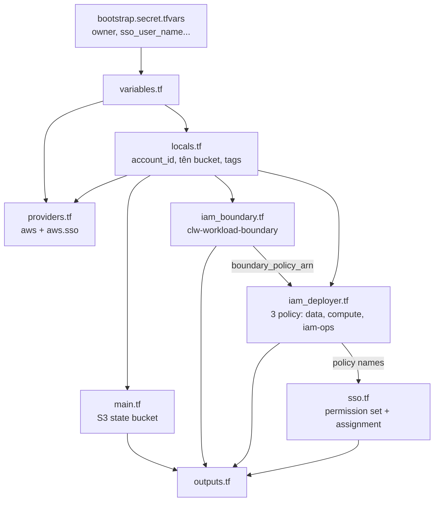
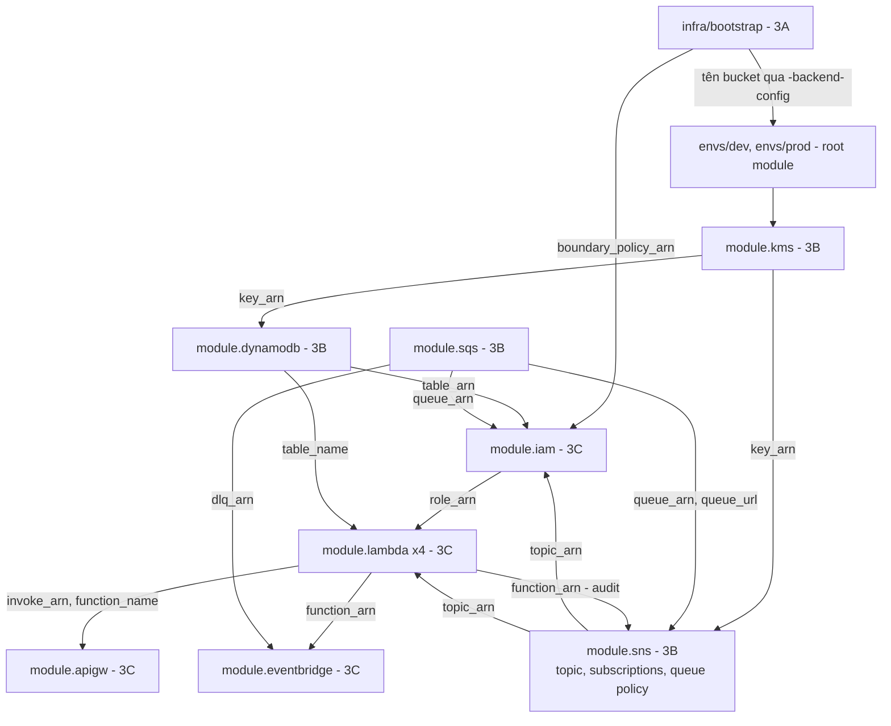

# Phase 3A: Bootstrap Remote State, Providers & Quyền Least Privilege — Customer Logic Workflow

> **Phạm vi 3A:** (1) bucket S3 chứa Terraform state kèm khóa state, (2) permissions boundary và các policy deploy theo Least Privilege, (3) permission set IAM Identity Center cho bạn (tùy chọn), (4) khung `providers.tf`, tagging và backend cho `envs/dev` và `envs/prod`.
> **Không nằm trong 3A:** các module hạ tầng (`kms`, `dynamodb`, `sqs`, `sns` ở 3B; `iam`, `lambda`, `apigw`, `eventbridge` ở 3C).
> **Yêu cầu công cụ:** Terraform **>= 1.10** (dùng khóa state native của S3, không cần bảng DynamoDB) và AWS provider **~> 6.0**.
> **Chi phí:** dưới 0,05 USD/tháng (vài KB state trên S3; IAM và IAM Identity Center miễn phí).
> **Tình trạng kiểm chứng:** code chưa được `terraform validate/plan/apply` trên máy bạn. Mục 9 là các bước để bạn kiểm chứng. Policy deploy ở File 7 là điểm khởi đầu theo Least Privilege, **có thể cần chỉnh** khi apply thật ở 3B/3C (xem mục 8).

---

## 1. Các quyết định thiết kế mới (bổ sung ADR)

| ADR | Quyết định | Lý do | Đánh đổi |
|---|---|---|---|
| **ADR-010** | Khóa state bằng **S3 native lockfile** (`use_lockfile = true`) thay vì bảng DynamoDB | Ít tài nguyên hơn, rẻ hơn, Terraform mới khuyến nghị | Cần Terraform >= 1.10 |
| **ADR-011** | Mã hóa bucket state bằng **SSE-KMS với khóa AWS managed (`aws/s3`)** và Bucket Key | Miễn phí, có dấu vết trong CloudTrail, không phải quản lý key policy | Không tự kiểm soát xoay khóa như CMK ($1/tháng) |
| **ADR-012** | Bootstrap là bước **đặc quyền, chạy một lần** bằng phiên quản trị của bạn. Việc hằng ngày dùng permission set **ClwDeployer** (không có quyền sửa chính policy của nó) | Người deploy không tự nâng quyền được | Cần một phiên quản trị cho lần đầu và mỗi lần đổi policy |
| **ADR-013** | **Permissions boundary** cho mọi role workload (`clw-workload-boundary`). Deployer chỉ tạo được role `clw-*` **có gắn boundary** | Chặn leo thang đặc quyền: deployer không thể tạo role mạnh hơn trần cho phép | Thêm một policy cần bảo trì |
| **ADR-014** | Chia policy deploy thành **3 customer managed policy** (`data`, `compute`, `iam-ops`) | Mỗi policy có giới hạn 6.144 ký tự. Role OIDC của CI (Phase 5) gắn lại **đúng 3 policy này**, nên người và CI có cùng quyền | Nhiều tài nguyên IAM hơn |

---

## 2. Cấu trúc file của Phase 3A

```text
infra/
├── bootstrap/
│   ├── versions.tf
│   ├── providers.tf
│   ├── variables.tf
│   ├── locals.tf
│   ├── main.tf                    # bucket state
│   ├── iam_boundary.tf            # permissions boundary cho role workload
│   ├── iam_deployer.tf            # 3 policy deploy Least Privilege
│   ├── sso.tf                     # permission set Identity Center (tùy chọn)
│   ├── outputs.tf
│   └── bootstrap.secret.tfvars.example
└── envs/
    ├── dev/
    │   ├── versions.tf
    │   ├── backend.tf
    │   ├── providers.tf
    │   ├── variables.tf
    │   ├── locals.tf
    │   ├── main.tf
    │   ├── outputs.tf
    │   └── terraform.tfvars
    └── prod/                      # cùng cấu trúc, khác backend.tf và terraform.tfvars
```

Có sẵn `main.tf` và `outputs.tf` ngay cả khi chưa có module vì rule `terraform_standard_module_structure` của `tflint` yêu cầu đủ bộ `main.tf`, `variables.tf`, `outputs.tf`.

---

## 3. Dependency / Call Graph

### 3.1. Bên trong `infra/bootstrap`



### 3.2. Toàn bộ Phase 3 (dự kiến, chốt ở 3C)



> **Chú ý chu kỳ phụ thuộc:** subscription SNS cần ARN queue, còn queue policy cần ARN topic. Để tránh vòng, `module.sqs` chỉ tạo queue và DLQ; **queue policy và subscription đặt trong `module.sns`** (nhận `queue_arn` và `queue_url` làm đầu vào). Mũi tên `LAM → SNS` (subscribe Lambda `audit`) sẽ được giải quyết ở 3C bằng cách đặt subscription và `aws_lambda_permission` của audit ở root `envs/*`, không ở trong module.

### 3.3. Contract Table (Phase 3A)

| Caller → Callee | Inputs / Tham số truyền | Outputs / Giá trị trả về | Vì sao có phụ thuộc này |
|---|---|---|---|
| `bootstrap.secret.tfvars` → `variables.tf` | `owner`, `cost_center`, `sso_user_name`, `sso_region`... | Giá trị biến đã kiểm tra (validation) | Tách dữ liệu riêng tư khỏi code (file bị `.gitignore` chặn) |
| `locals.tf` → `data.aws_caller_identity` | (không) | `account_id` | Tên bucket chứa account ID nên duy nhất toàn cầu |
| `main.tf` (bucket) → `aws_s3_bucket_*` | `local.state_bucket_name`, `var.force_destroy_state_bucket` | `bucket_name`, `bucket_arn` | State là "nguồn sự thật" của hạ tầng, phải bền vững, mã hóa, có version |
| `iam_deployer.tf` → `iam_boundary.tf` | `aws_iam_policy.boundary.arn` | Điều kiện `iam:PermissionsBoundary` trong policy `iam-ops` | Deployer chỉ được tạo role gắn đúng boundary |
| `sso.tf` → `iam_deployer.tf` | Tên 3 policy (`name`, `path = "/"`) | Permission set có 3 policy đính kèm | Người dùng nhận đúng quyền như role CI |
| `sso.tf` → IAM Identity Center | `sso_user_name` | `permission_set_arn`, gán vào account | Gán quyền bằng code, không ClickOps |
| `Makefile tf-init` → `aws sts` | `AWS_PROFILE` | Account ID, ghép thành tên bucket | Không commit account ID lên repo public |
| `envs/*/backend.tf` → S3 | `-backend-config=bucket=...`, `key`, `region`, `use_lockfile` | State đọc/ghi + file khóa `.tflock` | Hai lần `apply` đồng thời không phá state |
| `envs/*/providers.tf` → `locals.tf` | `local.common_tags` | `default_tags` gắn cho mọi tài nguyên | Tagging chuẩn không cần nhớ gắn tay |

### 3.4. Execution Trace

**Kịch bản 1 — Happy path:**

1. Bạn đăng nhập `aws sso login --profile clw-admin` (phiên quản trị, chỉ để bootstrap).
2. `terraform -chdir=infra/bootstrap apply`: Terraform đọc `account_id`, tạo bucket `clw-tfstate-<account>-ap-southeast-1` (versioning, mã hóa, chặn public, policy ép TLS), tạo policy boundary, tạo 3 policy deploy (policy `iam-ops` tham chiếu ARN boundary nên Terraform tạo boundary trước), rồi tạo permission set `ClwDeployer`, đính 3 policy và gán cho user của bạn.
3. Bạn chạy lại `aws configure sso --profile clw-dev`, lần này chọn permission set `ClwDeployer`.
4. `make tf-init ENV=dev`: Make gọi `aws sts get-caller-identity` lấy account ID, ghép tên bucket, rồi `terraform init -backend-config="bucket=..."`. Terraform kết nối S3, tạo `envs/dev/terraform.tfstate`.
5. `make tf-plan ENV=dev`: Terraform ghi file khóa `envs/dev/terraform.tfstate.tflock`, đọc state và trả kế hoạch "No changes" (chưa có tài nguyên). Khóa được giải phóng.

**Kịch bản 2 — Error path:**

1. **Chạy bootstrap bằng phiên không đủ quyền** (ví dụ `clw-dev` còn là ReadOnly): lệnh đầu tiên `s3:CreateBucket` trả `AccessDenied`, Terraform dừng, chưa có gì được tạo. Cách xử lý: dùng profile `clw-admin`.
2. **Hai terminal cùng `terraform apply` một môi trường:** terminal thứ hai nhận `Error acquiring the state lock` kèm thông tin người giữ khóa. Chờ terminal đầu xong rồi chạy lại. Chỉ dùng `terraform force-unlock <ID>` khi chắc chắn tiến trình giữ khóa đã chết.
3. **Deployer tạo role không gắn boundary** (quên `permissions_boundary` trong module `iam` ở 3C): IAM trả `AccessDenied` vì không thỏa điều kiện `iam:PermissionsBoundary`. Đây là lỗi **có chủ đích**: sửa code module để role luôn gắn boundary.
4. **SSO hết hạn khi chạy `make tf-init`:** biểu thức `$(shell aws sts ...)` trả rỗng, tên bucket sai và Terraform báo không tìm thấy bucket. Chạy `aws sso login --profile clw-dev` rồi thử lại.

---

## 4. Code: `infra/bootstrap`

### File 1: `infra/bootstrap/versions.tf`

**Overview:** Khóa phiên bản Terraform và AWS provider. Được Terraform đọc đầu tiên khi `init`. Kết hợp với `.terraform.lock.hcl` (phải commit) để mọi máy và CI dùng cùng một bản provider.

```hcl
terraform {
  required_version = ">= 1.10.0"

  required_providers {
    aws = {
      source  = "hashicorp/aws"
      version = "~> 6.0"
    }
  }
}
```

**Giải thích chi tiết:**
- `>= 1.10.0`: tính năng `use_lockfile` của backend S3 chỉ có từ Terraform 1.10, nên đặt sàn phiên bản ở đây để lỗi hiện ra sớm.
- `~> 6.0`: nhận bản vá và minor của nhánh 6.x, chặn nhảy sang 7.x có thể phá API. Dependabot sẽ đề xuất nâng cấp có kiểm soát (File `dependabot.yml` ở Phase 2).

---

### File 2: `infra/bootstrap/providers.tf`

**Overview:** Cấu hình hai provider AWS: mặc định (region dự án) và alias `sso` (region nơi bạn bật IAM Identity Center, có thể khác). Gắn `default_tags` cho mọi tài nguyên. Dùng `local.common_tags` từ `locals.tf`.

```hcl
provider "aws" {
  region = var.aws_region

  default_tags {
    tags = local.common_tags
  }
}

# Provider riêng cho IAM Identity Center: dịch vụ này nằm ở region bạn đã bật nó (có thể khác region dự án)
provider "aws" {
  alias  = "sso"
  region = var.sso_region

  default_tags {
    tags = local.common_tags
  }
}
```

**Giải thích chi tiết:**
- `default_tags`: mọi tài nguyên hỗ trợ tag tự nhận `Project`, `Environment`, `Owner`, `CostCenter`, `ManagedBy`, đáp ứng checklist tagging mà không phải gõ tag ở từng resource.
- Không đặt `access_key`/`secret_key`/`profile` trong code: credential lấy từ biến môi trường `AWS_PROFILE` (SSO), nên **không có credential tĩnh** nào trong repo.
- Alias `sso`: IAM Identity Center là dịch vụ theo region (thường là region bạn chọn khi bật lần đầu). Tách provider để khỏi bị ép dùng chung region với hạ tầng.

---

### File 3: `infra/bootstrap/variables.tf`

**Overview:** Khai báo toàn bộ đầu vào của bootstrap, có kiểu, mô tả và kiểm tra giá trị. Giá trị riêng tư (tên SSO user) được truyền qua `bootstrap.secret.tfvars` (File 10).

```hcl
variable "project" {
  description = "Tên dự án, dùng làm tag Project (phải khớp với biến project của envs/*)."
  type        = string
  default     = "customer-logic-workflow"
}

variable "name_prefix" {
  description = "Tiền tố đặt tên tài nguyên (ví dụ: clw)."
  type        = string
  default     = "clw"

  validation {
    condition     = can(regex("^[a-z][a-z0-9]{1,7}$", var.name_prefix))
    error_message = "name_prefix chỉ gồm chữ thường và số, bắt đầu bằng chữ, dài 2 đến 8 ký tự."
  }
}

variable "aws_region" {
  description = "Region triển khai hạ tầng dự án."
  type        = string
  default     = "ap-southeast-1"
}

variable "owner" {
  description = "Đội hoặc nhóm sở hữu, dùng làm tag Owner (không dùng tên cá nhân)."
  type        = string
  default     = "platform-team"
}

variable "cost_center" {
  description = "Mã trung tâm chi phí, dùng làm tag CostCenter."
  type        = string
  default     = "portfolio"
}

variable "force_destroy_state_bucket" {
  description = "Cho phép xóa bucket state kể cả khi còn object (chỉ đặt true khi teardown toàn bộ dự án)."
  type        = bool
  default     = false
}

variable "noncurrent_version_retention_days" {
  description = "Số ngày giữ các phiên bản cũ của file state trước khi xóa."
  type        = number
  default     = 90

  validation {
    condition     = var.noncurrent_version_retention_days >= 1
    error_message = "noncurrent_version_retention_days phải lớn hơn hoặc bằng 1."
  }
}

variable "sso_user_name" {
  description = "Username của bạn trong IAM Identity Center. Để trống nếu không muốn Terraform tạo permission set."
  type        = string
  default     = ""
}

variable "sso_region" {
  description = "Region đã bật IAM Identity Center."
  type        = string
  default     = "ap-southeast-1"
}

variable "sso_permission_set_name" {
  description = "Tên permission set dành cho người deploy."
  type        = string
  default     = "ClwDeployer"
}

variable "sso_session_duration" {
  description = "Thời lượng phiên của permission set theo ISO 8601 (từ PT1H đến PT12H)."
  type        = string
  default     = "PT8H"

  validation {
    condition     = can(regex("^PT([1-9]|1[0-2])H$", var.sso_session_duration))
    error_message = "sso_session_duration phải có dạng PT1H đến PT12H."
  }
}
```

**Giải thích chi tiết:**
- `owner` mặc định `platform-team`: tag nên mô tả **đội**, tránh đưa tên hoặc email cá nhân vào tag của một repo public.
- `validation` ở `name_prefix`: tên có chữ hoa hoặc ký tự lạ sẽ làm hỏng tên bucket S3 và ARN, nên chặn ngay lúc `plan`.
- `force_destroy_state_bucket = false` mặc định: tránh xóa nhầm state. Chỉ bật khi teardown (mục 10).
- `sso_user_name` mặc định rỗng: bootstrap vẫn chạy được (tạo bucket và policy) mà không chạm tới IAM Identity Center, hữu ích nếu tài khoản của bạn quản lý quyền theo cách khác.

---

### File 4: `infra/bootstrap/locals.tf`

**Overview:** Gom các giá trị dẫn xuất dùng chung: account ID, tên bucket, bộ tag chuẩn, cờ bật SSO. Được `providers.tf`, `main.tf`, `iam_*.tf`, `sso.tf` gọi.

```hcl
locals {
  account_id     = data.aws_caller_identity.current.account_id
  region_account = "${var.aws_region}:${local.account_id}"

  state_bucket_name = "${var.name_prefix}-tfstate-${local.account_id}-${var.aws_region}"

  manage_sso = var.sso_user_name != ""

  common_tags = {
    Project     = var.project
    Environment = "shared"
    Owner       = var.owner
    CostCenter  = var.cost_center
    ManagedBy   = "Terraform"
  }
}
```

**Giải thích chi tiết:**
- `state_bucket_name` chứa account ID và region: tên bucket S3 phải **duy nhất toàn cầu**, và gắn account ID giúp tránh va chạm cũng như tránh bị người khác chiếm trước tên.
- `region_account`: chuỗi `region:account` dùng để ghép ARN ngắn gọn trong các policy (ví dụ `arn:aws:sns:${local.region_account}:clw-*`).
- `manage_sso`: cờ điều khiển `count` ở `sso.tf`. Phải là giá trị xác định lúc `plan` (chỉ phụ thuộc biến), nên dùng được trong `count`.
- `Environment = "shared"`: bootstrap dùng chung cho `dev` và `prod`.

---

### File 5: `infra/bootstrap/main.tf`

**Overview:** Tạo bucket S3 chứa Terraform state, an toàn theo baseline: versioning, mã hóa, chặn public, chỉ cho TLS 1.2 trở lên, dọn phiên bản cũ. Được các `envs/*/backend.tf` sử dụng (qua tên bucket). Cũng chứa data source `aws_caller_identity` mà `locals.tf` dùng.

```hcl
data "aws_caller_identity" "current" {}

resource "aws_s3_bucket" "tfstate" {
  #checkov:skip=CKV_AWS_18:Dự án portfolio, chưa bật access logging cho bucket state (cần thêm một bucket log)
  #checkov:skip=CKV_AWS_144:Không nhân bản chéo region để tránh chi phí, state có thể khôi phục từ version cũ
  #checkov:skip=CKV2_AWS_62:Không cần event notification cho bucket state

  bucket        = local.state_bucket_name
  force_destroy = var.force_destroy_state_bucket
}

resource "aws_s3_bucket_versioning" "tfstate" {
  bucket = aws_s3_bucket.tfstate.id

  versioning_configuration {
    status = "Enabled"
  }
}

resource "aws_s3_bucket_server_side_encryption_configuration" "tfstate" {
  bucket = aws_s3_bucket.tfstate.id

  rule {
    bucket_key_enabled = true

    apply_server_side_encryption_by_default {
      sse_algorithm = "aws:kms"
    }
  }
}

resource "aws_s3_bucket_ownership_controls" "tfstate" {
  bucket = aws_s3_bucket.tfstate.id

  rule {
    object_ownership = "BucketOwnerEnforced"
  }
}

resource "aws_s3_bucket_public_access_block" "tfstate" {
  bucket = aws_s3_bucket.tfstate.id

  block_public_acls       = true
  block_public_policy     = true
  ignore_public_acls      = true
  restrict_public_buckets = true
}

resource "aws_s3_bucket_lifecycle_configuration" "tfstate" {
  bucket = aws_s3_bucket.tfstate.id

  rule {
    id     = "expire-noncurrent-versions"
    status = "Enabled"

    filter {}

    noncurrent_version_expiration {
      noncurrent_days = var.noncurrent_version_retention_days
    }

    abort_incomplete_multipart_upload {
      days_after_initiation = 7
    }
  }

  depends_on = [aws_s3_bucket_versioning.tfstate]
}

data "aws_iam_policy_document" "tfstate_transport" {
  statement {
    sid     = "DenyInsecureTransport"
    effect  = "Deny"
    actions = ["s3:*"]

    principals {
      type        = "*"
      identifiers = ["*"]
    }

    resources = [
      aws_s3_bucket.tfstate.arn,
      "${aws_s3_bucket.tfstate.arn}/*",
    ]

    condition {
      test     = "Bool"
      variable = "aws:SecureTransport"
      values   = ["false"]
    }
  }

  statement {
    sid     = "DenyOldTlsVersions"
    effect  = "Deny"
    actions = ["s3:*"]

    principals {
      type        = "*"
      identifiers = ["*"]
    }

    resources = [
      aws_s3_bucket.tfstate.arn,
      "${aws_s3_bucket.tfstate.arn}/*",
    ]

    condition {
      test     = "NumericLessThan"
      variable = "s3:TlsVersion"
      values   = ["1.2"]
    }
  }
}

resource "aws_s3_bucket_policy" "tfstate" {
  bucket = aws_s3_bucket.tfstate.id
  policy = data.aws_iam_policy_document.tfstate_transport.json

  depends_on = [aws_s3_bucket_public_access_block.tfstate]
}
```

**Giải thích chi tiết:**
- **Versioning**: nếu một lần `apply` làm hỏng state, bạn khôi phục được phiên bản trước. Đây là "lưới an toàn" quan trọng nhất của remote state.
- **SSE-KMS không chỉ định `kms_master_key_id`**: S3 dùng khóa AWS managed `aws/s3` (ADR-011). `bucket_key_enabled = true` giảm số lần gọi KMS, tiết kiệm chi phí.
- **`BucketOwnerEnforced`**: vô hiệu hóa ACL, mọi quyền chỉ đi qua IAM và bucket policy, đơn giản và an toàn hơn.
- **Public access block** đủ 4 cờ `true` đúng baseline checklist.
- **Lifecycle**: `filter {}` rỗng nghĩa là áp dụng cho mọi object (bắt buộc có `filter` hoặc `prefix` ở provider mới). Xóa các phiên bản cũ sau 90 ngày để chi phí lưu trữ không phình, và dọn upload dang dở sau 7 ngày. `depends_on` versioning vì lifecycle cho phiên bản cũ chỉ có nghĩa khi bucket đã bật versioning.
- **Hai statement `Deny`**: một chặn truy cập không dùng HTTPS, một chặn TLS dưới 1.2, đáp ứng yêu cầu "TLS 1.2+ enforced everywhere".
- `depends_on` public access block trước bucket policy: tránh lỗi tranh chấp khi AWS đang áp dụng thiết lập chặn public.
- **Các dòng `#checkov:skip=...`** nằm ngay trong resource, mỗi dòng ghi lý do. Đây là cách ưu tiên cho ngoại lệ cục bộ (thay vì skip toàn cục).
- Chủ ý **không có** `lifecycle { prevent_destroy = true }`: giá trị đó không thể điều khiển bằng biến, sẽ cản trở teardown. Thay vào đó bảo vệ bằng `force_destroy = false` mặc định.

---

### File 6: `infra/bootstrap/iam_boundary.tf`

**Overview:** Tạo **permissions boundary** `clw-workload-boundary`, tức là "trần quyền" tối đa mà bất kỳ role workload nào (role của Lambda ở 3C) được phép có. Được `iam_deployer.tf` tham chiếu bằng ARN để ép mọi role `clw-*` phải gắn boundary này.

```hcl
data "aws_iam_policy_document" "boundary" {
  statement {
    sid     = "LambdaLogs"
    actions = ["logs:CreateLogStream", "logs:PutLogEvents"]

    resources = [
      "arn:aws:logs:${local.region_account}:log-group:/aws/lambda/${var.name_prefix}-*:*",
    ]
  }

  # X-Ray không hỗ trợ giới hạn theo resource nên bắt buộc dùng "*"
  statement {
    sid       = "XRayTracing"
    actions   = ["xray:PutTraceSegments", "xray:PutTelemetryRecords"]
    resources = ["*"]
  }

  statement {
    sid       = "PublishToProjectTopics"
    actions   = ["sns:Publish"]
    resources = ["arn:aws:sns:${local.region_account}:${var.name_prefix}-*"]
  }

  statement {
    sid = "UseProjectQueues"

    actions = [
      "sqs:ReceiveMessage",
      "sqs:DeleteMessage",
      "sqs:ChangeMessageVisibility",
      "sqs:GetQueueAttributes",
      "sqs:GetQueueUrl",
      "sqs:SendMessage",
    ]

    resources = ["arn:aws:sqs:${local.region_account}:${var.name_prefix}-*"]
  }

  statement {
    sid = "UseProjectTables"

    actions = [
      "dynamodb:GetItem",
      "dynamodb:PutItem",
      "dynamodb:UpdateItem",
      "dynamodb:DeleteItem",
      "dynamodb:Query",
    ]

    resources = [
      "arn:aws:dynamodb:${local.region_account}:table/${var.name_prefix}-*",
      "arn:aws:dynamodb:${local.region_account}:table/${var.name_prefix}-*/index/*",
    ]
  }

  statement {
    sid       = "ReadProjectParameters"
    actions   = ["ssm:GetParameter", "ssm:GetParameters"]
    resources = ["arn:aws:ssm:${local.region_account}:parameter/${var.name_prefix}/*"]
  }

  statement {
    sid       = "UseProjectKeys"
    actions   = ["kms:Decrypt", "kms:Encrypt", "kms:GenerateDataKey", "kms:DescribeKey"]
    resources = ["arn:aws:kms:${local.region_account}:key/*"]

    condition {
      test     = "StringEquals"
      variable = "aws:ResourceTag/Project"
      values   = [var.project]
    }
  }
}

resource "aws_iam_policy" "boundary" {
  name        = "${var.name_prefix}-workload-boundary"
  description = "Permissions boundary: trần quyền tối đa cho mọi role workload của dự án ${var.project}."
  policy      = data.aws_iam_policy_document.boundary.json
}
```

**Giải thích chi tiết:**
- **Boundary không cấp quyền, chỉ đặt trần.** Quyền hiệu lực của role = giao của (policy gắn vào role) và (boundary). Role ở 3C sẽ có policy hẹp hơn nhiều; boundary là lớp bảo hiểm nếu ai đó lỡ viết policy quá rộng.
- Mọi quyền giới hạn theo tiền tố `clw-*` và region, trừ X-Ray (dịch vụ không hỗ trợ giới hạn tài nguyên) nên là ngoại lệ có lý do.
- `kms:*` giới hạn theo tag `Project` của khóa: ở `prod` các CMK do Terraform tạo sẽ mang tag này (nhờ `default_tags`), còn khóa AWS managed (dev) không cần quyền IAM vì key policy mặc định cho phép qua dịch vụ.
- `sqs:SendMessage`: cần cho đích `on_failure` của Lambda gửi vào DLQ.
- **Chủ ý không** cho `dynamodb:Scan`, `dynamodb:*` hay `sns:*`: ứng dụng chỉ cần các thao tác tối thiểu.

---

### File 7: `infra/bootstrap/iam_deployer.tf`

**Overview:** Tạo **3 customer managed policy** cho người deploy (và sau này cho role OIDC của CI ở Phase 5): `clw-deployer-data`, `clw-deployer-compute`, `clw-deployer-iam-ops`. Mỗi policy giới hạn theo tiền tố `clw-*` và region. Gọi ARN của boundary từ File 6. Được `sso.tf` đính vào permission set.

```hcl
# ---------------------------------------------------------------------------
# Policy 1: data - state, KMS, DynamoDB, SQS, SNS, SSM
# ---------------------------------------------------------------------------
data "aws_iam_policy_document" "deployer_data" {
  statement {
    sid       = "TerraformStateBucket"
    actions   = ["s3:ListBucket", "s3:GetBucketLocation"]
    resources = ["arn:aws:s3:::${var.name_prefix}-tfstate-*"]
  }

  statement {
    sid       = "TerraformStateObjects"
    actions   = ["s3:GetObject", "s3:PutObject", "s3:DeleteObject"]
    resources = ["arn:aws:s3:::${var.name_prefix}-tfstate-*/*"]
  }

  # CreateKey không có ARN trước khi tạo nên phải dùng "*", nhưng chỉ cho phép khi request gắn tag Project đúng
  statement {
    sid       = "KmsCreateKeyWithProjectTag"
    actions   = ["kms:CreateKey", "kms:TagResource"]
    resources = ["*"]

    condition {
      test     = "StringEquals"
      variable = "aws:RequestTag/Project"
      values   = [var.project]
    }
  }

  statement {
    sid = "KmsManageProjectKeys"

    actions = [
      "kms:DescribeKey",
      "kms:GetKeyPolicy",
      "kms:GetKeyRotationStatus",
      "kms:ListResourceTags",
      "kms:EnableKeyRotation",
      "kms:DisableKeyRotation",
      "kms:PutKeyPolicy",
      "kms:UpdateKeyDescription",
      "kms:ScheduleKeyDeletion",
      "kms:CancelKeyDeletion",
      "kms:TagResource",
      "kms:UntagResource",
      "kms:CreateAlias",
      "kms:DeleteAlias",
      "kms:UpdateAlias",
    ]

    resources = ["arn:aws:kms:${local.region_account}:key/*"]

    condition {
      test     = "StringEquals"
      variable = "aws:ResourceTag/Project"
      values   = [var.project]
    }
  }

  statement {
    sid       = "KmsManageProjectAliases"
    actions   = ["kms:CreateAlias", "kms:DeleteAlias", "kms:UpdateAlias"]
    resources = ["arn:aws:kms:${local.region_account}:alias/${var.name_prefix}-*"]
  }

  # ListAliases chỉ hỗ trợ resource "*"
  statement {
    sid       = "KmsListAliases"
    actions   = ["kms:ListAliases"]
    resources = ["*"]
  }

  statement {
    sid = "DynamoDbManageProjectTables"

    actions = [
      "dynamodb:CreateTable",
      "dynamodb:DeleteTable",
      "dynamodb:DescribeTable",
      "dynamodb:UpdateTable",
      "dynamodb:DescribeTimeToLive",
      "dynamodb:UpdateTimeToLive",
      "dynamodb:DescribeContinuousBackups",
      "dynamodb:UpdateContinuousBackups",
      "dynamodb:DescribeContributorInsights",
      "dynamodb:DescribeKinesisStreamingDestination",
      "dynamodb:DescribeTableReplicaAutoScaling",
      "dynamodb:ListTagsOfResource",
      "dynamodb:TagResource",
      "dynamodb:UntagResource",
    ]

    resources = ["arn:aws:dynamodb:${local.region_account}:table/${var.name_prefix}-*"]
  }

  statement {
    sid = "SqsManageProjectQueues"

    actions = [
      "sqs:CreateQueue",
      "sqs:DeleteQueue",
      "sqs:GetQueueAttributes",
      "sqs:GetQueueUrl",
      "sqs:SetQueueAttributes",
      "sqs:ListQueueTags",
      "sqs:TagQueue",
      "sqs:UntagQueue",
    ]

    resources = ["arn:aws:sqs:${local.region_account}:${var.name_prefix}-*"]
  }

  statement {
    sid = "SnsManageProjectTopics"

    actions = [
      "sns:CreateTopic",
      "sns:DeleteTopic",
      "sns:GetTopicAttributes",
      "sns:SetTopicAttributes",
      "sns:ListTagsForResource",
      "sns:TagResource",
      "sns:UntagResource",
      "sns:Subscribe",
      "sns:Unsubscribe",
      "sns:GetSubscriptionAttributes",
      "sns:SetSubscriptionAttributes",
      "sns:ListSubscriptionsByTopic",
    ]

    # Mẫu clw-* khớp cả ARN của topic lẫn ARN của subscription (topic-arn:uuid)
    resources = ["arn:aws:sns:${local.region_account}:${var.name_prefix}-*"]
  }

  statement {
    sid = "SsmManageProjectParameters"

    actions = [
      "ssm:PutParameter",
      "ssm:GetParameter",
      "ssm:GetParameters",
      "ssm:DeleteParameter",
      "ssm:AddTagsToResource",
      "ssm:RemoveTagsFromResource",
      "ssm:ListTagsForResource",
    ]

    resources = ["arn:aws:ssm:${local.region_account}:parameter/${var.name_prefix}/*"]
  }

  # DescribeParameters chỉ hỗ trợ resource "*"
  statement {
    sid       = "SsmDescribeParameters"
    actions   = ["ssm:DescribeParameters"]
    resources = ["*"]
  }
}

# ---------------------------------------------------------------------------
# Policy 2: compute - Lambda, API Gateway, EventBridge, CloudWatch Logs
# ---------------------------------------------------------------------------
data "aws_iam_policy_document" "deployer_compute" {
  statement {
    sid = "LambdaManageProjectFunctions"

    actions = [
      "lambda:CreateFunction",
      "lambda:DeleteFunction",
      "lambda:GetFunction",
      "lambda:GetFunctionConfiguration",
      "lambda:GetFunctionCodeSigningConfig",
      "lambda:GetFunctionConcurrency",
      "lambda:GetFunctionEventInvokeConfig",
      "lambda:GetPolicy",
      "lambda:ListVersionsByFunction",
      "lambda:ListTags",
      "lambda:PublishVersion",
      "lambda:PutFunctionConcurrency",
      "lambda:DeleteFunctionConcurrency",
      "lambda:PutFunctionEventInvokeConfig",
      "lambda:UpdateFunctionEventInvokeConfig",
      "lambda:DeleteFunctionEventInvokeConfig",
      "lambda:UpdateFunctionCode",
      "lambda:UpdateFunctionConfiguration",
      "lambda:AddPermission",
      "lambda:RemovePermission",
      "lambda:TagResource",
      "lambda:UntagResource",
      "lambda:CreateAlias",
      "lambda:UpdateAlias",
      "lambda:DeleteAlias",
      "lambda:GetAlias",
    ]

    resources = [
      "arn:aws:lambda:${local.region_account}:function:${var.name_prefix}-*",
      "arn:aws:lambda:${local.region_account}:function:${var.name_prefix}-*:*",
    ]
  }

  # Event source mapping có ID sinh ngẫu nhiên nên chỉ giới hạn được theo loại tài nguyên
  statement {
    sid = "LambdaManageEventSourceMappings"

    actions = [
      "lambda:CreateEventSourceMapping",
      "lambda:UpdateEventSourceMapping",
      "lambda:DeleteEventSourceMapping",
      "lambda:GetEventSourceMapping",
      "lambda:TagResource",
      "lambda:UntagResource",
    ]

    resources = ["arn:aws:lambda:${local.region_account}:event-source-mapping:*"]
  }

  # HTTP API có ID sinh ngẫu nhiên nên chỉ giới hạn được theo đường dẫn /apis
  statement {
    sid     = "ApiGatewayManageHttpApis"
    actions = ["apigateway:GET", "apigateway:POST", "apigateway:PUT", "apigateway:PATCH", "apigateway:DELETE"]

    resources = [
      "arn:aws:apigateway:${var.aws_region}::/apis",
      "arn:aws:apigateway:${var.aws_region}::/apis/*",
      "arn:aws:apigateway:${var.aws_region}::/tags/*",
    ]
  }

  statement {
    sid = "EventBridgeManageProjectRules"

    actions = [
      "events:PutRule",
      "events:DeleteRule",
      "events:DescribeRule",
      "events:EnableRule",
      "events:DisableRule",
      "events:PutTargets",
      "events:RemoveTargets",
      "events:ListTargetsByRule",
      "events:ListTagsForResource",
      "events:TagResource",
      "events:UntagResource",
    ]

    resources = [
      "arn:aws:events:${local.region_account}:rule/${var.name_prefix}-*",
      "arn:aws:events:${local.region_account}:rule/${var.name_prefix}-*/*",
    ]
  }

  statement {
    sid = "EventBridgeManageProjectBuses"

    actions = [
      "events:CreateEventBus",
      "events:DeleteEventBus",
      "events:DescribeEventBus",
      "events:ListTagsForResource",
      "events:TagResource",
      "events:UntagResource",
    ]

    resources = ["arn:aws:events:${local.region_account}:event-bus/${var.name_prefix}-*"]
  }

  statement {
    sid = "LogsManageProjectLogGroups"

    actions = [
      "logs:CreateLogGroup",
      "logs:DeleteLogGroup",
      "logs:PutRetentionPolicy",
      "logs:DeleteRetentionPolicy",
      "logs:AssociateKmsKey",
      "logs:DisassociateKmsKey",
      "logs:TagResource",
      "logs:UntagResource",
      "logs:ListTagsForResource",
      "logs:ListTagsLogGroup",
      "logs:TagLogGroup",
      "logs:UntagLogGroup",
    ]

    resources = [
      "arn:aws:logs:${local.region_account}:log-group:/aws/lambda/${var.name_prefix}-*",
      "arn:aws:logs:${local.region_account}:log-group:/aws/lambda/${var.name_prefix}-*:*",
      "arn:aws:logs:${local.region_account}:log-group:/aws/apigateway/${var.name_prefix}-*",
      "arn:aws:logs:${local.region_account}:log-group:/aws/apigateway/${var.name_prefix}-*:*",
      "arn:aws:logs:${local.region_account}:log-group:/${var.name_prefix}/*",
      "arn:aws:logs:${local.region_account}:log-group:/${var.name_prefix}/*:*",
    ]
  }

  # Các action này không hỗ trợ giới hạn theo resource. Access log của HTTP API dùng cơ chế log delivery nên cần chúng
  statement {
    sid = "LogsDescribeAndDelivery"

    actions = [
      "logs:DescribeLogGroups",
      "logs:CreateLogDelivery",
      "logs:GetLogDelivery",
      "logs:UpdateLogDelivery",
      "logs:DeleteLogDelivery",
      "logs:ListLogDeliveries",
      "logs:DescribeResourcePolicies",
      "logs:PutResourcePolicy",
    ]

    resources = ["*"]
  }
}

# ---------------------------------------------------------------------------
# Policy 3: iam-ops - IAM role (có boundary), CloudWatch, Budgets
# ---------------------------------------------------------------------------
data "aws_iam_policy_document" "deployer_iam_ops" {
  # Chỉ được tạo và sửa policy của role clw-* khi role đó có gắn đúng permissions boundary
  statement {
    sid = "CreateWorkloadRolesWithBoundary"

    actions = [
      "iam:CreateRole",
      "iam:PutRolePermissionsBoundary",
      "iam:PutRolePolicy",
      "iam:DeleteRolePolicy",
    ]

    resources = ["arn:aws:iam::${local.account_id}:role/${var.name_prefix}-*"]

    condition {
      test     = "StringEquals"
      variable = "iam:PermissionsBoundary"
      values   = [aws_iam_policy.boundary.arn]
    }
  }

  statement {
    sid = "ManageWorkloadRoles"

    actions = [
      "iam:DeleteRole",
      "iam:UpdateRole",
      "iam:UpdateRoleDescription",
      "iam:UpdateAssumeRolePolicy",
      "iam:TagRole",
      "iam:UntagRole",
    ]

    resources = ["arn:aws:iam::${local.account_id}:role/${var.name_prefix}-*"]
  }

  statement {
    sid = "ReadWorkloadRoles"

    actions = [
      "iam:GetRole",
      "iam:GetRolePolicy",
      "iam:ListRolePolicies",
      "iam:ListAttachedRolePolicies",
      "iam:ListInstanceProfilesForRole",
      "iam:ListRoleTags",
    ]

    resources = ["arn:aws:iam::${local.account_id}:role/${var.name_prefix}-*"]
  }

  statement {
    sid       = "PassWorkloadRolesToLambda"
    actions   = ["iam:PassRole"]
    resources = ["arn:aws:iam::${local.account_id}:role/${var.name_prefix}-*"]

    condition {
      test     = "StringEquals"
      variable = "iam:PassedToService"
      values   = ["lambda.amazonaws.com"]
    }
  }

  # Chặn tuyệt đối việc gỡ boundary hoặc sửa chính policy boundary
  statement {
    sid       = "DenyRemovingBoundaryFromRoles"
    effect    = "Deny"
    actions   = ["iam:DeleteRolePermissionsBoundary"]
    resources = ["arn:aws:iam::${local.account_id}:role/*"]
  }

  statement {
    sid    = "DenyChangingBoundaryPolicy"
    effect = "Deny"

    actions = [
      "iam:CreatePolicyVersion",
      "iam:DeletePolicy",
      "iam:DeletePolicyVersion",
      "iam:SetDefaultPolicyVersion",
    ]

    resources = [aws_iam_policy.boundary.arn]
  }

  statement {
    sid = "CloudWatchManageProjectAlarms"

    actions = [
      "cloudwatch:PutMetricAlarm",
      "cloudwatch:DeleteAlarms",
      "cloudwatch:ListTagsForResource",
      "cloudwatch:TagResource",
      "cloudwatch:UntagResource",
    ]

    resources = ["arn:aws:cloudwatch:*:${local.account_id}:alarm:${var.name_prefix}-*"]
  }

  # DescribeAlarms chỉ hỗ trợ resource "*"
  statement {
    sid       = "CloudWatchDescribeAlarms"
    actions   = ["cloudwatch:DescribeAlarms"]
    resources = ["*"]
  }

  statement {
    sid       = "CloudWatchManageProjectDashboards"
    actions   = ["cloudwatch:PutDashboard", "cloudwatch:GetDashboard", "cloudwatch:DeleteDashboards"]
    resources = ["arn:aws:cloudwatch::${local.account_id}:dashboard/${var.name_prefix}-*"]
  }

  statement {
    sid = "BudgetsManageProjectBudgets"

    actions = [
      "budgets:ViewBudget",
      "budgets:ModifyBudget",
      "budgets:ListTagsForResource",
      "budgets:TagResource",
      "budgets:UntagResource",
    ]

    resources = ["arn:aws:budgets::${local.account_id}:budget/${var.name_prefix}-*"]
  }
}

# ---------------------------------------------------------------------------
# Tạo 3 customer managed policy từ 3 tài liệu ở trên
# ---------------------------------------------------------------------------
locals {
  deployer_policy_documents = {
    data    = data.aws_iam_policy_document.deployer_data.json
    compute = data.aws_iam_policy_document.deployer_compute.json
    iam-ops = data.aws_iam_policy_document.deployer_iam_ops.json
  }
}

resource "aws_iam_policy" "deployer" {
  for_each = local.deployer_policy_documents

  name        = "${var.name_prefix}-deployer-${each.key}"
  description = "Policy deploy Least Privilege (${each.key}) cho dự án ${var.project}."
  policy      = each.value
}
```

**Giải thích chi tiết:**
- **Nguyên tắc:** mỗi statement giới hạn theo tiền tố `clw-*` và region. Chỗ nào phải dùng `"*"` đều có comment nêu lý do (AWS không hỗ trợ giới hạn tài nguyên cho action đó, hoặc ARN chưa tồn tại lúc tạo).
- **Giới hạn bằng tag cho KMS:** `kms:CreateKey` chỉ được phép khi request mang tag `Project` đúng, các thao tác tiếp theo chỉ trên khóa có tag đó. Nhờ đó deployer không đụng được vào khóa của dịch vụ khác trong cùng tài khoản.
- **Chống leo thang đặc quyền (ADR-013):**
  - Tạo role, sửa inline policy của role: chỉ khi role mang đúng boundary (`iam:PermissionsBoundary`).
  - **Không** có `iam:AttachRolePolicy` nên không thể gắn `AdministratorAccess` vào role.
  - `iam:PassRole` chỉ cho phép truyền role cho `lambda.amazonaws.com`.
  - Hai statement `Deny` ngăn gỡ boundary hoặc sửa policy boundary.
- **Deployer không có quyền sửa 3 policy này** (không có `iam:CreatePolicyVersion` trên chúng): đổi quyền cần chạy lại bootstrap bằng phiên quản trị (ADR-012).
- **`for_each` trên map tĩnh** (`data`, `compute`, `iam-ops`): khóa của map xác định lúc `plan`, nên `sso.tf` dùng lại được. Tên policy ra dạng `clw-deployer-data`...
- **Điểm chưa kiểm chứng:** (1) quyền DynamoDB/Lambda/IAM của provider có thể thay đổi giữa các phiên bản; (2) tổng ký tự mỗi policy phải dưới giới hạn 6.144 (đã chia 3 policy để chừa dư). Mục 8 hướng dẫn cách phát hiện và bổ sung quyền thiếu có kiểm soát.
- `logs:PutResourcePolicy` trên `"*"` là quyền rộng nhất trong bộ (cần cho access log của HTTP API). Nếu bạn không bật access log cho API, có thể bỏ statement `LogsDescribeAndDelivery` ở 3C để thu hẹp quyền.

---

### File 8: `infra/bootstrap/sso.tf`

**Overview:** Tạo permission set `ClwDeployer` trong IAM Identity Center, đính 3 policy ở File 7 và gán cho user của bạn vào account hiện tại. Chỉ chạy khi `sso_user_name` khác rỗng (`count`). Dùng provider alias `aws.sso`.

```hcl
data "aws_ssoadmin_instances" "this" {
  count    = local.manage_sso ? 1 : 0
  provider = aws.sso
}

data "aws_identitystore_user" "deployer" {
  count    = local.manage_sso ? 1 : 0
  provider = aws.sso

  identity_store_id = tolist(data.aws_ssoadmin_instances.this[0].identity_store_ids)[0]

  alternate_identifier {
    unique_attribute {
      attribute_path  = "UserName"
      attribute_value = var.sso_user_name
    }
  }
}

resource "aws_ssoadmin_permission_set" "deployer" {
  count    = local.manage_sso ? 1 : 0
  provider = aws.sso

  name             = var.sso_permission_set_name
  description      = "Quyền deploy Least Privilege cho dự án ${var.project}, không có AdministratorAccess."
  instance_arn     = tolist(data.aws_ssoadmin_instances.this[0].arns)[0]
  session_duration = var.sso_session_duration
}

resource "aws_ssoadmin_customer_managed_policy_attachment" "deployer" {
  for_each = { for key, policy in aws_iam_policy.deployer : key => policy.name if local.manage_sso }
  provider = aws.sso

  instance_arn       = tolist(data.aws_ssoadmin_instances.this[0].arns)[0]
  permission_set_arn = aws_ssoadmin_permission_set.deployer[0].arn

  customer_managed_policy_reference {
    name = each.value
    path = "/"
  }
}

resource "aws_ssoadmin_account_assignment" "deployer" {
  count    = local.manage_sso ? 1 : 0
  provider = aws.sso

  instance_arn       = tolist(data.aws_ssoadmin_instances.this[0].arns)[0]
  permission_set_arn = aws_ssoadmin_permission_set.deployer[0].arn

  principal_id   = data.aws_identitystore_user.deployer[0].user_id
  principal_type = "USER"

  target_id   = local.account_id
  target_type = "AWS_ACCOUNT"

  depends_on = [aws_ssoadmin_customer_managed_policy_attachment.deployer]
}
```

**Giải thích chi tiết:**
- `data.aws_ssoadmin_instances`: tự tìm instance IAM Identity Center của tài khoản, không phải gõ ARN.
- `aws_identitystore_user`: tra `user_id` từ username của bạn, nên không cần tự copy GUID.
- **Điều kiện tiên quyết:** IAM Identity Center phải được bật **trong chính tài khoản này** (thường là management account của Organizations, hoặc account được ủy quyền quản trị) và user đã tồn tại. Nếu không, bước `plan` sẽ lỗi ở data source, và bạn có thể bỏ trống `sso_user_name` để bỏ qua toàn bộ file này.
- `customer_managed_policy_reference`: permission set **tham chiếu policy theo tên và path**, nên policy phải tồn tại trong tài khoản trước khi gán. `depends_on` ở `account_assignment` đảm bảo thứ tự: policy, rồi đính vào permission set, rồi mới gán.
- `for_each = { for ... if local.manage_sso }`: tạo map `string => string` hoặc map rỗng, tránh lỗi "kiểu không nhất quán" của toán tử điều kiện giữa map và object.
- **Không** gắn bất kỳ managed policy nào của AWS (như `AdministratorAccess` hay `PowerUserAccess`): quyền của `ClwDeployer` chính xác là 3 policy ở File 7.

---

### File 9: `infra/bootstrap/outputs.tf`

**Overview:** Xuất các giá trị mà bước sau cần: tên bucket (để `make tf-init`), ARN boundary (module `iam` ở 3C), ARN các policy (role OIDC ở Phase 5), ARN permission set.

```hcl
output "state_bucket_name" {
  description = "Tên bucket S3 chứa Terraform state, dùng cho -backend-config của envs/*."
  value       = aws_s3_bucket.tfstate.bucket
}

output "state_bucket_arn" {
  description = "ARN của bucket S3 chứa Terraform state."
  value       = aws_s3_bucket.tfstate.arn
}

output "boundary_policy_arn" {
  description = "ARN của permissions boundary mà mọi role workload bắt buộc phải gắn."
  value       = aws_iam_policy.boundary.arn
}

output "deployer_policy_arns" {
  description = "ARN của 3 policy deploy Least Privilege (data, compute, iam-ops)."
  value       = { for key, policy in aws_iam_policy.deployer : key => policy.arn }
}

output "deployer_permission_set_arn" {
  description = "ARN của permission set ClwDeployer, null nếu sso_user_name để trống."
  value       = try(aws_ssoadmin_permission_set.deployer[0].arn, null)
}
```

**Giải thích chi tiết:**
- Mỗi output có `description` (rule `terraform_documented_outputs` của tflint yêu cầu).
- `try(..., null)`: khi `count = 0`, truy cập `[0]` sẽ lỗi, `try` biến nó thành `null` thay vì làm vỡ `plan`.
- Các output này **không chứa secret**. Tên bucket có account ID nhưng ID tài khoản không phải bí mật (dù vậy, ta không commit nó lên repo).

---

### File 10: `infra/bootstrap/bootstrap.secret.tfvars.example`

**Overview:** File mẫu giá trị riêng cho bootstrap. Bạn sao chép thành `bootstrap.secret.tfvars` (tên khớp mẫu `*.secret.tfvars` trong `.gitignore`, nên **không bị commit**).

```hcl
owner       = "platform-team"
cost_center = "portfolio"

# Username của bạn trong IAM Identity Center. Để trống nếu không muốn Terraform tạo permission set.
sso_user_name = ""

# Region đã bật IAM Identity Center
sso_region = "ap-southeast-1"
```

**Giải thích chi tiết:**
- `sso_user_name`: điền username đăng nhập IAM Identity Center của bạn vào file `.secret.tfvars` (không điền vào file mẫu). Dữ liệu cá nhân chỉ nằm ở file bị `.gitignore` chặn.
- `sso_region`: nếu lúc bật Identity Center bạn chọn region khác, sửa ở đây.

---

## 5. Code: khung `envs/dev` và `envs/prod`

Các file bên dưới ở `dev` được hoàn chỉnh. `prod` dùng **cùng file**, chỉ khác `backend.tf` và `terraform.tfvars` (xem File 17, 18 và lệnh sao chép ở mục 6).

### File 11: `infra/envs/dev/versions.tf`

**Overview:** Khóa phiên bản Terraform và provider cho môi trường `dev`. Giống hệt `bootstrap/versions.tf` để cả hai cùng một phiên bản.

```hcl
terraform {
  required_version = ">= 1.10.0"

  required_providers {
    aws = {
      source  = "hashicorp/aws"
      version = "~> 6.0"
    }
  }
}
```

**Giải thích chi tiết:** xem File 1. Giữ hai nơi đồng nhất để tránh tình huống bootstrap và env chạy lệch phiên bản provider.

---

### File 12: `infra/envs/dev/backend.tf`

**Overview:** Khai báo backend S3 **không có tên bucket**. Tên bucket được truyền lúc `init` qua `-backend-config` (do `make tf-init` tính từ account hiện tại). Được Terraform đọc ở bước `init`.

```hcl
terraform {
  backend "s3" {
    key          = "envs/dev/terraform.tfstate"
    region       = "ap-southeast-1"
    encrypt      = true
    use_lockfile = true
  }
}
```

**Giải thích chi tiết:**
- **Không có `bucket`** (partial configuration): tên bucket chứa account ID, ta không muốn commit nó lên repo public. Terraform chấp nhận khai báo thiếu rồi bổ sung qua `-backend-config="bucket=..."`.
- Backend không được dùng biến hoặc local (giới hạn của Terraform), nên phải ghi literal `region` và `key`.
- `key = "envs/dev/terraform.tfstate"`: mỗi môi trường một file state, cùng nằm trong một bucket. State `dev` và `prod` độc lập, không ảnh hưởng nhau.
- `use_lockfile = true`: Terraform tạo file `terraform.tfstate.tflock` cạnh state để khóa (ADR-010), không cần bảng DynamoDB.
- `encrypt = true`: yêu cầu mã hóa phía server khi ghi state.

---

### File 13: `infra/envs/dev/providers.tf`

**Overview:** Provider AWS cho môi trường `dev` với `default_tags` lấy từ `locals.tf`. Mọi module ở 3B/3C kế thừa provider này.

```hcl
provider "aws" {
  region = var.aws_region

  default_tags {
    tags = local.common_tags
  }
}
```

**Giải thích chi tiết:**
- Region lấy từ biến, nên `dev` và `prod` có thể đổi region qua `terraform.tfvars` mà không sửa code.
- Credential **không** xuất hiện ở đây: Terraform đọc `AWS_PROFILE` (đã được `make` truyền vào) và dùng phiên SSO tạm thời.

---

### File 14: `infra/envs/dev/variables.tf`

**Overview:** Đầu vào của root module môi trường. Giá trị cụ thể nằm ở `terraform.tfvars`.

```hcl
variable "project" {
  description = "Tên dự án, dùng làm tag Project (phải khớp với bootstrap)."
  type        = string
  default     = "customer-logic-workflow"
}

variable "name_prefix" {
  description = "Tiền tố đặt tên tài nguyên (phải khớp với bootstrap, vì policy deploy giới hạn theo tiền tố này)."
  type        = string
  default     = "clw"
}

variable "environment" {
  description = "Tên môi trường: dev hoặc prod."
  type        = string

  validation {
    condition     = contains(["dev", "prod"], var.environment)
    error_message = "environment chỉ nhận giá trị dev hoặc prod."
  }
}

variable "aws_region" {
  description = "Region triển khai hạ tầng."
  type        = string
  default     = "ap-southeast-1"
}

variable "owner" {
  description = "Đội hoặc nhóm sở hữu, dùng làm tag Owner."
  type        = string
  default     = "platform-team"
}

variable "cost_center" {
  description = "Mã trung tâm chi phí, dùng làm tag CostCenter."
  type        = string
  default     = "portfolio"
}
```

**Giải thích chi tiết:**
- `project` và `name_prefix` **phải khớp bootstrap**: policy deploy giới hạn quyền theo `clw-*` và tag `Project`. Đổi một bên mà không đổi bên kia sẽ gây `AccessDenied`.
- `environment` không có `default`: buộc phải khai báo rõ trong `terraform.tfvars`, tránh deploy nhầm `dev` khi định deploy `prod`.
- `validation` với `contains`: gõ sai (`production`, `stg`) sẽ bị chặn từ bước `plan`.

---

### File 15: `infra/envs/dev/locals.tf`

**Overview:** Gom tên tiền tố đầy đủ và bộ tag chuẩn. `providers.tf` dùng `common_tags`; các module ở 3B/3C dùng `name_prefix`.

```hcl
locals {
  name_prefix = "${var.name_prefix}-${var.environment}"

  common_tags = {
    Project     = var.project
    Environment = var.environment
    Owner       = var.owner
    CostCenter  = var.cost_center
    ManagedBy   = "Terraform"
  }
}
```

**Giải thích chi tiết:**
- `local.name_prefix` ra dạng `clw-dev`/`clw-prod`: tài nguyên ở hai môi trường **không bao giờ trùng tên** dù cùng một account, và vẫn khớp mẫu `clw-*` của policy deploy.
- Bộ tag gồm đủ 5 tag theo checklist: `Project`, `Environment`, `Owner`, `CostCenter`, `ManagedBy`.

---

### File 16: `infra/envs/dev/main.tf` và `outputs.tf`

**Overview:** `main.tf` là nơi ở 3B/3C sẽ gọi các module. Ở 3A, nó chỉ mang chú thích để đủ cấu trúc chuẩn của module. `outputs.tf` xuất tiền tố và tag để bạn kiểm tra nhanh bằng `terraform output`, và giúp `tflint` không báo `locals` chưa dùng.

`infra/envs/dev/main.tf`:

```hcl
# Root module của môi trường dev.
# Phase 3B gọi: module.kms, module.dynamodb, module.sqs, module.sns.
# Phase 3C gọi: module.iam, module.lambda, module.apigw, module.eventbridge.
# Ở Phase 3A chưa có tài nguyên nào, nên terraform plan sẽ trả về "No changes".
```

`infra/envs/dev/outputs.tf`:

```hcl
output "name_prefix" {
  description = "Tiền tố đặt tên tài nguyên của môi trường (ví dụ: clw-dev)."
  value       = local.name_prefix
}

output "common_tags" {
  description = "Bộ tag chuẩn được gắn tự động qua default_tags."
  value       = local.common_tags
}
```

**Giải thích chi tiết:**
- `main.tf` chỉ chứa chú thích là chủ ý, không phải chỗ để quên code: Phase 3A thuần về nền móng (state, provider, tag), tài nguyên thật bắt đầu từ 3B.
- Hai output này vô hại và hữu ích: sau `apply` bạn gõ `terraform output` để xác nhận môi trường nào đang được trỏ tới.

---

### File 17: `infra/envs/dev/terraform.tfvars`

**Overview:** Giá trị cụ thể cho `dev`, không chứa bí mật, được phép commit và review qua PR.

```hcl
environment = "dev"
aws_region  = "ap-southeast-1"
owner       = "platform-team"
cost_center = "portfolio"
```

**Giải thích chi tiết:** `terraform.tfvars` được Terraform nạp tự động. Mọi thay đổi giá trị môi trường đều qua PR nên có lịch sử và review.

---

### File 18: `infra/envs/prod/backend.tf` và `terraform.tfvars`

**Overview:** Hai file khác biệt duy nhất của `prod`: khóa state riêng và giá trị môi trường.

`infra/envs/prod/backend.tf`:

```hcl
terraform {
  backend "s3" {
    key          = "envs/prod/terraform.tfstate"
    region       = "ap-southeast-1"
    encrypt      = true
    use_lockfile = true
  }
}
```

`infra/envs/prod/terraform.tfvars`:

```hcl
environment = "prod"
aws_region  = "ap-southeast-1"
owner       = "platform-team"
cost_center = "portfolio"
```

**Giải thích chi tiết:** state của `prod` nằm ở khóa `envs/prod/terraform.tfstate`, tách hoàn toàn khỏi `dev`. Một lỗi `apply` ở `dev` không thể làm hỏng state `prod`.

---

### File 19: Cập nhật `Makefile` (thay thế phần Terraform)

**Overview:** Cập nhật Makefile của Phase 2 để `tf-init` tự tính tên bucket. Gọi `aws sts` và `terraform`. Thay các dòng sau.

Trong phần đầu file, ngay sau dòng `AWS_PROFILE ?= clw-$(ENV)`, **thêm**:

```make
AWS_REGION ?= ap-southeast-1
TF_STATE_BUCKET = clw-tfstate-$(shell aws sts get-caller-identity --query Account --output text --profile $(AWS_PROFILE))-$(AWS_REGION)
```

Dòng `.PHONY` thay bằng:

```make
.PHONY: help setup fmt lint test test-integration security tf-init tf-validate tf-plan emulator-build emulator-up emulator-down clean
```

Hai target `tf-init` và `tf-plan` thay bằng ba target sau:

```make
tf-init: ## Terraform init cho ENV (mặc định dev), tên bucket tính từ account hiện tại
> AWS_PROFILE=$(AWS_PROFILE) terraform -chdir=$(TF_DIR) init -backend-config="bucket=$(TF_STATE_BUCKET)"

tf-validate: ## Terraform validate cho ENV
> AWS_PROFILE=$(AWS_PROFILE) terraform -chdir=$(TF_DIR) validate

tf-plan: ## Terraform plan cho ENV (mặc định dev)
> AWS_PROFILE=$(AWS_PROFILE) terraform -chdir=$(TF_DIR) plan
```

**Giải thích chi tiết:**
- `TF_STATE_BUCKET` dùng dấu `=` (đánh giá mỗi lần dùng) nên chỉ gọi `aws sts` khi target cần nó, không làm chậm `make help`.
- Nếu phiên SSO đã hết hạn, `aws sts` trả rỗng và tên bucket thành `clw-tfstate--ap-southeast-1`. Hãy `aws sso login --profile clw-dev` trước khi `make tf-init`.
- Tên bucket được tính ở đây khớp công thức `${name_prefix}-tfstate-${account_id}-${region}` ở `locals.tf` của bootstrap.

---

## 6. Hướng dẫn thực hiện (PowerShell)

### 6.1. Tạo các file

Tạo đủ các file ở mục 4, 5 và cập nhật Makefile (File 19). `prod` dùng chung các file còn lại với `dev`, chỉ cần sao chép:

```powershell
New-Item -ItemType Directory -Force infra\envs\prod | Out-Null
foreach ($f in "versions.tf", "providers.tf", "variables.tf", "locals.tf", "main.tf", "outputs.tf") {
  Copy-Item "infra\envs\dev\$f" "infra\envs\prod\$f"
}
```

Sau đó tạo `infra/envs/prod/backend.tf` và `infra/envs/prod/terraform.tfvars` theo File 18.

### 6.2. Chuẩn bị phiên quản trị cho bootstrap (một lần)

Tạo profile quản trị (chọn permission set quản trị mà tài khoản của bạn đang có):

```powershell
aws configure sso --profile clw-admin
aws sso login --profile clw-admin
aws sts get-caller-identity --profile clw-admin
```

> **Lưu ý ADR-012:** đây là lần duy nhất (và mỗi lần đổi policy) cần quyền cao, vì bootstrap tạo IAM policy, permission set và bucket. Sau bootstrap, bạn làm việc hằng ngày bằng `ClwDeployer`, và không dùng `clw-admin` nữa.

### 6.3. Chạy bootstrap

```powershell
Copy-Item infra\bootstrap\bootstrap.secret.tfvars.example infra\bootstrap\bootstrap.secret.tfvars
notepad infra\bootstrap\bootstrap.secret.tfvars
```

Điền `sso_user_name` (username IAM Identity Center của bạn), rồi:

```powershell
$env:AWS_PROFILE = "clw-admin"
terraform -chdir=infra/bootstrap init
terraform -chdir=infra/bootstrap fmt -check
terraform -chdir=infra/bootstrap validate
terraform -chdir=infra/bootstrap plan -var-file=bootstrap.secret.tfvars -out=tfplan
```

Đọc kỹ kế hoạch (cần thấy: 1 bucket cùng các cấu hình đi kèm, 1 boundary, 3 policy deploy, 1 permission set, 3 policy attachment, 1 account assignment), rồi:

```powershell
terraform -chdir=infra/bootstrap apply tfplan
terraform -chdir=infra/bootstrap output
Remove-Item Env:AWS_PROFILE
```

> **State của bootstrap nằm trên máy bạn** (`infra/bootstrap/terraform.tfstate`, bị `.gitignore` chặn) vì bucket chưa tồn tại lúc tạo nó. Hãy sao lưu file này ở nơi an toàn. Nếu mất, có thể phục hồi bằng `terraform import`, nhưng rất mất công.

### 6.4. Chuyển sang quyền `ClwDeployer`

Cấu hình lại profile làm việc hằng ngày, lần này chọn permission set `ClwDeployer`:

```powershell
aws configure sso --profile clw-dev
aws sso login --profile clw-dev
aws sts get-caller-identity --profile clw-dev
```

Kết quả `Arn` phải chứa `ClwDeployer` (ví dụ `...assumed-role/AWSReservedSSO_ClwDeployer_.../...`).

### 6.5. Khởi tạo và plan môi trường dev

Chạy trong Git Bash hoặc WSL2 (vì dùng `make`):

```bash
make tf-init ENV=dev
make tf-validate ENV=dev
make tf-plan ENV=dev
```

Kỳ vọng: `Terraform has been successfully initialized`, `Success! The configuration is valid`, và `No changes. Your infrastructure matches the configuration.`

---

## 7. Lệnh xác minh (fmt, validate, plan, security scan)

```powershell
terraform fmt -check -recursive infra
terraform -chdir=infra/envs/dev init -backend=false
terraform -chdir=infra/envs/dev validate
terraform -chdir=infra/bootstrap init -backend=false
terraform -chdir=infra/bootstrap validate
python scripts/run_tflint.py
checkov --config-file .checkov.yaml
```

Sinh file khóa provider cho nhiều nền tảng (để CI trên Linux khớp với máy Windows của bạn), rồi **commit các file `.terraform.lock.hcl`**:

```powershell
terraform -chdir=infra/bootstrap providers lock -platform=windows_amd64 -platform=linux_amd64 -platform=linux_arm64 -platform=darwin_arm64
terraform -chdir=infra/envs/dev providers lock -platform=windows_amd64 -platform=linux_amd64 -platform=linux_arm64 -platform=darwin_arm64
terraform -chdir=infra/envs/prod providers lock -platform=windows_amd64 -platform=linux_amd64 -platform=linux_arm64 -platform=darwin_arm64
```

**Về kết quả `checkov`:** tôi chưa chạy được nên chưa biết chính xác check nào sẽ báo. Với policy deploy có nhiều statement quản lý IAM, dự kiến một số check về "permissions management" và "resource `*`" (dạng `CKV_AWS_289`, `CKV_AWS_290`, `CKV_AWS_355`) có thể báo. Hãy gửi cho tôi kết quả. Mỗi mục sẽ được xử lý bằng một trong hai cách: sửa policy cho hẹp hơn, hoặc skip có lý do ngay trong code. Tuyệt đối không skip hàng loạt để "cho pass".

---

## 8. Cách xử lý khi policy deploy thiếu quyền (dự kiến xảy ra ở 3B/3C)

Policy ở File 7 viết theo hiểu biết về các API mà Terraform provider gọi, chưa được kiểm chứng bằng `apply` thật. Nếu gặp `AccessDenied` khi deploy:

1. Đọc thông báo lỗi: nó nêu rõ **action** và **resource** bị từ chối (ví dụ `dynamodb:DescribeTableReplicaAutoScaling on arn:...:table/clw-dev-idempotency`).
2. Kiểm tra action đó có hợp lý cho tài nguyên `clw-*` không, rồi thêm **đúng action đó, đúng resource đó** vào statement tương ứng ở File 7.
3. Chạy lại bootstrap bằng phiên `clw-admin` (ADR-012), rồi thử lại với `ClwDeployer`.
4. Không bao giờ "vá nhanh" bằng `AdministratorAccess` hoặc `Action: "*"`.

Có thể dùng thêm **CloudTrail** hoặc **IAM Access Analyzer (policy generation)** để liệt kê các API đã thực sự được gọi, rồi đối chiếu với policy.

---

## 9. Checklist xác minh Phase 3A

| # | Kiểm tra | Kết quả mong đợi |
|---|---|---|
| 1 | `terraform fmt -check -recursive infra` | Không in tên file nào |
| 2 | `validate` ở `bootstrap` và `envs/dev` (với `init -backend=false`) | `Success! The configuration is valid` |
| 3 | `python scripts/run_tflint.py` | Không có lỗi (cảnh báo nhỏ xem xét từng cái) |
| 4 | `checkov --config-file .checkov.yaml` | Gửi kết quả cho tôi để xử lý theo mục 7 |
| 5 | `terraform plan` của bootstrap | Đúng danh sách tài nguyên ở mục 6.3, không có `destroy` |
| 6 | Sau `apply`: `aws s3api get-bucket-versioning --bucket <tên bucket> --profile clw-admin` | `"Status": "Enabled"` |
| 7 | `aws s3api get-public-access-block --bucket <tên bucket> --profile clw-admin` | Cả 4 cờ là `true` |
| 8 | `aws sts get-caller-identity --profile clw-dev` | `Arn` chứa `ClwDeployer` |
| 9 | `make tf-init ENV=dev` rồi `make tf-plan ENV=dev` | Init thành công, `No changes` |
| 10 | Thử `aws iam create-role` không kèm boundary bằng `clw-dev` | **Bị `AccessDenied`** (chứng minh boundary đang có hiệu lực) |
| 11 | `git status` | Không thấy `bootstrap.secret.tfvars` hay `*.tfstate` |

Lệnh cho mục 6 và 7 (PowerShell, thay `<tên bucket>` bằng output `state_bucket_name`):

```powershell
aws s3api get-bucket-versioning --bucket "<tên bucket>" --profile clw-admin
aws s3api get-public-access-block --bucket "<tên bucket>" --profile clw-admin
```

Lệnh cho mục 10 (kỳ vọng thất bại với `AccessDenied`):

```powershell
aws iam create-role --role-name clw-test-no-boundary --assume-role-policy-document '{"Version":"2012-10-17","Statement":[{"Effect":"Allow","Principal":{"Service":"lambda.amazonaws.com"},"Action":"sts:AssumeRole"}]}' --profile clw-dev
```

---

## 10. Chi phí và Teardown của Phase 3A

- **Chi phí:** S3 lưu vài KB state (cent), IAM policy và IAM Identity Center miễn phí, request S3 không đáng kể. Ước tính **dưới 0,05 USD/tháng**.
- **Teardown** (chỉ làm **sau khi** đã destroy `envs/prod` và `envs/dev`, vì bucket này giữ state của chúng):

```powershell
$env:AWS_PROFILE = "clw-admin"
terraform -chdir=infra/bootstrap destroy -var-file=bootstrap.secret.tfvars -var="force_destroy_state_bucket=true"
Remove-Item Env:AWS_PROFILE
```

> Lệnh trên xóa bucket state (kể cả mọi phiên bản), boundary, 3 policy deploy và permission set. Sau đó bạn mất khả năng `terraform destroy` các env nếu chúng còn tồn tại, nên **đúng thứ tự là quan trọng**.

---

## 11. Rà soát checklist (phần liên quan Phase 3A)

| Hạng mục | Trạng thái | Ghi chú |
|---|---|---|
| 100% IaC | ✅ | Kể cả permission set SSO và branch protection (Phase 2) |
| Standardized Tagging | ✅ | `default_tags` ở mọi provider |
| Encryption at rest (state) | ✅ | SSE-KMS (khóa AWS managed), ADR-011 |
| TLS 1.2+ | ✅ | Hai statement `Deny` trên bucket policy |
| S3 Security Baseline | ✅ | 4 cờ block public access, `BucketOwnerEnforced` |
| Remote state + locking | ✅ | S3 + `use_lockfile`, state không bao giờ vào Git |
| Backup (versioning) | ✅ | Versioning bật, giữ 90 ngày phiên bản cũ |
| Zero static credentials | ✅ | SSO tạm thời, không Access Key |
| Least privilege | ⚠️ | Có vài `"*"` bắt buộc (CreateKey có điều kiện tag, Describe/List, log delivery, X-Ray), mỗi chỗ đã comment lý do. Cần kiểm chứng bằng `apply` ở 3B/3C |
| Never AdministratorAccess | ✅ | Permission set chỉ có 3 policy tự viết |
| Permissions Boundary | ✅ | ADR-013, có `Deny` ngăn gỡ boundary |
| Confused deputy (`aws:SourceArn`) | ⏳ | Áp dụng ở queue policy và `lambda_permission` trong 3B/3C |
| DLQ, idempotency, alarm... | ⏳ | 3B, 3C và Phase 6 |

---

## 12. Sản phẩm bàn giao Phase 3A

- Bootstrap remote state (S3 versioning, mã hóa, chặn public, ép TLS 1.2+, khóa state native).
- Permissions boundary và 3 policy deploy Least Privilege, cùng permission set `ClwDeployer`.
- Khung `envs/dev` và `envs/prod` (versions, backend, providers, variables, locals, tfvars).
- Cập nhật Makefile (`tf-init`, `tf-validate`, `tf-plan`).
- Call graph, contract table, execution trace; checklist xác minh và lệnh teardown.

**Phase 3B tiếp theo:** module `kms`, `dynamodb`, `sqs` (kèm DLQ), `sns` (kèm filter policy, queue policy, subscription), root `envs/dev/main.tf` gọi các module đó. Kèm unit test hạ tầng bằng `terraform test` hoặc kiểm tra bằng `plan`.
