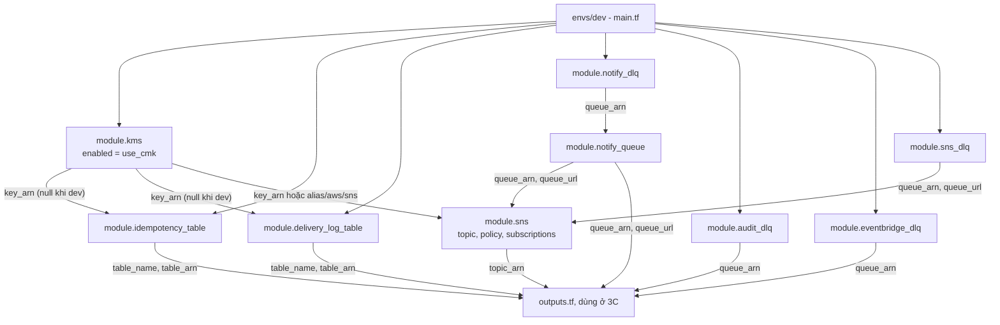

# Phase 3B: Core Modules (KMS, DynamoDB, SQS, SNS) — Customer Logic Workflow

> **Phạm vi 3B:** 4 module Terraform tái sử dụng (`kms`, `dynamodb`, `sqs`, `sns`), các bài `terraform test` cho chúng, và `envs/dev/main.tf` gọi chúng để dựng "xương sống" nhắn tin: **2 bảng DynamoDB, 5 queue (gồm 4 DLQ), 1 SNS topic với 2 subscription**.
> **Không nằm trong 3B:** IAM role, Lambda, API Gateway, EventBridge (3C).
> **Chi phí:** `dev` ≈ 0 USD (toàn bộ on-demand, không có KMS CMK). `prod` thêm ≈ 1 USD/tháng cho 1 CMK.
> **Tình trạng kiểm chứng:** code chưa được `terraform validate/test/plan/apply`. Mục 7 là các bước kiểm chứng. Tôi đã cố căn lề đúng chuẩn, nhưng nếu `terraform fmt -check` báo lệch thì chạy `terraform fmt -recursive infra` (chỉ căn lề, không đổi ý nghĩa).

---

## 1. Quyết định thiết kế mới và một điểm đính chính

| ADR | Quyết định | Lý do |
|---|---|---|
| **ADR-015** | **Queue policy và subscription nằm trong `module.sns`**, `module.sqs` chỉ tạo queue | Tránh vòng phụ thuộc: subscription cần ARN queue, còn queue policy cần ARN topic |
| **ADR-016** | Subscription email dùng **filter policy với toán tử `$or`**: `severity = critical` **hoặc** `event_type` thuộc `payment.failed`, `system.alert` | Một policy diễn đạt đúng yêu cầu "hoặc" của Phase 1 |
| **ADR-017** | Bảng `idempotency` có khóa `id` và TTL `expiration` | Đây là tên thuộc tính mặc định của Powertools Idempotency (Phase 4), nên không cần cấu hình thêm |
| **ADR-018** | Subscription SQS bật `raw_message_delivery` | Body của message trong SQS **chính là JSON sự kiện**, không bọc trong "phong bì" SNS, nên code `notifier` đơn giản hơn |
| **ADR-019** | Dùng **module generic nhỏ** (`dynamodb`, `sqs` gọi nhiều lần) thay vì module riêng cho từng bảng/queue | Ít code lặp, mỗi module chỉ làm một việc |
| **ADR-020** | Mọi queue dùng **SSE-SQS** ở cả `dev` và `prod` | SNS gửi vào queue mã hóa SSE-SQS không cần cấu hình khóa. Ở `prod` mã hóa bằng CMK cho queue là tùy chọn, không bắt buộc |

> **Đính chính so với Phase 1:** Phase 1 nêu subscription email có DLQ. Theo hiểu biết của tôi, SNS **chỉ hỗ trợ DLQ cho subscription kiểu SQS, Lambda, HTTP/S** (không hỗ trợ email, SMS, push), nên ở 3B chỉ subscription SQS có `redrive_policy`. Với email, lỗi gửi được theo dõi bằng metric `NumberOfNotificationsFailed` ở Phase 6. Hãy đối chiếu tài liệu AWS hiện hành để chắc chắn.

---

## 2. Cấu trúc file của Phase 3B

```text
infra/
├── modules/
│   ├── kms/
│   │   ├── versions.tf  variables.tf  main.tf  outputs.tf
│   │   └── tests/kms.tftest.hcl
│   ├── dynamodb/
│   │   ├── versions.tf  variables.tf  main.tf  outputs.tf
│   │   └── tests/dynamodb.tftest.hcl
│   ├── sqs/
│   │   ├── versions.tf  variables.tf  main.tf  outputs.tf
│   │   └── tests/sqs.tftest.hcl
│   └── sns/
│       ├── versions.tf  variables.tf  main.tf  outputs.tf
│       └── tests/sns.tftest.hcl
└── envs/
    ├── dev/   variables.tf  main.tf  outputs.tf  terraform.tfvars  ops.secret.auto.tfvars (bạn tự tạo)
    └── prod/  (main.tf, variables.tf, outputs.tf giống dev; khác terraform.tfvars)
```

---

## 3. Dependency / Call Graph

### 3.1. Đồ thị module của Phase 3B



**Thứ tự tạo (Terraform tự suy ra từ đồ thị):**
1. `kms` (chỉ khi `use_cmk = true`), 2 bảng DynamoDB và 5 queue (song song, vì chỉ `notify_queue` cần `notify_dlq`).
2. SNS topic và topic policy.
3. Queue policy (cho phép SNS gửi vào `notify_queue` và `sns_dlq`).
4. Subscription (`depends_on` queue policy), email và SQS.

### 3.2. Contract Table

| Caller → Callee | Inputs / Tham số truyền | Outputs / Giá trị trả về | Vì sao có phụ thuộc này |
|---|---|---|---|
| `envs/*/main.tf` → `module.kms` | `enabled`, `name_prefix`, `alias_suffix`, `description`, `service_principals` | `key_arn` (null nếu tắt), `key_id`, `alias_arn` | Một CMK chung cho SNS và DynamoDB ở `prod`, tắt ở `dev` để miễn phí |
| `envs/*/main.tf` → `module.dynamodb` (x2) | `name`, `hash_key`, `range_key`, `ttl_attribute_name`, `point_in_time_recovery_enabled`, `deletion_protection_enabled`, `kms_key_arn` | `table_name`, `table_arn` | Idempotency (chống gửi trùng) và delivery log (tra cứu kết quả gửi) |
| `module.kms` → `module.dynamodb` | `key_arn` | (không) | Bảng mã hóa bằng CMK khi có, mặc định khóa AWS owned |
| `envs/*/main.tf` → `module.sqs` (x5) | `name`, `visibility_timeout_seconds`, `message_retention_seconds`, `dead_letter_queue_arn`, `max_receive_count` | `queue_arn`, `queue_url`, `queue_name` | Bộ đệm và các DLQ (ADR-019) |
| `module.sqs[notify_dlq]` → `module.sqs[notify_queue]` | `queue_arn` truyền vào `dead_letter_queue_arn` | Redrive policy gắn vào `notify_queue` | Message lỗi quá 3 lần được chuyển sang DLQ |
| `envs/*/main.tf` → `module.sns` | `name`, `kms_master_key_id`, `ops_email_addresses`, `notify_queue_arn`, `notify_queue_url`, `subscription_dlq_arn`, `subscription_dlq_url` | `topic_arn`, `topic_name`, `notify_subscription_arn` | Trung tâm fan-out. Module sở hữu topic, policy và subscription (ADR-015) |
| `module.sns` → `aws_sqs_queue_policy` | `topic_arn` (làm điều kiện `aws:SourceArn`), `queue_url` | Queue chấp nhận message từ **đúng topic này** | Ngăn "confused deputy": topic khác trong cùng account không gửi lẫn vào được |
| `module.sns` → `aws_sns_topic_subscription` (SQS) | `filter_policy`, `raw_message_delivery`, `redrive_policy` | Subscription đang hoạt động | Chỉ message `order.*` và `payment.failed` vào `notify_queue`; lỗi chuyển sang `sns_dlq` |

### 3.3. Execution Trace

**Kịch bản 1 — Happy path, một sự kiện chạy qua hạ tầng (sau khi 3C hoàn tất ingest, ở đây giả lập bằng lệnh CLI):**

1. Publisher gọi `sns:Publish` lên `clw-dev-customer-events` với body là JSON sự kiện và `MessageAttributes` `event_type=order.created`, `severity=info`.
2. SNS mã hóa message bằng khóa `alias/aws/sns` (dev), rồi đánh giá từng subscription theo **filter policy**:
   - `notify_queue`: `event_type` có tiền tố `order.` thì **khớp**.
   - Email Ops: `severity=info` (không phải `critical`) và `event_type` không thuộc `payment.failed`/`system.alert` thì **không khớp**, bỏ qua.
3. SNS gửi vào `clw-dev-notify` dưới dạng **raw message** (body = JSON sự kiện, attributes giữ lại). Queue policy cho phép vì `aws:SourceArn` trùng ARN topic.
4. Message nằm trong queue tối đa 4 ngày, chờ Lambda `notifier` (3C) đọc.

**Kịch bản 2 — Error path:**

1. **Consumer lỗi:** `notifier` nhận message nhưng lỗi 3 lần liên tiếp (`maxReceiveCount = 3`). SQS chuyển message sang `clw-dev-notify-dlq`, giữ 14 ngày để điều tra và replay.
2. **SNS không gửi được vào queue** (ví dụ ai đó xóa queue policy bằng tay): SNS thử lại rồi đẩy message vào `clw-dev-sns-dlq` nhờ `redrive_policy` của subscription. Queue policy của `sns_dlq` cũng chỉ cho phép đúng topic này gửi vào.
3. **Thứ tự tạo sai:** nếu subscription SQS được tạo trước queue policy, AWS có thể từ chối hoặc subscription hoạt động sai. `depends_on = [aws_sqs_queue_policy.notify]` chặn tình huống này.
4. **Email chưa xác nhận:** subscription ở trạng thái `PendingConfirmation`, **không có email nào được gửi** cho tới khi người nhận bấm link xác nhận (Terraform không tự xác nhận được).
5. **Bật `use_cmk` sau khi đã chạy:** `kms_master_key_id` của topic đổi, Terraform cập nhật tại chỗ, không tạo lại topic. Bảng DynamoDB đổi mã hóa cũng cập nhật tại chỗ.

---

## 4. Code: các module

### File 1: `versions.tf` (dùng chung cho 4 module)

**Overview:** Khóa phiên bản Terraform và provider cho từng module. **Cùng một nội dung** được đặt ở 4 đường dẫn: `infra/modules/kms/versions.tf`, `infra/modules/dynamodb/versions.tf`, `infra/modules/sqs/versions.tf`, `infra/modules/sns/versions.tf`. Rule `terraform_required_providers` của tflint yêu cầu mỗi module tự khai báo provider.

```hcl
terraform {
  required_version = ">= 1.10.0"

  required_providers {
    aws = {
      source  = "hashicorp/aws"
      version = "~> 6.0"
    }
  }
}
```

**Giải thích chi tiết:** module **không** có block `provider`: chúng kế thừa provider của root module (`envs/*/providers.tf`), nên `default_tags` tự áp dụng cho mọi tài nguyên trong module. Cùng ràng buộc phiên bản với root để không bị lệch.

Sao chép nhanh sau khi tạo file đầu tiên:

```powershell
foreach ($m in "dynamodb", "sqs", "sns") {
  New-Item -ItemType Directory -Force "infra\modules\$m" | Out-Null
  Copy-Item infra\modules\kms\versions.tf "infra\modules\$m\versions.tf"
}
```

---

### Module `kms`

#### File 2: `infra/modules/kms/variables.tf`

**Overview:** Đầu vào của module KMS. Được gọi từ `envs/*/main.tf`.

```hcl
variable "enabled" {
  description = "Có tạo CMK hay không. Đặt false ở dev để dùng khóa AWS managed/owned miễn phí."
  type        = bool
  default     = true
}

variable "name_prefix" {
  description = "Tiền tố tên môi trường, ví dụ clw-prod. Alias sẽ là alias/<name_prefix>-<alias_suffix>."
  type        = string
}

variable "alias_suffix" {
  description = "Hậu tố của alias khóa."
  type        = string
  default     = "main"
}

variable "description" {
  description = "Mô tả của khóa KMS."
  type        = string
}

variable "deletion_window_in_days" {
  description = "Số ngày chờ trước khi khóa thực sự bị xóa sau khi lên lịch xóa (7 đến 30)."
  type        = number
  default     = 30

  validation {
    condition     = var.deletion_window_in_days >= 7 && var.deletion_window_in_days <= 30
    error_message = "deletion_window_in_days phải nằm trong khoảng 7 đến 30."
  }
}

variable "service_principals" {
  description = "Danh sách service principal được phép dùng khóa (ví dụ sns.amazonaws.com)."
  type        = list(string)
  default     = ["sns.amazonaws.com"]
}
```

**Giải thích chi tiết:**
- `enabled`: cho phép **gọi module nhưng không tạo gì** ở `dev`, nên `main.tf` của hai môi trường giống hệt nhau (khác biệt nằm ở `tfvars`).
- `deletion_window_in_days` mặc định 30 (tối đa): khóa bị xóa nhầm có tới 30 ngày để hủy lịch xóa. Dữ liệu mã hóa bằng khóa đã xóa là **mất vĩnh viễn**.
- `service_principals`: SNS cần quyền dùng khóa để mã hóa message của topic.

#### File 3: `infra/modules/kms/main.tf`

**Overview:** Tạo CMK, bật xoay khóa tự động, tạo alias, và key policy. Gọi `data.aws_caller_identity` để biết account. Output `key_arn` được `dynamodb` và `sns` dùng.

```hcl
data "aws_caller_identity" "current" {}

data "aws_iam_policy_document" "key" {
  count = var.enabled ? 1 : 0

  # Cho phép IAM policy trong account quản lý quyền dùng khóa, đồng thời tránh khóa bị "mồ côi"
  statement {
    sid       = "EnableIamPolicies"
    actions   = ["kms:*"]
    resources = ["*"]

    principals {
      type        = "AWS"
      identifiers = ["arn:aws:iam::${data.aws_caller_identity.current.account_id}:root"]
    }
  }

  statement {
    sid       = "AllowServicePrincipals"
    actions   = ["kms:GenerateDataKey*", "kms:Decrypt"]
    resources = ["*"]

    principals {
      type        = "Service"
      identifiers = var.service_principals
    }

    condition {
      test     = "StringEquals"
      variable = "aws:SourceAccount"
      values   = [data.aws_caller_identity.current.account_id]
    }
  }
}

resource "aws_kms_key" "this" {
  count = var.enabled ? 1 : 0

  description             = var.description
  deletion_window_in_days = var.deletion_window_in_days
  enable_key_rotation     = true
  policy                  = data.aws_iam_policy_document.key[0].json
}

resource "aws_kms_alias" "this" {
  count = var.enabled ? 1 : 0

  name          = "alias/${var.name_prefix}-${var.alias_suffix}"
  target_key_id = aws_kms_key.this[0].key_id
}
```

**Giải thích chi tiết:**
- **Key policy statement 1** là mẫu chuẩn của AWS: trao cho "root" của account quyền `kms:*` nghĩa là **ủy quyền cho IAM** quyết định ai dùng khóa. Principal ở đây là account, **không phải wildcard**, nên người ngoài account vẫn không dùng được. Nếu thiếu statement này, khóa có thể không ai quản lý được.
- **Statement 2** cho dịch vụ (SNS) dùng khóa, bị ràng buộc `aws:SourceAccount` để chỉ dịch vụ **hoạt động thay mặt account này** mới dùng được (chống confused deputy).
- `enable_key_rotation = true`: AWS tự xoay vật liệu khóa hằng năm (checklist yêu cầu "CMK với automatic key rotation").
- `count` ở data, key và alias cùng dùng `var.enabled`, nên khi tắt module không tạo gì và không cần tham chiếu `[0]`.
- Tag `Project` của khóa đến từ `default_tags`. Điều này **quan trọng**: policy deploy (3A) chỉ cho `kms:CreateKey` khi request mang tag `Project`, và chỉ quản lý được khóa có tag đó.

#### File 4: `infra/modules/kms/outputs.tf`

**Overview:** Xuất ARN khóa cho các module khác.

```hcl
output "key_arn" {
  description = "ARN của CMK, null nếu module bị tắt (enabled = false)."
  value       = try(aws_kms_key.this[0].arn, null)
}

output "key_id" {
  description = "ID của CMK, null nếu module bị tắt."
  value       = try(aws_kms_key.this[0].key_id, null)
}

output "alias_arn" {
  description = "ARN của alias khóa, null nếu module bị tắt."
  value       = try(aws_kms_alias.this[0].arn, null)
}
```

**Giải thích chi tiết:** `try(..., null)` để module bị tắt trả `null` thay vì làm vỡ `plan`. Các module nhận `kms_key_arn` đều xử lý `null` (không mã hóa bằng CMK).

#### File 5: `infra/modules/kms/tests/kms.tftest.hcl`

**Overview:** Bài test `terraform test` cho module KMS, chạy ở chế độ `plan` với **provider giả (mock)** nên không cần AWS và không tốn tiền.

```hcl
mock_provider "aws" {}

variables {
  name_prefix = "clw-test"
  description = "Khóa kiểm thử"
}

run "disabled_creates_nothing" {
  command = plan

  variables {
    enabled = false
  }

  assert {
    condition     = length(aws_kms_key.this) == 0
    error_message = "Khi enabled = false thì không được tạo khóa KMS."
  }

  assert {
    condition     = length(aws_kms_alias.this) == 0
    error_message = "Khi enabled = false thì không được tạo alias."
  }
}

run "enabled_creates_rotating_key_with_alias" {
  command = plan

  variables {
    enabled = true
  }

  assert {
    condition     = aws_kms_key.this[0].enable_key_rotation == true
    error_message = "CMK phải bật xoay khóa tự động."
  }

  assert {
    condition     = aws_kms_alias.this[0].name == "alias/clw-test-main"
    error_message = "Alias phải có dạng alias/<name_prefix>-<alias_suffix>."
  }
}

run "rejects_invalid_deletion_window" {
  command = plan

  variables {
    deletion_window_in_days = 3
  }

  expect_failures = [var.deletion_window_in_days]
}
```

**Giải thích chi tiết:**
- `mock_provider "aws" {}`: provider AWS giả, trả giá trị tự sinh cho thuộc tính computed. Các assert chỉ kiểm tra thuộc tính **do chúng ta cấu hình** (xoay khóa, tên alias, số lượng tài nguyên), không phụ thuộc giá trị giả.
- Bài 3 dùng `expect_failures` để kiểm tra **validation chặn giá trị sai** (3 ngày < 7), tức "test cho trường hợp lỗi".

---

### Module `dynamodb`

#### File 6: `infra/modules/dynamodb/variables.tf`

**Overview:** Đầu vào của module bảng DynamoDB generic. Gọi 2 lần từ `main.tf` (idempotency và delivery log).

```hcl
variable "name" {
  description = "Tên bảng DynamoDB."
  type        = string

  validation {
    condition     = can(regex("^[a-zA-Z0-9_.-]{3,255}$", var.name))
    error_message = "Tên bảng chỉ gồm chữ, số, dấu gạch ngang, gạch dưới, dấu chấm, dài 3 đến 255 ký tự."
  }
}

variable "hash_key" {
  description = "Tên thuộc tính partition key."
  type        = string
}

variable "hash_key_type" {
  description = "Kiểu của partition key: S (chuỗi), N (số) hoặc B (nhị phân)."
  type        = string
  default     = "S"

  validation {
    condition     = contains(["S", "N", "B"], var.hash_key_type)
    error_message = "hash_key_type chỉ nhận S, N hoặc B."
  }
}

variable "range_key" {
  description = "Tên thuộc tính sort key, null nếu bảng chỉ có partition key."
  type        = string
  default     = null
}

variable "range_key_type" {
  description = "Kiểu của sort key: S, N hoặc B."
  type        = string
  default     = "S"

  validation {
    condition     = contains(["S", "N", "B"], var.range_key_type)
    error_message = "range_key_type chỉ nhận S, N hoặc B."
  }
}

variable "ttl_attribute_name" {
  description = "Tên thuộc tính TTL (epoch giây), null nếu không dùng TTL."
  type        = string
  default     = null
}

variable "point_in_time_recovery_enabled" {
  description = "Bật Point-in-Time Recovery (bật ở prod, tắt ở dev để tiết kiệm)."
  type        = bool
  default     = false
}

variable "deletion_protection_enabled" {
  description = "Bật bảo vệ xóa bảng (bật ở prod)."
  type        = bool
  default     = false
}

variable "kms_key_arn" {
  description = "ARN CMK để mã hóa bảng, null nghĩa là dùng khóa AWS owned (miễn phí, vẫn mã hóa at-rest)."
  type        = string
  default     = null
}
```

**Giải thích chi tiết:**
- `range_key`, `ttl_attribute_name`, `kms_key_arn` mặc định `null` để **một module phục vụ nhiều hình dạng bảng**: bảng idempotency chỉ có partition key và TTL; bảng delivery log có thêm sort key.
- Hai cờ `point_in_time_recovery_enabled` và `deletion_protection_enabled` do môi trường quyết định (qua `tfvars`), không hardcode trong module.

#### File 7: `infra/modules/dynamodb/main.tf`

**Overview:** Tạo bảng DynamoDB chế độ **on-demand** (trả theo request, về 0 khi không dùng). Dùng `dynamic` block để bật tùy chọn sort key, TTL và mã hóa CMK chỉ khi có đầu vào tương ứng.

```hcl
resource "aws_dynamodb_table" "this" {
  #checkov:skip=CKV_AWS_119:Dev dùng khóa AWS owned để miễn phí; prod truyền kms_key_arn (CMK) qua biến, xem ADR-006
  #checkov:skip=CKV_AWS_28:PITR điều khiển bằng biến point_in_time_recovery_enabled; prod bật qua terraform.tfvars

  name         = var.name
  billing_mode = "PAY_PER_REQUEST"
  hash_key     = var.hash_key
  range_key    = var.range_key

  deletion_protection_enabled = var.deletion_protection_enabled

  attribute {
    name = var.hash_key
    type = var.hash_key_type
  }

  dynamic "attribute" {
    for_each = var.range_key == null ? [] : [var.range_key]

    content {
      name = attribute.value
      type = var.range_key_type
    }
  }

  dynamic "ttl" {
    for_each = var.ttl_attribute_name == null ? [] : [var.ttl_attribute_name]

    content {
      attribute_name = ttl.value
      enabled        = true
    }
  }

  point_in_time_recovery {
    enabled = var.point_in_time_recovery_enabled
  }

  dynamic "server_side_encryption" {
    for_each = var.kms_key_arn == null ? [] : [var.kms_key_arn]

    content {
      enabled     = true
      kms_key_arn = server_side_encryption.value
    }
  }
}
```

**Giải thích chi tiết:**
- `PAY_PER_REQUEST`: không cần dự đoán dung lượng, chi phí ≈ 0 khi ít dùng, phù hợp mục tiêu FinOps.
- **Mã hóa:** DynamoDB **luôn mã hóa at-rest**. Khi không có `server_side_encryption`, bảng dùng khóa AWS owned (miễn phí). Khi truyền CMK, bảng dùng CMK đó (prod). Đây là hiện thực của ADR-006.
- `dynamic "ttl"`: TTL tự xóa item hết hạn miễn phí, giúp bảng idempotency và delivery log không phình mãi.
- Hai dòng `#checkov:skip` có lý do và bị **ràng buộc bởi biến**; ở `prod` giá trị được bật qua `terraform.tfvars` và đi qua review PR. Nếu sau này muốn chặt hơn, có thể thêm `precondition` theo môi trường.
- `deletion_protection_enabled`: ở `prod` bật để không xóa nhầm bảng dữ liệu. Muốn `destroy` ở prod phải tắt cờ này trước (xem teardown).

#### File 8: `infra/modules/dynamodb/outputs.tf`

**Overview:** Xuất tên và ARN bảng cho IAM policy và biến môi trường của Lambda ở 3C.

```hcl
output "table_name" {
  description = "Tên bảng DynamoDB, dùng làm biến môi trường cho Lambda."
  value       = aws_dynamodb_table.this.name
}

output "table_arn" {
  description = "ARN bảng DynamoDB, dùng trong IAM policy của Lambda."
  value       = aws_dynamodb_table.this.arn
}
```

**Giải thích chi tiết:** IAM policy ở 3C cần `table_arn` để giới hạn quyền đúng một bảng; Lambda cần `table_name` để biết ghi vào đâu.

#### File 9: `infra/modules/dynamodb/tests/dynamodb.tftest.hcl`

**Overview:** Test hình dạng bảng với provider giả.

```hcl
mock_provider "aws" {}

variables {
  name = "clw-test-table"
}

run "idempotency_shape_has_ttl_and_no_sort_key" {
  command = plan

  variables {
    hash_key           = "id"
    ttl_attribute_name = "expiration"
  }

  assert {
    condition     = aws_dynamodb_table.this.billing_mode == "PAY_PER_REQUEST"
    error_message = "Bảng phải ở chế độ on-demand."
  }

  assert {
    condition     = aws_dynamodb_table.this.ttl[0].attribute_name == "expiration"
    error_message = "TTL phải dùng thuộc tính expiration."
  }

  assert {
    condition     = length(aws_dynamodb_table.this.attribute) == 1
    error_message = "Bảng không có sort key thì chỉ khai báo 1 thuộc tính."
  }
}

run "delivery_log_shape_has_sort_key_and_cmk" {
  command = plan

  variables {
    hash_key                       = "event_id"
    range_key                      = "channel_ts"
    point_in_time_recovery_enabled = true
    kms_key_arn                    = "arn:aws:kms:ap-southeast-1:123456789012:key/11111111-2222-3333-4444-555555555555"
  }

  assert {
    condition     = length(aws_dynamodb_table.this.attribute) == 2
    error_message = "Bảng có sort key thì phải khai báo 2 thuộc tính."
  }

  assert {
    condition     = aws_dynamodb_table.this.point_in_time_recovery[0].enabled == true
    error_message = "PITR phải bật khi được yêu cầu."
  }

  assert {
    condition     = aws_dynamodb_table.this.server_side_encryption[0].enabled == true
    error_message = "Khi có kms_key_arn thì phải bật mã hóa bằng CMK."
  }
}

run "rejects_invalid_key_type" {
  command = plan

  variables {
    hash_key      = "id"
    hash_key_type = "X"
  }

  expect_failures = [var.hash_key_type]
}
```

**Giải thích chi tiết:** hai bài đầu kiểm tra hai "hình dạng" bảng sẽ dùng thật (idempotency và delivery log); bài cuối kiểm tra validation. ARN KMS trong test là chuỗi giả, chỉ để kiểm tra nhánh `dynamic`.

---

### Module `sqs`

#### File 10: `infra/modules/sqs/variables.tf`

**Overview:** Đầu vào của module queue generic (dùng cho cả queue chính lẫn DLQ). Gọi 5 lần từ `main.tf`.

```hcl
variable "name" {
  description = "Tên queue SQS."
  type        = string

  validation {
    condition     = can(regex("^[a-zA-Z0-9_-]{1,80}$", var.name))
    error_message = "Tên queue chỉ gồm chữ, số, gạch ngang, gạch dưới, dài 1 đến 80 ký tự."
  }
}

variable "visibility_timeout_seconds" {
  description = "Thời gian message bị ẩn sau khi consumer nhận. Nên lớn hơn hoặc bằng 6 lần timeout của Lambda đọc queue."
  type        = number
  default     = 30

  validation {
    condition     = var.visibility_timeout_seconds >= 0 && var.visibility_timeout_seconds <= 43200
    error_message = "visibility_timeout_seconds phải nằm trong khoảng 0 đến 43200."
  }
}

variable "message_retention_seconds" {
  description = "Thời gian giữ message (60 giây đến 14 ngày). Mặc định 4 ngày."
  type        = number
  default     = 345600

  validation {
    condition     = var.message_retention_seconds >= 60 && var.message_retention_seconds <= 1209600
    error_message = "message_retention_seconds phải nằm trong khoảng 60 đến 1209600."
  }
}

variable "receive_wait_time_seconds" {
  description = "Thời gian long polling (0 đến 20 giây). 20 giúp giảm số request rỗng và chi phí."
  type        = number
  default     = 20

  validation {
    condition     = var.receive_wait_time_seconds >= 0 && var.receive_wait_time_seconds <= 20
    error_message = "receive_wait_time_seconds phải nằm trong khoảng 0 đến 20."
  }
}

variable "dead_letter_queue_arn" {
  description = "ARN của DLQ, null nếu queue này không có DLQ (ví dụ chính nó là DLQ)."
  type        = string
  default     = null
}

variable "max_receive_count" {
  description = "Số lần nhận tối đa trước khi message bị chuyển sang DLQ."
  type        = number
  default     = 3

  validation {
    condition     = var.max_receive_count >= 1 && var.max_receive_count <= 1000
    error_message = "max_receive_count phải nằm trong khoảng 1 đến 1000."
  }
}
```

**Giải thích chi tiết:**
- `visibility_timeout_seconds`: khuyến nghị của AWS khi Lambda đọc SQS là đặt **>= 6 lần timeout của hàm**. Root sẽ truyền 180 cho `notify_queue` (Lambda timeout dự kiến 30 giây), nếu nhỏ hơn thì message có thể bị xử lý trùng.
- `receive_wait_time_seconds = 20` (long polling): giảm số request rỗng nên giảm chi phí và độ trễ.
- `dead_letter_queue_arn = null`: chính các DLQ cũng dùng module này, và DLQ không có DLQ.

#### File 11: `infra/modules/sqs/main.tf`

**Overview:** Tạo một queue SQS mã hóa SSE-SQS, kèm redrive policy tùy chọn.

```hcl
resource "aws_sqs_queue" "this" {
  name                       = var.name
  visibility_timeout_seconds = var.visibility_timeout_seconds
  message_retention_seconds  = var.message_retention_seconds
  receive_wait_time_seconds  = var.receive_wait_time_seconds
  sqs_managed_sse_enabled    = true

  redrive_policy = var.dead_letter_queue_arn == null ? null : jsonencode({
    deadLetterTargetArn = var.dead_letter_queue_arn
    maxReceiveCount     = var.max_receive_count
  })
}
```

**Giải thích chi tiết:**
- `sqs_managed_sse_enabled = true` (SSE-SQS): mã hóa at-rest miễn phí, và **tương thích với SNS** (ADR-020). Dùng khóa `alias/aws/sqs` sẽ khiến SNS không gửi vào được vì không sửa được key policy của khóa AWS managed.
- `redrive_policy`: khi có `dead_letter_queue_arn`, mỗi message nhận quá `max_receive_count` lần sẽ chuyển sang DLQ. Đây là cơ chế "Failure Handling" của checklist.
- Chủ ý không tạo queue policy ở đây (ADR-015): policy cần ARN topic, mà topic lại cần ARN queue để subscribe. Đặt policy trong `module.sns` phá vòng phụ thuộc.

#### File 12: `infra/modules/sqs/outputs.tf`

**Overview:** Xuất ARN, URL và tên queue.

```hcl
output "queue_arn" {
  description = "ARN của queue, dùng cho IAM policy, subscription và redrive."
  value       = aws_sqs_queue.this.arn
}

output "queue_url" {
  description = "URL của queue, dùng cho queue policy và biến môi trường."
  value       = aws_sqs_queue.this.url
}

output "queue_name" {
  description = "Tên của queue."
  value       = aws_sqs_queue.this.name
}
```

**Giải thích chi tiết:** `queue_arn` dùng cho IAM, subscription và event source mapping; `queue_url` dùng cho `aws_sqs_queue_policy` và SDK.

#### File 13: `infra/modules/sqs/tests/sqs.tftest.hcl`

**Overview:** Test với provider giả.

```hcl
mock_provider "aws" {}

variables {
  name = "clw-test-queue"
}

run "queue_is_encrypted_and_has_no_dlq_by_default" {
  command = plan

  assert {
    condition     = aws_sqs_queue.this.sqs_managed_sse_enabled == true
    error_message = "Queue phải bật mã hóa SSE-SQS."
  }

  assert {
    condition     = aws_sqs_queue.this.redrive_policy == null
    error_message = "Không truyền DLQ thì không được có redrive policy."
  }

  assert {
    condition     = aws_sqs_queue.this.receive_wait_time_seconds == 20
    error_message = "Mặc định phải dùng long polling 20 giây."
  }
}

run "queue_with_dlq_sets_redrive_policy" {
  command = plan

  variables {
    dead_letter_queue_arn = "arn:aws:sqs:ap-southeast-1:123456789012:clw-test-dlq"
    max_receive_count     = 5
  }

  assert {
    condition     = jsondecode(aws_sqs_queue.this.redrive_policy).maxReceiveCount == 5
    error_message = "maxReceiveCount phải đúng giá trị đầu vào."
  }

  assert {
    condition     = jsondecode(aws_sqs_queue.this.redrive_policy).deadLetterTargetArn == "arn:aws:sqs:ap-southeast-1:123456789012:clw-test-dlq"
    error_message = "deadLetterTargetArn phải trỏ đúng DLQ."
  }
}

run "rejects_zero_receive_count" {
  command = plan

  variables {
    max_receive_count = 0
  }

  expect_failures = [var.max_receive_count]
}
```

**Giải thích chi tiết:** bài 1 kiểm tra "an toàn theo mặc định" (mã hóa, long polling, không DLQ); bài 2 kiểm tra nối DLQ; bài 3 là trường hợp lỗi (validation chặn `max_receive_count = 0`, vì 0 làm message vào DLQ ngay lần đầu).

---

### Module `sns`

#### File 14: `infra/modules/sns/variables.tf`

**Overview:** Đầu vào của module SNS: topic, danh sách email Ops, và thông tin queue/DLQ để gắn subscription. Được gọi một lần từ `main.tf`.

```hcl
variable "name" {
  description = "Tên SNS topic."
  type        = string

  validation {
    condition     = can(regex("^[a-zA-Z0-9_-]{1,256}$", var.name))
    error_message = "Tên topic chỉ gồm chữ, số, gạch ngang, gạch dưới, dài 1 đến 256 ký tự."
  }
}

variable "kms_master_key_id" {
  description = "Khóa mã hóa topic: ARN của CMK (prod) hoặc alias/aws/sns (dev)."
  type        = string
}

variable "ops_email_addresses" {
  description = "Danh sách email đội vận hành nhận cảnh báo (mỗi email phải bấm xác nhận sau khi được tạo)."
  type        = list(string)
  default     = []

  validation {
    condition     = alltrue([for e in var.ops_email_addresses : can(regex("^[^@\\s]+@[^@\\s]+\\.[^@\\s]+$", e))])
    error_message = "Mỗi phần tử của ops_email_addresses phải là địa chỉ email hợp lệ."
  }
}

variable "notify_queue_arn" {
  description = "ARN của queue notify (nhận sự kiện order.* và payment.failed)."
  type        = string
}

variable "notify_queue_url" {
  description = "URL của queue notify, dùng để gắn queue policy."
  type        = string
}

variable "subscription_dlq_arn" {
  description = "ARN của DLQ nhận message khi SNS không gửi được vào subscription SQS."
  type        = string
}

variable "subscription_dlq_url" {
  description = "URL của DLQ subscription, dùng để gắn queue policy."
  type        = string
}
```

**Giải thích chi tiết:**
- `ops_email_addresses` mặc định rỗng: module vẫn hoạt động (không có subscription email). Email được truyền từ file `ops.secret.auto.tfvars` bị `.gitignore` chặn, nên **không nằm trong repo**.
- Regex email cố ý đơn giản: chỉ bắt lỗi gõ sai rõ ràng, việc xác thực thật sự là bước bấm link xác nhận của SNS.
- `kms_master_key_id` là **bắt buộc** (không có `default`): không thể vô tình tạo topic không mã hóa.

#### File 15: `infra/modules/sns/main.tf`

**Overview:** Tạo SNS topic, topic policy, queue policy (cho `notify_queue` và DLQ), và các subscription (email Ops, SQS notify). Nhận ARN/URL queue từ `module.sqs` qua root. Output `topic_arn` dùng ở 3C.

```hcl
resource "aws_sns_topic" "this" {
  name              = var.name
  kms_master_key_id = var.kms_master_key_id
  tracing_config    = "Active"
}

data "aws_iam_policy_document" "topic" {
  # Chặn mọi truy cập không dùng HTTPS. Quyền publish cấp bằng IAM của từng Lambda (Least Privilege)
  statement {
    sid       = "DenyInsecureTransport"
    effect    = "Deny"
    actions   = ["sns:Publish", "sns:Subscribe"]
    resources = [aws_sns_topic.this.arn]

    principals {
      type        = "*"
      identifiers = ["*"]
    }

    condition {
      test     = "Bool"
      variable = "aws:SecureTransport"
      values   = ["false"]
    }
  }
}

resource "aws_sns_topic_policy" "this" {
  arn    = aws_sns_topic.this.arn
  policy = data.aws_iam_policy_document.topic.json
}

# ---------------------------------------------------------------------------
# Queue policy: chỉ topic này mới được gửi vào queue (chống confused deputy)
# ---------------------------------------------------------------------------
data "aws_iam_policy_document" "notify_queue" {
  statement {
    sid       = "AllowSnsTopicToSend"
    actions   = ["sqs:SendMessage"]
    resources = [var.notify_queue_arn]

    principals {
      type        = "Service"
      identifiers = ["sns.amazonaws.com"]
    }

    condition {
      test     = "ArnEquals"
      variable = "aws:SourceArn"
      values   = [aws_sns_topic.this.arn]
    }
  }

  statement {
    sid       = "DenyInsecureTransport"
    effect    = "Deny"
    actions   = ["sqs:*"]
    resources = [var.notify_queue_arn]

    principals {
      type        = "*"
      identifiers = ["*"]
    }

    condition {
      test     = "Bool"
      variable = "aws:SecureTransport"
      values   = ["false"]
    }
  }
}

resource "aws_sqs_queue_policy" "notify" {
  queue_url = var.notify_queue_url
  policy    = data.aws_iam_policy_document.notify_queue.json
}

data "aws_iam_policy_document" "subscription_dlq" {
  statement {
    sid       = "AllowSnsTopicToSend"
    actions   = ["sqs:SendMessage"]
    resources = [var.subscription_dlq_arn]

    principals {
      type        = "Service"
      identifiers = ["sns.amazonaws.com"]
    }

    condition {
      test     = "ArnEquals"
      variable = "aws:SourceArn"
      values   = [aws_sns_topic.this.arn]
    }
  }

  statement {
    sid       = "DenyInsecureTransport"
    effect    = "Deny"
    actions   = ["sqs:*"]
    resources = [var.subscription_dlq_arn]

    principals {
      type        = "*"
      identifiers = ["*"]
    }

    condition {
      test     = "Bool"
      variable = "aws:SecureTransport"
      values   = ["false"]
    }
  }
}

resource "aws_sqs_queue_policy" "subscription_dlq" {
  queue_url = var.subscription_dlq_url
  policy    = data.aws_iam_policy_document.subscription_dlq.json
}

# ---------------------------------------------------------------------------
# Subscription 1: email đội Ops, chỉ nhận severity=critical HOẶC payment.failed, system.alert
# ---------------------------------------------------------------------------
resource "aws_sns_topic_subscription" "ops_email" {
  for_each = toset(var.ops_email_addresses)

  topic_arn           = aws_sns_topic.this.arn
  protocol            = "email"
  endpoint            = each.value
  filter_policy_scope = "MessageAttributes"

  filter_policy = jsonencode({
    "$or" = [
      { severity = ["critical"] },
      { event_type = ["payment.failed", "system.alert"] },
    ]
  })
}

# ---------------------------------------------------------------------------
# Subscription 2: queue notify, nhận order.* và payment.failed, gửi raw message, lỗi chuyển sang DLQ
# ---------------------------------------------------------------------------
resource "aws_sns_topic_subscription" "notify_queue" {
  topic_arn            = aws_sns_topic.this.arn
  protocol             = "sqs"
  endpoint             = var.notify_queue_arn
  raw_message_delivery = true
  filter_policy_scope  = "MessageAttributes"

  filter_policy = jsonencode({
    event_type = [{ prefix = "order." }, "payment.failed"]
  })

  redrive_policy = jsonencode({
    deadLetterTargetArn = var.subscription_dlq_arn
  })

  depends_on = [
    aws_sqs_queue_policy.notify,
    aws_sqs_queue_policy.subscription_dlq,
  ]
}
```

**Giải thích chi tiết:**
- **Topic:** `kms_master_key_id` luôn được đặt (dev: `alias/aws/sns`, prod: CMK). `tracing_config = "Active"` đưa SNS vào trace X-Ray để nhìn thấy cả chuỗi ingest, SNS và consumer (Phase 6).
- **Topic policy chỉ có `Deny`:** không cấp quyền publish ở resource policy, vì Lambda `ingest` sẽ nhận quyền `sns:Publish` qua IAM role với ARN topic cụ thể (Least Privilege). `Deny` ép dùng HTTPS cho `Publish` và `Subscribe`.
- **Queue policy** có hai statement: (1) `Allow` cho `sns.amazonaws.com` **kèm điều kiện `aws:SourceArn` = ARN topic này**: chỉ đúng topic của dự án mới gửi được, các topic khác trong cùng account bị chặn (chống confused deputy). (2) `Deny` truy cập không HTTPS.
- **DLQ của subscription** có policy tương tự: SNS cần quyền `sqs:SendMessage` để đẩy message lỗi vào DLQ.
- **Subscription email, toán tử `$or`:** nhận message nếu `severity = critical` **hoặc** `event_type` thuộc `payment.failed`/`system.alert`. `filter_policy_scope = "MessageAttributes"` nghĩa là bộ lọc áp dụng lên **MessageAttributes** (không phải body), nên Lambda `ingest` phải đặt các attribute này khi publish (Phase 4).
- **Không có `redrive_policy` cho email** (xem đính chính ở mục 1).
- **Subscription SQS:** filter `event_type` có tiền tố `order.` hoặc bằng `payment.failed`. `raw_message_delivery = true` (ADR-018) để body trong SQS là JSON sự kiện thẳng. `redrive_policy` chuyển message về `sns_dlq` nếu SNS không gửi được vào queue.
- `depends_on` hai queue policy: đảm bảo SNS đã có quyền gửi trước khi subscription được tạo.
- `for_each = toset(var.ops_email_addresses)`: mỗi email một subscription, danh sách rỗng thì không tạo gì.

#### File 16: `infra/modules/sns/outputs.tf`

**Overview:** Xuất thông tin topic cho IAM policy, Lambda `ingest` (biến môi trường) và subscription của Lambda `audit` ở 3C.

```hcl
output "topic_arn" {
  description = "ARN của SNS topic, dùng cho IAM policy, biến môi trường của ingest và subscription của audit."
  value       = aws_sns_topic.this.arn
}

output "topic_name" {
  description = "Tên của SNS topic."
  value       = aws_sns_topic.this.name
}

output "notify_subscription_arn" {
  description = "ARN của subscription SQS notify."
  value       = aws_sns_topic_subscription.notify_queue.arn
}
```

**Giải thích chi tiết:** `topic_arn` là đầu ra quan trọng nhất của 3B: ở 3C nó vào (1) IAM policy của `ingest` (`sns:Publish` đúng topic), (2) biến môi trường `SNS_TOPIC_ARN`, (3) `aws_lambda_permission` và subscription của `audit`.

#### File 17: `infra/modules/sns/tests/sns.tftest.hcl`

**Overview:** Test cấu hình topic, filter policy và subscription với provider giả.

```hcl
mock_provider "aws" {}

variables {
  name                 = "clw-test-customer-events"
  kms_master_key_id    = "alias/aws/sns"
  ops_email_addresses  = ["ops@example.com"]
  notify_queue_arn     = "arn:aws:sqs:ap-southeast-1:123456789012:clw-test-notify"
  notify_queue_url     = "https://sqs.ap-southeast-1.amazonaws.com/123456789012/clw-test-notify"
  subscription_dlq_arn = "arn:aws:sqs:ap-southeast-1:123456789012:clw-test-sns-dlq"
  subscription_dlq_url = "https://sqs.ap-southeast-1.amazonaws.com/123456789012/clw-test-sns-dlq"
}

run "topic_is_encrypted_and_traced" {
  command = plan

  assert {
    condition     = aws_sns_topic.this.kms_master_key_id == "alias/aws/sns"
    error_message = "Topic phải được mã hóa bằng khóa được truyền vào."
  }

  assert {
    condition     = aws_sns_topic.this.tracing_config == "Active"
    error_message = "Topic phải bật X-Ray tracing."
  }
}

run "notify_queue_subscription_filters_orders_and_payment_failures" {
  command = plan

  assert {
    condition     = jsondecode(aws_sns_topic_subscription.notify_queue.filter_policy).event_type[0].prefix == "order."
    error_message = "Subscription notify phải lọc theo tiền tố order."
  }

  assert {
    condition     = anytrue([for v in jsondecode(aws_sns_topic_subscription.notify_queue.filter_policy).event_type : v == "payment.failed"])
    error_message = "Subscription notify phải nhận payment.failed."
  }

  assert {
    condition     = aws_sns_topic_subscription.notify_queue.raw_message_delivery == true
    error_message = "Subscription SQS phải bật raw message delivery."
  }

  assert {
    condition     = jsondecode(aws_sns_topic_subscription.notify_queue.redrive_policy).deadLetterTargetArn == var.subscription_dlq_arn
    error_message = "Subscription SQS phải có redrive policy trỏ đúng DLQ."
  }
}

run "ops_email_uses_or_filter" {
  command = plan

  assert {
    condition     = length(aws_sns_topic_subscription.ops_email) == 1
    error_message = "Mỗi email phải tạo đúng một subscription."
  }

  assert {
    condition     = length(jsondecode(aws_sns_topic_subscription.ops_email["ops@example.com"].filter_policy)["$or"]) == 2
    error_message = "Filter policy của email phải có hai nhánh $or."
  }
}

run "no_emails_creates_no_email_subscription" {
  command = plan

  variables {
    ops_email_addresses = []
  }

  assert {
    condition     = length(aws_sns_topic_subscription.ops_email) == 0
    error_message = "Danh sách email rỗng thì không được tạo subscription email."
  }
}

run "rejects_invalid_email" {
  command = plan

  variables {
    ops_email_addresses = ["khong-phai-email"]
  }

  expect_failures = [var.ops_email_addresses]
}
```

**Giải thích chi tiết:** test bám sát **hợp đồng nghiệp vụ** ở Phase 1: ai nhận loại sự kiện nào (filter policy), có DLQ, có raw delivery. Test email dùng địa chỉ `example.com` (tên miền dành riêng cho ví dụ).

---

## 5. Code: nối dây ở `envs/dev` và `envs/prod`

`main.tf`, `variables.tf`, `outputs.tf` **giống hệt nhau** ở hai môi trường; khác biệt chỉ nằm ở `terraform.tfvars`. Nhờ vậy cùng một code được promote từ `dev` sang `prod`.

### File 18: `infra/envs/dev/variables.tf` (thay thế bản ở 3A)

**Overview:** Bản cập nhật đầy đủ của `variables.tf`: giữ các biến cũ, thêm 4 biến mới điều khiển khác biệt giữa môi trường.

```hcl
variable "project" {
  description = "Tên dự án, dùng làm tag Project (phải khớp với bootstrap)."
  type        = string
  default     = "customer-logic-workflow"
}

variable "name_prefix" {
  description = "Tiền tố đặt tên tài nguyên (phải khớp với bootstrap, vì policy deploy giới hạn theo tiền tố này)."
  type        = string
  default     = "clw"
}

variable "environment" {
  description = "Tên môi trường: dev hoặc prod."
  type        = string

  validation {
    condition     = contains(["dev", "prod"], var.environment)
    error_message = "environment chỉ nhận giá trị dev hoặc prod."
  }
}

variable "aws_region" {
  description = "Region triển khai hạ tầng."
  type        = string
  default     = "ap-southeast-1"
}

variable "owner" {
  description = "Đội hoặc nhóm sở hữu, dùng làm tag Owner."
  type        = string
  default     = "platform-team"
}

variable "cost_center" {
  description = "Mã trung tâm chi phí, dùng làm tag CostCenter."
  type        = string
  default     = "portfolio"
}

variable "use_cmk" {
  description = "Dùng KMS CMK (true ở prod) hay khóa AWS managed/owned miễn phí (false ở dev). Xem ADR-006."
  type        = bool
  default     = false
}

variable "enable_pitr" {
  description = "Bật Point-in-Time Recovery cho các bảng DynamoDB (bật ở prod)."
  type        = bool
  default     = false
}

variable "enable_deletion_protection" {
  description = "Bật bảo vệ xóa cho các bảng DynamoDB (bật ở prod)."
  type        = bool
  default     = false
}

variable "ops_email_addresses" {
  description = "Danh sách email đội vận hành nhận cảnh báo. Đặt trong file ops.secret.auto.tfvars (không commit)."
  type        = list(string)
  default     = []
}
```

**Giải thích chi tiết:**
- Bốn biến mới đều có `default` an toàn cho `dev` (miễn phí, không bảo vệ xóa) và được `prod` **bật tường minh** trong `tfvars`.
- `ops_email_addresses` mặc định rỗng: hệ thống vẫn dựng được khi chưa có email, nhưng đội Ops sẽ chưa nhận cảnh báo nào.

### File 19: `infra/envs/dev/main.tf` (thay thế bản chú thích ở 3A)

**Overview:** Gọi toàn bộ module của 3B. Đọc `local.name_prefix` từ `locals.tf`, các biến từ `variables.tf`, và xuất kết quả qua `outputs.tf`.

```hcl
# ---------------------------------------------------------------------------
# Mã hóa: CMK chỉ được tạo khi use_cmk = true (prod)
# ---------------------------------------------------------------------------
module "kms" {
  source = "../../modules/kms"

  enabled            = var.use_cmk
  name_prefix        = local.name_prefix
  alias_suffix       = "main"
  description        = "CMK chính của hệ thống thông báo ${local.name_prefix}"
  service_principals = ["sns.amazonaws.com"]
}

# ---------------------------------------------------------------------------
# DynamoDB: idempotency (khóa id, TTL expiration) và delivery log (khóa event_id + channel_ts)
# ---------------------------------------------------------------------------
module "idempotency_table" {
  source = "../../modules/dynamodb"

  name                           = "${local.name_prefix}-idempotency"
  hash_key                       = "id"
  ttl_attribute_name             = "expiration"
  point_in_time_recovery_enabled = var.enable_pitr
  deletion_protection_enabled    = var.enable_deletion_protection
  kms_key_arn                    = module.kms.key_arn
}

module "delivery_log_table" {
  source = "../../modules/dynamodb"

  name                           = "${local.name_prefix}-delivery-log"
  hash_key                       = "event_id"
  range_key                      = "channel_ts"
  ttl_attribute_name             = "expires_at"
  point_in_time_recovery_enabled = var.enable_pitr
  deletion_protection_enabled    = var.enable_deletion_protection
  kms_key_arn                    = module.kms.key_arn
}

# ---------------------------------------------------------------------------
# SQS: queue notify + các DLQ (giữ 14 ngày để điều tra và replay)
# ---------------------------------------------------------------------------
module "notify_dlq" {
  source = "../../modules/sqs"

  name                      = "${local.name_prefix}-notify-dlq"
  message_retention_seconds = 1209600
}

module "notify_queue" {
  source = "../../modules/sqs"

  name                       = "${local.name_prefix}-notify"
  visibility_timeout_seconds = 180
  dead_letter_queue_arn      = module.notify_dlq.queue_arn
  max_receive_count          = 3
}

module "audit_dlq" {
  source = "../../modules/sqs"

  name                      = "${local.name_prefix}-audit-dlq"
  message_retention_seconds = 1209600
}

module "eventbridge_dlq" {
  source = "../../modules/sqs"

  name                      = "${local.name_prefix}-eventbridge-dlq"
  message_retention_seconds = 1209600
}

module "sns_dlq" {
  source = "../../modules/sqs"

  name                      = "${local.name_prefix}-sns-dlq"
  message_retention_seconds = 1209600
}

# ---------------------------------------------------------------------------
# SNS: topic trung tâm, policy, subscription email Ops và queue notify
# ---------------------------------------------------------------------------
module "sns" {
  source = "../../modules/sns"

  name                 = "${local.name_prefix}-customer-events"
  kms_master_key_id    = var.use_cmk ? module.kms.key_arn : "alias/aws/sns"
  ops_email_addresses  = var.ops_email_addresses
  notify_queue_arn     = module.notify_queue.queue_arn
  notify_queue_url     = module.notify_queue.queue_url
  subscription_dlq_arn = module.sns_dlq.queue_arn
  subscription_dlq_url = module.sns_dlq.queue_url
}
```

**Giải thích chi tiết:**
- **Tên tài nguyên** đều bắt đầu bằng `local.name_prefix` (`clw-dev-...`), khớp mẫu `clw-*` của policy deploy ở 3A. Nếu đổi tiền tố mà không đổi bootstrap, `apply` sẽ bị `AccessDenied`.
- `module.kms.key_arn` là `null` ở `dev`, nên hai bảng dùng khóa AWS owned. Ở `prod` nó là ARN CMK.
- `kms_master_key_id = var.use_cmk ? module.kms.key_arn : "alias/aws/sns"`: chọn khóa theo môi trường (ADR-006).
- `visibility_timeout_seconds = 180` cho `notify_queue`: bằng 6 lần timeout Lambda dự kiến 30 giây (khuyến nghị AWS).
- `max_receive_count = 3` khớp thiết kế ở Phase 1.
- **Ba DLQ chưa dùng ở 3B** (`audit_dlq`, `eventbridge_dlq`): chúng được tạo sớm để 3C chỉ việc tham chiếu ARN. Chi phí queue rỗng bằng 0.
- Ghi chú ngoài phạm vi: SQS queue `eventbridge_dlq` sẽ cần queue policy cho EventBridge ở 3C (module `eventbridge`).

### File 20: `infra/envs/dev/outputs.tf` (thay thế bản ở 3A)

**Overview:** Xuất các giá trị cần cho 3C (IAM, Lambda, EventBridge) và cho bước kiểm tra thủ công.

```hcl
output "name_prefix" {
  description = "Tiền tố đặt tên tài nguyên của môi trường (ví dụ: clw-dev)."
  value       = local.name_prefix
}

output "common_tags" {
  description = "Bộ tag chuẩn được gắn tự động qua default_tags."
  value       = local.common_tags
}

output "sns_topic_arn" {
  description = "ARN của SNS topic customer-events."
  value       = module.sns.topic_arn
}

output "notify_queue_url" {
  description = "URL của queue notify, dùng để kiểm tra thủ công."
  value       = module.notify_queue.queue_url
}

output "queue_arns" {
  description = "ARN của các queue (notify) và DLQ (notify, audit, eventbridge, sns)."
  value = {
    notify          = module.notify_queue.queue_arn
    notify_dlq      = module.notify_dlq.queue_arn
    audit_dlq       = module.audit_dlq.queue_arn
    eventbridge_dlq = module.eventbridge_dlq.queue_arn
    sns_dlq         = module.sns_dlq.queue_arn
  }
}

output "table_names" {
  description = "Tên các bảng DynamoDB (idempotency, delivery_log)."
  value = {
    idempotency  = module.idempotency_table.table_name
    delivery_log = module.delivery_log_table.table_name
  }
}

output "table_arns" {
  description = "ARN các bảng DynamoDB (idempotency, delivery_log)."
  value = {
    idempotency  = module.idempotency_table.table_arn
    delivery_log = module.delivery_log_table.table_arn
  }
}

output "kms_key_arn" {
  description = "ARN CMK của môi trường, null nếu không dùng CMK (dev)."
  value       = module.kms.key_arn
}
```

**Giải thích chi tiết:** các output kiểu `map` giúp 3C truyền gọn (`module.x` -> `local`/biến). Không output nào chứa secret. Danh sách `queue_arns` gồm cả `notify` (queue chính) lẫn 4 DLQ.

### File 21: `infra/envs/dev/terraform.tfvars` và `infra/envs/prod/terraform.tfvars` (thay thế bản ở 3A)

**Overview:** Giá trị theo môi trường, không chứa bí mật. Đây là **chỗ duy nhất** `dev` và `prod` khác nhau về hành vi.

`infra/envs/dev/terraform.tfvars`:

```hcl
environment                = "dev"
aws_region                 = "ap-southeast-1"
owner                      = "platform-team"
cost_center                = "portfolio"
use_cmk                    = false
enable_pitr                = false
enable_deletion_protection = false
```

`infra/envs/prod/terraform.tfvars`:

```hcl
environment                = "prod"
aws_region                 = "ap-southeast-1"
owner                      = "platform-team"
cost_center                = "portfolio"
use_cmk                    = true
enable_pitr                = true
enable_deletion_protection = true
```

**Giải thích chi tiết:**
- `dev`: ưu tiên chi phí bằng 0, bảng có thể xóa tự do để dễ teardown.
- `prod`: bật CMK (~1 USD/tháng), PITR và chống xóa nhầm. Đổi sang `prod` chỉ là đổi giá trị ở file này, **không sửa code**.

### File 22: `infra/envs/dev/ops.secret.auto.tfvars.example` và cập nhật `.gitignore`

**Overview:** Email đội Ops là dữ liệu cá nhân nên không commit. Terraform tự nạp mọi file `*.auto.tfvars` trong thư mục. File thật `ops.secret.auto.tfvars` được `.gitignore` chặn nhờ dòng mới.

`infra/envs/dev/ops.secret.auto.tfvars.example`:

```hcl
ops_email_addresses = []
```

Thêm vào `.gitignore` (trong khối "Terraform"):

```gitignore
*.secret.auto.tfvars
```

**Giải thích chi tiết:**
- Bạn sao chép file mẫu thành `ops.secret.auto.tfvars` rồi điền email thật, ví dụ `ops_email_addresses = ["email-cua-ban@gmail.com"]`.
- **Lưu ý cho Phase 5:** CI không có file này (vì không nằm trong repo). Khi deploy qua GitHub Actions, email sẽ truyền bằng biến môi trường `TF_VAR_ops_email_addresses` lấy từ GitHub Environment. Nếu để rỗng trong CI, `apply` sẽ **xóa** subscription email. Đây là chỗ cần xử lý cẩn thận ở Phase 5.

---

## 6. Hướng dẫn thực hiện (PowerShell)

### 6.1. Tạo file và cập nhật `prod`

Tạo đủ các file ở mục 4 và 5. Sau đó sao chép sang `prod` (giống nhau, trừ `terraform.tfvars` và `backend.tf` đã có):

```powershell
foreach ($f in "variables.tf", "main.tf", "outputs.tf") {
  Copy-Item "infra\envs\dev\$f" "infra\envs\prod\$f" -Force
}
```

Sau đó cập nhật `infra/envs/prod/terraform.tfvars` theo File 21 và thêm dòng `*.secret.auto.tfvars` vào `.gitignore`.

### 6.2. Tạo file email (không commit)

```powershell
Copy-Item infra\envs\dev\ops.secret.auto.tfvars.example infra\envs\dev\ops.secret.auto.tfvars
notepad infra\envs\dev\ops.secret.auto.tfvars
```

---

## 7. Lệnh xác minh (fmt, validate, test, plan, security scan)

### 7.1. Kiểm tra tĩnh

```powershell
terraform fmt -recursive infra
terraform fmt -check -recursive infra
python scripts/run_tflint.py
checkov --config-file .checkov.yaml
```

### 7.2. Kiểm tra từng module bằng `terraform test` (không cần AWS)

```powershell
foreach ($m in "kms", "dynamodb", "sqs", "sns") {
  terraform -chdir="infra/modules/$m" init -backend=false
  terraform -chdir="infra/modules/$m" validate
  terraform -chdir="infra/modules/$m" test
}
```

Mong đợi: mỗi module báo `Success!` với số lượng `run` pass bằng số bài test (kms 3, dynamodb 3, sqs 3, sns 5).

### 7.3. Validate và plan root `dev` (cần SSO ClwDeployer)

```powershell
aws sso login --profile clw-dev
```

```bash
make tf-init ENV=dev
make tf-validate ENV=dev
make tf-plan ENV=dev
```

Mong đợi trong `plan` (không kể email): **2 bảng DynamoDB, 5 queue, 1 topic, 1 topic policy, 2 queue policy, 1 subscription SQS** (cộng 1 subscription email cho mỗi email bạn khai báo). **Không** có tài nguyên KMS ở `dev`.

### 7.4. Apply `dev`

```powershell
$env:AWS_PROFILE = "clw-dev"
terraform -chdir=infra/envs/dev apply
terraform -chdir=infra/envs/dev output
Remove-Item Env:AWS_PROFILE
```

> **`prod` chưa apply ở bước này.** Prod được deploy qua pipeline CD có approval ở Phase 5.

### 7.5. Kiểm tra runtime bằng một message thử

Bước này **cần phiên quản trị** (`clw-admin`) vì `ClwDeployer` cố ý **không** có quyền `sns:Publish` hay `sqs:ReceiveMessage` (nó chỉ quản lý hạ tầng, không đọc ghi dữ liệu).

Tạo file thuộc tính message (dùng `ascii` để tránh BOM làm AWS CLI không đọc được JSON):

```powershell
$attrs = '{"event_type":{"DataType":"String","StringValue":"order.created"},"severity":{"DataType":"String","StringValue":"info"}}'
Set-Content -Path "$env:TEMP\attrs.json" -Value $attrs -Encoding ascii

$topicArn = terraform -chdir=infra/envs/dev output -raw sns_topic_arn
$queueUrl = terraform -chdir=infra/envs/dev output -raw notify_queue_url
```

Publish rồi đọc từ queue:

```powershell
aws sns publish --topic-arn $topicArn --message "test-order-created" --message-attributes file://$env:TEMP/attrs.json --profile clw-admin
aws sqs receive-message --queue-url $queueUrl --message-attribute-names All --wait-time-seconds 10 --profile clw-admin
```

Mong đợi: `receive-message` trả về message có `Body` là `test-order-created` (raw delivery nên không bọc phong bì SNS) và `MessageAttributes` có `event_type`. Nếu bạn đã khai báo email Ops và bấm xác nhận, **email không nhận gì** vì `severity=info` và `event_type=order.created` không khớp filter.

Thử nhánh khớp email: publish với `severity = critical` thì email Ops phải nhận, còn queue notify thì không (vì `event_type` không bắt đầu bằng `order.`):

```powershell
$attrs = '{"event_type":{"DataType":"String","StringValue":"system.alert"},"severity":{"DataType":"String","StringValue":"critical"}}'
Set-Content -Path "$env:TEMP\attrs.json" -Value $attrs -Encoding ascii
aws sns publish --topic-arn $topicArn --message "test-system-alert" --message-attributes file://$env:TEMP/attrs.json --profile clw-admin
```

Dọn file tạm:

```powershell
Remove-Item "$env:TEMP\attrs.json"
```

---

## 8. Checklist xác minh Phase 3B

| # | Kiểm tra | Kết quả mong đợi |
|---|---|---|
| 1 | `terraform fmt -check -recursive infra` | Không in tên file nào (nếu có, chạy `terraform fmt -recursive infra`) |
| 2 | `terraform test` ở 4 module | Tất cả `run` pass |
| 3 | `python scripts/run_tflint.py` | Không có lỗi |
| 4 | `checkov --config-file .checkov.yaml` | Gửi kết quả cho tôi để xử lý (xem ghi chú bên dưới) |
| 5 | `make tf-plan ENV=dev` | Đúng danh sách tài nguyên ở mục 7.3, không có `destroy` |
| 6 | `terraform apply` ở dev | `Apply complete!`, không `AccessDenied` (nếu có, xem mục 8 của tài liệu 3A) |
| 7 | Publish `order.created` / `info` | Message vào `notify` (raw), **không** có email |
| 8 | Publish `system.alert` / `critical` | Email Ops nhận được, `notify` **không** nhận |
| 9 | Kiểm tra mã hóa: `aws sns get-topic-attributes --topic-arn $topicArn --profile clw-admin` | `KmsMasterKeyId` là `alias/aws/sns` |
| 10 | Kiểm tra `aws sqs get-queue-attributes --queue-url $queueUrl --attribute-names All --profile clw-admin` | `SqsManagedSseEnabled` là `true`, có `RedrivePolicy` với `maxReceiveCount` 3 |
| 11 | `git status` | Không thấy `ops.secret.auto.tfvars` |

**Về `checkov`:** tôi dự đoán một số check có thể báo, ví dụ `CKV_AWS_109`/`CKV_AWS_111` (key policy `kms:*`), `CKV2_AWS_20`. Hãy gửi kết quả; mỗi mục sẽ được sửa hoặc skip kèm lý do, không skip hàng loạt.

---

## 9. Chi phí và Teardown của Phase 3B

- **Chi phí `dev`:** DynamoDB on-demand, SQS, SNS đều nằm trong hoặc sát Free Tier khi tải thấp. Ước tính **≈ 0 USD/tháng**.
- **Chi phí `prod`:** thêm 1 CMK ≈ **1 USD/tháng** (cộng phí request KMS rất nhỏ).
- **Teardown `dev`** (bảng `dev` không bật bảo vệ xóa nên xóa trực tiếp được):

```powershell
$env:AWS_PROFILE = "clw-dev"
terraform -chdir=infra/envs/dev destroy
Remove-Item Env:AWS_PROFILE
```

- **Teardown `prod`** (cần tắt bảo vệ xóa trước): đặt `enable_deletion_protection = false` trong `infra/envs/prod/terraform.tfvars`, chạy `terraform apply` để áp dụng, rồi mới `terraform destroy`. CMK **không bị xóa ngay**, nó chuyển sang trạng thái chờ xóa 30 ngày (có thể hủy lịch xóa trong thời gian đó).
- Subscription email đang `PendingConfirmation` sẽ tự bị xóa cùng topic.

---

## 10. Rà soát checklist (phần liên quan Phase 3B)

| Hạng mục | Trạng thái | Ghi chú |
|---|---|---|
| Encryption at rest (SNS/SQS/DynamoDB) | ✅ | SNS: `alias/aws/sns` hoặc CMK; SQS: SSE-SQS; DynamoDB: khóa owned hoặc CMK |
| CMK có rotation | ✅ | `enable_key_rotation = true` (prod) |
| TLS in transit | ✅ | `Deny` khi `aws:SecureTransport = false` trên topic và queue |
| Asynchronous decoupling | ✅ | SNS, SQS |
| DLQ cho SQS và subscription SQS | ✅ | `notify_dlq`, `sns_dlq` đã gắn. `audit_dlq`, `eventbridge_dlq` gắn ở 3C |
| DLQ cho subscription email | ⚠️ | SNS không hỗ trợ (đính chính mục 1). Bù bằng metric/alarm ở Phase 6 |
| Idempotency | ✅ (hạ tầng) | Bảng `idempotency` + TTL. Logic ở Phase 4 |
| Backup (PITR) | ⚠️ | Bật ở prod, tắt ở dev (có ghi lý do trong `#checkov:skip`) |
| Confused deputy (`aws:SourceArn`) | ✅ | Queue policy ràng buộc đúng ARN topic; key policy ràng buộc `aws:SourceAccount` |
| Tagging | ✅ | `default_tags` từ provider root |
| Least privilege IAM | ⏳ | 3C (role Lambda) |
| Observability | ⏳ | Phase 6 |

---

## 11. Sản phẩm bàn giao Phase 3B

- 4 module Terraform (`kms`, `dynamodb`, `sqs`, `sns`) hoàn chỉnh kèm 14 bài `terraform test`.
- Root `envs/dev` và `envs/prod` nối dây các module; khác biệt môi trường chỉ ở `terraform.tfvars`.
- Đồ thị phụ thuộc, bảng contract, trace happy path và error path.
- Quy trình kiểm tra: `fmt`, `tflint`, `checkov`, `terraform test`, `plan`, `apply` và thử publish thực tế.
- Đính chính: subscription email không có DLQ.

**Phase 3C tiếp theo:** module `iam` (role Lambda gắn boundary, policy theo ARN từ 3B), `lambda` (4 hàm: authorizer, ingest, notifier, audit, arm64, X-Ray, DLQ `on_failure`), `apigw` (HTTP API, authorizer, throttling), `eventbridge` (bus, rule, DLQ policy), rồi nối vào `envs/dev/main.tf`. Kèm sơ đồ phụ thuộc toàn bộ Phase 3, bảng contract tổng, và **rà soát checklist đầy đủ cho Phase 3**.
