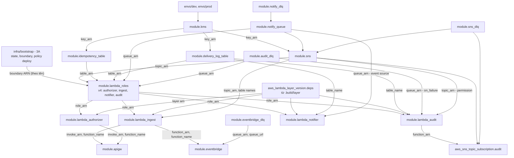

# Phase 3C: IAM, Lambda, API Gateway, EventBridge & Nối dây — Customer Logic Workflow

> **Phạm vi 3C:** 4 module (`iam`, `lambda`, `apigw`, `eventbridge`), nối dây vào `envs/dev` và `envs/prod`, đóng gói Lambda layer, và **rà soát checklist đầy đủ cho cả Phase 3**.
> **Kết quả:** sau 3C, toàn bộ hạ tầng của sơ đồ Phase 1 đã được mô tả bằng Terraform (trừ observability ở Phase 6 và pipeline ở Phase 5). Code ứng dụng thật nằm ở Phase 4.
> **Chi phí:** `dev` ≈ 0 đến 1 USD/tháng (Free Tier). `prod` ≈ 10 đến 20 USD/tháng khi có ~1 triệu sự kiện, chưa gồm WAF và SMS.
> **Tình trạng kiểm chứng:** code chưa được `validate/test/plan/apply`. Mục 8 là các bước kiểm chứng.

---

## 0. Đọc trước: 2 bản vá cho phần đã giao (3A và 3B)

Khi thiết kế 3C, tôi phát hiện **hai chỗ trong code trước cần sửa**. Hãy áp dụng trước khi làm tiếp (hướng dẫn chi tiết ở mục 7).

### Bản vá 3A: policy deploy thiếu quyền (cần chạy lại bootstrap bằng phiên `clw-admin`)

| Thiếu | Hậu quả nếu không vá | Bổ sung |
|---|---|---|
| Quyền **dùng khóa KMS** (`Encrypt`, `Decrypt`, `GenerateDataKey*`, `CreateGrant`) cho deployer | Ở `prod`, tạo bảng DynamoDB hoặc đặt khóa cho SNS topic bằng CMK sẽ bị `AccessDenied` | Hai statement mới trong `deployer_data` (File P1) |
| Quyền **Lambda layer** (`PublishLayerVersion`, `GetLayerVersion`, `DeleteLayerVersion`) | Không tạo được layer và không gắn được layer vào hàm | Statement mới trong `deployer_compute` (File P2) |
| Quyền runtime/recursion config của Lambda | Provider mới có thể gọi các API này khi đọc hàm Lambda | 4 action thêm vào statement hiện có (File P2) |

### Bản vá 3B: module `dynamodb` dùng điều kiện chưa biết lúc plan

`dynamic "server_side_encryption"` đang dựa vào `var.kms_key_arn == null`. Ở `prod`, ARN của CMK **chưa tồn tại lúc plan lần đầu** (unknown), nên điều kiện không xác định được. Sửa bằng một biến bool `use_cmk` (xác định ngay lúc plan) — xem File P3.

> Tôi đã đánh giá các điểm trên bằng cách suy luận từ hành vi của AWS và Terraform, chưa tự chạy thử. Nếu `apply` vẫn báo `AccessDenied`, áp dụng quy trình ở mục 8 của tài liệu 3A (thêm đúng action, đúng resource).

---

## 1. Quyết định thiết kế mới

| ADR | Quyết định | Lý do | Đánh đổi |
|---|---|---|---|
| **ADR-021** | Mỗi Lambda có **role riêng**, gắn **permissions boundary**, policy **inline** theo ARN cụ thể | Least Privilege, deployer không tạo được role mạnh hơn trần cho phép | Nhiều tài nguyên IAM hơn |
| **ADR-022** | Phụ thuộc Python (Powertools, Pydantic) và thư mục `src/common` đóng gói trong **một Lambda layer** do Terraform quản lý, build cho **arm64 Python 3.12** bằng `scripts/build_layer.py` | Không cần đoán số phiên bản của layer công khai; mỗi hàm chỉ chứa code của chính nó nên nhẹ | Cần chạy script build trước `plan` |
| **ADR-023** | `aws_lambda_permission` cho API Gateway nằm **trong module `apigw`**, permission cho SNS nằm trong module `lambda` | Tránh vòng phụ thuộc: ARN authorizer và ARN API chỉ có sau khi API tồn tại | Module `apigw` biết tên hai hàm Lambda |
| **ADR-024** | Secret API key lưu ở **SSM SecureString, tạo ngoài Terraform** bằng CLI | Giá trị secret **không bao giờ vào Terraform state** | Một bước thủ công có tài liệu (mục 7.6) |
| **ADR-025** | **Không** đặt `reserved_concurrent_executions` mặc định (biến, mặc định `null`) | Tài khoản mới thường có hạn mức 10 concurrent, AWS yêu cầu chừa ≥ 10 chưa đặt trước nên không đặt trước được | Chống vòng lặp vô hạn dựa vào `maximum_concurrency` của SQS và alarm ở Phase 6 |
| **ADR-026** | **Authorizer cache** 300 giây ở API Gateway | Giảm số lần gọi Lambda authorizer và SSM | Đổi API key có độ trễ tối đa 5 phút |

> **Về `reserved_concurrent_executions`:** Phase 1 có nói sẽ đặt giới hạn này để chống vòng lặp. Nay tôi chuyển sang **tùy chọn** (ADR-025) và dùng `maximum_concurrency` của SQS làm lớp bảo vệ chính. Hãy kiểm tra hạn mức Lambda concurrency của tài khoản bạn.

---

## 2. Cấu trúc file của Phase 3C

```text
scripts/
└── build_layer.py                       # build layer arm64 (File 1)

infra/
├── modules/
│   ├── iam/         versions.tf variables.tf main.tf outputs.tf  tests/iam.tftest.hcl
│   ├── lambda/      versions.tf variables.tf main.tf outputs.tf  tests/lambda.tftest.hcl
│   ├── apigw/       versions.tf variables.tf main.tf outputs.tf  tests/apigw.tftest.hcl
│   └── eventbridge/ versions.tf variables.tf main.tf outputs.tf  tests/eventbridge.tftest.hcl
└── envs/
    ├── dev/
    │   ├── versions.tf      # cập nhật: thêm provider archive
    │   ├── iam.tf           # mới: role + policy cho 4 Lambda
    │   ├── lambda.tf        # mới: layer + 4 hàm + subscription audit
    │   ├── api.tf           # mới: HTTP API
    │   ├── events.tf        # mới: EventBridge
    │   ├── variables.tf     # thêm 5 biến
    │   ├── outputs.tf       # thêm 4 output
    │   └── terraform.tfvars # thêm giá trị
    └── prod/                # iam.tf, lambda.tf, api.tf, events.tf, versions.tf giống dev
```

Ghi chú: các biến phải nằm trong `variables.tf` và output trong `outputs.tf` (rule `terraform_standard_module_structure` của tflint), nên 3C **thêm vào** hai file đó thay vì tạo file riêng.

---

## 3. Dependency / Call Graph

### 3.1. Đồ thị module đầy đủ của Phase 3



**Thứ tự tạo (Terraform tự suy ra):** (1) KMS, bảng, queue; (2) SNS; (3) role IAM (cần ARN của bước 1 và 2) và layer; (4) 4 hàm Lambda; (5) subscription audit, API Gateway, EventBridge.

### 3.2. Contract Table tổng hợp (Phase 3C)

| Caller → Callee | Inputs / Tham số truyền | Outputs / Giá trị trả về | Vì sao có phụ thuộc này |
|---|---|---|---|
| `iam.tf` → `module.iam` (x4, `for_each`) | `name`, `permissions_boundary_arn`, `policy_json` | `role_arn`, `role_name` | Role riêng cho từng hàm, gắn boundary (ADR-021) |
| `iam.tf` → `module.sns`, `module.*_table`, `module.*_queue`, `module.kms` | Đọc `topic_arn`, `table_arn`, `queue_arn`, `key_arn` | (không) | Policy giới hạn theo **ARN cụ thể**, không dùng `*` |
| `lambda.tf` → `.build/layer` | Thư mục do `build_layer.py` tạo | `aws_lambda_layer_version.deps.arn` | Dependency và `common` đóng gói một lần, dùng cho 4 hàm |
| `lambda.tf` → `module.lambda` (x4) | `function_name`, `handler`, `source_dir`, `role_arn`, `layers`, `environment_variables`, `timeout`, `log_retention_days`... | `function_arn`, `function_name`, `invoke_arn` | Triển khai code, log group, X-Ray, JSON logging |
| `module.lambda[notifier]` → SQS | `sqs_event_source` (`queue_arn`, `batch_size`, `maximum_concurrency`) | Event source mapping, trả `batchItemFailures` | Đọc `notify_queue`, giới hạn đồng thời để chống vòng lặp |
| `module.lambda[audit]` → SQS DLQ | `on_failure_destination_arn` | Event invoke config | Lambda async lỗi sẽ vào `audit_dlq` |
| `module.lambda[audit]` ← SNS | `invoke_permissions.sns` (`principal`, `source_arn` = topic ARN) | `aws_lambda_permission` | Chỉ **đúng topic này** được gọi hàm audit |
| `lambda.tf` → `aws_sns_topic_subscription.audit` | `topic_arn`, `function_arn`, `redrive_policy` (`sns_dlq`) | Subscription | Audit nhận **mọi** sự kiện (không filter) |
| `api.tf` → `module.apigw` | `ingest_*`, `authorizer_*`, `throttling_*`, `log_retention_days` | `api_endpoint`, `api_id` | HTTP API, route `POST /events`, authorizer Lambda, throttling |
| `module.apigw` → `aws_lambda_permission` | `source_arn` = `execution_arn/...` | Quyền gọi cho API Gateway | Chỉ đúng route và đúng authorizer của API này được gọi hàm (ADR-023) |
| `events.tf` → `module.eventbridge` | `target_function_*`, `dlq_arn`, `dlq_url` | `bus_name`, `rule_arn` | Nguồn sự kiện nội bộ, retry rồi vào DLQ |
| `module.eventbridge` → SQS policy | `aws:SourceArn` = ARN rule | EventBridge được ghi vào `eventbridge_dlq` | Chống confused deputy cho DLQ |

### 3.3. Execution Trace (cả chuỗi, dù code chạy thật ở Phase 4)

**Kịch bản 1 — Happy path: `POST /events` với API key hợp lệ**

1. Client gọi `POST https://<api>.execute-api.ap-southeast-1.amazonaws.com/events` kèm `x-api-key`. API Gateway áp throttling (50 req/s, burst 200).
2. API Gateway kiểm tra cache authorizer (TTL 300 giây). Nếu chưa có, gọi Lambda `authorizer` (quyền do `aws_lambda_permission` với `source_arn` đúng authorizer). Authorizer đọc SSM `/clw/dev/api-key`, so khớp và trả `isAuthorized = true`.
3. API Gateway gọi Lambda `ingest` (route `POST /events`). `ingest` dùng role riêng: ghi `idempotency` (conditional put), rồi `sns:Publish` lên topic kèm `MessageAttributes`. Trả `202`.
4. SNS fan-out theo filter policy (3B): vào `notify` queue, và Lambda `audit` luôn nhận bản sao.
5. Event source mapping của `notifier` đọc batch tối đa 10 message (chờ tối đa 5 giây), xử lý, ghi `delivery_log`, trả `batchItemFailures` rỗng. Message được xóa khỏi queue.

**Kịch bản 2 — Error path**

1. **Sai hoặc thiếu API key:** thiếu header thì API Gateway trả `401` (không gọi authorizer); sai key thì authorizer trả `isAuthorized = false` và API Gateway trả `403`. `ingest` không bao giờ chạy.
2. **Quá tải:** vượt 50 req/s ổn định hoặc burst 200 thì API Gateway trả `429`, `ingest` không bị gọi, chi phí được bảo vệ.
3. **`notifier` lỗi một phần batch:** hàm trả `batchItemFailures` chỉ chứa các message lỗi; các message còn lại được xóa. Message lỗi hiện lại sau `visibility_timeout` (180 giây); sau 3 lần nhận thì vào `notify_dlq`.
4. **`audit` lỗi:** SNS gọi Lambda bất đồng bộ, Lambda tự retry 2 lần; vẫn lỗi thì đẩy vào `audit_dlq` (`on_failure`). Nếu SNS không gọi được Lambda, subscription chuyển message vào `sns_dlq`.
5. **Sự kiện nội bộ qua EventBridge:** rule khớp `source = customer.workflow` gọi `ingest`; lỗi thì retry (tối đa 3 lần hoặc 1 giờ), sau đó vào `eventbridge_dlq`.
6. **Quên gắn boundary khi sửa module `iam`:** IAM trả `AccessDenied` vì không thỏa điều kiện `iam:PermissionsBoundary` (có chủ đích).
7. **Chưa build layer:** `terraform plan` báo thư mục `.build/layer` không tồn tại. Chạy `scripts/build_layer.py`.

---

## 4. Code: script build layer

### File 1: `scripts/build_layer.py`

**Overview:** Build Lambda layer cho **Linux arm64, Python 3.12** từ `src/requirements.txt` và copy thư mục `src/common`. Được gọi bởi `make build-layer`. Kết quả nằm ở `.build/layer/python/`, nơi `lambda.tf` sẽ nén thành layer. Chạy được trên Windows nhờ cờ `--platform` của pip.

```python
"""Build Lambda layer (arm64, Python 3.12) từ src/requirements.txt và src/common."""

from __future__ import annotations

import shutil
import subprocess
import sys
from pathlib import Path

ROOT = Path(__file__).resolve().parent.parent
REQUIREMENTS = ROOT / "src" / "requirements.txt"
COMMON_SRC = ROOT / "src" / "common"
LAYER_DIR = ROOT / ".build" / "layer"
PYTHON_DIR = LAYER_DIR / "python"


def install_dependencies() -> int:
    """Cài dependency bản dựng sẵn cho Lambda arm64 vào thư mục python/ của layer."""
    command = [
        sys.executable,
        "-m",
        "pip",
        "install",
        "--requirement",
        str(REQUIREMENTS),
        "--target",
        str(PYTHON_DIR),
        "--platform",
        "manylinux2014_aarch64",
        "--python-version",
        "3.12",
        "--implementation",
        "cp",
        "--only-binary=:all:",
        "--upgrade",
        "--no-compile",
    ]
    return subprocess.run(command, check=False).returncode


def copy_common_code() -> None:
    """Copy src/common vào layer để các hàm import được `common.*`."""
    if COMMON_SRC.exists():
        shutil.copytree(
            COMMON_SRC,
            PYTHON_DIR / "common",
            ignore=shutil.ignore_patterns("__pycache__", "*.pyc"),
        )
    else:
        print("Chưa có src/common, chỉ đóng gói dependency.")


def main() -> int:
    if LAYER_DIR.exists():
        shutil.rmtree(LAYER_DIR)
    PYTHON_DIR.mkdir(parents=True)

    exit_code = install_dependencies()
    if exit_code != 0:
        print("pip install thất bại, kiểm tra kết nối mạng và src/requirements.txt.")
        return exit_code

    copy_common_code()
    print(f"Layer đã sẵn sàng tại {LAYER_DIR}")
    return 0


if __name__ == "__main__":
    sys.exit(main())
```

**Giải thích chi tiết:**
- `--platform manylinux2014_aarch64 --python-version 3.12 --implementation cp --only-binary=:all:`: yêu cầu pip tải **wheel đã dựng sẵn cho Lambda arm64** thay vì build trên máy Windows của bạn. Thiếu bước này, các thư viện biên dịch sẵn (như `pydantic-core`) sẽ không chạy trên Lambda.
- Tên thư mục **bắt buộc là `python/`**: Lambda tự thêm `/opt/python` vào đường dẫn import của Python, nên mọi thứ trong `python/` import được ngay.
- `rmtree` trước khi build: layer luôn "sạch", tránh lẫn thư viện cũ.
- `copy_common_code` copy `src/common` vào layer. Nếu bạn sửa `common`, phải build lại layer và `apply`.
- Script **chưa kiểm chứng** trên máy bạn. Nếu `pip` báo không tìm thấy wheel cho một thư viện, chạy lại với mạng ổn định, hoặc báo tôi tên thư viện.

---

## 5. Code: các module

### File 2: `versions.tf` cho module `iam`, `apigw`, `eventbridge`

**Overview:** Giống `versions.tf` dùng chung ở 3B. Đặt cùng nội dung ở `infra/modules/iam/versions.tf`, `infra/modules/apigw/versions.tf`, `infra/modules/eventbridge/versions.tf`.

```hcl
terraform {
  required_version = ">= 1.10.0"

  required_providers {
    aws = {
      source  = "hashicorp/aws"
      version = "~> 6.0"
    }
  }
}
```

```powershell
foreach ($m in "iam", "apigw", "eventbridge") {
  New-Item -ItemType Directory -Force "infra\modules\$m" | Out-Null
  Copy-Item infra\modules\kms\versions.tf "infra\modules\$m\versions.tf"
}
```

**Giải thích chi tiết:** giữ đồng nhất phiên bản với root và các module 3B.

---

### Module `iam`

#### File 3: `infra/modules/iam/variables.tf`

**Overview:** Đầu vào của module tạo **một role thực thi Lambda**. Gọi 4 lần (qua `for_each`) từ `iam.tf` ở root.

```hcl
variable "name" {
  description = "Tên role, ví dụ clw-dev-ingest-role. Phải bắt đầu bằng tiền tố dự án để khớp policy deploy."
  type        = string
}

variable "permissions_boundary_arn" {
  description = "ARN của permissions boundary (tạo ở bootstrap). Bắt buộc gắn cho mọi role."
  type        = string

  validation {
    condition     = can(regex("^arn:aws:iam::[0-9]{12}:policy/.+$", var.permissions_boundary_arn))
    error_message = "permissions_boundary_arn phải là ARN của một IAM policy hợp lệ."
  }
}

variable "policy_json" {
  description = "Nội dung IAM policy inline (JSON) cấp quyền cụ thể cho hàm Lambda."
  type        = string
}
```

**Giải thích chi tiết:** `permissions_boundary_arn` **bắt buộc** (không `default`) và được kiểm tra dạng ARN: không thể tạo role mà quên boundary, và policy deploy cũng sẽ từ chối nếu thiếu.

#### File 4: `infra/modules/iam/main.tf`

**Overview:** Tạo role với trust policy chỉ cho `lambda.amazonaws.com`, gắn boundary và đính policy inline do root truyền vào.

```hcl
data "aws_caller_identity" "current" {}

data "aws_iam_policy_document" "assume_role" {
  statement {
    sid     = "LambdaAssumeRole"
    actions = ["sts:AssumeRole"]

    principals {
      type        = "Service"
      identifiers = ["lambda.amazonaws.com"]
    }

    condition {
      test     = "StringEquals"
      variable = "aws:SourceAccount"
      values   = [data.aws_caller_identity.current.account_id]
    }
  }
}

resource "aws_iam_role" "this" {
  name                 = var.name
  assume_role_policy   = data.aws_iam_policy_document.assume_role.json
  permissions_boundary = var.permissions_boundary_arn
}

resource "aws_iam_role_policy" "runtime" {
  name   = "${var.name}-runtime"
  role   = aws_iam_role.this.id
  policy = var.policy_json
}
```

**Giải thích chi tiết:**
- **Trust policy** chỉ cho dịch vụ Lambda, kèm điều kiện `aws:SourceAccount` (chống confused deputy). Điều kiện này là phần tôi **chưa chắc 100%** với Lambda; nếu `CreateFunction` báo lỗi liên quan đến việc assume role, hãy báo tôi để bỏ điều kiện.
- `permissions_boundary`: ép role bị chặn bởi trần quyền ở bootstrap (ADR-013). Tên role phải khớp `clw-*` và boundary phải đúng ARN, nếu không policy deploy từ chối `iam:CreateRole`.
- Dùng **inline policy** (không managed policy): không cần quyền `iam:AttachRolePolicy` (cố ý không cấp cho deployer) và policy gắn chặt vòng đời với role.

#### File 5: `infra/modules/iam/outputs.tf`

**Overview:** Xuất ARN và tên role cho module `lambda`.

```hcl
output "role_arn" {
  description = "ARN của role thực thi Lambda."
  value       = aws_iam_role.this.arn
}

output "role_name" {
  description = "Tên của role thực thi Lambda."
  value       = aws_iam_role.this.name
}
```

**Giải thích chi tiết:** `role_arn` đi vào `role` của `aws_lambda_function`. Terraform cần `iam:PassRole` để truyền role cho Lambda, và deployer chỉ có quyền đó với `lambda.amazonaws.com`.

#### File 6: `infra/modules/iam/tests/iam.tftest.hcl`

**Overview:** Test role luôn gắn boundary.

```hcl
mock_provider "aws" {}

variables {
  name                     = "clw-test-fn-role"
  permissions_boundary_arn = "arn:aws:iam::123456789012:policy/clw-workload-boundary"

  policy_json = jsonencode({
    Version = "2012-10-17"
    Statement = [{
      Effect   = "Allow"
      Action   = ["logs:PutLogEvents"]
      Resource = ["arn:aws:logs:ap-southeast-1:123456789012:log-group:/aws/lambda/clw-test-fn:*"]
    }]
  })
}

run "role_has_boundary_and_expected_name" {
  command = plan

  assert {
    condition     = aws_iam_role.this.permissions_boundary == "arn:aws:iam::123456789012:policy/clw-workload-boundary"
    error_message = "Role phải gắn đúng permissions boundary."
  }

  assert {
    condition     = aws_iam_role.this.name == "clw-test-fn-role"
    error_message = "Tên role phải đúng đầu vào."
  }

  assert {
    condition     = aws_iam_role_policy.runtime.name == "clw-test-fn-role-runtime"
    error_message = "Tên inline policy phải có hậu tố -runtime."
  }
}

run "rejects_invalid_boundary_arn" {
  command = plan

  variables {
    permissions_boundary_arn = "khong-phai-arn"
  }

  expect_failures = [var.permissions_boundary_arn]
}
```

**Giải thích chi tiết:** test chứng minh hai điều quan trọng nhất của module: role **luôn** có boundary, và ARN boundary sai bị chặn từ bước `plan`.

---

### Module `lambda`

#### File 7: `infra/modules/lambda/versions.tf`

**Overview:** Khác 3 module trên ở chỗ cần thêm provider `archive` để nén code.

```hcl
terraform {
  required_version = ">= 1.10.0"

  required_providers {
    aws = {
      source  = "hashicorp/aws"
      version = "~> 6.0"
    }

    archive = {
      source  = "hashicorp/archive"
      version = "~> 2.0"
    }
  }
}
```

**Giải thích chi tiết:** `archive_file` nén thư mục `src/<hàm>` thành file `.zip` ngay lúc `plan/apply`, và băm nội dung để Terraform biết khi nào code đổi cần cập nhật hàm.

#### File 8: `infra/modules/lambda/variables.tf`

**Overview:** Đầu vào của module Lambda generic. Gọi 4 lần từ `lambda.tf`.

```hcl
variable "function_name" {
  description = "Tên hàm Lambda, ví dụ clw-dev-ingest."
  type        = string
}

variable "handler" {
  description = "Handler theo dạng <tên file>.<tên hàm>, ví dụ handler.lambda_handler."
  type        = string
}

variable "source_dir" {
  description = "Thư mục chứa code của hàm (chỉ code của hàm, dependency nằm trong layer)."
  type        = string
}

variable "role_arn" {
  description = "ARN role thực thi (từ module iam)."
  type        = string
}

variable "runtime" {
  description = "Runtime của Lambda."
  type        = string
  default     = "python3.12"
}

variable "memory_size" {
  description = "Bộ nhớ của hàm (MB)."
  type        = number
  default     = 256

  validation {
    condition     = var.memory_size >= 128 && var.memory_size <= 10240
    error_message = "memory_size phải nằm trong khoảng 128 đến 10240."
  }
}

variable "timeout" {
  description = "Timeout của hàm (giây)."
  type        = number
  default     = 10

  validation {
    condition     = var.timeout >= 1 && var.timeout <= 900
    error_message = "timeout phải nằm trong khoảng 1 đến 900."
  }
}

variable "layers" {
  description = "Danh sách ARN layer gắn vào hàm."
  type        = list(string)
  default     = []
}

variable "environment_variables" {
  description = "Biến môi trường riêng của hàm (không đưa secret vào đây)."
  type        = map(string)
  default     = {}
}

variable "metrics_namespace" {
  description = "Namespace metric của Powertools."
  type        = string
  default     = "CustomerLogicWorkflow"
}

variable "log_level" {
  description = "Mức log của ứng dụng: DEBUG, INFO, WARN hoặc ERROR."
  type        = string
  default     = "INFO"

  validation {
    condition     = contains(["DEBUG", "INFO", "WARN", "ERROR"], var.log_level)
    error_message = "log_level chỉ nhận DEBUG, INFO, WARN hoặc ERROR."
  }
}

variable "log_retention_days" {
  description = "Số ngày giữ log (7 ở dev, 30 ở prod). Không cho phép giữ vĩnh viễn."
  type        = number
  default     = 7

  validation {
    condition     = contains([1, 3, 5, 7, 14, 30, 60, 90, 120, 150, 180, 365], var.log_retention_days)
    error_message = "log_retention_days phải là một giá trị CloudWatch Logs hợp lệ từ 1 đến 365 ngày."
  }
}

variable "reserved_concurrent_executions" {
  description = "Số concurrent đặt trước cho hàm, null nghĩa là không đặt (xem ADR-025)."
  type        = number
  default     = null
}

variable "invoke_permissions" {
  description = "Map quyền gọi hàm cho dịch vụ khác. Khóa là hậu tố statement_id, giá trị gồm principal và source_arn."
  type = map(object({
    principal  = string
    source_arn = string
  }))
  default = {}
}

variable "sqs_event_source" {
  description = "Cấu hình đọc từ SQS, null nếu hàm không đọc queue."
  type = object({
    queue_arn                          = string
    batch_size                         = optional(number, 10)
    maximum_batching_window_in_seconds = optional(number, 5)
    maximum_concurrency                = optional(number, 5)
  })
  default = null
}

variable "enable_on_failure_destination" {
  description = "Có cấu hình đích on_failure cho lời gọi bất đồng bộ hay không (cần biết lúc plan nên là bool riêng)."
  type        = bool
  default     = false
}

variable "on_failure_destination_arn" {
  description = "ARN của SQS DLQ nhận sự kiện khi Lambda bất đồng bộ lỗi hết số lần retry."
  type        = string
  default     = null
}

variable "maximum_retry_attempts" {
  description = "Số lần retry khi gọi bất đồng bộ lỗi (0 đến 2)."
  type        = number
  default     = 2

  validation {
    condition     = var.maximum_retry_attempts >= 0 && var.maximum_retry_attempts <= 2
    error_message = "maximum_retry_attempts phải nằm trong khoảng 0 đến 2."
  }
}
```

**Giải thích chi tiết:**
- `enable_on_failure_destination` tách riêng khỏi `on_failure_destination_arn` vì ARN queue **chưa biết lúc plan lần đầu**, mà `count` bắt buộc dùng giá trị đã biết. Đây chính là bài học đã dẫn tới bản vá 3B.
- `log_retention_days` chỉ nhận giá trị CloudWatch cho phép và **không có giá trị "vĩnh viễn"**, đáp ứng checklist "never Never Expire".
- `sqs_event_source` dùng `optional()` với giá trị mặc định (`batch_size = 10`, chờ 5 giây, `maximum_concurrency = 5`): chỉ cần truyền `queue_arn`.

#### File 9: `infra/modules/lambda/main.tf`

**Overview:** Tạo log group, đóng gói code, hàm Lambda arm64 với X-Ray và JSON logging, cùng các thành phần tùy chọn: quyền gọi, event source SQS, đích `on_failure`.

```hcl
resource "aws_cloudwatch_log_group" "this" {
  name              = "/aws/lambda/${var.function_name}"
  retention_in_days = var.log_retention_days
}

data "archive_file" "this" {
  type        = "zip"
  source_dir  = var.source_dir
  output_path = "${path.root}/.build/${var.function_name}.zip"
  excludes    = ["__pycache__"]
}

resource "aws_lambda_function" "this" {
  #checkov:skip=CKV_AWS_116:Hàm đồng bộ (API), SQS (có DLQ riêng) hoặc dùng đích on_failure; không dùng DLQ kiểu cũ
  #checkov:skip=CKV_AWS_115:Hạn mức concurrency của tài khoản mới không cho đặt trước, xem ADR-025

  function_name                  = var.function_name
  role                           = var.role_arn
  handler                        = var.handler
  runtime                        = var.runtime
  architectures                  = ["arm64"]
  memory_size                    = var.memory_size
  timeout                        = var.timeout
  filename                       = data.archive_file.this.output_path
  source_code_hash               = data.archive_file.this.output_base64sha256
  layers                         = var.layers
  reserved_concurrent_executions = var.reserved_concurrent_executions

  environment {
    variables = merge(
      {
        POWERTOOLS_SERVICE_NAME      = var.function_name
        POWERTOOLS_METRICS_NAMESPACE = var.metrics_namespace
        LOG_LEVEL                    = var.log_level
      },
      var.environment_variables,
    )
  }

  tracing_config {
    mode = "Active"
  }

  logging_config {
    log_format            = "JSON"
    log_group             = aws_cloudwatch_log_group.this.name
    application_log_level = var.log_level
    system_log_level      = "INFO"
  }

  depends_on = [aws_cloudwatch_log_group.this]
}

resource "aws_lambda_permission" "invoke" {
  for_each = var.invoke_permissions

  statement_id  = "AllowInvokeFrom-${each.key}"
  action        = "lambda:InvokeFunction"
  function_name = aws_lambda_function.this.function_name
  principal     = each.value.principal
  source_arn    = each.value.source_arn
}

resource "aws_lambda_event_source_mapping" "sqs" {
  count = var.sqs_event_source == null ? 0 : 1

  event_source_arn                   = var.sqs_event_source.queue_arn
  function_name                      = aws_lambda_function.this.arn
  batch_size                         = var.sqs_event_source.batch_size
  maximum_batching_window_in_seconds = var.sqs_event_source.maximum_batching_window_in_seconds
  function_response_types            = ["ReportBatchItemFailures"]

  scaling_config {
    maximum_concurrency = var.sqs_event_source.maximum_concurrency
  }
}

resource "aws_lambda_function_event_invoke_config" "this" {
  count = var.enable_on_failure_destination ? 1 : 0

  function_name          = aws_lambda_function.this.function_name
  maximum_retry_attempts = var.maximum_retry_attempts

  destination_config {
    on_failure {
      destination = var.on_failure_destination_arn
    }
  }
}
```

**Giải thích chi tiết:**
- **Log group do Terraform tạo trước** và `depends_on` hàm: nếu để Lambda tự tạo log group, nó sẽ có retention "không bao giờ hết hạn" và nằm ngoài quản lý IaC.
- `architectures = ["arm64"]` (rẻ hơn khoảng 20%), khớp layer build cho `manylinux2014_aarch64`.
- `tracing_config.mode = "Active"`: Lambda gửi trace sang X-Ray.
- `logging_config` với `log_format = "JSON"`: Lambda tự ghi log dạng JSON có cấu trúc (kết hợp Powertools Logger ở Phase 4 cho `correlation_id`, `request_id`).
- `source_code_hash`: đổi code thì hash đổi và Terraform cập nhật hàm. Không có dòng này, sửa code không kích hoạt deploy.
- `merge({...mặc định}, var.environment_variables)`: biến môi trường của hàm có thể **ghi đè** mặc định nhưng không bao giờ chứa secret (secret lấy từ SSM lúc chạy).
- `aws_lambda_permission` đặt `source_arn`: chỉ nguồn cụ thể (đúng topic SNS) được gọi hàm, chống confused deputy.
- **Event source mapping:** `ReportBatchItemFailures` cho phép trả về **chỉ các message lỗi** trong batch (không phải làm lại cả batch); `maximum_concurrency` giới hạn số hàm chạy song song, chặn việc queue đầy kéo theo chi phí và tải bất thường.
- **`event_invoke_config`**: lời gọi bất đồng bộ (từ SNS) lỗi sau số lần retry sẽ được đẩy vào DLQ qua `on_failure`. Role phải có `sqs:SendMessage` tới DLQ đó (`iam.tf` đã cấp cho `audit`).
- Hai dòng `#checkov:skip` có lý do. `CKV_AWS_117` (VPC) và `CKV_AWS_272` (code signing) đã được bỏ ở cấp toàn cục trong `.checkov.yaml` từ Phase 2.

#### File 10: `infra/modules/lambda/outputs.tf`

**Overview:** Xuất thông tin hàm cho API Gateway, EventBridge, SNS.

```hcl
output "function_name" {
  description = "Tên hàm Lambda."
  value       = aws_lambda_function.this.function_name
}

output "function_arn" {
  description = "ARN hàm Lambda, dùng làm đích của EventBridge và subscription SNS."
  value       = aws_lambda_function.this.arn
}

output "invoke_arn" {
  description = "Invoke ARN của hàm, dùng làm đích tích hợp của API Gateway."
  value       = aws_lambda_function.this.invoke_arn
}

output "log_group_name" {
  description = "Tên log group của hàm."
  value       = aws_cloudwatch_log_group.this.name
}
```

**Giải thích chi tiết:** `invoke_arn` (khác `function_arn`) là định dạng API Gateway yêu cầu cho tích hợp Lambda proxy.

#### File 11: `infra/modules/lambda/tests/lambda.tftest.hcl`

**Overview:** Test module Lambda bằng hai provider giả (`aws` và `archive`) nên không cần thư mục code thật.

```hcl
mock_provider "aws" {}
mock_provider "archive" {}

variables {
  function_name = "clw-test-fn"
  handler       = "handler.lambda_handler"
  source_dir    = "./src-does-not-matter"
  role_arn      = "arn:aws:iam::123456789012:role/clw-test-fn-role"
}

run "secure_defaults" {
  command = plan

  assert {
    condition     = contains(aws_lambda_function.this.architectures, "arm64")
    error_message = "Hàm phải chạy trên arm64."
  }

  assert {
    condition     = aws_lambda_function.this.tracing_config[0].mode == "Active"
    error_message = "Hàm phải bật X-Ray tracing."
  }

  assert {
    condition     = aws_cloudwatch_log_group.this.retention_in_days == 7
    error_message = "Log group phải có retention rõ ràng (mặc định 7 ngày)."
  }

  assert {
    condition     = length(aws_lambda_event_source_mapping.sqs) == 0 && length(aws_lambda_function_event_invoke_config.this) == 0
    error_message = "Mặc định không được tạo event source mapping hay event invoke config."
  }
}

run "sqs_trigger_reports_batch_item_failures" {
  command = plan

  variables {
    sqs_event_source = {
      queue_arn = "arn:aws:sqs:ap-southeast-1:123456789012:clw-test-notify"
    }
  }

  assert {
    condition     = length(aws_lambda_event_source_mapping.sqs) == 1
    error_message = "Phải tạo đúng một event source mapping."
  }

  assert {
    condition     = contains(tolist(aws_lambda_event_source_mapping.sqs[0].function_response_types), "ReportBatchItemFailures")
    error_message = "Phải bật ReportBatchItemFailures."
  }

  assert {
    condition     = aws_lambda_event_source_mapping.sqs[0].scaling_config[0].maximum_concurrency == 5
    error_message = "Mặc định phải giới hạn concurrency là 5."
  }
}

run "async_failure_destination_is_created_when_enabled" {
  command = plan

  variables {
    enable_on_failure_destination = true
    on_failure_destination_arn    = "arn:aws:sqs:ap-southeast-1:123456789012:clw-test-audit-dlq"
  }

  assert {
    condition     = length(aws_lambda_function_event_invoke_config.this) == 1
    error_message = "Phải tạo event invoke config khi bật on_failure."
  }
}

run "rejects_invalid_log_retention" {
  command = plan

  variables {
    log_retention_days = 10
  }

  expect_failures = [var.log_retention_days]
}
```

**Giải thích chi tiết:** `source_dir` là chuỗi bất kỳ vì `mock_provider "archive"` không đọc thư mục. Bốn bài kiểm tra: mặc định an toàn, SQS trigger đúng, đích lỗi bất đồng bộ, và chặn retention không hợp lệ.

---

### Module `apigw`

#### File 12: `infra/modules/apigw/variables.tf`

**Overview:** Đầu vào của module HTTP API.

```hcl
variable "name" {
  description = "Tên HTTP API, ví dụ clw-dev-api."
  type        = string
}

variable "ingest_function_name" {
  description = "Tên hàm Lambda ingest (đích của route)."
  type        = string
}

variable "ingest_invoke_arn" {
  description = "Invoke ARN của hàm ingest."
  type        = string
}

variable "authorizer_function_name" {
  description = "Tên hàm Lambda authorizer."
  type        = string
}

variable "authorizer_invoke_arn" {
  description = "Invoke ARN của hàm authorizer."
  type        = string
}

variable "route_key" {
  description = "Route của API, dạng 'METHOD /path'."
  type        = string
  default     = "POST /events"
}

variable "identity_source" {
  description = "Nơi API Gateway lấy API key để đưa cho authorizer."
  type        = string
  default     = "$request.header.x-api-key"
}

variable "authorizer_ttl_seconds" {
  description = "Thời gian cache kết quả authorizer (0 đến 3600 giây)."
  type        = number
  default     = 300

  validation {
    condition     = var.authorizer_ttl_seconds >= 0 && var.authorizer_ttl_seconds <= 3600
    error_message = "authorizer_ttl_seconds phải nằm trong khoảng 0 đến 3600."
  }
}

variable "throttling_rate_limit" {
  description = "Số request mỗi giây ổn định cho phép."
  type        = number
  default     = 50

  validation {
    condition     = var.throttling_rate_limit >= 1
    error_message = "throttling_rate_limit phải lớn hơn hoặc bằng 1."
  }
}

variable "throttling_burst_limit" {
  description = "Số request tối đa trong một đợt bùng nổ."
  type        = number
  default     = 200

  validation {
    condition     = var.throttling_burst_limit >= 1
    error_message = "throttling_burst_limit phải lớn hơn hoặc bằng 1."
  }
}

variable "log_retention_days" {
  description = "Số ngày giữ access log của API."
  type        = number
  default     = 7

  validation {
    condition     = contains([1, 3, 5, 7, 14, 30, 60, 90, 120, 150, 180, 365], var.log_retention_days)
    error_message = "log_retention_days phải là một giá trị CloudWatch Logs hợp lệ từ 1 đến 365 ngày."
  }
}
```

**Giải thích chi tiết:** `identity_source = $request.header.x-api-key`: nếu header này **thiếu**, API Gateway trả `401` mà không gọi authorizer (tiết kiệm chi phí); nếu có, giá trị được đưa cho authorizer và cũng làm khóa cache.

#### File 13: `infra/modules/apigw/main.tf`

**Overview:** Tạo HTTP API, tích hợp Lambda proxy tới `ingest`, authorizer Lambda, route, stage mặc định kèm throttling và access log, cùng các `aws_lambda_permission` cho API Gateway (ADR-023).

```hcl
resource "aws_apigatewayv2_api" "this" {
  name          = var.name
  protocol_type = "HTTP"
}

resource "aws_apigatewayv2_integration" "ingest" {
  api_id                 = aws_apigatewayv2_api.this.id
  integration_type       = "AWS_PROXY"
  integration_uri        = var.ingest_invoke_arn
  integration_method     = "POST"
  payload_format_version = "2.0"
  timeout_milliseconds   = 10000
}

resource "aws_apigatewayv2_authorizer" "lambda" {
  api_id                            = aws_apigatewayv2_api.this.id
  name                              = "${var.name}-authorizer"
  authorizer_type                   = "REQUEST"
  authorizer_uri                    = var.authorizer_invoke_arn
  authorizer_payload_format_version = "2.0"
  enable_simple_responses           = true
  identity_sources                  = [var.identity_source]
  authorizer_result_ttl_in_seconds  = var.authorizer_ttl_seconds
}

resource "aws_apigatewayv2_route" "ingest" {
  api_id             = aws_apigatewayv2_api.this.id
  route_key          = var.route_key
  target             = "integrations/${aws_apigatewayv2_integration.ingest.id}"
  authorization_type = "CUSTOM"
  authorizer_id      = aws_apigatewayv2_authorizer.lambda.id
}

resource "aws_cloudwatch_log_group" "access" {
  name              = "/aws/apigateway/${var.name}"
  retention_in_days = var.log_retention_days
}

resource "aws_apigatewayv2_stage" "default" {
  api_id      = aws_apigatewayv2_api.this.id
  name        = "$default"
  auto_deploy = true

  default_route_settings {
    throttling_burst_limit = var.throttling_burst_limit
    throttling_rate_limit  = var.throttling_rate_limit
  }

  access_log_settings {
    destination_arn = aws_cloudwatch_log_group.access.arn

    format = jsonencode({
      requestId        = "$context.requestId"
      requestTime      = "$context.requestTime"
      httpMethod       = "$context.httpMethod"
      routeKey         = "$context.routeKey"
      status           = "$context.status"
      protocol         = "$context.protocol"
      responseLength   = "$context.responseLength"
      responseLatency  = "$context.responseLatency"
      sourceIp         = "$context.identity.sourceIp"
      authorizerError  = "$context.authorizer.error"
      integrationError = "$context.integrationErrorMessage"
    })
  }
}

# ---------------------------------------------------------------------------
# Quyền cho API Gateway gọi Lambda: giới hạn đúng route và đúng authorizer của API này
# ---------------------------------------------------------------------------
resource "aws_lambda_permission" "ingest" {
  statement_id  = "AllowApiGatewayInvokeIngest"
  action        = "lambda:InvokeFunction"
  function_name = var.ingest_function_name
  principal     = "apigateway.amazonaws.com"
  source_arn    = "${aws_apigatewayv2_api.this.execution_arn}/*/${replace(var.route_key, " ", "")}"
}

resource "aws_lambda_permission" "authorizer" {
  statement_id  = "AllowApiGatewayInvokeAuthorizer"
  action        = "lambda:InvokeFunction"
  function_name = var.authorizer_function_name
  principal     = "apigateway.amazonaws.com"
  source_arn    = "${aws_apigatewayv2_api.this.execution_arn}/authorizers/${aws_apigatewayv2_authorizer.lambda.id}"
}
```

**Giải thích chi tiết:**
- `authorization_type = "CUSTOM"` trên route: **mọi request đều phải qua authorizer**; không có route nào mở.
- `enable_simple_responses = true` + payload 2.0: authorizer chỉ cần trả `{"isAuthorized": true|false}` (Phase 4), đơn giản hơn IAM policy response.
- **Throttling** ở stage (`rate=50`, `burst=200`) là lớp bảo vệ thay cho WAF ở `dev` (ADR-005). Vượt ngưỡng nhận `429` ngay tại cổng, không gọi Lambda, không phát sinh chi phí.
- **Access log JSON** ghi trạng thái, độ trễ, lỗi authorizer/integration, không ghi body hay header (tránh lộ API key). `sourceIp` có thể coi là dữ liệu cá nhân; nếu cần tuân thủ chặt hơn, bỏ trường này.
- **Permission nằm trong module** (ADR-023): `source_arn` của ingest là `.../*/POST/events` (đúng route, mọi stage); của authorizer là `.../authorizers/<id>` (đúng authorizer). Nếu đặt ở module `lambda`, ARN này chưa tồn tại lúc tạo hàm, sinh vòng phụ thuộc.
- `replace(var.route_key, " ", "")`: `POST /events` thành `POST/events` để ghép ARN thực thi đúng định dạng.
- `name = "$default"`: stage mặc định, URL gọi không có tiền tố stage, dạng `https://<id>.execute-api.<region>.amazonaws.com/events`. `auto_deploy = true`: đổi route tự triển khai.

#### File 14: `infra/modules/apigw/outputs.tf`

**Overview:** Xuất URL gọi API để smoke test và Phase 5.

```hcl
output "api_endpoint" {
  description = "URL gốc của HTTP API (không kèm đường dẫn route)."
  value       = aws_apigatewayv2_api.this.api_endpoint
}

output "api_id" {
  description = "ID của HTTP API."
  value       = aws_apigatewayv2_api.this.id
}

output "execution_arn" {
  description = "Execution ARN của API, dùng để lập các ARN quyền liên quan."
  value       = aws_apigatewayv2_api.this.execution_arn
}
```

**Giải thích chi tiết:** `api_endpoint` ghép với `/events` để tạo URL đầy đủ ở smoke test (mục 8.4).

#### File 15: `infra/modules/apigw/tests/apigw.tftest.hcl`

**Overview:** Test route luôn có authorizer và throttling đúng.

```hcl
mock_provider "aws" {}

variables {
  name                     = "clw-test-api"
  ingest_function_name     = "clw-test-ingest"
  ingest_invoke_arn        = "arn:aws:apigateway:ap-southeast-1:lambda:path/2015-03-31/functions/arn:aws:lambda:ap-southeast-1:123456789012:function:clw-test-ingest/invocations"
  authorizer_function_name = "clw-test-authorizer"
  authorizer_invoke_arn    = "arn:aws:apigateway:ap-southeast-1:lambda:path/2015-03-31/functions/arn:aws:lambda:ap-southeast-1:123456789012:function:clw-test-authorizer/invocations"
}

run "route_requires_custom_authorizer_and_is_throttled" {
  command = plan

  assert {
    condition     = aws_apigatewayv2_route.ingest.authorization_type == "CUSTOM"
    error_message = "Route phải dùng authorizer tùy chỉnh."
  }

  assert {
    condition     = aws_apigatewayv2_route.ingest.route_key == "POST /events"
    error_message = "Route mặc định phải là POST /events."
  }

  assert {
    condition     = aws_apigatewayv2_stage.default.default_route_settings[0].throttling_rate_limit == 50
    error_message = "Rate limit mặc định phải là 50."
  }

  assert {
    condition     = aws_apigatewayv2_stage.default.default_route_settings[0].throttling_burst_limit == 200
    error_message = "Burst limit mặc định phải là 200."
  }

  assert {
    condition     = aws_apigatewayv2_authorizer.lambda.authorizer_result_ttl_in_seconds == 300
    error_message = "Authorizer phải cache 300 giây."
  }
}

run "rejects_zero_rate_limit" {
  command = plan

  variables {
    throttling_rate_limit = 0
  }

  expect_failures = [var.throttling_rate_limit]
}
```

**Giải thích chi tiết:** bài 1 khóa các cam kết bảo mật của API (luôn có authorizer, có throttling, cache hợp lý); bài 2 là trường hợp lỗi.

---

### Module `eventbridge`

#### File 16: `infra/modules/eventbridge/variables.tf`

**Overview:** Đầu vào của module EventBridge (bus, rule, target, DLQ).

```hcl
variable "name" {
  description = "Tên event bus, ví dụ clw-dev-bus."
  type        = string
}

variable "event_source" {
  description = "Giá trị trường source mà rule khớp."
  type        = string
  default     = "customer.workflow"
}

variable "target_function_arn" {
  description = "ARN hàm Lambda ingest, đích của rule."
  type        = string
}

variable "target_function_name" {
  description = "Tên hàm Lambda ingest, dùng để cấp quyền gọi."
  type        = string
}

variable "dlq_arn" {
  description = "ARN SQS DLQ nhận sự kiện khi gọi đích thất bại."
  type        = string
}

variable "dlq_url" {
  description = "URL của SQS DLQ, dùng để gắn queue policy."
  type        = string
}
```

**Giải thích chi tiết:** `event_source` mặc định `customer.workflow` khớp với thiết kế Phase 1 (nguồn sự kiện nội bộ).

#### File 17: `infra/modules/eventbridge/main.tf`

**Overview:** Tạo event bus riêng, rule khớp `source`, target là Lambda `ingest` kèm retry và DLQ, quyền gọi, và queue policy cho DLQ.

```hcl
resource "aws_cloudwatch_event_bus" "this" {
  name = var.name
}

resource "aws_cloudwatch_event_rule" "customer_events" {
  name           = "${var.name}-customer-events"
  event_bus_name = aws_cloudwatch_event_bus.this.name

  event_pattern = jsonencode({
    source = [var.event_source]
  })
}

resource "aws_cloudwatch_event_target" "ingest" {
  rule           = aws_cloudwatch_event_rule.customer_events.name
  event_bus_name = aws_cloudwatch_event_bus.this.name
  target_id      = "ingest"
  arn            = var.target_function_arn

  retry_policy {
    maximum_retry_attempts       = 3
    maximum_event_age_in_seconds = 3600
  }

  dead_letter_config {
    arn = var.dlq_arn
  }
}

resource "aws_lambda_permission" "events" {
  statement_id  = "AllowEventBridgeInvoke"
  action        = "lambda:InvokeFunction"
  function_name = var.target_function_name
  principal     = "events.amazonaws.com"
  source_arn    = aws_cloudwatch_event_rule.customer_events.arn
}

data "aws_iam_policy_document" "dlq" {
  statement {
    sid       = "AllowEventBridgeRuleToSend"
    actions   = ["sqs:SendMessage"]
    resources = [var.dlq_arn]

    principals {
      type        = "Service"
      identifiers = ["events.amazonaws.com"]
    }

    condition {
      test     = "ArnEquals"
      variable = "aws:SourceArn"
      values   = [aws_cloudwatch_event_rule.customer_events.arn]
    }
  }

  statement {
    sid       = "DenyInsecureTransport"
    effect    = "Deny"
    actions   = ["sqs:*"]
    resources = [var.dlq_arn]

    principals {
      type        = "*"
      identifiers = ["*"]
    }

    condition {
      test     = "Bool"
      variable = "aws:SecureTransport"
      values   = ["false"]
    }
  }
}

resource "aws_sqs_queue_policy" "dlq" {
  queue_url = var.dlq_url
  policy    = data.aws_iam_policy_document.dlq.json
}
```

**Giải thích chi tiết:**
- **Bus riêng** thay vì bus mặc định: tách sự kiện nghiệp vụ khỏi sự kiện hệ thống AWS, dễ cấp quyền `events:PutEvents` theo bus.
- `retry_policy`: thử lại tối đa 3 lần trong 1 giờ; sau đó đẩy vào DLQ qua `dead_letter_config`. Đây là "Failure Handling" cho EventBridge rule trong checklist.
- **Permission** của Lambda dùng `source_arn` = ARN rule: chỉ **đúng rule này** gọi được `ingest`.
- **Queue policy** cho DLQ: `Allow` cho EventBridge kèm `aws:SourceArn` = ARN rule (chống confused deputy), và `Deny` truy cập không HTTPS. Không có policy này, EventBridge không ghi được vào DLQ và sự kiện lỗi bị **mất lặng lẽ**.

#### File 18: `infra/modules/eventbridge/outputs.tf`

**Overview:** Xuất tên bus và ARN rule.

```hcl
output "bus_name" {
  description = "Tên event bus, dùng cho events:PutEvents."
  value       = aws_cloudwatch_event_bus.this.name
}

output "bus_arn" {
  description = "ARN của event bus."
  value       = aws_cloudwatch_event_bus.this.arn
}

output "rule_arn" {
  description = "ARN của rule khớp sự kiện khách hàng."
  value       = aws_cloudwatch_event_rule.customer_events.arn
}
```

**Giải thích chi tiết:** `bus_name` là thứ producer nội bộ cần khi gọi `PutEvents`.

#### File 19: `infra/modules/eventbridge/tests/eventbridge.tftest.hcl`

**Overview:** Test rule, retry và DLQ.

```hcl
mock_provider "aws" {}

variables {
  name                 = "clw-test-bus"
  target_function_arn  = "arn:aws:lambda:ap-southeast-1:123456789012:function:clw-test-ingest"
  target_function_name = "clw-test-ingest"
  dlq_arn              = "arn:aws:sqs:ap-southeast-1:123456789012:clw-test-eventbridge-dlq"
  dlq_url              = "https://sqs.ap-southeast-1.amazonaws.com/123456789012/clw-test-eventbridge-dlq"
}

run "rule_matches_source_and_target_has_retry_and_dlq" {
  command = plan

  assert {
    condition     = jsondecode(aws_cloudwatch_event_rule.customer_events.event_pattern).source[0] == "customer.workflow"
    error_message = "Rule phải khớp source customer.workflow."
  }

  assert {
    condition     = aws_cloudwatch_event_target.ingest.retry_policy[0].maximum_retry_attempts == 3
    error_message = "Target phải retry tối đa 3 lần."
  }

  assert {
    condition     = aws_cloudwatch_event_target.ingest.dead_letter_config[0].arn == var.dlq_arn
    error_message = "Target phải có DLQ trỏ đúng queue."
  }

  assert {
    condition     = aws_lambda_permission.events.principal == "events.amazonaws.com"
    error_message = "Chỉ EventBridge được gọi hàm."
  }
}

run "custom_event_source_is_applied" {
  command = plan

  variables {
    event_source = "partner.orders"
  }

  assert {
    condition     = jsondecode(aws_cloudwatch_event_rule.customer_events.event_pattern).source[0] == "partner.orders"
    error_message = "Rule phải dùng event_source tùy chỉnh."
  }
}
```

**Giải thích chi tiết:** bài 1 khóa các cam kết độ tin cậy (retry, DLQ) và giới hạn quyền gọi; bài 2 kiểm tra tham số hóa nguồn sự kiện.

---

## 6. Code: nối dây ở root (`envs/dev`, `envs/prod`)

### File 20: `infra/envs/dev/versions.tf` (thay thế)

**Overview:** Thêm provider `archive` cho root (module `lambda` cần).

```hcl
terraform {
  required_version = ">= 1.10.0"

  required_providers {
    aws = {
      source  = "hashicorp/aws"
      version = "~> 6.0"
    }

    archive = {
      source  = "hashicorp/archive"
      version = "~> 2.0"
    }
  }
}
```

**Giải thích chi tiết:** sau khi đổi, chạy lại `terraform init` (và `providers lock`, xem mục 8) để cập nhật `.terraform.lock.hcl`.

### File 21: `infra/envs/dev/iam.tf`

**Overview:** Dựng **policy Least Privilege cho từng Lambda** từ ARN thật của 3B, rồi tạo 4 role qua `module.iam`. Gọi output của `module.sns`, bảng, queue, `module.kms`; kết quả `module.lambda_roles[...]` được `lambda.tf` dùng.

```hcl
data "aws_caller_identity" "current" {}

locals {
  account_id          = data.aws_caller_identity.current.account_id
  region_account      = "${var.aws_region}:${local.account_id}"
  boundary_policy_arn = "arn:aws:iam::${local.account_id}:policy/${var.name_prefix}-workload-boundary"
  api_key_parameter   = "/${var.name_prefix}/${var.environment}/api-key"

  function_names = {
    for fn in ["authorizer", "ingest", "notifier", "audit"] : fn => "${local.name_prefix}-${fn}"
  }
}

# ---------------------------------------------------------------------------
# Quyền chung: ghi log của chính hàm và gửi trace X-Ray
# ---------------------------------------------------------------------------
data "aws_iam_policy_document" "lambda_common" {
  for_each = local.function_names

  statement {
    sid       = "WriteOwnLogs"
    actions   = ["logs:CreateLogStream", "logs:PutLogEvents"]
    resources = ["arn:aws:logs:${local.region_account}:log-group:/aws/lambda/${each.value}:*"]
  }

  # X-Ray không hỗ trợ giới hạn theo resource
  statement {
    sid       = "XRayTracing"
    actions   = ["xray:PutTraceSegments", "xray:PutTelemetryRecords"]
    resources = ["*"]
  }
}

# Chỉ có nội dung khi dùng CMK (prod): hàm cần quyền dùng khóa để đọc/ghi bảng và publish topic đã mã hóa
data "aws_iam_policy_document" "cmk_use" {
  count = var.use_cmk ? 1 : 0

  statement {
    sid       = "UseProjectCmk"
    actions   = ["kms:Decrypt", "kms:Encrypt", "kms:GenerateDataKey"]
    resources = [module.kms.key_arn]
  }
}

locals {
  cmk_policy_documents = var.use_cmk ? [data.aws_iam_policy_document.cmk_use[0].json] : []
}

# ---------------------------------------------------------------------------
# authorizer: chỉ đọc đúng một tham số SSM chứa API key
# ---------------------------------------------------------------------------
data "aws_iam_policy_document" "authorizer" {
  source_policy_documents = [data.aws_iam_policy_document.lambda_common["authorizer"].json]

  statement {
    sid       = "ReadApiKeyParameter"
    actions   = ["ssm:GetParameter"]
    resources = ["arn:aws:ssm:${local.region_account}:parameter${local.api_key_parameter}"]
  }
}

# ---------------------------------------------------------------------------
# ingest: ghi bảng idempotency và publish lên đúng một topic
# ---------------------------------------------------------------------------
data "aws_iam_policy_document" "ingest" {
  source_policy_documents = concat(
    [data.aws_iam_policy_document.lambda_common["ingest"].json],
    local.cmk_policy_documents,
  )

  statement {
    sid       = "UseIdempotencyTable"
    actions   = ["dynamodb:GetItem", "dynamodb:PutItem", "dynamodb:UpdateItem", "dynamodb:DeleteItem"]
    resources = [module.idempotency_table.table_arn]
  }

  statement {
    sid       = "PublishCustomerEvents"
    actions   = ["sns:Publish"]
    resources = [module.sns.topic_arn]
  }
}

# ---------------------------------------------------------------------------
# notifier: đọc đúng một queue và ghi bảng delivery log
# ---------------------------------------------------------------------------
data "aws_iam_policy_document" "notifier" {
  source_policy_documents = concat(
    [data.aws_iam_policy_document.lambda_common["notifier"].json],
    local.cmk_policy_documents,
  )

  statement {
    sid = "ConsumeNotifyQueue"

    actions = [
      "sqs:ReceiveMessage",
      "sqs:DeleteMessage",
      "sqs:GetQueueAttributes",
      "sqs:ChangeMessageVisibility",
    ]

    resources = [module.notify_queue.queue_arn]
  }

  statement {
    sid       = "WriteDeliveryLog"
    actions   = ["dynamodb:PutItem"]
    resources = [module.delivery_log_table.table_arn]
  }
}

# ---------------------------------------------------------------------------
# audit: ghi delivery log và gửi sự kiện lỗi vào DLQ (on_failure)
# ---------------------------------------------------------------------------
data "aws_iam_policy_document" "audit" {
  source_policy_documents = concat(
    [data.aws_iam_policy_document.lambda_common["audit"].json],
    local.cmk_policy_documents,
  )

  statement {
    sid       = "WriteDeliveryLog"
    actions   = ["dynamodb:PutItem"]
    resources = [module.delivery_log_table.table_arn]
  }

  statement {
    sid       = "SendFailedEventsToDlq"
    actions   = ["sqs:SendMessage"]
    resources = [module.audit_dlq.queue_arn]
  }
}

locals {
  lambda_policies = {
    authorizer = data.aws_iam_policy_document.authorizer.json
    ingest     = data.aws_iam_policy_document.ingest.json
    notifier   = data.aws_iam_policy_document.notifier.json
    audit      = data.aws_iam_policy_document.audit.json
  }
}

module "lambda_roles" {
  source   = "../../modules/iam"
  for_each = local.lambda_policies

  name                     = "${local.function_names[each.key]}-role"
  permissions_boundary_arn = local.boundary_policy_arn
  policy_json              = each.value
}
```

**Giải thích chi tiết:**
- **Mỗi hàm chỉ có đúng quyền nó cần**, trên đúng ARN: `ingest` chỉ ghi bảng `idempotency` và publish đúng topic; `notifier` chỉ đọc đúng queue và ghi `delivery_log`; `authorizer` chỉ đọc đúng một tham số SSM; `audit` chỉ ghi `delivery_log` và gửi vào `audit_dlq`. Không có `*` ở resource, ngoại trừ X-Ray.
- Tất cả action đều nằm **trong trần của boundary** (File 6 ở 3A). Nếu bạn thêm action ngoài boundary, nó sẽ **không có hiệu lực** dù policy cho phép (và đó chính là mục đích của boundary).
- `source_policy_documents` hợp nhất policy chung (log, X-Ray) với policy riêng. `sid` các statement không trùng nhau trong từng hàm.
- **Policy CMK chỉ tạo khi `use_cmk = true`**: ở `dev` không có khóa nên không cần. Dùng `count` theo biến bool nên giá trị biết ngay lúc plan.
- `boundary_policy_arn` **được ghép từ chuỗi** (account ID + tên) thay vì tra bằng data source `aws_iam_policy`: deployer không có quyền `iam:GetPolicy`, mà chuỗi ARN này khớp đúng điều kiện `iam:PermissionsBoundary` của policy deploy.
- `for_each = local.lambda_policies`: khóa của map là cố định (4 tên hàm) nên biết lúc plan, còn giá trị (JSON policy) có thể chưa biết cho tới khi apply (vì chứa ARN của tài nguyên chưa tạo). Điều này được Terraform cho phép.
- `api_key_parameter` có dạng `/clw/dev/api-key`: nằm trong phạm vi `parameter/clw/*` của policy deploy và boundary.

### File 22: `infra/envs/dev/lambda.tf`

**Overview:** Tạo Lambda layer, 4 hàm Lambda và subscription audit. Gọi `module.lambda_roles`, `module.sns`, `module.*_table`, `module.*_queue`. `module.lambda_ingest` và `module.lambda_authorizer` được `api.tf` và `events.tf` sử dụng.

```hcl
locals {
  src_dir = "${path.root}/../../../src"
}

# ---------------------------------------------------------------------------
# Layer chứa dependency (Powertools, Pydantic) và src/common, build bằng scripts/build_layer.py
# ---------------------------------------------------------------------------
data "archive_file" "deps_layer" {
  type        = "zip"
  source_dir  = "${path.root}/../../../.build/layer"
  output_path = "${path.root}/.build/deps-layer.zip"
}

resource "aws_lambda_layer_version" "deps" {
  layer_name               = "${local.name_prefix}-deps"
  filename                 = data.archive_file.deps_layer.output_path
  source_code_hash         = data.archive_file.deps_layer.output_base64sha256
  compatible_runtimes      = ["python3.12"]
  compatible_architectures = ["arm64"]
}

# ---------------------------------------------------------------------------
# authorizer: kiểm tra API key lấy từ SSM
# ---------------------------------------------------------------------------
module "lambda_authorizer" {
  source = "../../modules/lambda"

  function_name      = local.function_names.authorizer
  handler            = "handler.lambda_handler"
  source_dir         = "${local.src_dir}/authorizer"
  role_arn           = module.lambda_roles["authorizer"].role_arn
  timeout            = 5
  layers             = [aws_lambda_layer_version.deps.arn]
  log_level          = var.log_level
  log_retention_days = var.log_retention_days

  environment_variables = {
    ENVIRONMENT            = var.environment
    API_KEY_PARAMETER_NAME = local.api_key_parameter
  }
}

# ---------------------------------------------------------------------------
# ingest: validate, chống trùng, publish lên SNS
# ---------------------------------------------------------------------------
module "lambda_ingest" {
  source = "../../modules/lambda"

  function_name      = local.function_names.ingest
  handler            = "handler.lambda_handler"
  source_dir         = "${local.src_dir}/ingest"
  role_arn           = module.lambda_roles["ingest"].role_arn
  timeout            = 10
  layers             = [aws_lambda_layer_version.deps.arn]
  log_level          = var.log_level
  log_retention_days = var.log_retention_days

  environment_variables = {
    ENVIRONMENT       = var.environment
    SNS_TOPIC_ARN     = module.sns.topic_arn
    IDEMPOTENCY_TABLE = module.idempotency_table.table_name
  }
}

# ---------------------------------------------------------------------------
# notifier: đọc queue notify, gửi thông báo khách hàng, ghi delivery log
# ---------------------------------------------------------------------------
module "lambda_notifier" {
  source = "../../modules/lambda"

  function_name      = local.function_names.notifier
  handler            = "handler.lambda_handler"
  source_dir         = "${local.src_dir}/notifier"
  role_arn           = module.lambda_roles["notifier"].role_arn
  timeout            = 30
  layers             = [aws_lambda_layer_version.deps.arn]
  log_level          = var.log_level
  log_retention_days = var.log_retention_days

  environment_variables = {
    ENVIRONMENT        = var.environment
    DELIVERY_LOG_TABLE = module.delivery_log_table.table_name
  }

  sqs_event_source = {
    queue_arn           = module.notify_queue.queue_arn
    maximum_concurrency = var.notifier_max_concurrency
  }
}

# ---------------------------------------------------------------------------
# audit: subscribe trực tiếp vào SNS, nhận mọi sự kiện, ghi delivery log
# ---------------------------------------------------------------------------
module "lambda_audit" {
  source = "../../modules/lambda"

  function_name      = local.function_names.audit
  handler            = "handler.lambda_handler"
  source_dir         = "${local.src_dir}/audit"
  role_arn           = module.lambda_roles["audit"].role_arn
  timeout            = 10
  layers             = [aws_lambda_layer_version.deps.arn]
  log_level          = var.log_level
  log_retention_days = var.log_retention_days

  environment_variables = {
    ENVIRONMENT        = var.environment
    DELIVERY_LOG_TABLE = module.delivery_log_table.table_name
  }

  invoke_permissions = {
    sns = {
      principal  = "sns.amazonaws.com"
      source_arn = module.sns.topic_arn
    }
  }

  enable_on_failure_destination = true
  on_failure_destination_arn    = module.audit_dlq.queue_arn
}

resource "aws_sns_topic_subscription" "audit" {
  topic_arn = module.sns.topic_arn
  protocol  = "lambda"
  endpoint  = module.lambda_audit.function_arn

  redrive_policy = jsonencode({
    deadLetterTargetArn = module.sns_dlq.queue_arn
  })

  depends_on = [module.lambda_audit]
}
```

**Giải thích chi tiết:**
- `src_dir` trỏ về `src/` ở gốc repo (`envs/dev` lên 3 cấp). Mỗi hàm chỉ đóng gói thư mục của chính nó; **dependency và `common` nằm trong layer**.
- **Biến môi trường chỉ chứa tên, không chứa secret**: `API_KEY_PARAMETER_NAME` là *tên* tham số SSM, giá trị API key đọc lúc chạy và không bao giờ đi qua Terraform (ADR-024).
- `notifier.sqs_event_source`: chỉ truyền `queue_arn` và `maximum_concurrency` (từ biến), còn `batch_size = 10`, chờ 5 giây lấy mặc định của module.
- **`audit`** có hai lớp bảo vệ lỗi: SNS gọi Lambda bất đồng bộ, lỗi thì Lambda retry 2 lần rồi đẩy vào `audit_dlq` (on_failure); nếu SNS không gọi được Lambda thì subscription đẩy vào `sns_dlq`.
- `depends_on = [module.lambda_audit]` đảm bảo `aws_lambda_permission` (nằm trong module) đã tồn tại trước khi đăng ký subscription.
- Subscription audit **không có filter policy**: audit nhận mọi sự kiện, đúng thiết kế ở Phase 1.

### File 23: `infra/envs/dev/api.tf`

**Overview:** Gọi module `apigw` với thông tin hai hàm Lambda và tham số throttling từ biến.

```hcl
module "apigw" {
  source = "../../modules/apigw"

  name                     = "${local.name_prefix}-api"
  ingest_function_name     = module.lambda_ingest.function_name
  ingest_invoke_arn        = module.lambda_ingest.invoke_arn
  authorizer_function_name = module.lambda_authorizer.function_name
  authorizer_invoke_arn    = module.lambda_authorizer.invoke_arn
  throttling_rate_limit    = var.api_throttling_rate_limit
  throttling_burst_limit   = var.api_throttling_burst_limit
  log_retention_days       = var.log_retention_days
}
```

**Giải thích chi tiết:** toàn bộ tham số nhạy cảm theo môi trường (throttling, retention) đến từ `tfvars`, không hardcode. Module tự sinh các `aws_lambda_permission` cần thiết (ADR-023).

### File 24: `infra/envs/dev/events.tf`

**Overview:** Gọi module `eventbridge`, dùng `module.lambda_ingest` làm đích và `module.eventbridge_dlq` (3B) làm DLQ.

```hcl
module "eventbridge" {
  source = "../../modules/eventbridge"

  name                 = "${local.name_prefix}-bus"
  target_function_arn  = module.lambda_ingest.function_arn
  target_function_name = module.lambda_ingest.function_name
  dlq_arn              = module.eventbridge_dlq.queue_arn
  dlq_url              = module.eventbridge_dlq.queue_url
}
```

**Giải thích chi tiết:** queue `eventbridge_dlq` đã được tạo ở 3B; module này gắn **queue policy** cho nó (EventBridge được phép ghi, kèm điều kiện `aws:SourceArn`).

### File 25: Bổ sung vào `variables.tf` (thêm vào cuối file)

**Overview:** Năm biến mới điều khiển khác biệt `dev` và `prod` của lớp compute.

```hcl
variable "log_retention_days" {
  description = "Số ngày giữ log của Lambda và API Gateway (7 ở dev, 30 ở prod)."
  type        = number
  default     = 7
}

variable "log_level" {
  description = "Mức log của ứng dụng: DEBUG, INFO, WARN hoặc ERROR."
  type        = string
  default     = "INFO"
}

variable "api_throttling_rate_limit" {
  description = "Số request mỗi giây ổn định cho phép ở API Gateway."
  type        = number
  default     = 50
}

variable "api_throttling_burst_limit" {
  description = "Số request tối đa trong một đợt bùng nổ ở API Gateway."
  type        = number
  default     = 200
}

variable "notifier_max_concurrency" {
  description = "Số bản chạy đồng thời tối đa của Lambda notifier khi đọc SQS (tối thiểu 2)."
  type        = number
  default     = 5
}
```

**Giải thích chi tiết:** việc kiểm tra giá trị hợp lệ nằm ở module (`validation` trong `lambda` và `apigw`), nên biến root chỉ truyền thẳng xuống.

### File 26: Bổ sung vào `outputs.tf` (thêm vào cuối file)

**Overview:** Các output cho smoke test, Phase 4 và pipeline Phase 5.

```hcl
output "api_endpoint" {
  description = "URL gốc của HTTP API. Gọi POST <api_endpoint>/events kèm header x-api-key."
  value       = module.apigw.api_endpoint
}

output "event_bus_name" {
  description = "Tên EventBridge bus nhận sự kiện nội bộ (source customer.workflow)."
  value       = module.eventbridge.bus_name
}

output "lambda_function_names" {
  description = "Tên 4 hàm Lambda của môi trường."
  value = {
    authorizer = module.lambda_authorizer.function_name
    ingest     = module.lambda_ingest.function_name
    notifier   = module.lambda_notifier.function_name
    audit      = module.lambda_audit.function_name
  }
}

output "api_key_parameter_name" {
  description = "Tên tham số SSM chứa API key (bạn tạo bằng CLI, giá trị không nằm trong state)."
  value       = local.api_key_parameter
}
```

**Giải thích chi tiết:** `api_key_parameter_name` chỉ xuất **tên** tham số để bạn biết tạo ở đâu, giá trị secret không bao giờ xuất hiện trong Terraform.

### File 27: Cập nhật `terraform.tfvars` của `dev` và `prod`

**Overview:** Thêm giá trị cho 5 biến mới vào cuối mỗi file.

`infra/envs/dev/terraform.tfvars` (thêm cuối file):

```hcl
log_retention_days         = 7
log_level                  = "DEBUG"
api_throttling_rate_limit  = 50
api_throttling_burst_limit = 200
notifier_max_concurrency   = 5
```

`infra/envs/prod/terraform.tfvars` (thêm cuối file):

```hcl
log_retention_days         = 30
log_level                  = "INFO"
api_throttling_rate_limit  = 50
api_throttling_burst_limit = 200
notifier_max_concurrency   = 10
```

**Giải thích chi tiết:** `dev` giữ log 7 ngày với mức `DEBUG` để dễ gỡ lỗi; `prod` giữ 30 ngày với mức `INFO` (ít nhiễu, rẻ hơn) và cho `notifier` chạy song song nhiều hơn.

---

## 7. Hướng dẫn thực hiện (PowerShell)

### 7.1. Áp dụng bản vá 3A (cần phiên quản trị, vì bootstrap là đặc quyền)

Sửa `infra/bootstrap/iam_deployer.tf` (File P1 và P2 bên dưới), rồi:

```powershell
$env:AWS_PROFILE = "clw-admin"
aws sso login --profile clw-admin
terraform -chdir=infra/bootstrap plan -var-file=bootstrap.secret.tfvars -out=tfplan
```

Chỉ được thấy **3 policy được cập nhật tại chỗ** (`update in-place`), không có tài nguyên nào bị `destroy`. Sau đó:

```powershell
terraform -chdir=infra/bootstrap apply tfplan
Remove-Item Env:AWS_PROFILE
```

#### File P1: thêm 2 statement vào `data "aws_iam_policy_document" "deployer_data"` (trong `iam_deployer.tf`)

```hcl
  # Cho phép dịch vụ (DynamoDB, SNS) xác nhận quyền dùng CMK khi deployer tạo hoặc sửa tài nguyên mã hóa bằng CMK
  statement {
    sid = "KmsUseProjectKeysForServices"

    actions = [
      "kms:Encrypt",
      "kms:Decrypt",
      "kms:ReEncrypt*",
      "kms:GenerateDataKey*",
      "kms:DescribeKey",
    ]

    resources = ["arn:aws:kms:${local.region_account}:key/*"]

    condition {
      test     = "StringEquals"
      variable = "aws:ResourceTag/Project"
      values   = [var.project]
    }
  }

  # DynamoDB tạo grant trên CMK; chỉ cho phép grant dành cho dịch vụ AWS
  statement {
    sid       = "KmsCreateGrantForAwsServices"
    actions   = ["kms:CreateGrant"]
    resources = ["arn:aws:kms:${local.region_account}:key/*"]

    condition {
      test     = "StringEquals"
      variable = "aws:ResourceTag/Project"
      values   = [var.project]
    }

    condition {
      test     = "Bool"
      variable = "kms:GrantIsForAWSResource"
      values   = ["true"]
    }
  }
```

#### File P2: sửa `data "aws_iam_policy_document" "deployer_compute"` (trong `iam_deployer.tf`)

Thêm 4 dòng này vào cuối danh sách `actions` của statement `LambdaManageProjectFunctions`:

```hcl
      "lambda:GetRuntimeManagementConfig",
      "lambda:PutRuntimeManagementConfig",
      "lambda:GetFunctionRecursionConfig",
      "lambda:PutFunctionRecursionConfig",
```

Và thêm một statement mới vào cùng tài liệu policy:

```hcl
  statement {
    sid = "LambdaManageProjectLayers"

    actions = [
      "lambda:PublishLayerVersion",
      "lambda:GetLayerVersion",
      "lambda:DeleteLayerVersion",
    ]

    resources = [
      "arn:aws:lambda:${local.region_account}:layer:${var.name_prefix}-*",
      "arn:aws:lambda:${local.region_account}:layer:${var.name_prefix}-*:*",
    ]
  }
```

### 7.2. Áp dụng bản vá 3B (module `dynamodb`)

#### File P3: sửa module `dynamodb`

Thêm vào cuối `infra/modules/dynamodb/variables.tf`:

```hcl
variable "use_cmk" {
  description = "Có mã hóa bằng CMK hay không. Phải biết lúc plan nên là bool riêng, nếu true thì kms_key_arn phải được truyền."
  type        = bool
  default     = false
}
```

Trong `infra/modules/dynamodb/main.tf`, thay block `dynamic "server_side_encryption"` bằng:

```hcl
  dynamic "server_side_encryption" {
    for_each = var.use_cmk ? [var.kms_key_arn] : []

    content {
      enabled     = true
      kms_key_arn = server_side_encryption.value
    }
  }

  lifecycle {
    precondition {
      condition     = !var.use_cmk || var.kms_key_arn != null
      error_message = "Khi use_cmk = true thì phải truyền kms_key_arn."
    }
  }
```

Trong `infra/modules/dynamodb/tests/dynamodb.tftest.hcl`, bài `delivery_log_shape_has_sort_key_and_cmk` thêm một dòng vào khối `variables`:

```hcl
    use_cmk                        = true
```

Trong `infra/envs/dev/main.tf`, thêm vào **cả hai** module `idempotency_table` và `delivery_log_table` dòng:

```hcl
  use_cmk                        = var.use_cmk
```

### 7.3. Tạo file mới và đồng bộ `prod`

Tạo các file ở mục 4, 5, 6. Cập nhật `.gitignore` (thêm dòng `.build/`). Sao chép sang `prod`:

```powershell
foreach ($f in "versions.tf", "iam.tf", "lambda.tf", "api.tf", "events.tf", "main.tf", "variables.tf", "outputs.tf") {
  Copy-Item "infra\envs\dev\$f" "infra\envs\prod\$f" -Force
}
```

Thêm vào `Makefile` (target mới và `.PHONY`):

```make
build-layer: ## Build Lambda layer arm64 (dependency + src/common)
> $(PYTHON) scripts/build_layer.py
```

Và thêm `build-layer` vào dòng `.PHONY`.

### 7.4. Build layer

```powershell
python scripts/build_layer.py
```

Mong đợi: `Layer đã sẵn sàng tại ...\.build\layer`. Kiểm tra có thư mục `.build\layer\python` chứa `aws_lambda_powertools` và `pydantic`.

### 7.5. Stub tạm cho 4 Lambda (chỉ nếu muốn apply hạ tầng trước Phase 4)

Code Lambda thật nằm ở Phase 4. Nếu bạn muốn `apply` hạ tầng ngay bây giờ, các thư mục `src/<hàm>` phải tồn tại. Các stub dưới đây **an toàn**: authorizer luôn từ chối, ingest trả `501`, notifier báo **lỗi toàn bộ batch** (nên không mất message; chúng sẽ đi vào DLQ), audit không làm gì. **Phase 4 sẽ ghi đè các file này.**

```powershell
$stubs = @{
  authorizer = "def lambda_handler(event, context):`n    return {`"isAuthorized`": False}`n"
  ingest     = "import json`n`n`ndef lambda_handler(event, context):`n    return {`"statusCode`": 501, `"body`": json.dumps({`"message`": `"not implemented`"})}`n"
  notifier   = "def lambda_handler(event, context):`n    return {`"batchItemFailures`": [{`"itemIdentifier`": r[`"messageId`"]} for r in event.get(`"Records`", [])]}`n"
  audit      = "def lambda_handler(event, context):`n    return None`n"
}
foreach ($name in $stubs.Keys) {
  New-Item -ItemType Directory -Force "src\$name" | Out-Null
  [System.IO.File]::WriteAllText("$PWD\src\$name\handler.py", $stubs[$name], (New-Object System.Text.UTF8Encoding($false)))
}
```

> Các file này được ghi **không có BOM** (UTF-8 thuần) để Python đọc đúng.

### 7.6. Tạo API key trong SSM (ngoài Terraform, ADR-024)

Sinh khóa ngẫu nhiên mạnh bằng bộ sinh ngẫu nhiên mật mã của hệ điều hành, rồi lưu thành `SecureString`:

```powershell
$bytes = New-Object byte[] 32
[System.Security.Cryptography.RandomNumberGenerator]::Create().GetBytes($bytes)
$apiKey = [Convert]::ToBase64String($bytes)
aws ssm put-parameter --name "/clw/dev/api-key" --type SecureString --value $apiKey --profile clw-dev
```

Khi cần dùng khóa (ví dụ gọi API ở Phase 4), đọc lại **chỉ trong shell của bạn**, đừng dán vào chat hay commit:

```powershell
$apiKey = aws ssm get-parameter --name "/clw/dev/api-key" --with-decryption --query Parameter.Value --output text --profile clw-dev
```

> Lệnh đầu để lộ giá trị khóa trong tham số dòng lệnh của tiến trình trong vài giây (chấp nhận được trên máy cá nhân). Với `prod`, tham số `/clw/prod/api-key` sẽ được tạo bằng cách tương tự, hoặc dùng quy trình bí mật của bạn.

---

## 8. Lệnh xác minh (fmt, validate, test, plan, security scan)

### 8.1. Kiểm tra tĩnh

```powershell
terraform fmt -recursive infra
terraform fmt -check -recursive infra
python scripts/run_tflint.py
checkov --config-file .checkov.yaml
```

### 8.2. Test từng module (không cần AWS)

```powershell
foreach ($m in "kms", "dynamodb", "sqs", "sns", "iam", "lambda", "apigw", "eventbridge") {
  terraform -chdir="infra/modules/$m" init -backend=false
  terraform -chdir="infra/modules/$m" validate
  terraform -chdir="infra/modules/$m" test
}
```

Mong đợi số bài pass: kms 3, dynamodb 3, sqs 3, sns 5, iam 2, lambda 4, apigw 2, eventbridge 2 (**tổng 24**).

### 8.3. Plan và apply `dev`

Cập nhật khóa provider (do thêm `archive`), rồi chạy:

```powershell
terraform -chdir=infra/envs/dev init -upgrade -backend=false
terraform -chdir=infra/envs/dev providers lock -platform=windows_amd64 -platform=linux_amd64 -platform=linux_arm64 -platform=darwin_arm64
aws sso login --profile clw-dev
```

```bash
make tf-init ENV=dev
make tf-validate ENV=dev
make tf-plan ENV=dev
```

Mong đợi: **thêm** 1 layer, 4 hàm Lambda, 4 log group, 4 role cùng 4 policy inline, 1 event source mapping, 1 event invoke config, 3 `lambda_permission` (SNS, API Gateway x2) cộng 1 của EventBridge, 1 HTTP API (integration, authorizer, route, stage, log group), 1 EventBridge bus, 1 rule, 1 target, 1 queue policy, 1 subscription audit. **Không** có `destroy`.

```powershell
$env:AWS_PROFILE = "clw-dev"
terraform -chdir=infra/envs/dev apply
terraform -chdir=infra/envs/dev output
Remove-Item Env:AWS_PROFILE
```

### 8.4. Smoke test (với stub ở mục 7.5)

```powershell
$api = terraform -chdir=infra/envs/dev output -raw api_endpoint
```

Không có header: kỳ vọng **401**.

```powershell
curl.exe -s -o NUL -w "%{http_code}`n" -X POST "$api/events" -H "content-type: application/json" -d "{}"
```

Có header nhưng sai khóa (authorizer stub từ chối mọi khóa): kỳ vọng **403**.

```powershell
curl.exe -s -o NUL -w "%{http_code}`n" -X POST "$api/events" -H "content-type: application/json" -H "x-api-key: sai-khoa" -d "{}"
```

Hai kết quả trên chứng minh route đã được **bảo vệ bằng authorizer** và authorizer thật sự được gọi (có thể xem log của hàm `authorizer` trong CloudWatch). Luồng đầy đủ (202, SNS, SQS) sẽ kiểm ở Phase 4 khi có code thật.

Kiểm tra quyền Least Privilege đã có hiệu lực, **kỳ vọng thất bại**: role `ingest` không được đọc tham số SSM (chỉ `authorizer` mới được). Cách kiểm tra đầy đủ bằng IAM Policy Simulator sẽ làm ở Phase 6.

---

## 9. Checklist xác minh Phase 3C

| # | Kiểm tra | Kết quả mong đợi |
|---|---|---|
| 1 | Bản vá 3A: `plan` bootstrap | Chỉ 3 policy `update in-place`, không `destroy` |
| 2 | `terraform fmt -check -recursive infra` | Không in tên file nào |
| 3 | `terraform test` ở 8 module | Tổng 24 bài pass |
| 4 | `python scripts/run_tflint.py` | Không có lỗi |
| 5 | `checkov --config-file .checkov.yaml` | Gửi kết quả cho tôi xử lý |
| 6 | `python scripts/build_layer.py` | Có `.build/layer/python/aws_lambda_powertools` |
| 7 | `make tf-plan ENV=dev` | Đúng danh sách tài nguyên mục 8.3, không `destroy` |
| 8 | `terraform apply` | `Apply complete!`, không `AccessDenied` (nếu có, xem mục 8 của tài liệu 3A) |
| 9 | `curl` không có `x-api-key` | HTTP 401 |
| 10 | `curl` với khóa sai | HTTP 403 |
| 11 | `aws lambda get-function-configuration --function-name clw-dev-ingest --profile clw-dev` | `Architectures` là `arm64`, `TracingConfig.Mode` là `Active` |
| 12 | `aws iam get-role --role-name clw-dev-ingest-role --profile clw-dev` | Có `PermissionsBoundary` trỏ tới `clw-workload-boundary` |
| 13 | `aws logs describe-log-groups --log-group-name-prefix /aws/lambda/clw-dev --profile clw-dev` | Mọi log group có `retentionInDays` là 7 |
| 14 | `git status` | Không thấy `.build/`, `*.tfstate`, `*.secret.*` |

---

## 10. Chi phí và Teardown

**Chi phí (ước tính, kiểm tra lại bằng AWS Pricing Calculator):**

| Môi trường | Chi tiết | Ước tính |
|---|---|---|
| `dev` | Lambda, API Gateway (12 tháng đầu), SNS, SQS, DynamoDB, log, X-Ray trong Free Tier. Không CMK, không WAF | **≈ 0 đến 1 USD/tháng** |
| `prod` (~1 triệu sự kiện) | API Gateway ~1–1,5; Lambda ~1–2; SNS ~0,5–1; SQS ~1; DynamoDB ~2–4; CMK ~1; CloudWatch ~2–5 | **≈ 10 đến 20 USD/tháng** (chưa gồm WAF và SMS) |

**Teardown `dev`** (theo đúng thứ tự):

```powershell
$env:AWS_PROFILE = "clw-dev"
terraform -chdir=infra/envs/dev destroy
aws ssm delete-parameter --name "/clw/dev/api-key" --profile clw-dev
Remove-Item Env:AWS_PROFILE
```

- Tham số SSM **không nằm trong Terraform** nên phải xóa bằng CLI.
- **`prod`:** tắt `enable_deletion_protection` trước (3B), rồi `destroy`; xóa `/clw/prod/api-key`. CMK chuyển sang trạng thái chờ xóa 30 ngày.
- Bootstrap (3A) destroy **sau cùng**, khi cả `dev` và `prod` đã xóa.
- Dọn local: `Remove-Item -Recurse -Force .build`.

---

## 11. Rà soát checklist đầy đủ cho Phase 3 (đối chiếu `enterprise-checklist.md`)

### 11.1. Well-Architected Framework

| Hạng mục | Trạng thái | Bằng chứng / Ghi chú |
|---|---|---|
| **100% IaC, không ClickOps** | ✅ | Toàn bộ bằng Terraform. Hai ngoại lệ có tài liệu: bật IAM Identity Center (3A) và API key SSM bằng CLI (ADR-024) |
| **Standardized Tagging** | ✅ | `default_tags` (Project, Environment, Owner, CostCenter, ManagedBy) ở mọi provider |
| **Structured Logging JSON** | ✅ (hạ tầng) | `logging_config.log_format = "JSON"`. Trường `correlation_id` do Powertools ở Phase 4 |
| **Operational Runbooks** | ⏳ | Phase 6 |
| **Encryption at rest** | ✅ | SNS, SQS (SSE-SQS), DynamoDB, S3 state. Prod dùng CMK có rotation |
| **Encryption in transit TLS 1.2+** | ✅ | HTTP API chỉ HTTPS; `Deny aws:SecureTransport=false` trên topic, queue, bucket; TLS 1.2+ trên bucket state |
| **Network isolation (Private Subnet)** | ⚠️ ngoại lệ | Không VPC, ADR-004. Lộ trình: VPC Endpoint |
| **Secrets management** | ✅ | API key ở SSM SecureString, ngoài state. Biến môi trường chỉ chứa tên tham số |
| **Edge protection (WAF)** | ⚠️ ngoại lệ | Dev dùng throttling thay WAF (ADR-005). Prod: bật WAF là việc cần làm nếu mở API ra công chúng |
| **Multi-AZ** | ✅ | Toàn bộ dịch vụ managed tự đa AZ |
| **Asynchronous decoupling** | ✅ | SNS, SQS, EventBridge |
| **DLQ cho mọi async trigger** | ✅ / ⚠️ | `notify_dlq`, `audit_dlq` (on_failure), `eventbridge_dlq`, `sns_dlq`. Ngoại lệ: subscription email không hỗ trợ DLQ; hàm ingest đồng bộ (không cần) |
| **Idempotency & retries** | ✅ (hạ tầng) | Bảng + TTL; retry/backoff có kiểm soát. Logic ở Phase 4 |
| **Backup (PITR)** | ⚠️ | Bật ở prod, tắt ở dev (đã ghi lý do). S3 state có versioning |
| **ARM64** | ✅ | `architectures = ["arm64"]` |
| **Caching** | ✅ | Authorizer cache 300 giây |
| **Connection management** | n/a | Không dùng RDS |
| **Dev scale-down (FinOps)** | ✅ | On-demand, không CMK/WAF/NAT ở dev |
| **Log retention** | ✅ | 7 ngày dev, 30 ngày prod, validation chặn "vĩnh viễn" |
| **Storage lifecycle** | ✅ | S3 state: xóa phiên bản cũ sau 90 ngày |
| **Budget alerts** | ⏳ | Phase 6 |
| **Managed & serverless first, scale-to-zero** | ✅ | Toàn bộ serverless |

### 11.2. IAM và Security Hardening

| Hạng mục | Trạng thái | Bằng chứng / Ghi chú |
|---|---|---|
| **Zero static credentials** | ✅ | SSO tạm thời; OIDC ở Phase 5 |
| **Không dùng AdministratorAccess/PowerUserAccess cho workload** | ✅ | Permission set chỉ gồm 3 policy tự viết; role Lambda có policy riêng |
| **Tránh `Action:*`, `Resource:*`** | ⚠️ | Role Lambda: không có `*` ngoài X-Ray. Policy deploy: một số `*` bắt buộc đã comment (CreateKey có điều kiện tag, Describe/List, log delivery) |
| **Confused deputy (`aws:SourceAccount`/`aws:SourceArn`)** | ✅ | Queue policy, `lambda_permission` (SNS, API GW, EventBridge), key policy, trust policy role (SourceAccount) |
| **S3 baseline (4 cờ block public)** | ✅ | Bucket state |
| **Permissions boundary** | ✅ | `clw-workload-boundary` bắt buộc cho mọi role; deployer có `Deny` ngăn gỡ boundary |

### 11.3. CI/CD và DevSecOps (phần Phase 3 phụ trách)

| Hạng mục | Trạng thái | Ghi chú |
|---|---|---|
| Remote state + locking, không commit state | ✅ | S3 + `use_lockfile`, `.gitignore` chặn |
| Linting, IaC scan, secret scan | ✅ (cấu hình) | `tflint`, `checkov`, `gitleaks` qua pre-commit (Phase 2). Chạy ở CI: Phase 5 |
| Branch protection, OIDC, môi trường promote, canary | ⏳ | Phase 5 |

### 11.4. Rủi ro và điểm chưa kiểm chứng (cần bạn lưu ý)

1. **Policy deploy:** đã vá thêm KMS và Lambda layer, nhưng vẫn có thể còn thiếu quyền khi `apply` thật (mục 8 của tài liệu 3A).
2. **Trust policy với `aws:SourceAccount`** cho Lambda chưa được kiểm chứng.
3. **Kết quả `checkov`** chưa biết, cần chạy rồi xử lý từng mục.
4. **`script build_layer.py`** chưa chạy thử trên máy bạn (đặc biệt `pip --platform`).
5. **Concurrency:** `reserved_concurrent_executions` chưa đặt (ADR-025). Chống vòng lặp dựa vào `maximum_concurrency` của SQS và alarm ở Phase 6.
6. **`sourceIp` trong access log** có thể là dữ liệu cá nhân.
7. **Email Ops ở CI** (Phase 5): cần `TF_VAR_ops_email_addresses`, nếu không `apply` sẽ xóa subscription email.

**Kết luận audit:** không có lỗ hổng bảo mật ở mức thiết kế. Các ngoại lệ (VPC, WAF ở dev, PITR ở dev, DLQ email) đều có ADR/giải thích. Các mục `⏳` thuộc Phase 4, 5, 6. Các điểm ở 11.4 cần được kiểm chứng bằng chạy thật trước khi coi Phase 3 là hoàn tất.

---

## 12. Sản phẩm bàn giao Phase 3C (và Phase 3 nói chung)

- 4 module mới (`iam`, `lambda`, `apigw`, `eventbridge`) với 10 bài `terraform test` (cùng 14 bài ở 3B, tổng 24).
- Nối dây root: 4 role Least Privilege, layer arm64, 4 hàm Lambda, HTTP API có authorizer và throttling, EventBridge bus/rule/DLQ, subscription audit.
- Hai bản vá cho 3A (KMS, layer) và 3B (`use_cmk` ở DynamoDB).
- Script build layer, stub tạm an toàn, quy trình tạo API key ngoài Terraform.
- Đồ thị phụ thuộc đầy đủ, bảng contract, trace happy/error path.
- Rà soát checklist đầy đủ cho Phase 3.

**Phase 4 tiếp theo (chia 4A, 4B nếu cần):** code ứng dụng Python theo lớp `handler → service → repository`, Powertools (Logger, Tracer, Idempotency, Batch), 4 Lambda thật thay thế stub, Event Contract bằng Pydantic, unit test với `moto`, integration test với AWS Emulator, sơ đồ sequence và call-chain đầy đủ.
