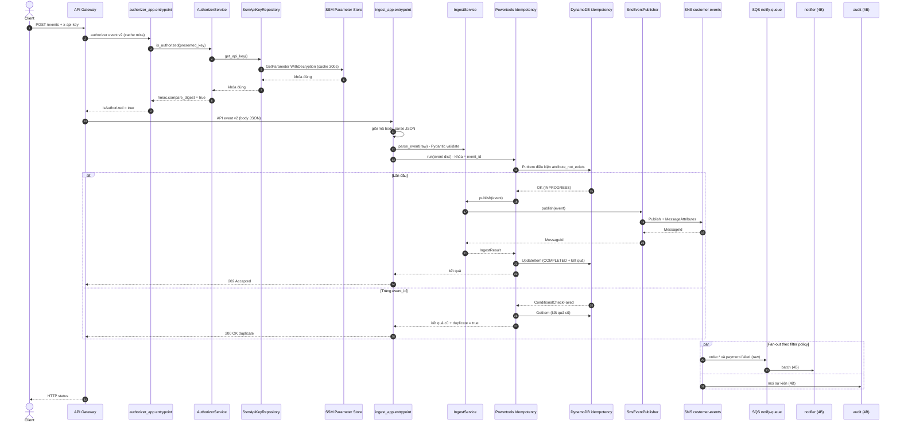

# Phase 4A: Application Code — common, authorizer, ingest — Customer Logic Workflow

> **Phạm vi 4A:** thư mục `src/common` (dùng chung), Lambda **authorizer** và **ingest** (cửa vào của hệ thống), kèm unit test bằng `moto`.
> **Phase 4B (sau):** Lambda **notifier** và **audit**, integration test với AWS Emulator, nâng ngưỡng coverage.
> **Chia 4A/4B** để không cắt code: Phase 4 có 4 hàm Lambda cùng bộ test, quá dài cho một lượt.
> **Tình trạng kiểm chứng:** code chưa được chạy (`pytest`, `ruff`, deploy). Các API của Powertools tôi dùng theo hiểu biết về phiên bản 3.x, nên mục 8 hướng dẫn kiểm tra và xử lý nếu có chỗ khác.

---

## 1. Quyết định thiết kế mới

| ADR | Quyết định | Lý do |
|---|---|---|
| **ADR-027** | Mỗi hàm gồm `handler.py` **mỏng** (chỉ re-export) và một package riêng `<hàm>_app/` (`entrypoint`, `service`, `publisher`/`repository`...) | Lambda import `handler` như module cấp cao nhất nên `import` tương đối không dùng được. Tên package **duy nhất theo hàm** (`ingest_app`, `authorizer_app`...) giúp unit test import cả 4 hàm trong cùng một tiến trình mà không đụng tên `service`/`handler` |
| **ADR-028** | Phân tầng **Handler (entrypoint) → Service → Repository/Publisher**. Handler lo giao thức (API Gateway/EventBridge), Service lo nghiệp vụ, Repository/Publisher lo AWS SDK | Mỗi tầng test độc lập, chỉ mock **một ranh giới** |
| **ADR-029** | **Validate trước, chống trùng sau**: Pydantic xác thực sự kiện rồi mới vào lớp idempotency theo `event_id` | Sự kiện sai không tạo bản ghi idempotency rác; khóa chống trùng luôn tồn tại |
| **ADR-030** | **Fail closed** ở authorizer: bất kỳ lỗi đọc API key nào cũng trả `isAuthorized = false` | Lỗi hạ tầng không bao giờ biến thành "cho qua" |
| **ADR-031** | Một cặp `logger`/`tracer` dùng chung trong `common/observability.py` | Mọi tầng ghi log cùng một cấu hình, cùng `correlation_id`, không phải lo thứ tự khởi tạo logger con |
| **ADR-032** | Log **không bao giờ** ghi `payload`, API key hay email. Chỉ ghi `event_id`, `event_type`, `severity`, `message_id` | Giảm thiểu dữ liệu cá nhân trong log |
| **ADR-033** | Với nguồn **EventBridge**, lỗi (kể cả sự kiện không hợp lệ) được `raise` để Lambda/EventBridge retry rồi chuyển vào DLQ. Với nguồn **API**, lỗi trả mã HTTP | Sự kiện nội bộ lỗi không bị mất lặng lẽ; client API cần biết mã lỗi để xử lý |

---

## 2. Cấu trúc file của Phase 4A

```text
src/
├── common/
│   ├── __init__.py
│   ├── config.py
│   ├── http.py
│   ├── models.py
│   ├── observability.py
│   └── pii.py
├── authorizer/
│   ├── handler.py
│   └── authorizer_app/
│       ├── __init__.py
│       ├── entrypoint.py
│       ├── repository.py
│       └── service.py
└── ingest/
    ├── handler.py
    └── ingest_app/
        ├── __init__.py
        ├── entrypoint.py
        ├── idempotency.py
        ├── publisher.py
        └── service.py

tests/
├── conftest.py
└── unit/
    ├── common/   test_config.py  test_http.py  test_models.py  test_pii.py
    ├── authorizer/  test_entrypoint.py  test_repository.py  test_service.py
    └── ingest/   test_entrypoint.py  test_publisher.py  test_service.py
```

Các file `handler.py` của `authorizer` và `ingest` **thay thế stub tạm** ở Phase 3C.

---

## 3. Sơ đồ tuần tự end-to-end

Phần màu `4A` hoàn thiện ở phase này; `4B` (notifier, audit) ở phase sau.



---

## 4. Call-Chain Walkthrough với một payload cụ thể

Payload: `POST /events` với body

```json
{
  "event_id": "7f3c1e52-9b1a-4c0e-8d52-1b2a3c4d5e6f",
  "event_type": "order.created",
  "severity": "info",
  "customer_id": "cus_10293",
  "occurred_at": "2026-11-23T08:15:30Z",
  "payload": { "order_id": "ord_5521", "total": 450000, "currency": "VND" }
}
```

### 4.1. Chuỗi gọi và biến đổi dữ liệu (happy path)

| Bước | File / hàm | Dữ liệu vào | Dữ liệu ra / biến đổi |
|---|---|---|---|
| 1 | `authorizer_app/entrypoint.py::lambda_handler` | Event v2 của authorizer, header `x-api-key` | Lấy giá trị header (API Gateway đã hạ chữ thường tên header) |
| 2 | `authorizer_app/service.py::is_authorized` | Chuỗi khóa client gửi | Gọi repository lấy khóa đúng, so sánh bằng `hmac.compare_digest` (thời gian cố định, chống timing attack) |
| 3 | `authorizer_app/repository.py::get_api_key` | Tên tham số `/clw/dev/api-key` | `SSMProvider.get(..., decrypt=True, max_age=300)`: giải mã SecureString, cache 5 phút trong bộ nhớ hàm |
| 4 | `ingest_app/entrypoint.py::lambda_handler` | Event v2 của API (có `requestContext.http`) | `_detect_source` nhận ra nguồn `api` |
| 5 | `entrypoint.py::_extract_raw_event` | `event["body"]` (chuỗi, có thể base64) | `dict` sau `json.loads` |
| 6 | `service.py::IngestService.parse_event` | `dict` thô | `CustomerEvent` đã kiểm tra (UUID v4, enum, thời gian có múi giờ, `customer_id`, kích thước payload) |
| 7 | `entrypoint.py` | `CustomerEvent` | Đặt `correlation_id = event_id` và các khóa log; `model_dump(mode="json")` thành `dict` an toàn cho JSON |
| 8 | `idempotency.py::IdempotentIngest.run` | `dict` | Powertools tính khóa từ `event_id`, ghi DynamoDB có điều kiện |
| 9 | `service.py::IngestService.publish` | `CustomerEvent` dựng lại từ `dict` | Gọi publisher, trả `IngestResult(event_id, message_id)` |
| 10 | `publisher.py::SnsEventPublisher.publish` | `CustomerEvent` | `Message` = JSON sự kiện (bỏ trường `null`); `MessageAttributes` = `event_type`, `severity`. Trả `MessageId` |
| 11 | `entrypoint.py` | `{"event_id", "message_id"}` | Đóng gói `json_response(202, ...)` |

### 4.2. Xử lý lỗi và retry

| Tình huống | Nơi phát hiện | Kết quả với **API** | Kết quả với **EventBridge** |
|---|---|---|---|
| Thiếu header `x-api-key` | API Gateway (identity source) | `401`, không gọi authorizer | không áp dụng |
| Khóa sai | `AuthorizerService` | `403` | không áp dụng |
| SSM lỗi hoặc thiếu tham số | `SsmApiKeyRepository` ném `ApiKeyUnavailableError` | `403` (fail closed) | không áp dụng |
| JSON hỏng, thiếu trường, sai kiểu | `_extract_raw_event` hoặc Pydantic, bọc thành `InvalidRequestError` | `400` kèm vị trí lỗi (**không** kèm giá trị client gửi) | `raise` để retry rồi vào `eventbridge_dlq` |
| `event_id` đang xử lý (gửi song song) | Powertools ném `IdempotencyAlreadyInProgressError` | `409` | `raise` |
| SNS lỗi hoặc timeout | Publisher bọc thành `PublishError` | `503`; Powertools **xóa bản ghi idempotency** nên client gửi lại cùng `event_id` được xử lý bình thường | `raise` để retry |
| DynamoDB lỗi | Powertools ném `IdempotencyPersistenceLayerError` | `503` | `raise` |
| Gửi lại cùng `event_id` đã xong | Idempotency | `200`, `duplicate = true`, **không publish lại** | trả kết quả cũ |

**Thiết lập thời gian:** Lambda `ingest` có timeout 10 giây. Client SNS dùng `connect_timeout = 1`, `read_timeout = 3`, `max_attempts = 2` (backoff có jitter của botocore ở chế độ `standard`), nên trường hợp xấu nhất khoảng 8 giây, vừa trong timeout.

---

## 5. Contract Table (Phase 4A)

| Caller → Callee | Inputs / Tham số truyền | Outputs / Giá trị trả về | Vì sao có phụ thuộc này |
|---|---|---|---|
| API Gateway → `authorizer_app.entrypoint.lambda_handler` | Event v2 loại `REQUEST` | `{"isAuthorized": bool}` | Đúng định dạng "simple response" đã bật ở 3C |
| `authorizer entrypoint` → `AuthorizerService.is_authorized` | `presented_key: str \| None` | `bool` hoặc ném `ApiKeyUnavailableError` | Tách nghiệp vụ so sánh khỏi giao thức |
| `AuthorizerService` → `SsmApiKeyRepository.get_api_key` | (không) | `str` hoặc ném `ApiKeyUnavailableError` | Tách AWS SDK, dễ thay bằng fake khi test |
| API Gateway/EventBridge → `ingest_app.entrypoint.lambda_handler` | Event v2 hoặc EventBridge envelope | Response HTTP (dict) hoặc `dict` kết quả | Một hàm phục vụ hai nguồn (3C) |
| `ingest entrypoint` → `IngestService.parse_event` | `Mapping` thô | `CustomerEvent` hoặc ném `pydantic.ValidationError` | Một nơi duy nhất định nghĩa "sự kiện hợp lệ" (`common.models`) |
| `ingest entrypoint` → `IdempotentIngest.run` | `dict` (đã `model_dump(mode="json")`) | `dict` kết quả (thêm `duplicate = true` nếu là bản phát lại) | Chống gửi trùng theo `event_id` |
| `IdempotentIngest` → `IngestService.publish` | `CustomerEvent` | `IngestResult` | Chỉ chạy khi chưa từng thành công |
| `IngestService` → `EventPublisher.publish` | `CustomerEvent` | `message_id: str` hoặc ném `PublishError` | Tách SNS khỏi nghiệp vụ |
| `SnsEventPublisher` → SNS | `TopicArn`, `Message`, `MessageAttributes` | `MessageId` | `MessageAttributes` là thứ **filter policy ở 3B dựa vào**; thiếu chúng thì không subscriber nào nhận đúng |
| `common.config.require_env` → môi trường | Tên biến | Giá trị hoặc `ConfigurationError` | Lỗi cấu hình hiện ngay ở cold start, không lặng lẽ |

---

## 6. Code: package `common`

### File 1: `src/common/__init__.py`

**Overview:** Đánh dấu `common` là package Python. Được `scripts/build_layer.py` copy vào layer (`/opt/python/common`) để cả 4 hàm `import common...`.

```python
"""Mã dùng chung cho các Lambda: mô hình sự kiện, cấu hình, logging và tiện ích."""
```

**Giải thích chi tiết:** file chỉ chứa docstring. Không import gì ở đây để `import common` không kéo theo chi phí khởi động.

### File 2: `src/common/config.py`

**Overview:** Đọc biến môi trường bắt buộc. Được các `entrypoint` gọi khi dựng "runtime" ở cold start.

```python
"""Đọc cấu hình bắt buộc từ biến môi trường."""

from __future__ import annotations

import os


class ConfigurationError(RuntimeError):
    """Thiếu hoặc sai cấu hình bắt buộc của hàm Lambda."""


def require_env(name: str) -> str:
    """Trả về giá trị biến môi trường, ném ConfigurationError nếu thiếu hoặc rỗng."""
    value = os.environ.get(name, "").strip()
    if not value:
        raise ConfigurationError(f"Thiếu biến môi trường bắt buộc: {name}")
    return value
```

**Giải thích chi tiết:**
- Thiếu cấu hình thì **dừng ngay ở lần gọi đầu tiên** với thông báo rõ tên biến, thay vì lỗi khó hiểu khi đã chạy giữa chừng.
- Các biến này do Terraform (3C) đặt (`SNS_TOPIC_ARN`, `IDEMPOTENCY_TABLE`, `API_KEY_PARAMETER_NAME`). Hàm này chỉ đọc **tên và ARN**, không bao giờ chứa secret.

### File 3: `src/common/observability.py`

**Overview:** Tạo **một** `Logger` và **một** `Tracer` của Powertools dùng chung cho mọi tầng (ADR-031). Được mọi module trong `*_app` import.

```python
"""Logger và Tracer dùng chung: log JSON có cấu trúc và truy vết X-Ray."""

from __future__ import annotations

from aws_lambda_powertools import Logger, Tracer

logger = Logger()
tracer = Tracer()
```

**Giải thích chi tiết:**
- `Logger()` đọc `POWERTOOLS_SERVICE_NAME` và `LOG_LEVEL` từ môi trường (do module `lambda` ở 3C đặt), nên mỗi hàm tự có tên service riêng trong log.
- Log ra dạng JSON, kết hợp với `logging_config.log_format = "JSON"` ở 3C. Quy ước: chỉ truyền các trường **không nhạy cảm** vào `extra`.
- `Tracer()` bật X-Ray (đã `Active` ở Terraform). Ở unit test đặt `POWERTOOLS_TRACE_DISABLED=true` để không cần daemon X-Ray.
- Import ở một nơi duy nhất nên mọi module dùng chung cùng instance và cùng `correlation_id`.

### File 4: `src/common/http.py`

**Overview:** Dựng response chuẩn cho API Gateway HTTP API (payload v2). Được `ingest_app.entrypoint` dùng.

```python
"""Tiện ích dựng response cho API Gateway HTTP API (payload format 2.0)."""

from __future__ import annotations

import json
from collections.abc import Mapping
from typing import Any


def json_response(status_code: int, body: Mapping[str, Any]) -> dict[str, Any]:
    """Dựng response JSON gọn, không chứa dữ liệu thừa."""
    return {
        "statusCode": status_code,
        "headers": {"content-type": "application/json"},
        "body": json.dumps(body, separators=(",", ":")),
    }
```

**Giải thích chi tiết:** `separators=(",", ":")` bỏ khoảng trắng thừa, giảm kích thước response. Header `content-type` được đặt cố định để client luôn parse đúng.

### File 5: `src/common/models.py`

**Overview:** **Hợp đồng sự kiện** (Event Contract) bằng Pydantic v2, hiện thực hóa schema ở Phase 1. Được `IngestService.parse_event`, `notifier` và `audit` (4B) dùng chung, nên "sự kiện hợp lệ" được định nghĩa ở **đúng một nơi**.

```python
"""Hợp đồng sự kiện (Event Contract) dùng chung cho mọi Lambda."""

from __future__ import annotations

import json
from datetime import datetime
from enum import StrEnum
from typing import Annotated, Any

from pydantic import UUID4, BaseModel, ConfigDict, Field, field_validator, model_validator

MAX_PAYLOAD_BYTES = 200_000
CUSTOMER_ID_PATTERN = r"^[A-Za-z0-9_-]{1,64}$"


class EventType(StrEnum):
    ORDER_CREATED = "order.created"
    ORDER_SHIPPED = "order.shipped"
    PAYMENT_FAILED = "payment.failed"
    SYSTEM_ALERT = "system.alert"


class Severity(StrEnum):
    INFO = "info"
    WARNING = "warning"
    CRITICAL = "critical"


class CustomerEvent(BaseModel):
    """Sự kiện nghiệp vụ được ingest, bất biến sau khi tạo."""

    model_config = ConfigDict(extra="forbid", frozen=True)

    event_id: UUID4
    event_type: EventType
    severity: Severity
    customer_id: Annotated[str, Field(pattern=CUSTOMER_ID_PATTERN)] | None = None
    occurred_at: datetime
    payload: dict[str, Any] = Field(default_factory=dict)

    @field_validator("occurred_at")
    @classmethod
    def occurred_at_must_have_timezone(cls, value: datetime) -> datetime:
        if value.tzinfo is None or value.utcoffset() is None:
            raise ValueError("occurred_at phải có múi giờ, ví dụ 2026-11-23T08:15:30Z")
        return value

    @field_validator("payload")
    @classmethod
    def payload_must_be_small(cls, value: dict[str, Any]) -> dict[str, Any]:
        size = len(json.dumps(value, default=str).encode("utf-8"))
        if size > MAX_PAYLOAD_BYTES:
            raise ValueError(f"payload vượt quá {MAX_PAYLOAD_BYTES} byte")
        return value

    @model_validator(mode="after")
    def customer_id_required_except_system_alert(self) -> CustomerEvent:
        if self.event_type is not EventType.SYSTEM_ALERT and self.customer_id is None:
            raise ValueError("customer_id là bắt buộc với mọi sự kiện trừ system.alert")
        return self
```

**Giải thích chi tiết:**
- `extra="forbid"`: **từ chối trường lạ**, giúp phát hiện client gửi sai tên trường thay vì lặng lẽ bỏ qua. `frozen=True`: sự kiện không bị sửa sau khi đã xác thực.
- `UUID4`: chỉ nhận UUID phiên bản 4, vì `event_id` là khóa idempotency, phải khó đoán và không trùng.
- `StrEnum` (Python 3.11+): `event_type` và `severity` là tập giá trị đóng, khớp với **filter policy ở 3B**. Thêm loại sự kiện mới thì phải sửa ở đây và ở filter policy.
- `occurred_at` bắt buộc có múi giờ: tránh nhập nhằng thời gian giữa các hệ thống.
- Giới hạn `payload` 200.000 byte (message SNS/SQS tối đa 256 KB, chừa chỗ cho phần còn lại của sự kiện).
- `customer_id_required_except_system_alert`: quy tắc nghiệp vụ ở Phase 1, `system.alert` không gắn với khách hàng.
- Pydantic **không echo giá trị đầu vào** vào thông điệp lỗi chúng ta trả cho client (entrypoint chỉ lấy `loc` và `msg`).

### File 6: `src/common/pii.py`

**Overview:** Che dữ liệu cá nhân trước khi ghi log. Được `notifier` (4B) dùng; đặt trong `common` từ bây giờ để test và dùng thống nhất.

```python
"""Che dữ liệu cá nhân (PII) trước khi ghi log."""

from __future__ import annotations


def mask_email(email: str) -> str:
    """Giữ ký tự đầu của phần tên và toàn bộ tên miền: john@example.com -> j***@example.com."""
    local, separator, domain = email.partition("@")
    if not separator or not local or not domain:
        return "***"
    return f"{local[0]}***@{domain}"


def mask_phone(phone: str) -> str:
    """Chỉ giữ 2 chữ số cuối: +84 912 345 678 -> *********78."""
    digits = [char for char in phone if char.isdigit()]
    if len(digits) < 4:
        return "***"
    return "*" * (len(digits) - 2) + "".join(digits[-2:])
```

**Giải thích chi tiết:** giá trị không hợp lệ trả `***` thay vì ném lỗi: **việc che dữ liệu không bao giờ được làm hỏng luồng xử lý chính**.

---

## 7. Code: Lambda `authorizer`

### File 7: `src/authorizer/handler.py`

**Overview:** Điểm vào mà Lambda gọi (`handler.lambda_handler`, đã cấu hình ở 3C). Chỉ re-export từ package `authorizer_app` (ADR-027). **Thay thế stub tạm** ở Phase 3C.

```python
"""Điểm vào Lambda authorizer. Logic nằm trong authorizer_app."""

from authorizer_app.entrypoint import lambda_handler

__all__ = ["lambda_handler"]
```

**Giải thích chi tiết:** `__all__` khai báo việc re-export là có chủ đích (để `ruff` không báo import không dùng). File này được loại khỏi báo cáo coverage vì không có logic.

### File 8: `src/authorizer/authorizer_app/__init__.py`

**Overview:** Đánh dấu package.

```python
"""Package của Lambda authorizer."""
```

**Giải thích chi tiết:** để trống logic, tên package `authorizer_app` là duy nhất trong toàn dự án (ADR-027).

### File 9: `src/authorizer/authorizer_app/repository.py`

**Overview:** Tầng **Repository**: lấy API key chuẩn từ SSM Parameter Store (SecureString) và cache trong bộ nhớ. Được `AuthorizerService` gọi. Quyền IAM `ssm:GetParameter` trên đúng một tham số đã cấp ở `iam.tf` (3C).

```python
"""Repository đọc API key từ SSM Parameter Store."""

from __future__ import annotations

from aws_lambda_powertools.utilities import parameters
from aws_lambda_powertools.utilities.parameters.exceptions import GetParameterError

from common.observability import tracer

DEFAULT_CACHE_SECONDS = 300


class ApiKeyUnavailableError(RuntimeError):
    """Không đọc được API key chuẩn (thiếu tham số, thiếu quyền hoặc lỗi dịch vụ)."""


class SsmApiKeyRepository:
    """Đọc API key từ một tham số SSM SecureString, có cache để giảm số lần gọi."""

    def __init__(
        self,
        parameter_name: str,
        provider: parameters.SSMProvider | None = None,
        cache_seconds: int = DEFAULT_CACHE_SECONDS,
    ) -> None:
        self._parameter_name = parameter_name
        self._provider = provider or parameters.SSMProvider()
        self._cache_seconds = cache_seconds

    @tracer.capture_method
    def get_api_key(self) -> str:
        try:
            value = self._provider.get(
                self._parameter_name,
                max_age=self._cache_seconds,
                decrypt=True,
            )
        except GetParameterError as exc:
            raise ApiKeyUnavailableError("Không đọc được API key từ SSM") from exc

        if not isinstance(value, str) or not value:
            raise ApiKeyUnavailableError("API key trong SSM rỗng hoặc sai kiểu")
        return value
```

**Giải thích chi tiết:**
- `decrypt=True`: giải mã `SecureString` (khóa `aws/ssm` của AWS, quyền đi qua key policy mặc định nên không cần thêm quyền KMS).
- `max_age=300`: cache 5 phút **trong bộ nhớ của môi trường thực thi**, giảm số request SSM. Đổi khóa có độ trễ tới 5 phút ở đây **cộng** 5 phút cache của API Gateway (ADR-026).
- **Tiêm `provider`** qua constructor: unit test truyền provider của riêng nó (mỗi provider có cache riêng), không phụ thuộc cache toàn cục.
- Lỗi SDK được bọc thành `ApiKeyUnavailableError` mà **không chứa giá trị khóa** trong thông điệp, để tầng trên xử lý fail closed.

### File 10: `src/authorizer/authorizer_app/service.py`

**Overview:** Tầng **Service**: nghiệp vụ "khóa gửi lên có đúng không". Được `entrypoint` gọi, gọi `SsmApiKeyRepository` (hoặc fake khi test).

```python
"""Nghiệp vụ xác thực API key."""

from __future__ import annotations

import hmac
from typing import Protocol


class ApiKeyRepository(Protocol):
    def get_api_key(self) -> str: ...


class AuthorizerService:
    """So sánh API key client gửi với API key chuẩn."""

    def __init__(self, repository: ApiKeyRepository) -> None:
        self._repository = repository

    def is_authorized(self, presented_key: str | None) -> bool:
        if not presented_key:
            return False

        expected_key = self._repository.get_api_key()
        return hmac.compare_digest(
            presented_key.encode("utf-8"),
            expected_key.encode("utf-8"),
        )
```

**Giải thích chi tiết:**
- `hmac.compare_digest`: so sánh **thời gian không đổi**, chống tấn công timing để đoán khóa từng ký tự.
- Khóa trống bị từ chối **trước khi** gọi SSM, tiết kiệm một request vô ích.
- `ApiKeyRepository` là `Protocol`: service chỉ biết "một thứ có `get_api_key`", nên test dùng được fake mà không cần boto3.

### File 11: `src/authorizer/authorizer_app/entrypoint.py`

**Overview:** Tầng **Handler**: nhận event authorizer v2, trả "simple response". Được API Gateway gọi (qua `handler.py`). Dựng `AuthorizerService` một lần ở cold start.

```python
"""Lambda authorizer: kiểm tra header x-api-key của HTTP API."""

from __future__ import annotations

from functools import lru_cache
from typing import Any

from aws_lambda_powertools.logging import correlation_paths
from aws_lambda_powertools.utilities.typing import LambdaContext

from authorizer_app.repository import ApiKeyUnavailableError, SsmApiKeyRepository
from authorizer_app.service import AuthorizerService
from common.config import require_env
from common.observability import logger, tracer

API_KEY_HEADER = "x-api-key"


@lru_cache(maxsize=1)
def get_service() -> AuthorizerService:
    """Dựng service một lần cho mỗi môi trường thực thi (cold start)."""
    parameter_name = require_env("API_KEY_PARAMETER_NAME")
    return AuthorizerService(SsmApiKeyRepository(parameter_name))


@logger.inject_lambda_context(correlation_id_path=correlation_paths.API_GATEWAY_HTTP)
@tracer.capture_lambda_handler
def lambda_handler(event: dict[str, Any], context: LambdaContext) -> dict[str, bool]:
    headers = event.get("headers") or {}
    presented_key = headers.get(API_KEY_HEADER)

    try:
        authorized = get_service().is_authorized(presented_key)
    except ApiKeyUnavailableError:
        # Fail closed: lỗi hạ tầng không bao giờ được biến thành "cho qua"
        logger.exception("Không đọc được API key, từ chối yêu cầu")
        return {"isAuthorized": False}

    logger.info("Kết quả xác thực", extra={"authorized": authorized})
    return {"isAuthorized": authorized}
```

**Giải thích chi tiết:**
- **Không bao giờ** ghi giá trị `presented_key` hay khóa chuẩn vào log. Chỉ ghi kết quả `authorized`.
- `correlation_paths.API_GATEWAY_HTTP`: Powertools lấy `requestContext.requestId` làm `correlation_id`, nên log của authorizer và `ingest` (cùng request) đối chiếu được với access log của API Gateway.
- `lru_cache(maxsize=1)`: dựng một lần ở cold start, các lần gọi sau (warm) dùng lại, và **tái sử dụng cache SSM** giữa các lần gọi.
- Thiếu `API_KEY_PARAMETER_NAME` thì `ConfigurationError` không bị bắt: hàm lỗi, API Gateway trả `500`, request cũng không được cho qua (vẫn an toàn).
- Thứ tự decorator: `logger.inject_lambda_context` ngoài cùng (gắn ngữ cảnh log trước), `tracer.capture_lambda_handler` bên trong.

---

## 8. Code: Lambda `ingest`

### File 12: `src/ingest/handler.py`

**Overview:** Điểm vào của `ingest`, re-export từ `ingest_app`. **Thay thế stub tạm** ở 3C.

```python
"""Điểm vào Lambda ingest. Logic nằm trong ingest_app."""

from ingest_app.entrypoint import lambda_handler

__all__ = ["lambda_handler"]
```

**Giải thích chi tiết:** giống File 7.

### File 13: `src/ingest/ingest_app/__init__.py`

**Overview:** Đánh dấu package.

```python
"""Package của Lambda ingest."""
```

**Giải thích chi tiết:** tên `ingest_app` duy nhất (ADR-027).

### File 14: `src/ingest/ingest_app/publisher.py`

**Overview:** Tầng **Publisher** (đóng vai Repository cho SNS): đẩy sự kiện lên topic kèm `MessageAttributes`. Được `IngestService` gọi. Quyền `sns:Publish` trên đúng một topic đã cấp ở 3C.

```python
"""Publisher đẩy sự kiện lên SNS."""

from __future__ import annotations

from typing import Any, Protocol

import boto3
from botocore.config import Config
from botocore.exceptions import BotoCoreError, ClientError

from common.models import CustomerEvent
from common.observability import tracer


class PublishError(RuntimeError):
    """Không publish được sự kiện lên SNS."""


class EventPublisher(Protocol):
    def publish(self, event: CustomerEvent) -> str: ...


class SnsEventPublisher:
    """Publish sự kiện lên một SNS topic, kèm MessageAttributes cho filter policy."""

    def __init__(self, topic_arn: str, client: Any | None = None) -> None:
        self._topic_arn = topic_arn
        # Timeout và retry được chỉnh để trường hợp xấu nhất vẫn nằm trong timeout 10 giây của hàm
        self._client = client or boto3.client(
            "sns",
            config=Config(
                connect_timeout=1,
                read_timeout=3,
                retries={"max_attempts": 2, "mode": "standard"},
            ),
        )

    @tracer.capture_method
    def publish(self, event: CustomerEvent) -> str:
        try:
            response = self._client.publish(
                TopicArn=self._topic_arn,
                Message=event.model_dump_json(exclude_none=True),
                MessageAttributes={
                    "event_type": {"DataType": "String", "StringValue": event.event_type.value},
                    "severity": {"DataType": "String", "StringValue": event.severity.value},
                },
            )
        except (BotoCoreError, ClientError) as exc:
            raise PublishError("Publish lên SNS thất bại") from exc
        return str(response["MessageId"])
```

**Giải thích chi tiết:**
- **`MessageAttributes` là điểm then chốt**: filter policy ở 3B (`filter_policy_scope = "MessageAttributes"`) chỉ nhìn vào `event_type` và `severity` ở đây, không nhìn body. Thiếu hai thuộc tính này, không subscriber nào nhận được sự kiện.
- `Message` là JSON của sự kiện (`exclude_none` bỏ trường `null`), vì subscription SQS bật `raw_message_delivery` nên consumer nhận đúng JSON này.
- Chế độ retry `standard` của botocore dùng **exponential backoff có jitter**, đáp ứng checklist "retries with backoff and jitter".
- `client` có thể tiêm vào (test dùng fake, hoặc client trỏ vào moto).
- Lỗi SDK bọc thành `PublishError` không kèm nội dung sự kiện, để tầng trên quyết định mã HTTP.

### File 15: `src/ingest/ingest_app/service.py`

**Overview:** Tầng **Service**: parse sự kiện và điều phối việc publish. Được `entrypoint` và `idempotency` gọi; gọi `EventPublisher`.

```python
"""Nghiệp vụ ingest: kiểm tra sự kiện và publish."""

from __future__ import annotations

from collections.abc import Mapping
from dataclasses import dataclass
from typing import Any

from common.models import CustomerEvent
from common.observability import logger
from ingest_app.publisher import EventPublisher


@dataclass(frozen=True)
class IngestResult:
    event_id: str
    message_id: str

    def as_dict(self) -> dict[str, str]:
        return {"event_id": self.event_id, "message_id": self.message_id}


class IngestService:
    """Điều phối: validate sự kiện rồi publish qua EventPublisher."""

    def __init__(self, publisher: EventPublisher) -> None:
        self._publisher = publisher

    @staticmethod
    def parse_event(raw_event: Mapping[str, Any]) -> CustomerEvent:
        """Xác thực dữ liệu thô, ném pydantic.ValidationError nếu không hợp lệ."""
        return CustomerEvent.model_validate(raw_event)

    def publish(self, event: CustomerEvent) -> IngestResult:
        message_id = self._publisher.publish(event)
        logger.info("Đã publish sự kiện", extra={"message_id": message_id})
        return IngestResult(event_id=str(event.event_id), message_id=message_id)
```

**Giải thích chi tiết:**
- `parse_event` là `staticmethod`: không cần publisher, `entrypoint` gọi trước khi vào lớp idempotency (ADR-029).
- Log chỉ ghi `message_id`. `event_id`, `event_type`, `severity` đã được `entrypoint` gắn vào mọi dòng log qua `append_keys`, nên không lặp ở đây.
- `IngestResult.as_dict` trả `dict[str, str]` **JSON-serializable**: Powertools lưu kết quả này vào DynamoDB để phát lại cho bản trùng.

### File 16: `src/ingest/ingest_app/idempotency.py`

**Overview:** Bọc `IngestService.publish` bằng **Powertools Idempotency** lưu ở DynamoDB (bảng `idempotency` 3B: khóa `id`, TTL `expiration`). Được `entrypoint` dựng ở cold start.

```python
"""Lớp chống trùng (idempotency) cho thao tác publish, lưu ở DynamoDB."""

from __future__ import annotations

from collections.abc import Callable
from dataclasses import dataclass
from typing import Any

from aws_lambda_powertools.utilities.idempotency import (
    DynamoDBPersistenceLayer,
    IdempotencyConfig,
    idempotent_function,
)
from aws_lambda_powertools.utilities.idempotency.persistence.datarecord import DataRecord

from common.models import CustomerEvent
from ingest_app.service import IngestService

DEFAULT_TTL_SECONDS = 86_400


@dataclass(frozen=True)
class IdempotentIngest:
    run: Callable[[dict[str, Any]], dict[str, Any]]
    config: IdempotencyConfig


def _mark_replayed(response: Any, _record: DataRecord) -> Any:
    """Gắn cờ duplicate khi kết quả được phát lại từ DynamoDB thay vì tính mới."""
    return {**response, "duplicate": True}


def build_idempotent_ingest(
    service: IngestService,
    table_name: str,
    ttl_seconds: int = DEFAULT_TTL_SECONDS,
) -> IdempotentIngest:
    persistence_store = DynamoDBPersistenceLayer(table_name=table_name)
    config = IdempotencyConfig(
        event_key_jmespath="event_id",
        expires_after_seconds=ttl_seconds,
        raise_on_no_idempotency_key=True,
        response_hook=_mark_replayed,
    )

    @idempotent_function(
        data_keyword_argument="event",
        config=config,
        persistence_store=persistence_store,
    )
    def ingest_once(event: dict[str, Any]) -> dict[str, Any]:
        return service.publish(CustomerEvent.model_validate(event)).as_dict()

    def run(event: dict[str, Any]) -> dict[str, Any]:
        return ingest_once(event=event)

    return IdempotentIngest(run=run, config=config)
```

**Giải thích chi tiết:**
- `event_key_jmespath="event_id"`: khóa chống trùng chính là `event_id` (UUID v4 đã xác thực). Cùng `event_id` gửi lại trong 24 giờ không publish lại.
- `raise_on_no_idempotency_key=True`: thiếu khóa thì **lỗi chứ không bỏ qua** (an toàn mặc định). Trên thực tế không xảy ra vì ta đã validate trước.
- **Cơ chế của Powertools:** trước khi chạy, ghi bản ghi `INPROGRESS` bằng `PutItem` có điều kiện `attribute_not_exists`; chạy xong thì cập nhật `COMPLETED` kèm kết quả; nếu hàm **lỗi**, bản ghi bị **xóa** để client được thử lại. Điều này khớp với Execution Trace.
- `response_hook=_mark_replayed`: hook này chỉ được gọi khi kết quả lấy từ bản ghi đã lưu (tức là bản trùng), nên `entrypoint` biết trả `200` thay vì `202`.
- **Đây là điểm tôi dựa vào hiểu biết về API Powertools 3.x** (`response_hook`, đường dẫn `DataRecord`). Nếu `pytest` báo lỗi import hoặc tham số, xem mục 10 để xử lý.
- Dùng closure (`build_idempotent_ingest`) thay vì decorator ở mức module: bảng và service chỉ biết lúc chạy (qua biến môi trường), không biết lúc import.
- `ttl_seconds=86400` khớp thuộc tính TTL `expiration` của bảng ở 3B: DynamoDB tự xóa bản ghi hết hạn, không tốn phí.
- `config` được trả về để `entrypoint` gọi `register_lambda_context(context)` mỗi lần gọi: Powertools cần biết thời gian còn lại để xử lý trường hợp hàm timeout giữa chừng.

### File 17: `src/ingest/ingest_app/entrypoint.py`

**Overview:** Tầng **Handler**: nhận event từ API Gateway **hoặc** EventBridge, điều phối parse, idempotency, và ánh xạ lỗi sang mã HTTP (API) hoặc ném lỗi để retry (EventBridge). Gọi `IngestService`, `IdempotentIngest`, `common`.

```python
"""Lambda ingest: nhận API Gateway hoặc EventBridge, validate, chống trùng, publish SNS."""

from __future__ import annotations

import base64
import json
from collections.abc import Mapping
from dataclasses import dataclass
from functools import lru_cache
from typing import Any

from aws_lambda_powertools.utilities.idempotency.exceptions import (
    IdempotencyAlreadyInProgressError,
    IdempotencyPersistenceLayerError,
)
from aws_lambda_powertools.utilities.typing import LambdaContext
from pydantic import ValidationError

from common.config import require_env
from common.http import json_response
from common.models import CustomerEvent
from common.observability import logger, tracer
from ingest_app.idempotency import IdempotentIngest, build_idempotent_ingest
from ingest_app.publisher import PublishError, SnsEventPublisher
from ingest_app.service import IngestService

SOURCE_API = "api"
SOURCE_EVENTBRIDGE = "eventbridge"


class InvalidRequestError(ValueError):
    """Yêu cầu hoặc sự kiện không hợp lệ. `details` chỉ chứa vị trí và lý do, không chứa giá trị."""

    def __init__(self, details: list[dict[str, Any]]) -> None:
        super().__init__("Yêu cầu không hợp lệ")
        self.details = details


@dataclass(frozen=True)
class Runtime:
    idempotent_ingest: IdempotentIngest


@lru_cache(maxsize=1)
def get_runtime() -> Runtime:
    """Dựng các thành phần một lần cho mỗi môi trường thực thi (cold start)."""
    topic_arn = require_env("SNS_TOPIC_ARN")
    table_name = require_env("IDEMPOTENCY_TABLE")
    service = IngestService(SnsEventPublisher(topic_arn))
    return Runtime(idempotent_ingest=build_idempotent_ingest(service, table_name))


def _detect_source(event: Mapping[str, Any]) -> str:
    request_context = event.get("requestContext")
    if isinstance(request_context, Mapping) and "http" in request_context:
        return SOURCE_API
    if "detail-type" in event and "detail" in event:
        return SOURCE_EVENTBRIDGE
    raise ValueError("Nguồn sự kiện không được hỗ trợ")


def _invalid(location: str, message: str) -> InvalidRequestError:
    return InvalidRequestError([{"loc": [location], "msg": message}])


def _extract_raw_event(event: Mapping[str, Any], source: str) -> Mapping[str, Any]:
    if source == SOURCE_EVENTBRIDGE:
        detail = event["detail"]
        if not isinstance(detail, Mapping):
            raise _invalid("detail", "detail phải là một object JSON")
        return detail

    body = event.get("body")
    if body is None:
        raise _invalid("body", "Thiếu body")

    try:
        if event.get("isBase64Encoded"):
            body = base64.b64decode(body).decode("utf-8")
        data = json.loads(body)
    except ValueError as exc:
        raise _invalid("body", "Body không phải JSON hợp lệ") from exc

    if not isinstance(data, dict):
        raise _invalid("body", "Body phải là một object JSON")
    return data


def _parse(raw_event: Mapping[str, Any]) -> CustomerEvent:
    try:
        return IngestService.parse_event(raw_event)
    except ValidationError as exc:
        details = [
            {"loc": [str(part) for part in error["loc"]], "msg": error["msg"]}
            for error in exc.errors(include_url=False, include_context=False, include_input=False)
        ]
        raise InvalidRequestError(details) from exc


def _process(runtime: Runtime, event: Mapping[str, Any], source: str) -> dict[str, Any]:
    parsed = _parse(_extract_raw_event(event, source))

    logger.set_correlation_id(str(parsed.event_id))
    logger.append_keys(
        event_id=str(parsed.event_id),
        event_type=parsed.event_type.value,
        severity=parsed.severity.value,
    )

    return runtime.idempotent_ingest.run(parsed.model_dump(mode="json"))


@logger.inject_lambda_context
@tracer.capture_lambda_handler
def lambda_handler(event: dict[str, Any], context: LambdaContext) -> dict[str, Any]:
    runtime = get_runtime()
    runtime.idempotent_ingest.config.register_lambda_context(context)
    source = _detect_source(event)

    try:
        result = _process(runtime, event, source)
    except InvalidRequestError as exc:
        logger.warning("Sự kiện không hợp lệ", extra={"error_count": len(exc.details)})
        if source == SOURCE_EVENTBRIDGE:
            raise
        return json_response(400, {"error": "validation_failed", "details": exc.details})
    except IdempotencyAlreadyInProgressError:
        logger.warning("Sự kiện đang được xử lý bởi một lời gọi khác")
        if source == SOURCE_EVENTBRIDGE:
            raise
        return json_response(409, {"error": "request_in_progress"})
    except (PublishError, IdempotencyPersistenceLayerError):
        logger.exception("Không xử lý được sự kiện do lỗi hạ tầng")
        if source == SOURCE_EVENTBRIDGE:
            raise
        return json_response(503, {"error": "temporarily_unavailable"})

    if source == SOURCE_EVENTBRIDGE:
        return result

    status_code = 200 if result.get("duplicate") else 202
    return json_response(status_code, result)
```

**Giải thích chi tiết:**
- **Một hàm, hai nguồn:** `_detect_source` phân biệt API (có `requestContext.http`) và EventBridge (có `detail-type` và `detail`). Nguồn khác thì `ValueError` (cấu hình sai), hàm lỗi và Lambda tự retry/chuyển DLQ.
- **Không echo dữ liệu client:** thông điệp lỗi chỉ chứa **vị trí** (`loc`) và **lý do** (`msg`), `include_input=False` ngăn giá trị đầu vào lọt vào response hoặc log (ADR-032).
- **`logger.set_correlation_id(event_id)` và `append_keys`:** mọi dòng log sau đó (kể cả ở `service`, `publisher`) tự mang `event_id`, `event_type`, `severity`, giúp truy vết một sự kiện xuyên suốt (Phase 6).
- **Ánh xạ lỗi theo nguồn (ADR-033):** API trả `400/409/503`; EventBridge `raise` để Lambda/EventBridge retry rồi vào DLQ.
- **`200` hay `202`:** `202 Accepted` khi vừa nhận xử lý; `200` khi là bản phát lại (`duplicate = true`).
- `register_lambda_context(context)` **bắt buộc** gọi mỗi lần với `idempotent_function`: Powertools dùng thời gian còn lại của hàm để đặt hạn cho trạng thái `INPROGRESS`.
- `get_runtime()` có `lru_cache` để unit test xóa cache (`get_runtime.cache_clear()`) và dựng lại với tài nguyên giả.
- Lỗi không lường trước (ví dụ bug) **không bị nuốt**: lan ra ngoài, API Gateway trả `500` và Lambda ghi lỗi, đúng nguyên tắc "đừng giấu lỗi".

---

## 9. Code: cấu hình test và unit test

### File 18: `pyproject.toml` (thay thế bản ở Phase 2)

**Overview:** Bổ sung đường dẫn import cho 4 package `*_app`, bật coverage với ngưỡng 80% và cho phép các quy tắc test cần thiết.

```toml
[project]
name = "customer-logic-workflow"
version = "0.1.0"
description = "He thong thong bao serverless: Lambda + SNS + SQS + DynamoDB"
requires-python = ">=3.12"

[tool.ruff]
line-length = 100
target-version = "py312"
src = ["src", "tests", "scripts"]

[tool.ruff.lint]
select = [
  "E",   # pycodestyle errors
  "F",   # pyflakes
  "I",   # isort
  "B",   # flake8-bugbear
  "UP",  # pyupgrade
  "S",   # flake8-bandit (bảo mật)
  "C4",  # flake8-comprehensions
  "SIM", # flake8-simplify
  "N",   # pep8-naming
]

[tool.ruff.lint.per-file-ignores]
"tests/**" = ["S101", "S105", "S106"]  # cho phép assert và giá trị secret giả trong test
"scripts/**" = ["S603", "S607"]        # script dev gọi subprocess có chủ đích

[tool.pytest.ini_options]
pythonpath = ["src", "src/authorizer", "src/ingest", "src/notifier", "src/audit"]
testpaths = ["tests"]
addopts = "-ra --strict-markers --cov --cov-report=term-missing --cov-fail-under=80"
markers = [
  "integration: test cần AWS Emulator (chạy bằng make test-integration)",
]

[tool.coverage.run]
source = ["src"]
branch = true
omit = ["src/*/handler.py"]
```

**Giải thích chi tiết:**
- `pythonpath` thêm từng thư mục hàm để import `ingest_app`, `authorizer_app`... Vì tên package **khác nhau** nên không xung đột (ADR-027). `handler.py` ở mỗi thư mục **không** được import trong test.
- `--cov-fail-under=80`: coverage dưới 80% thì `pytest` thất bại, hook `pre-push` và CI sẽ chặn. Ở 4B sẽ nâng cao hơn khi có đủ 4 hàm.
- `omit = ["src/*/handler.py"]`: loại các file re-export (và stub của `notifier`/`audit` còn tồn tại từ 3C) khỏi coverage.
- `S105`/`S106` được bỏ trong `tests/`: test dùng chuỗi "khóa" giả như `"khoa-dung"`.

### File 19: `tests/conftest.py`

**Overview:** Fixture dùng chung cho **toàn bộ** unit test: cô lập môi trường AWS (không bao giờ chạm tài khoản thật hay emulator), dữ liệu mẫu và context giả của Lambda. Tự động áp dụng cho mọi test **trừ** test `integration`.

```python
"""Fixture dùng chung cho unit test."""

from __future__ import annotations

import json
import uuid
from collections.abc import Callable
from typing import Any

import pytest


@pytest.fixture(autouse=True)
def isolated_aws_environment(
    request: pytest.FixtureRequest,
    monkeypatch: pytest.MonkeyPatch,
) -> None:
    """Gỡ mọi cấu hình AWS thật và đặt credential giả để moto không bao giờ gọi AWS thật."""
    if request.node.get_closest_marker("integration"):
        return

    for name in (
        "AWS_ENDPOINT_URL",
        "AWS_PROFILE",
        "AWS_CA_BUNDLE",
        "AWS_SESSION_TOKEN",
        "AWS_SHARED_CREDENTIALS_FILE",
        "AWS_CONFIG_FILE",
    ):
        monkeypatch.delenv(name, raising=False)

    monkeypatch.setenv("AWS_ACCESS_KEY_ID", "testing")
    monkeypatch.setenv("AWS_SECRET_ACCESS_KEY", "testing")
    monkeypatch.setenv("AWS_DEFAULT_REGION", "ap-southeast-1")
    monkeypatch.setenv("AWS_REGION", "ap-southeast-1")
    monkeypatch.setenv("POWERTOOLS_TRACE_DISABLED", "true")
    monkeypatch.setenv("POWERTOOLS_SERVICE_NAME", "clw-test")
    monkeypatch.setenv("LOG_LEVEL", "INFO")


class FakeLambdaContext:
    function_name = "clw-test-function"
    memory_limit_in_mb = 256
    invoked_function_arn = "arn:aws:lambda:ap-southeast-1:123456789012:function:clw-test-function"
    aws_request_id = "req-123"

    def get_remaining_time_in_millis(self) -> int:
        return 30_000


@pytest.fixture
def lambda_context() -> FakeLambdaContext:
    return FakeLambdaContext()


@pytest.fixture
def valid_event() -> dict[str, Any]:
    return {
        "event_id": str(uuid.uuid4()),
        "event_type": "order.created",
        "severity": "info",
        "customer_id": "cus_10293",
        "occurred_at": "2026-11-23T08:15:30Z",
        "payload": {"order_id": "ord_5521", "total": 450000, "currency": "VND"},
    }


@pytest.fixture
def api_event() -> Callable[[str | dict[str, Any] | None], dict[str, Any]]:
    """Dựng event API Gateway HTTP API (payload v2) với body tùy ý."""

    def build(body: str | dict[str, Any] | None) -> dict[str, Any]:
        event: dict[str, Any] = {
            "version": "2.0",
            "routeKey": "POST /events",
            "headers": {"content-type": "application/json", "x-api-key": "khoa-dung"},
            "requestContext": {
                "requestId": "req-api-1",
                "http": {"method": "POST", "path": "/events"},
            },
            "isBase64Encoded": False,
        }
        if body is not None:
            event["body"] = body if isinstance(body, str) else json.dumps(body)
        return event

    return build


@pytest.fixture
def eventbridge_event() -> Callable[[Any], dict[str, Any]]:
    """Dựng envelope EventBridge với phần detail tùy ý."""

    def build(detail: Any) -> dict[str, Any]:
        return {
            "version": "0",
            "id": "eb-1",
            "detail-type": "customer.event",
            "source": "customer.workflow",
            "account": "123456789012",
            "time": "2026-11-23T08:15:30Z",
            "region": "ap-southeast-1",
            "resources": [],
            "detail": detail,
        }

    return build
```

**Giải thích chi tiết:**
- **Fixture `autouse` cô lập môi trường**: gỡ `AWS_ENDPOINT_URL`, `AWS_PROFILE`... để unit test **không thể** vô tình đi vào AWS thật hay vào emulator. Credential `testing` là giá trị giả mà moto chấp nhận.
- `request.node.get_closest_marker("integration")`: nhờ hook ở `tests/integration/conftest.py` (Phase 2) tự gắn marker này, integration test không bị gỡ cấu hình emulator.
- `POWERTOOLS_TRACE_DISABLED=true`: tắt X-Ray khi test.
- `FakeLambdaContext` cung cấp đúng các thuộc tính Powertools đọc (`get_remaining_time_in_millis` dùng bởi idempotency).
- `api_event`/`eventbridge_event` là **hàm dựng** (factory) để mỗi test tạo biến thể riêng (body hỏng, thiếu body, `detail` sai...).

### File 20: `tests/unit/common/test_models.py`

**Overview:** Test Event Contract, tức "định nghĩa sự kiện hợp lệ". Không cần mock vì `models.py` là code thuần.

```python
"""Test hợp đồng sự kiện CustomerEvent."""

from __future__ import annotations

import uuid
from typing import Any

import pytest
from pydantic import ValidationError

from common.models import MAX_PAYLOAD_BYTES, CustomerEvent, EventType, Severity


def test_valid_event_is_parsed(valid_event: dict[str, Any]) -> None:
    event = CustomerEvent.model_validate(valid_event)

    assert str(event.event_id) == valid_event["event_id"]
    assert event.event_type is EventType.ORDER_CREATED
    assert event.severity is Severity.INFO
    assert event.occurred_at.utcoffset() is not None


def test_system_alert_does_not_require_customer_id(valid_event: dict[str, Any]) -> None:
    valid_event.update(event_type="system.alert", severity="critical")
    del valid_event["customer_id"]

    event = CustomerEvent.model_validate(valid_event)

    assert event.customer_id is None


@pytest.mark.parametrize("event_type", ["order.created", "order.shipped", "payment.failed"])
def test_customer_id_is_required_for_customer_events(
    valid_event: dict[str, Any], event_type: str
) -> None:
    valid_event["event_type"] = event_type
    del valid_event["customer_id"]

    with pytest.raises(ValidationError):
        CustomerEvent.model_validate(valid_event)


def test_naive_datetime_is_rejected(valid_event: dict[str, Any]) -> None:
    valid_event["occurred_at"] = "2026-11-23T08:15:30"

    with pytest.raises(ValidationError):
        CustomerEvent.model_validate(valid_event)


def test_unknown_field_is_rejected(valid_event: dict[str, Any]) -> None:
    valid_event["ghi_chu"] = "khong duoc phep"

    with pytest.raises(ValidationError):
        CustomerEvent.model_validate(valid_event)


def test_unknown_event_type_is_rejected(valid_event: dict[str, Any]) -> None:
    valid_event["event_type"] = "order.deleted"

    with pytest.raises(ValidationError):
        CustomerEvent.model_validate(valid_event)


def test_non_v4_uuid_is_rejected(valid_event: dict[str, Any]) -> None:
    valid_event["event_id"] = str(uuid.uuid1())

    with pytest.raises(ValidationError):
        CustomerEvent.model_validate(valid_event)


def test_invalid_customer_id_is_rejected(valid_event: dict[str, Any]) -> None:
    valid_event["customer_id"] = "khach hang co khoang trang"

    with pytest.raises(ValidationError):
        CustomerEvent.model_validate(valid_event)


def test_oversized_payload_is_rejected(valid_event: dict[str, Any]) -> None:
    valid_event["payload"] = {"blob": "x" * (MAX_PAYLOAD_BYTES + 1)}

    with pytest.raises(ValidationError):
        CustomerEvent.model_validate(valid_event)


def test_event_is_immutable(valid_event: dict[str, Any]) -> None:
    event = CustomerEvent.model_validate(valid_event)

    with pytest.raises(ValidationError):
        event.severity = Severity.CRITICAL  # type: ignore[misc]
```

**Giải thích chi tiết:** mỗi quy tắc nghiệp vụ trong `models.py` có ít nhất một test, gồm cả **trường hợp lỗi** (múi giờ, trường lạ, UUID sai phiên bản, payload quá lớn). Test cuối chứng minh sự kiện bất biến (`frozen=True`).

### File 21: `tests/unit/common/test_pii.py`

**Overview:** Test hàm che dữ liệu cá nhân.

```python
"""Test các hàm che dữ liệu cá nhân."""

from __future__ import annotations

import pytest

from common.pii import mask_email, mask_phone


def test_mask_email_keeps_first_char_and_domain() -> None:
    assert mask_email("john@example.com") == "j***@example.com"


@pytest.mark.parametrize("value", ["", "khong-co-a-cong", "@example.com", "john@"])
def test_mask_email_handles_invalid_input(value: str) -> None:
    assert mask_email(value) == "***"


def test_mask_phone_keeps_last_two_digits() -> None:
    assert mask_phone("+84 912 345 678") == "*********78"


@pytest.mark.parametrize("value", ["", "12", "abc"])
def test_mask_phone_handles_short_input(value: str) -> None:
    assert mask_phone(value) == "***"
```

**Giải thích chi tiết:** kiểm tra cả đầu vào xấu, để chứng minh việc che dữ liệu **không ném lỗi** làm hỏng luồng chính.

### File 22: `tests/unit/common/test_http.py` và `test_config.py`

**Overview:** Test hai tiện ích nhỏ. Hai file tách riêng ở hai đường dẫn.

`tests/unit/common/test_http.py`:

```python
"""Test tiện ích dựng response HTTP."""

from __future__ import annotations

import json

from common.http import json_response


def test_json_response_has_expected_shape() -> None:
    response = json_response(202, {"event_id": "abc"})

    assert response["statusCode"] == 202
    assert response["headers"] == {"content-type": "application/json"}
    assert json.loads(response["body"]) == {"event_id": "abc"}


def test_json_response_body_is_compact() -> None:
    response = json_response(200, {"a": 1, "b": 2})

    assert response["body"] == '{"a":1,"b":2}'
```

`tests/unit/common/test_config.py`:

```python
"""Test đọc cấu hình từ biến môi trường."""

from __future__ import annotations

import pytest

from common.config import ConfigurationError, require_env


def test_require_env_returns_value(monkeypatch: pytest.MonkeyPatch) -> None:
    monkeypatch.setenv("CLW_TEST_VALUE", "  gia-tri  ")

    assert require_env("CLW_TEST_VALUE") == "gia-tri"


@pytest.mark.parametrize("value", [None, "", "   "])
def test_require_env_raises_when_missing_or_blank(
    monkeypatch: pytest.MonkeyPatch, value: str | None
) -> None:
    if value is None:
        monkeypatch.delenv("CLW_TEST_VALUE", raising=False)
    else:
        monkeypatch.setenv("CLW_TEST_VALUE", value)

    with pytest.raises(ConfigurationError, match="CLW_TEST_VALUE"):
        require_env("CLW_TEST_VALUE")
```

**Giải thích chi tiết:** test cấu hình chứng minh biến thiếu **và** biến chỉ có khoảng trắng đều bị coi là thiếu, đúng thiết kế fail-fast.

### File 23: `tests/unit/authorizer/test_service.py`

**Overview:** Test tầng Service của authorizer. **Ranh giới được mock:** `ApiKeyRepository` (thay bằng fake), vì ta chỉ kiểm tra logic so sánh, không kiểm tra SSM.

```python
"""Test AuthorizerService với repository giả."""

from __future__ import annotations

import pytest

from authorizer_app.repository import ApiKeyUnavailableError
from authorizer_app.service import AuthorizerService


class FakeRepository:
    def __init__(self, key: str | None = "khoa-dung", error: Exception | None = None) -> None:
        self._key = key
        self._error = error
        self.calls = 0

    def get_api_key(self) -> str:
        self.calls += 1
        if self._error is not None:
            raise self._error
        assert self._key is not None
        return self._key


def test_matching_key_is_authorized() -> None:
    service = AuthorizerService(FakeRepository())

    assert service.is_authorized("khoa-dung") is True


def test_wrong_key_is_rejected() -> None:
    service = AuthorizerService(FakeRepository())

    assert service.is_authorized("khoa-sai") is False


@pytest.mark.parametrize("presented", [None, ""])
def test_missing_key_is_rejected_without_calling_repository(presented: str | None) -> None:
    repository = FakeRepository()
    service = AuthorizerService(repository)

    assert service.is_authorized(presented) is False
    assert repository.calls == 0


def test_repository_error_propagates() -> None:
    service = AuthorizerService(FakeRepository(error=ApiKeyUnavailableError("hong")))

    with pytest.raises(ApiKeyUnavailableError):
        service.is_authorized("khoa-dung")
```

**Giải thích chi tiết:** test cuối quan trọng: Service **không nuốt** lỗi repository, việc fail closed là trách nhiệm của `entrypoint` (kiểm tra ở File 25). Test thứ ba chứng minh khóa trống không gây gọi SSM vô ích.

### File 24: `tests/unit/authorizer/test_repository.py`

**Overview:** Test Repository với **moto SSM** (ranh giới được giả lập là dịch vụ SSM thật).

```python
"""Test SsmApiKeyRepository với moto SSM."""

from __future__ import annotations

import boto3
import pytest
from aws_lambda_powertools.utilities import parameters
from moto import mock_aws

from authorizer_app.repository import ApiKeyUnavailableError, SsmApiKeyRepository

PARAMETER_NAME = "/clw/test/api-key"


def test_reads_decrypted_secure_string() -> None:
    with mock_aws():
        boto3.client("ssm").put_parameter(
            Name=PARAMETER_NAME, Value="khoa-bi-mat", Type="SecureString"
        )
        repository = SsmApiKeyRepository(PARAMETER_NAME, provider=parameters.SSMProvider())

        assert repository.get_api_key() == "khoa-bi-mat"


def test_missing_parameter_raises_unavailable() -> None:
    with mock_aws():
        repository = SsmApiKeyRepository(PARAMETER_NAME, provider=parameters.SSMProvider())

        with pytest.raises(ApiKeyUnavailableError):
            repository.get_api_key()


def test_value_is_cached_between_calls() -> None:
    with mock_aws():
        ssm = boto3.client("ssm")
        ssm.put_parameter(Name=PARAMETER_NAME, Value="khoa-1", Type="SecureString")
        repository = SsmApiKeyRepository(PARAMETER_NAME, provider=parameters.SSMProvider())

        assert repository.get_api_key() == "khoa-1"

        ssm.put_parameter(Name=PARAMETER_NAME, Value="khoa-2", Type="SecureString", Overwrite=True)

        assert repository.get_api_key() == "khoa-1"
```

**Giải thích chi tiết:** test cuối chứng minh **cache có hiệu lực** (đổi giá trị trong SSM nhưng lần đọc thứ hai vẫn trả giá trị cũ), đúng với ADR-026. Mỗi test tạo `SSMProvider` mới nên cache không rò rỉ giữa các test.

### File 25: `tests/unit/authorizer/test_entrypoint.py`

**Overview:** Test **handler** của authorizer qua moto SSM, đi qua cả 3 tầng (handler, service, repository).

```python
"""Test handler của Lambda authorizer (qua cả service và repository, với moto SSM)."""

from __future__ import annotations

from collections.abc import Iterator
from typing import Any

import boto3
import pytest
from moto import mock_aws

from authorizer_app import entrypoint

PARAMETER_NAME = "/clw/test/api-key"
API_KEY = "khoa-dung"


def authorizer_event(headers: dict[str, str] | None) -> dict[str, Any]:
    return {
        "version": "2.0",
        "type": "REQUEST",
        "routeKey": "POST /events",
        "headers": headers,
        "requestContext": {"requestId": "req-1"},
    }


@pytest.fixture
def ssm_with_key(monkeypatch: pytest.MonkeyPatch) -> Iterator[None]:
    monkeypatch.setenv("API_KEY_PARAMETER_NAME", PARAMETER_NAME)
    with mock_aws():
        boto3.client("ssm").put_parameter(Name=PARAMETER_NAME, Value=API_KEY, Type="SecureString")
        entrypoint.get_service.cache_clear()
        yield
        entrypoint.get_service.cache_clear()


def test_correct_key_is_authorized(ssm_with_key: None, lambda_context: Any) -> None:
    response = entrypoint.lambda_handler(authorizer_event({"x-api-key": API_KEY}), lambda_context)

    assert response == {"isAuthorized": True}


def test_wrong_key_is_denied(ssm_with_key: None, lambda_context: Any) -> None:
    response = entrypoint.lambda_handler(authorizer_event({"x-api-key": "sai"}), lambda_context)

    assert response == {"isAuthorized": False}


@pytest.mark.parametrize("headers", [None, {}, {"khac": "x"}])
def test_missing_header_is_denied(
    ssm_with_key: None, lambda_context: Any, headers: dict[str, str] | None
) -> None:
    response = entrypoint.lambda_handler(authorizer_event(headers), lambda_context)

    assert response == {"isAuthorized": False}


def test_fails_closed_when_parameter_is_missing(
    monkeypatch: pytest.MonkeyPatch, lambda_context: Any
) -> None:
    monkeypatch.setenv("API_KEY_PARAMETER_NAME", PARAMETER_NAME)
    with mock_aws():
        entrypoint.get_service.cache_clear()

        response = entrypoint.lambda_handler(
            authorizer_event({"x-api-key": API_KEY}), lambda_context
        )

        entrypoint.get_service.cache_clear()

    assert response == {"isAuthorized": False}
```

**Giải thích chi tiết:**
- Test thứ tư là **bằng chứng ADR-030**: thiếu tham số SSM (tức hạ tầng hỏng) thì kết quả là `isAuthorized: False`, **ngay cả khi khóa client gửi lên đúng**.
- `get_service.cache_clear()` buộc handler dựng lại `AuthorizerService` bên trong `mock_aws()` của mỗi test (nếu không, client boto3 của test trước có thể bị dùng lại).
- Ranh giới được giả lập: SSM (qua moto). Cả handler, service và repository chạy **thật**.

### File 26: `tests/unit/ingest/test_service.py`

**Overview:** Test `IngestService`. **Ranh giới được mock:** `EventPublisher` (fake), vì ta chỉ kiểm tra việc điều phối.

```python
"""Test IngestService với publisher giả."""

from __future__ import annotations

from typing import Any

import pytest
from pydantic import ValidationError

from common.models import CustomerEvent
from ingest_app.publisher import PublishError
from ingest_app.service import IngestService


class FakePublisher:
    def __init__(self, error: Exception | None = None) -> None:
        self.published: list[CustomerEvent] = []
        self._error = error

    def publish(self, event: CustomerEvent) -> str:
        if self._error is not None:
            raise self._error
        self.published.append(event)
        return "msg-1"


def test_parse_event_returns_validated_model(valid_event: dict[str, Any]) -> None:
    event = IngestService.parse_event(valid_event)

    assert isinstance(event, CustomerEvent)
    assert str(event.event_id) == valid_event["event_id"]


def test_parse_event_rejects_invalid_data(valid_event: dict[str, Any]) -> None:
    del valid_event["event_type"]

    with pytest.raises(ValidationError):
        IngestService.parse_event(valid_event)


def test_publish_delegates_to_publisher_and_returns_result(valid_event: dict[str, Any]) -> None:
    publisher = FakePublisher()
    service = IngestService(publisher)
    event = IngestService.parse_event(valid_event)

    result = service.publish(event)

    assert publisher.published == [event]
    assert result.as_dict() == {"event_id": valid_event["event_id"], "message_id": "msg-1"}


def test_publish_error_propagates(valid_event: dict[str, Any]) -> None:
    service = IngestService(FakePublisher(error=PublishError("sns hong")))
    event = IngestService.parse_event(valid_event)

    with pytest.raises(PublishError):
        service.publish(event)
```

**Giải thích chi tiết:** tầng Service không biết gì về SNS hay Powertools. Test thứ ba xác nhận Service gọi publisher đúng một lần với đúng sự kiện; test cuối xác nhận lỗi không bị nuốt.

### File 27: `tests/unit/ingest/test_publisher.py`

**Overview:** Test `SnsEventPublisher`. Hai ranh giới: client giả (kiểm tra **chính xác tham số gửi SNS**) và moto (kiểm tra message **thật sự đến** queue).

```python
"""Test SnsEventPublisher: tham số gửi SNS và hành vi với moto."""

from __future__ import annotations

import json
from typing import Any

import boto3
import pytest
from botocore.exceptions import ClientError
from moto import mock_aws

from common.models import CustomerEvent
from ingest_app.publisher import PublishError, SnsEventPublisher


class RecordingClient:
    def __init__(self, error: Exception | None = None) -> None:
        self.calls: list[dict[str, Any]] = []
        self._error = error

    def publish(self, **kwargs: Any) -> dict[str, str]:
        if self._error is not None:
            raise self._error
        self.calls.append(kwargs)
        return {"MessageId": "msg-1"}


def test_publish_sends_message_attributes_for_filter_policy(valid_event: dict[str, Any]) -> None:
    client = RecordingClient()
    publisher = SnsEventPublisher("arn:aws:sns:ap-southeast-1:123456789012:topic", client=client)
    event = CustomerEvent.model_validate(valid_event)

    message_id = publisher.publish(event)

    assert message_id == "msg-1"
    call = client.calls[0]
    assert call["TopicArn"] == "arn:aws:sns:ap-southeast-1:123456789012:topic"
    assert call["MessageAttributes"] == {
        "event_type": {"DataType": "String", "StringValue": "order.created"},
        "severity": {"DataType": "String", "StringValue": "info"},
    }
    assert json.loads(call["Message"])["event_id"] == valid_event["event_id"]


def test_client_error_is_wrapped_as_publish_error(valid_event: dict[str, Any]) -> None:
    error = ClientError({"Error": {"Code": "InternalError", "Message": "x"}}, "Publish")
    publisher = SnsEventPublisher("arn:x", client=RecordingClient(error=error))

    with pytest.raises(PublishError):
        publisher.publish(CustomerEvent.model_validate(valid_event))


def test_message_reaches_subscribed_queue(valid_event: dict[str, Any]) -> None:
    with mock_aws():
        sns = boto3.client("sns")
        sqs = boto3.client("sqs")
        topic_arn = sns.create_topic(Name="clw-test-topic")["TopicArn"]
        queue_url = sqs.create_queue(QueueName="clw-test-queue")["QueueUrl"]
        queue_arn = sqs.get_queue_attributes(QueueUrl=queue_url, AttributeNames=["QueueArn"])[
            "Attributes"
        ]["QueueArn"]
        sns.subscribe(
            TopicArn=topic_arn,
            Protocol="sqs",
            Endpoint=queue_arn,
            Attributes={"RawMessageDelivery": "true"},
        )

        SnsEventPublisher(topic_arn).publish(CustomerEvent.model_validate(valid_event))

        messages = sqs.receive_message(QueueUrl=queue_url, MaxNumberOfMessages=10)["Messages"]
        assert len(messages) == 1
        assert json.loads(messages[0]["Body"])["event_id"] == valid_event["event_id"]


def test_unknown_topic_raises_publish_error(valid_event: dict[str, Any]) -> None:
    with mock_aws():
        publisher = SnsEventPublisher("arn:aws:sns:ap-southeast-1:123456789012:khong-ton-tai")

        with pytest.raises(PublishError):
            publisher.publish(CustomerEvent.model_validate(valid_event))
```

**Giải thích chi tiết:**
- Test đầu khóa **hợp đồng với filter policy ở 3B**: nếu ai đó đổi tên `MessageAttributes`, test hỏng ngay thay vì để production không subscriber nào nhận.
- Kiểm tra thuộc tính message ở **client giả** thay vì moto, vì độ trung thực của moto với `MessageAttributes` khi raw delivery có thể khác AWS thật; còn test moto kiểm tra phần "tin nhắn đi đến queue".

### File 28: `tests/unit/ingest/test_entrypoint.py`

**Overview:** Test **handler** của `ingest` đi qua **toàn bộ chuỗi** (handler, service, idempotency, publisher) với moto DynamoDB, SNS, SQS. Đây là test quan trọng nhất của 4A.

```python
"""Test handler Lambda ingest qua toàn bộ chuỗi, với moto DynamoDB, SNS và SQS."""

from __future__ import annotations

import json
from collections.abc import Callable, Iterator
from dataclasses import dataclass
from typing import Any

import boto3
import pytest
from moto import mock_aws

from ingest_app import entrypoint
from ingest_app.entrypoint import InvalidRequestError

TABLE_NAME = "clw-test-idempotency"
TOPIC_NAME = "clw-test-customer-events"


@dataclass
class AwsStack:
    sns: Any
    sqs: Any
    topic_arn: str
    queue_url: str

    def drain(self) -> list[dict[str, Any]]:
        response = self.sqs.receive_message(QueueUrl=self.queue_url, MaxNumberOfMessages=10)
        return [json.loads(message["Body"]) for message in response.get("Messages", [])]


@pytest.fixture
def stack(monkeypatch: pytest.MonkeyPatch) -> Iterator[AwsStack]:
    with mock_aws():
        dynamodb = boto3.client("dynamodb")
        dynamodb.create_table(
            TableName=TABLE_NAME,
            KeySchema=[{"AttributeName": "id", "KeyType": "HASH"}],
            AttributeDefinitions=[{"AttributeName": "id", "AttributeType": "S"}],
            BillingMode="PAY_PER_REQUEST",
        )
        dynamodb.update_time_to_live(
            TableName=TABLE_NAME,
            TimeToLiveSpecification={"Enabled": True, "AttributeName": "expiration"},
        )

        sns = boto3.client("sns")
        sqs = boto3.client("sqs")
        topic_arn = sns.create_topic(Name=TOPIC_NAME)["TopicArn"]
        queue_url = sqs.create_queue(QueueName="clw-test-notify")["QueueUrl"]
        queue_arn = sqs.get_queue_attributes(QueueUrl=queue_url, AttributeNames=["QueueArn"])[
            "Attributes"
        ]["QueueArn"]
        sns.subscribe(
            TopicArn=topic_arn,
            Protocol="sqs",
            Endpoint=queue_arn,
            Attributes={"RawMessageDelivery": "true"},
        )

        monkeypatch.setenv("SNS_TOPIC_ARN", topic_arn)
        monkeypatch.setenv("IDEMPOTENCY_TABLE", TABLE_NAME)
        entrypoint.get_runtime.cache_clear()

        yield AwsStack(sns=sns, sqs=sqs, topic_arn=topic_arn, queue_url=queue_url)

        entrypoint.get_runtime.cache_clear()


def test_api_request_is_accepted_and_published(
    stack: AwsStack,
    valid_event: dict[str, Any],
    api_event: Callable[..., dict[str, Any]],
    lambda_context: Any,
) -> None:
    response = entrypoint.lambda_handler(api_event(valid_event), lambda_context)

    assert response["statusCode"] == 202
    body = json.loads(response["body"])
    assert body["event_id"] == valid_event["event_id"]
    assert body["message_id"]
    assert [message["event_id"] for message in stack.drain()] == [valid_event["event_id"]]


def test_duplicate_event_is_replayed_without_publishing_again(
    stack: AwsStack,
    valid_event: dict[str, Any],
    api_event: Callable[..., dict[str, Any]],
    lambda_context: Any,
) -> None:
    first = entrypoint.lambda_handler(api_event(valid_event), lambda_context)
    second = entrypoint.lambda_handler(api_event(valid_event), lambda_context)

    assert first["statusCode"] == 202
    assert second["statusCode"] == 200
    assert json.loads(second["body"])["duplicate"] is True
    assert json.loads(second["body"])["message_id"] == json.loads(first["body"])["message_id"]
    assert len(stack.drain()) == 1


def test_invalid_event_returns_400_without_publishing(
    stack: AwsStack,
    valid_event: dict[str, Any],
    api_event: Callable[..., dict[str, Any]],
    lambda_context: Any,
) -> None:
    del valid_event["event_type"]

    response = entrypoint.lambda_handler(api_event(valid_event), lambda_context)

    assert response["statusCode"] == 400
    body = json.loads(response["body"])
    assert body["error"] == "validation_failed"
    assert any(detail["loc"] == ["event_type"] for detail in body["details"])
    assert stack.drain() == []


def test_error_response_does_not_echo_client_values(
    stack: AwsStack,
    valid_event: dict[str, Any],
    api_event: Callable[..., dict[str, Any]],
    lambda_context: Any,
) -> None:
    valid_event["customer_id"] = "gia tri nhay cam"

    response = entrypoint.lambda_handler(api_event(valid_event), lambda_context)

    assert response["statusCode"] == 400
    assert "gia tri nhay cam" not in response["body"]


@pytest.mark.parametrize("body", [None, "khong phai json", "[1, 2]"])
def test_malformed_body_returns_400(
    stack: AwsStack,
    body: str | None,
    api_event: Callable[..., dict[str, Any]],
    lambda_context: Any,
) -> None:
    response = entrypoint.lambda_handler(api_event(body), lambda_context)

    assert response["statusCode"] == 400


def test_eventbridge_event_is_published(
    stack: AwsStack,
    valid_event: dict[str, Any],
    eventbridge_event: Callable[..., dict[str, Any]],
    lambda_context: Any,
) -> None:
    result = entrypoint.lambda_handler(eventbridge_event(valid_event), lambda_context)

    assert result["event_id"] == valid_event["event_id"]
    assert len(stack.drain()) == 1


def test_eventbridge_invalid_detail_raises_so_it_can_be_retried(
    stack: AwsStack,
    eventbridge_event: Callable[..., dict[str, Any]],
    lambda_context: Any,
) -> None:
    with pytest.raises(InvalidRequestError):
        entrypoint.lambda_handler(eventbridge_event({"event_type": "khong-hop-le"}), lambda_context)


def test_publish_failure_returns_503_and_allows_retry_of_same_event(
    stack: AwsStack,
    valid_event: dict[str, Any],
    api_event: Callable[..., dict[str, Any]],
    lambda_context: Any,
) -> None:
    stack.sns.delete_topic(TopicArn=stack.topic_arn)

    failed = entrypoint.lambda_handler(api_event(valid_event), lambda_context)

    assert failed["statusCode"] == 503

    stack.sns.create_topic(Name=TOPIC_NAME)
    retried = entrypoint.lambda_handler(api_event(valid_event), lambda_context)

    # Bản ghi idempotency của lần lỗi đã bị xóa nên lần thử lại được xử lý như lần đầu (202, không phải 200)
    assert retried["statusCode"] == 202
```

**Giải thích chi tiết:**
- **Ranh giới được giả lập:** toàn bộ AWS (DynamoDB, SNS, SQS) bằng moto. Mọi tầng của code chạy **thật**, nên test này bắt được lỗi "nối dây" giữa các tầng.
- Test 1 (happy path) kiểm tra trọn chuỗi: API event, qua `202`, và message **thật sự nằm trong queue**.
- Test 2 chứng minh **idempotency**: lần hai trả `200`, `duplicate: true`, cùng `message_id`, và queue chỉ có **một** message.
- Test 3 và 4 chứng minh **fail an toàn**: sự kiện sai không publish; response lỗi **không chứa giá trị client gửi**.
- Test 7 ghi nhận hành vi ADR-033: EventBridge `raise` thay vì trả mã.
- Test 8 mô phỏng "SNS hỏng" bằng cách xóa topic: kết quả `503`, rồi dựng lại topic và gửi lại **cùng `event_id`** thì được xử lý như lần đầu (`202`). Đây là bằng chứng **bản ghi idempotency bị xóa khi lỗi**, nên client retry không bị chặn nhầm.

---

## 10. Hướng dẫn thực hiện (PowerShell)

### 10.1. Tạo file và cài dependency

Tạo các file ở mục 6 đến 9 (File 18 thay thế `pyproject.toml`). Sau đó:

```powershell
.\.venv\Scripts\Activate.ps1
pip install -r requirements-dev.txt
```

### 10.2. Chạy kiểm tra

```powershell
ruff check src tests scripts
ruff format --check src tests scripts
python -m pytest -m "not integration"
```

Mong đợi: toàn bộ test pass, báo cáo coverage từ 80% trở lên cho `src/common`, `authorizer_app`, `ingest_app`.

Nếu `ruff format --check` báo lệch, chạy `ruff format src tests scripts` (chỉ định dạng, không đổi logic).

### 10.3. Nếu có lỗi do API của Powertools khác dự kiến

Các điểm tôi chưa chắc, theo thứ tự có khả năng gặp:

| Triệu chứng | Nguyên nhân có thể | Cách xử lý |
|---|---|---|
| `ImportError` ở `DataRecord` | Đường dẫn module khác ở bản bạn cài | `python -c "import aws_lambda_powertools, sys; print(aws_lambda_powertools.__file__)"` rồi tìm `DataRecord` trong thư mục `utilities/idempotency/persistence/` |
| `TypeError: unexpected keyword 'response_hook'` | Bản Powertools cũ hơn | `pip install -U "aws-lambda-powertools[tracer,parser]"` và báo tôi phiên bản (`pip show aws-lambda-powertools`) |
| Test duplicate nhận `202` thay vì `200` | `response_hook` không được gọi như dự kiến | Báo tôi, tôi sẽ chuyển sang cách đọc trạng thái bản ghi |
| `ImportError` ở `GetParameterError` | Đường dẫn khác | Tìm `GetParameterError` trong `utilities/parameters/` |
| moto báo thiếu dịch vụ | Thiếu extra | `pip install "moto[dynamodb,sns,sqs,ssm]>=5.0,<6.0"` |

Kèm kết quả `pip show aws-lambda-powertools moto` khi báo lỗi để tôi sửa chính xác.

### 10.4. Chạy code thật trên môi trường `dev`

Sau khi test xanh, build lại layer rồi deploy (cùng quy trình ở 3C):

```powershell
python scripts/build_layer.py
$env:AWS_PROFILE = "clw-dev"
terraform -chdir=infra/envs/dev apply
```

Terraform sẽ phát hiện `src/authorizer` và `src/ingest` đã đổi (qua `source_code_hash`) và cập nhật hai hàm. Layer cũng đổi vì `src/common` có nội dung mới.

Gọi thử API thật với khóa đã lưu ở mục 7.6 của 3C:

```powershell
$api = terraform -chdir=infra/envs/dev output -raw api_endpoint
$apiKey = aws ssm get-parameter --name "/clw/dev/api-key" --with-decryption --query Parameter.Value --output text --profile clw-dev
```

Tạo file sự kiện mẫu (UTF-8 không BOM) và gọi:

```powershell
$id = [guid]::NewGuid().ToString()
$json = '{"event_id":"' + $id + '","event_type":"order.created","severity":"info","customer_id":"cus_10293","occurred_at":"2026-11-23T08:15:30Z","payload":{"order_id":"ord_5521"}}'
[System.IO.File]::WriteAllText("$env:TEMP\event.json", $json, (New-Object System.Text.UTF8Encoding($false)))

curl.exe -s -i -X POST "$api/events" -H "content-type: application/json" -H "x-api-key: $apiKey" --data-binary "@$env:TEMP\event.json"
```

Mong đợi `HTTP/1.1 202` và body có `message_id`. Gọi lại **cùng lệnh** thì nhận `200` với `"duplicate":true`. Dọn file tạm:

```powershell
Remove-Item "$env:TEMP\event.json"
```

> **Chưa kiểm tra được ở 4A:** message có đến queue `notify` và được `notifier` xử lý hay không, vì `notifier` vẫn là stub (báo lỗi cả batch nên message sẽ đi vào `notify_dlq` sau 3 lần nhận). Hiện tượng này **là bình thường** cho đến khi xong 4B.

---

## 11. Checklist xác minh Phase 4A

| # | Kiểm tra | Kết quả mong đợi |
|---|---|---|
| 1 | `ruff check src tests scripts` | Không có lỗi |
| 2 | `ruff format --check src tests scripts` | Không có file cần định dạng |
| 3 | `python -m pytest -m "not integration"` | Tất cả pass, coverage từ 80% |
| 4 | Test `test_duplicate_event_is_replayed_without_publishing_again` | Pass (chứng minh idempotency) |
| 5 | Test `test_fails_closed_when_parameter_is_missing` | Pass (chứng minh fail closed) |
| 6 | Test `test_error_response_does_not_echo_client_values` | Pass (không lộ dữ liệu client) |
| 7 | `python scripts/build_layer.py` rồi `terraform apply` ở `dev` | Cập nhật 2 hàm và layer, không `AccessDenied` |
| 8 | `curl` với khóa đúng và sự kiện hợp lệ | `202` kèm `message_id` |
| 9 | Gọi lại cùng lệnh | `200` kèm `"duplicate":true` |
| 10 | `curl` với sự kiện thiếu `event_type` | `400` kèm `loc` chứa `event_type`, không echo giá trị |
| 11 | `curl` không có `x-api-key` / khóa sai | `401` / `403` |
| 12 | CloudWatch Logs `/aws/lambda/clw-dev-ingest` | Log JSON có `event_id`, `event_type`, `severity`, `correlation_id`; **không** có `payload` hay API key |
| 13 | Kiểm tra DynamoDB `clw-dev-idempotency` (có bản ghi, có trường `expiration`) | Bản ghi tồn tại sau lần gọi thành công |

Lệnh cho mục 12 và 13 (dùng phiên `clw-admin` vì `ClwDeployer` không có quyền đọc dữ liệu):

```powershell
aws logs tail /aws/lambda/clw-dev-ingest --since 10m --profile clw-admin
aws dynamodb scan --table-name clw-dev-idempotency --max-items 5 --profile clw-admin
```

---

## 12. Chi phí và Teardown của Phase 4A

- **Chi phí:** không thêm tài nguyên AWS mới. Lệnh `apply` chỉ cập nhật code 2 hàm và layer (Free Tier). Mỗi lần gọi thử tốn vài request Lambda, API Gateway, SNS, DynamoDB, không đáng kể.
- **Teardown:** không đổi so với 3C (`terraform destroy` và xóa tham số SSM). Dọn local: `Remove-Item -Recurse -Force .build`.

---

## 13. Sản phẩm bàn giao Phase 4A

- Package `common` (Event Contract bằng Pydantic, cấu hình, logging/tracing dùng chung, response HTTP, che PII).
- Lambda `authorizer` (fail closed, so sánh hằng thời gian, cache SSM) và Lambda `ingest` (validate trước, idempotency theo `event_id`, publish SNS kèm `MessageAttributes`, ánh xạ lỗi theo nguồn).
- 28 file (code và test), sơ đồ tuần tự end-to-end, call-chain walkthrough kèm bảng lỗi/retry, contract table.
- Bộ unit test với `moto`, nêu rõ ranh giới được mock ở từng tầng.

**Phase 4B tiếp theo:** Lambda `notifier` (đọc SQS theo batch, `ReportBatchItemFailures`, che PII khi log, ghi `delivery_log`), Lambda `audit` (nhận từ SNS, ghi `delivery_log`, DLQ), integration test với AWS Emulator, thăm dò các thao tác emulator chưa hỗ trợ, và nâng ngưỡng coverage.
