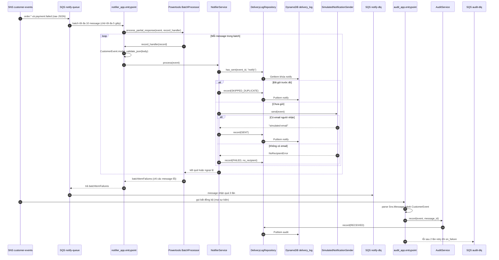

# Phase 4B: Application Code — notifier, audit, integration test — Customer Logic Workflow

> **Phạm vi 4B:** `common/delivery_log.py` (sổ giao nhận), Lambda **notifier** và **audit**, bộ unit test còn lại, integration test với **AWS Emulator**, và chốt ngưỡng coverage.
> **Điều kiện:** đã xong 4A (`common`, `authorizer`, `ingest`) và test của 4A xanh.
> **Tình trạng kiểm chứng:** code chưa được chạy (`ruff`, `pytest`, deploy). Các API Powertools Batch tôi dùng theo hiểu biết về bản 3.x; mục 11.3 hướng dẫn xử lý nếu khác.
> **Lưu ý trung thực về "gửi thông báo":** hệ thống chưa tích hợp kênh gửi thật (SES, SMS tắt theo ADR-007). `notifier` hiện **mô phỏng việc gửi** bằng log đã che PII, qua một interface `NotificationSender` để sau này thay bằng SES mà không đổi nghiệp vụ.

---

## 1. Quyết định thiết kế mới

| ADR | Quyết định | Lý do | Đánh đổi |
|---|---|---|---|
| **ADR-034** | **Sort key của `delivery_log` có dạng `kênh#trạng-thái` (cố định) hoặc `kênh#trạng-thái#thời-điểm`.** `SENT` và `RECEIVED` dùng khóa cố định, `FAILED` và `SKIPPED_DUPLICATE` thêm thời điểm | Ghi lại cùng một kết quả thành công là **idempotent** (ghi đè, không nhân bản dòng). Mỗi lần thất bại vẫn giữ riêng để điều tra. Đây là điều chỉnh so với Phase 1 (`kênh#thời-điểm`) | Truy vấn "mọi thứ của một sự kiện" vẫn đơn giản: `Query` theo `event_id` |
| **ADR-035** | `NotificationSender` là interface; bản hiện tại **mô phỏng** | Chưa có kênh gửi thật; ranh giới sạch để thêm SES sau | Chưa có email thật đến khách |
| **ADR-036** | Phân biệt lỗi **vĩnh viễn** và **tạm thời**: không có email người nhận thì ghi `FAILED` rồi **ack** (không retry vô ích). Lỗi tạm thời (gửi hoặc ghi DynamoDB lỗi) thì **báo lỗi của message** để SQS retry rồi vào DLQ | Không tốn retry cho lỗi không bao giờ tự khỏi, vẫn không mất message khi lỗi tạm thời | Message sai định dạng cũng đi hết 3 lần retry rồi vào `notify_dlq` (có chủ đích, để giữ bằng chứng) |
| **ADR-037** | Chống gửi trùng ở `notifier` bằng **kiểm tra `delivery_log` trước khi gửi** (`GetItem` khóa `notify#SENT`) | Không cần thêm quyền vào bảng `idempotency`; kết quả đã có sẵn trong sổ | Có cửa sổ race rất nhỏ nếu hai lần xử lý song song (SQS chỉ giao một message cho một consumer trong thời gian `visibility timeout`, nên hiếm) |
| **ADR-038** | `audit` ghi dòng `audit#RECEIVED` **cố định** cho mỗi sự kiện | SNS có thể gọi Lambda nhiều hơn một lần cho cùng message; ghi đè giữ đúng một dòng | Mất thông tin "SNS gọi mấy lần" (không cần thiết) |
| **ADR-039** | Ngưỡng coverage nâng lên **85%**; `make test-integration` thêm `--no-cov` | Coverage đo trên unit test, integration test chạy tập con nên sẽ luôn "thấp" | Cần sửa Makefile |

---

## 2. Cấu trúc file của Phase 4B

```text
src/
├── common/
│   └── delivery_log.py                     # mới (dùng bởi notifier và audit)
├── notifier/
│   ├── handler.py
│   └── notifier_app/
│       ├── __init__.py
│       ├── entrypoint.py
│       ├── sender.py
│       └── service.py
└── audit/
    ├── handler.py
    └── audit_app/
        ├── __init__.py
        ├── entrypoint.py
        └── service.py

tests/
├── conftest.py                             # cập nhật (thêm fixture)
├── unit/
│   ├── common/   test_delivery_log.py
│   ├── notifier/ test_sender.py  test_service.py  test_entrypoint.py
│   └── audit/    test_service.py  test_entrypoint.py
└── integration/
    └── test_pipeline.py
```

Các file `handler.py` của `notifier` và `audit` **thay thế stub tạm** ở Phase 3C.

---

## 3. Sơ đồ tuần tự (phần 4B) và Call-Chain

### 3.1. Sơ đồ tuần tự: từ SNS tới sổ giao nhận



### 3.2. Walkthrough với payload cụ thể

Message trong `notify-queue` (body là JSON sự kiện vì bật raw delivery ở 3B):

```json
{
  "event_id": "7f3c1e52-9b1a-4c0e-8d52-1b2a3c4d5e6f",
  "event_type": "order.created",
  "severity": "info",
  "customer_id": "cus_10293",
  "occurred_at": "2026-11-23T08:15:30Z",
  "payload": { "order_id": "ord_5521", "email": "khach@example.com" }
}
```

| Bước | File / hàm | Dữ liệu vào | Dữ liệu ra / biến đổi |
|---|---|---|---|
| 1 | `notifier_app/entrypoint.py::lambda_handler` | Event SQS (`Records[]`) | Giao cho `process_partial_response`, mỗi record gọi `_handle_record` |
| 2 | `entrypoint.py::_handle_record` | `SQSRecord.body` (chuỗi JSON) | `CustomerEvent.model_validate_json`; gắn `event_id`, `event_type`, `severity` vào log |
| 3 | `service.py::NotifierService.process` | `CustomerEvent` | Gọi `has_sent` trước |
| 4 | `common/delivery_log.py::has_sent` | `event_id`, kênh `notify` | `GetItem` khóa `notify#SENT` với `ConsistentRead`, trả `bool` |
| 5 | `sender.py::SimulatedNotificationSender.send` | `CustomerEvent` | Lấy email từ `payload`, dựng nội dung, ghi log với email **đã che** (`k***@example.com`). Trả `"simulated-email"` |
| 6 | `service.py` | Tên kênh gửi | `record(SENT, detail="simulated-email")` |
| 7 | `delivery_log.py::record` | Sự kiện, kênh, trạng thái | `PutItem`: `event_id`, `channel_ts = "notify#SENT"`, `status`, `event_type`, `severity`, `customer_id`, `occurred_at`, `recorded_at`, `expires_at` (+30 ngày). **Không** lưu `payload` |
| 8 | `entrypoint.py` | Kết quả từng record | `batchItemFailures: []`; SQS xóa các message thành công |

### 3.3. Xử lý lỗi và retry

| Tình huống | Nơi phát hiện | Kết quả |
|---|---|---|
| Body không phải JSON hợp lệ hoặc sai hợp đồng | `model_validate_json` ném `ValidationError` | Message được báo lỗi, SQS giao lại; sau 3 lần nhận vào `notify_dlq` |
| Sự kiện hợp lệ nhưng **không có email** | `NoRecipientError` | Ghi `FAILED` (`no_recipient`) rồi **xóa message** khỏi queue (lỗi vĩnh viễn, ADR-036) |
| Gửi thông báo lỗi tạm thời (`NotificationSendError`) | `NotifierService` | Ghi `FAILED` rồi ném lại; message được giao lại, sau 3 lần vào `notify_dlq` |
| DynamoDB lỗi khi đọc/ghi sổ | `DeliveryLogError` | Ném lên; message được giao lại, sau 3 lần vào `notify_dlq` |
| Cùng sự kiện được xử lý lần hai (SQS giao lại) | `has_sent = true` | Ghi `SKIPPED_DUPLICATE`, **không gửi lại** |
| Một message trong batch lỗi, các message khác ổn | `process_partial_response` | `batchItemFailures` chỉ chứa message lỗi; các message khác bị xóa |
| **Mọi** message trong batch đều lỗi | Powertools (mặc định `raise_on_entire_batch_failure`) | Hàm **ném lỗi** (hiện ra ở metric `Errors` để alarm Phase 6), cả batch được giao lại |
| `audit` lỗi (ví dụ DynamoDB) | `lambda_handler` ném lỗi | Lambda tự retry 2 lần rồi đẩy vào `audit_dlq` (on_failure, 3C) |
| `audit` nhận message không phải sự kiện hợp lệ | `ValidationError` | Ném lỗi, vào `audit_dlq` để điều tra |

---

## 4. Contract Table (Phase 4B)

| Caller → Callee | Inputs / Tham số truyền | Outputs / Giá trị trả về | Vì sao có phụ thuộc này |
|---|---|---|---|
| SQS event source mapping → `notifier_app.entrypoint.lambda_handler` | Event SQS (batch) | `{"batchItemFailures": [...]}` | Đúng định dạng `ReportBatchItemFailures` đã bật ở 3C |
| `notifier entrypoint` → Powertools `process_partial_response` | `event`, `record_handler`, `processor` | `batchItemFailures` | Xử lý từng message độc lập, chỉ báo lỗi message hỏng |
| `notifier entrypoint` → `NotifierService.process` | `CustomerEvent` | `Outcome` (`sent`, `duplicate`, `no_recipient`) hoặc ngoại lệ | Tách nghiệp vụ khỏi giao thức SQS |
| `NotifierService` → `DeliveryLog.has_sent` / `record` | `event_id`/`CustomerEvent`, kênh, trạng thái, `detail` | `bool` / `None` hoặc `DeliveryLogError` | Sổ giao nhận là nguồn sự thật cho chống trùng và tra cứu |
| `NotifierService` → `NotificationSender.send` | `CustomerEvent` | Tên kênh (`str`), hoặc `NoRecipientError`, `NotificationSendError` | Ranh giới để thay bằng SES sau này |
| `DeliveryLogRepository` → DynamoDB | `Key`/`Item`, `ConsistentRead` | Item hoặc `None` | Cần quyền `GetItem` và `PutItem` (bản vá IAM ở mục 7) |
| SNS → `audit_app.entrypoint.lambda_handler` | Event SNS (`Records[].Sns.Message`, `MessageId`) | `{"recorded": n}` | Subscription trực tiếp, mọi sự kiện, đã cấp permission ở 3C |
| `audit entrypoint` → `AuditService.record` | `CustomerEvent`, `message_id` | `None` | Ghi bằng chứng mọi sự kiện đã đi qua topic |
| `AuditService` → `DeliveryLog.record` | `channel="audit"`, `status=RECEIVED`, `detail="sns:<id>"` | `None` | Dùng chung repository với notifier |

---

## 5. Code: sổ giao nhận (`common`)

### File 1: `src/common/delivery_log.py`

**Overview:** Repository ghi và đọc **sổ giao nhận** trong bảng DynamoDB `delivery_log` (3B: khóa `event_id` + `channel_ts`, TTL `expires_at`). Được `NotifierService` và `AuditService` dùng; nằm trong `common` nên đi cùng layer. Quyền IAM: `GetItem` và `PutItem` trên đúng bảng này (xem bản vá ở mục 7).

```python
"""Repository ghi sổ giao nhận (delivery log) vào DynamoDB, dùng chung cho notifier và audit."""

from __future__ import annotations

from collections.abc import Callable
from datetime import UTC, datetime, timedelta
from enum import StrEnum
from typing import Any

import boto3
from botocore.config import Config
from botocore.exceptions import BotoCoreError, ClientError

from common.models import CustomerEvent
from common.observability import tracer

DEFAULT_TTL_DAYS = 30
MAX_DETAIL_LENGTH = 500


class DeliveryStatus(StrEnum):
    SENT = "SENT"
    FAILED = "FAILED"
    SKIPPED_DUPLICATE = "SKIPPED_DUPLICATE"
    RECEIVED = "RECEIVED"


# Các trạng thái dùng khóa cố định: ghi lại cùng kết quả là idempotent (ghi đè, không nhân bản dòng)
_DETERMINISTIC_STATUSES = frozenset({DeliveryStatus.SENT, DeliveryStatus.RECEIVED})


class DeliveryLogError(RuntimeError):
    """Không đọc hoặc ghi được sổ giao nhận."""


def _utc_now() -> datetime:
    return datetime.now(UTC)


class DeliveryLogRepository:
    """Đọc và ghi sổ giao nhận. Không bao giờ lưu payload của sự kiện."""

    def __init__(
        self,
        table_name: str,
        table: Any | None = None,
        ttl_days: int = DEFAULT_TTL_DAYS,
        now: Callable[[], datetime] = _utc_now,
    ) -> None:
        self._table = table or boto3.resource(
            "dynamodb",
            config=Config(
                connect_timeout=1,
                read_timeout=3,
                retries={"max_attempts": 2, "mode": "standard"},
            ),
        ).Table(table_name)
        self._ttl_days = ttl_days
        self._now = now

    @staticmethod
    def sort_key(channel: str, status: DeliveryStatus, recorded_at: datetime) -> str:
        if status in _DETERMINISTIC_STATUSES:
            return f"{channel}#{status.value}"
        return f"{channel}#{status.value}#{recorded_at.isoformat()}"

    @tracer.capture_method
    def has_sent(self, event_id: str, channel: str) -> bool:
        key = {
            "event_id": event_id,
            "channel_ts": self.sort_key(channel, DeliveryStatus.SENT, self._now()),
        }
        try:
            response = self._table.get_item(Key=key, ConsistentRead=True)
        except (BotoCoreError, ClientError) as exc:
            raise DeliveryLogError("Không đọc được sổ giao nhận") from exc
        return "Item" in response

    @tracer.capture_method
    def record(
        self,
        event: CustomerEvent,
        channel: str,
        status: DeliveryStatus,
        detail: str | None = None,
    ) -> None:
        recorded_at = self._now()
        item: dict[str, Any] = {
            "event_id": str(event.event_id),
            "channel_ts": self.sort_key(channel, status, recorded_at),
            "channel": channel,
            "status": status.value,
            "event_type": event.event_type.value,
            "severity": event.severity.value,
            "occurred_at": event.occurred_at.isoformat(),
            "recorded_at": recorded_at.isoformat(),
            "expires_at": int((recorded_at + timedelta(days=self._ttl_days)).timestamp()),
        }
        if event.customer_id is not None:
            item["customer_id"] = event.customer_id
        if detail:
            item["detail"] = detail[:MAX_DETAIL_LENGTH]

        try:
            self._table.put_item(Item=item)
        except (BotoCoreError, ClientError) as exc:
            raise DeliveryLogError("Không ghi được sổ giao nhận") from exc
```

**Giải thích chi tiết:**
- **Khóa cố định cho `SENT` và `RECEIVED`** (ADR-034): `PutItem` cùng khóa **ghi đè**, nên gửi lại hay xử lý lại không tạo dòng thừa. `FAILED` và `SKIPPED_DUPLICATE` có thêm thời điểm để giữ lịch sử từng lần.
- **Không lưu `payload`**: chỉ metadata (loại, mức độ, khách hàng, thời điểm). Sổ giao nhận không trở thành nơi rò rỉ dữ liệu cá nhân (email nằm trong `payload`).
- `expires_at` là epoch giây (số nguyên) khớp thuộc tính TTL ở 3B: DynamoDB tự xóa dòng sau 30 ngày, miễn phí.
- `ConsistentRead=True` ở `has_sent`: đọc nhất quán mạnh để lần xử lý lại ngay sau đó thấy được dòng `SENT` vừa ghi (đọc mặc định là nhất quán cuối cùng, có thể chưa thấy).
- `detail` bị cắt còn 500 ký tự để một thông điệp lỗi dài không làm item phình.
- `table` và `now` tiêm được qua constructor: test truyền đồng hồ cố định để kiểm tra TTL và khóa chính xác.
- Timeout và retry (`standard`, backoff có jitter) ngắn hơn timeout 30 giây của `notifier`.

---

## 6. Code: Lambda `notifier`

### File 2: `src/notifier/handler.py`

**Overview:** Điểm vào của `notifier` (`handler.lambda_handler`, đã cấu hình ở 3C), re-export từ `notifier_app`. **Thay thế stub tạm.**

```python
"""Điểm vào Lambda notifier. Logic nằm trong notifier_app."""

from notifier_app.entrypoint import lambda_handler

__all__ = ["lambda_handler"]
```

**Giải thích chi tiết:** giống `handler.py` của 4A (ADR-027).

### File 3: `src/notifier/notifier_app/__init__.py`

**Overview:** Đánh dấu package.

```python
"""Package của Lambda notifier."""
```

**Giải thích chi tiết:** tên `notifier_app` duy nhất trong dự án.

### File 4: `src/notifier/notifier_app/sender.py`

**Overview:** Tầng **gửi thông báo**: interface `NotificationSender` và bản **mô phỏng** `SimulatedNotificationSender` (ADR-035). Được `NotifierService` gọi. Dùng `common.pii` để che email trong log.

```python
"""Gửi thông báo khách hàng. Bản hiện tại mô phỏng việc gửi bằng log đã che dữ liệu cá nhân."""

from __future__ import annotations

from typing import Protocol

from common.models import CustomerEvent, EventType
from common.observability import logger
from common.pii import mask_email

SIMULATED_CHANNEL = "simulated-email"


class NoRecipientError(RuntimeError):
    """Sự kiện không có thông tin người nhận (lỗi vĩnh viễn, không nên retry)."""


class NotificationSendError(RuntimeError):
    """Gửi thông báo thất bại do lỗi tạm thời (nên retry)."""


class NotificationSender(Protocol):
    def send(self, event: CustomerEvent) -> str: ...


def resolve_email(event: CustomerEvent) -> str | None:
    email = event.payload.get("email")
    if isinstance(email, str) and "@" in email:
        return email.strip()
    return None


def render_message(event: CustomerEvent) -> str:
    order_id = str(event.payload.get("order_id", ""))
    match event.event_type:
        case EventType.ORDER_CREATED:
            return f"Đơn hàng {order_id} của bạn đã được tạo."
        case EventType.ORDER_SHIPPED:
            return f"Đơn hàng {order_id} của bạn đang được giao."
        case EventType.PAYMENT_FAILED:
            return f"Thanh toán cho đơn hàng {order_id} chưa thành công. Vui lòng thử lại."
        case _:
            return "Bạn có một thông báo mới từ hệ thống."


class SimulatedNotificationSender:
    """Mô phỏng gửi email: dựng nội dung và ghi log (email đã che), không gửi thật."""

    def send(self, event: CustomerEvent) -> str:
        email = resolve_email(event)
        if email is None:
            raise NoRecipientError("Sự kiện không có email người nhận")

        message = render_message(event)
        logger.info(
            "Gửi thông báo (mô phỏng)",
            extra={"recipient": mask_email(email), "message_length": len(message)},
        )
        return SIMULATED_CHANNEL
```

**Giải thích chi tiết:**
- **Log chỉ có email đã che** (`k***@example.com`) và **độ dài** nội dung, không có nội dung hay địa chỉ đầy đủ (ADR-032).
- Chỉ hỗ trợ **email**; số điện thoại bị bỏ qua vì SMS tắt (ADR-007). Sự kiện không có email thì `NoRecipientError`.
- `match` theo `EventType` để mỗi loại sự kiện có nội dung riêng; nhánh `_` bảo đảm không bao giờ ném lỗi vì loại mới.
- Để thay bằng SES: viết lớp mới có phương thức `send(event) -> str` và đổi ở `get_runtime()`. Nhớ ném `NotificationSendError` cho lỗi tạm thời và cấp thêm quyền `ses:SendEmail` ở Terraform (kèm cập nhật boundary).
- Nội dung thông báo chứa dữ liệu từ `payload` (không đáng tin). Khi gửi thật bằng SES, phải escape theo định dạng đích.

### File 5: `src/notifier/notifier_app/service.py`

**Overview:** Tầng **Service**: quy trình nghiệp vụ "đã gửi chưa, gửi, ghi sổ". Được `entrypoint` gọi; gọi `DeliveryLog` và `NotificationSender`.

```python
"""Nghiệp vụ gửi thông báo: chống gửi trùng, gửi, ghi sổ giao nhận."""

from __future__ import annotations

from enum import StrEnum
from typing import Protocol

from common.delivery_log import DeliveryStatus
from common.models import CustomerEvent
from notifier_app.sender import NoRecipientError, NotificationSender, NotificationSendError

CHANNEL = "notify"


class Outcome(StrEnum):
    SENT = "sent"
    DUPLICATE = "duplicate"
    NO_RECIPIENT = "no_recipient"


class DeliveryLog(Protocol):
    def has_sent(self, event_id: str, channel: str) -> bool: ...

    def record(
        self,
        event: CustomerEvent,
        channel: str,
        status: DeliveryStatus,
        detail: str | None = None,
    ) -> None: ...


class NotifierService:
    def __init__(self, delivery_log: DeliveryLog, sender: NotificationSender) -> None:
        self._delivery_log = delivery_log
        self._sender = sender

    def process(self, event: CustomerEvent) -> Outcome:
        event_id = str(event.event_id)

        if self._delivery_log.has_sent(event_id, CHANNEL):
            self._delivery_log.record(event, CHANNEL, DeliveryStatus.SKIPPED_DUPLICATE)
            return Outcome.DUPLICATE

        try:
            channel_used = self._sender.send(event)
        except NoRecipientError:
            self._delivery_log.record(event, CHANNEL, DeliveryStatus.FAILED, detail="no_recipient")
            return Outcome.NO_RECIPIENT
        except NotificationSendError:
            self._delivery_log.record(event, CHANNEL, DeliveryStatus.FAILED, detail="send_error")
            raise

        self._delivery_log.record(event, CHANNEL, DeliveryStatus.SENT, detail=channel_used)
        return Outcome.SENT
```

**Giải thích chi tiết:**
- **Kiểm tra `has_sent` trước khi gửi** (ADR-037): SQS là *at-least-once*, một message có thể được giao hơn một lần; sổ giao nhận cho biết đã gửi chưa để không gửi hai lần.
- **Phân loại lỗi (ADR-036):** `NoRecipientError` là lỗi vĩnh viễn: ghi `FAILED` và **trả kết quả bình thường** (message bị xóa, không retry). `NotificationSendError` là lỗi tạm thời: ghi `FAILED` rồi **ném lại** để SQS retry và cuối cùng vào DLQ.
- Ghi `SENT` **sau** khi gửi thành công: nếu hàm chết giữa chừng, lần retry sẽ gửi lại (ưu tiên "không mất thông báo" hơn "tuyệt đối không trùng").
- `DeliveryLog` là `Protocol`: test dùng fake thay vì DynamoDB.
- Service **không biết** SQS, DynamoDB hay Powertools.

### File 6: `src/notifier/notifier_app/entrypoint.py`

**Overview:** Tầng **Handler**: nhận batch SQS, xử lý từng message độc lập bằng **Powertools Batch**, trả `batchItemFailures`. Gọi `NotifierService`, `DeliveryLogRepository`, `SimulatedNotificationSender`.

```python
"""Lambda notifier: đọc batch từ SQS, gửi thông báo khách hàng, ghi sổ giao nhận."""

from __future__ import annotations

from dataclasses import dataclass
from functools import lru_cache, partial
from typing import Any

from aws_lambda_powertools.utilities.batch import (
    BatchProcessor,
    EventType,
    process_partial_response,
)
from aws_lambda_powertools.utilities.data_classes.sqs_event import SQSRecord
from aws_lambda_powertools.utilities.typing import LambdaContext

from common.config import require_env
from common.delivery_log import DeliveryLogRepository
from common.models import CustomerEvent
from common.observability import logger, tracer
from notifier_app.sender import SimulatedNotificationSender
from notifier_app.service import NotifierService

LOG_KEYS = ("event_id", "event_type", "severity")


@dataclass(frozen=True)
class Runtime:
    service: NotifierService
    processor: BatchProcessor


@lru_cache(maxsize=1)
def get_runtime() -> Runtime:
    """Dựng các thành phần một lần cho mỗi môi trường thực thi (cold start)."""
    table_name = require_env("DELIVERY_LOG_TABLE")
    service = NotifierService(DeliveryLogRepository(table_name), SimulatedNotificationSender())
    return Runtime(service=service, processor=BatchProcessor(event_type=EventType.SQS))


def _handle_record(service: NotifierService, record: SQSRecord) -> None:
    event = CustomerEvent.model_validate_json(record.body)

    logger.append_keys(
        event_id=str(event.event_id),
        event_type=event.event_type.value,
        severity=event.severity.value,
    )
    try:
        outcome = service.process(event)
        logger.info("Đã xử lý thông báo", extra={"outcome": outcome.value})
    finally:
        logger.remove_keys(list(LOG_KEYS))


@logger.inject_lambda_context
@tracer.capture_lambda_handler
def lambda_handler(event: dict[str, Any], context: LambdaContext) -> dict[str, Any]:
    runtime = get_runtime()
    return process_partial_response(
        event=event,
        record_handler=partial(_handle_record, runtime.service),
        processor=runtime.processor,
        context=context,
    )
```

**Giải thích chi tiết:**
- **`process_partial_response`** chạy `_handle_record` cho từng message, bắt ngoại lệ **riêng từng message** và trả `{"batchItemFailures": [{"itemIdentifier": messageId}, ...]}` chỉ với message lỗi. Nhờ đó một message hỏng không kéo cả batch làm lại (SQS xóa các message đã thành công).
- **Mọi message cùng lỗi:** theo mặc định Powertools **ném lỗi** của hàm (không chỉ trả danh sách lỗi), nên số lỗi xuất hiện trong metric `Errors` của Lambda, đầu vào cho alarm ở Phase 6.
- `logger.append_keys` gắn `event_id`... cho **mọi dòng log của message đó** (kể cả ở `service`, `sender`), rồi `remove_keys` trong `finally` để khóa của message này không rò sang message kế tiếp trong cùng batch.
- `CustomerEvent.model_validate_json(record.body)`: body là JSON sự kiện vì subscription bật `raw_message_delivery` (3B). Body sai thì `ValidationError`, message được báo lỗi để vào DLQ.
- `get_runtime()` dùng `lru_cache`: xử lý xong cold start thì các lần gọi sau dùng lại kết nối DynamoDB.

---

## 7. Code: Lambda `audit`

### File 7: `src/audit/handler.py`

**Overview:** Điểm vào của `audit`, re-export từ `audit_app`. **Thay thế stub tạm.**

```python
"""Điểm vào Lambda audit. Logic nằm trong audit_app."""

from audit_app.entrypoint import lambda_handler

__all__ = ["lambda_handler"]
```

**Giải thích chi tiết:** giống File 2.

### File 8: `src/audit/audit_app/__init__.py`

**Overview:** Đánh dấu package.

```python
"""Package của Lambda audit."""
```

**Giải thích chi tiết:** tên `audit_app` duy nhất trong dự án.

### File 9: `src/audit/audit_app/service.py`

**Overview:** Tầng **Service** của `audit`: ghi bằng chứng "sự kiện này đã đi qua topic". Gọi `DeliveryLog`.

```python
"""Nghiệp vụ audit: ghi lại mọi sự kiện đã đi qua topic."""

from __future__ import annotations

from typing import Protocol

from common.delivery_log import DeliveryStatus
from common.models import CustomerEvent

CHANNEL = "audit"


class DeliveryLog(Protocol):
    def record(
        self,
        event: CustomerEvent,
        channel: str,
        status: DeliveryStatus,
        detail: str | None = None,
    ) -> None: ...


class AuditService:
    def __init__(self, delivery_log: DeliveryLog) -> None:
        self._delivery_log = delivery_log

    def record(self, event: CustomerEvent, message_id: str) -> None:
        self._delivery_log.record(
            event,
            CHANNEL,
            DeliveryStatus.RECEIVED,
            detail=f"sns:{message_id}",
        )
```

**Giải thích chi tiết:** dòng `audit#RECEIVED` có khóa cố định (ADR-038) nên SNS gọi lại cũng chỉ ghi đè một dòng. `detail` lưu `MessageId` của SNS để đối chiếu với log của `ingest`.

### File 10: `src/audit/audit_app/entrypoint.py`

**Overview:** Tầng **Handler** của `audit`: nhận event SNS (gọi bất đồng bộ), parse từng record và ghi sổ. Gọi `AuditService`.

```python
"""Lambda audit: subscribe trực tiếp vào SNS, ghi bằng chứng mọi sự kiện."""

from __future__ import annotations

from functools import lru_cache
from typing import Any

from aws_lambda_powertools.utilities.typing import LambdaContext

from audit_app.service import AuditService
from common.config import require_env
from common.delivery_log import DeliveryLogRepository
from common.models import CustomerEvent
from common.observability import logger, tracer


@lru_cache(maxsize=1)
def get_service() -> AuditService:
    """Dựng service một lần cho mỗi môi trường thực thi (cold start)."""
    return AuditService(DeliveryLogRepository(require_env("DELIVERY_LOG_TABLE")))


@logger.inject_lambda_context
@tracer.capture_lambda_handler
def lambda_handler(event: dict[str, Any], context: LambdaContext) -> dict[str, int]:
    service = get_service()
    recorded = 0

    for record in event.get("Records", []):
        sns_message = record["Sns"]
        parsed = CustomerEvent.model_validate_json(sns_message["Message"])

        logger.append_keys(
            event_id=str(parsed.event_id),
            event_type=parsed.event_type.value,
            severity=parsed.severity.value,
        )
        service.record(parsed, message_id=sns_message["MessageId"])
        recorded += 1

    logger.info("Đã ghi bằng chứng sự kiện", extra={"recorded": recorded})
    return {"recorded": recorded}
```

**Giải thích chi tiết:**
- **Lỗi được ném lên, không nuốt:** nếu message không hợp lệ hoặc DynamoDB lỗi, hàm lỗi, Lambda tự retry 2 lần rồi đẩy vào `audit_dlq` (đích `on_failure` cấu hình ở 3C). Đó là cơ chế "không mất bằng chứng".
- Với Lambda, SNS bọc message trong phong bì (`Records[].Sns.Message` là **chuỗi JSON**), khác với SQS raw delivery. `model_validate_json` parse thẳng chuỗi đó.
- Chỉ ghi metadata của sự kiện, không bao giờ log `Message` thô (có thể chứa dữ liệu cá nhân trong `payload`).

---

## 8. Code: cấu hình test và unit test

### File 11: `tests/conftest.py` (thay thế bản ở 4A)

**Overview:** Bản đầy đủ đã bổ sung các fixture cho 4B: bảng `delivery_log` giả (moto), đọc dòng sổ, dựng event SQS và SNS, và sự kiện có email.

```python
"""Fixture dùng chung cho unit test."""

from __future__ import annotations

import json
import uuid
from collections.abc import Callable, Iterator
from typing import Any

import boto3
import pytest
from moto import mock_aws

DELIVERY_LOG_TABLE_NAME = "clw-test-delivery-log"


@pytest.fixture(autouse=True)
def isolated_aws_environment(
    request: pytest.FixtureRequest,
    monkeypatch: pytest.MonkeyPatch,
) -> None:
    """Gỡ mọi cấu hình AWS thật và đặt credential giả để moto không bao giờ gọi AWS thật."""
    if request.node.get_closest_marker("integration"):
        return

    for name in (
        "AWS_ENDPOINT_URL",
        "AWS_PROFILE",
        "AWS_CA_BUNDLE",
        "AWS_SESSION_TOKEN",
        "AWS_SHARED_CREDENTIALS_FILE",
        "AWS_CONFIG_FILE",
    ):
        monkeypatch.delenv(name, raising=False)

    monkeypatch.setenv("AWS_ACCESS_KEY_ID", "testing")
    monkeypatch.setenv("AWS_SECRET_ACCESS_KEY", "testing")
    monkeypatch.setenv("AWS_DEFAULT_REGION", "ap-southeast-1")
    monkeypatch.setenv("AWS_REGION", "ap-southeast-1")
    monkeypatch.setenv("POWERTOOLS_TRACE_DISABLED", "true")
    monkeypatch.setenv("POWERTOOLS_SERVICE_NAME", "clw-test")
    monkeypatch.setenv("LOG_LEVEL", "INFO")


class FakeLambdaContext:
    function_name = "clw-test-function"
    memory_limit_in_mb = 256
    invoked_function_arn = "arn:aws:lambda:ap-southeast-1:123456789012:function:clw-test-function"
    aws_request_id = "req-123"

    def get_remaining_time_in_millis(self) -> int:
        return 30_000


@pytest.fixture
def lambda_context() -> FakeLambdaContext:
    return FakeLambdaContext()


@pytest.fixture
def valid_event() -> dict[str, Any]:
    return {
        "event_id": str(uuid.uuid4()),
        "event_type": "order.created",
        "severity": "info",
        "customer_id": "cus_10293",
        "occurred_at": "2026-11-23T08:15:30Z",
        "payload": {"order_id": "ord_5521", "total": 450000, "currency": "VND"},
    }


@pytest.fixture
def event_with_email(valid_event: dict[str, Any]) -> dict[str, Any]:
    """Sự kiện hợp lệ có email người nhận để notifier gửi được."""
    valid_event["payload"]["email"] = "khach@example.com"
    return valid_event


@pytest.fixture
def api_event() -> Callable[[str | dict[str, Any] | None], dict[str, Any]]:
    """Dựng event API Gateway HTTP API (payload v2) với body tùy ý."""

    def build(body: str | dict[str, Any] | None) -> dict[str, Any]:
        event: dict[str, Any] = {
            "version": "2.0",
            "routeKey": "POST /events",
            "headers": {"content-type": "application/json", "x-api-key": "khoa-dung"},
            "requestContext": {
                "requestId": "req-api-1",
                "http": {"method": "POST", "path": "/events"},
            },
            "isBase64Encoded": False,
        }
        if body is not None:
            event["body"] = body if isinstance(body, str) else json.dumps(body)
        return event

    return build


@pytest.fixture
def eventbridge_event() -> Callable[[Any], dict[str, Any]]:
    """Dựng envelope EventBridge với phần detail tùy ý."""

    def build(detail: Any) -> dict[str, Any]:
        return {
            "version": "0",
            "id": "eb-1",
            "detail-type": "customer.event",
            "source": "customer.workflow",
            "account": "123456789012",
            "time": "2026-11-23T08:15:30Z",
            "region": "ap-southeast-1",
            "resources": [],
            "detail": detail,
        }

    return build


@pytest.fixture
def sqs_event() -> Callable[[list[tuple[str, str]]], dict[str, Any]]:
    """Dựng event SQS từ danh sách (messageId, body)."""

    def build(messages: list[tuple[str, str]]) -> dict[str, Any]:
        return {
            "Records": [
                {
                    "messageId": message_id,
                    "receiptHandle": f"handle-{message_id}",
                    "body": body,
                    "attributes": {
                        "ApproximateReceiveCount": "1",
                        "SentTimestamp": "1700000000000",
                        "SenderId": "AIDAEXAMPLE",
                        "ApproximateFirstReceiveTimestamp": "1700000000001",
                    },
                    "messageAttributes": {},
                    "md5OfBody": "d41d8cd98f00b204e9800998ecf8427e",
                    "eventSource": "aws:sqs",
                    "eventSourceARN": "arn:aws:sqs:ap-southeast-1:123456789012:clw-test-notify",
                    "awsRegion": "ap-southeast-1",
                }
                for message_id, body in messages
            ]
        }

    return build


@pytest.fixture
def sns_event() -> Callable[[str, str], dict[str, Any]]:
    """Dựng event SNS (gọi Lambda) từ (message, message_id)."""

    def build(message: str, message_id: str = "sns-msg-1") -> dict[str, Any]:
        return {
            "Records": [
                {
                    "EventSource": "aws:sns",
                    "EventVersion": "1.0",
                    "EventSubscriptionArn": "arn:aws:sns:ap-southeast-1:123456789012:t:sub-1",
                    "Sns": {
                        "Type": "Notification",
                        "MessageId": message_id,
                        "TopicArn": "arn:aws:sns:ap-southeast-1:123456789012:clw-test-events",
                        "Subject": None,
                        "Message": message,
                        "Timestamp": "2026-11-23T08:15:31.000Z",
                        "MessageAttributes": {},
                    },
                }
            ]
        }

    return build


@pytest.fixture
def delivery_log_table() -> Iterator[str]:
    """Bảng delivery_log giả (moto) với cùng schema như Terraform ở 3B."""
    with mock_aws():
        boto3.client("dynamodb").create_table(
            TableName=DELIVERY_LOG_TABLE_NAME,
            KeySchema=[
                {"AttributeName": "event_id", "KeyType": "HASH"},
                {"AttributeName": "channel_ts", "KeyType": "RANGE"},
            ],
            AttributeDefinitions=[
                {"AttributeName": "event_id", "AttributeType": "S"},
                {"AttributeName": "channel_ts", "AttributeType": "S"},
            ],
            BillingMode="PAY_PER_REQUEST",
        )
        yield DELIVERY_LOG_TABLE_NAME


@pytest.fixture
def read_log_rows(delivery_log_table: str) -> Callable[[], list[dict[str, Any]]]:
    """Đọc toàn bộ dòng của delivery_log, sắp theo sort key."""

    def read() -> list[dict[str, Any]]:
        table = boto3.resource("dynamodb").Table(delivery_log_table)
        return sorted(table.scan()["Items"], key=lambda item: item["channel_ts"])

    return read
```

**Giải thích chi tiết:**
- Thêm 5 fixture so với bản 4A: `event_with_email`, `sqs_event`, `sns_event`, `delivery_log_table`, `read_log_rows`. Các fixture cũ **giữ nguyên**.
- `delivery_log_table` tạo bảng **cùng schema** với Terraform (khóa `event_id` + `channel_ts`); nếu Terraform đổi schema, cập nhật ở đây để test không lệch hạ tầng.
- Bản dựng event SQS có đủ trường (`attributes`, `md5OfBody`...) vì lớp `SQSRecord` của Powertools đọc các trường này khi xử lý batch.

### File 12: `tests/unit/common/test_delivery_log.py`

**Overview:** Test `DeliveryLogRepository` với **moto DynamoDB**. Ranh giới giả lập: DynamoDB. Đồng hồ được tiêm để kết quả xác định.

```python
"""Test DeliveryLogRepository với moto DynamoDB."""

from __future__ import annotations

from collections.abc import Callable
from datetime import UTC, datetime, timedelta
from itertools import count
from typing import Any

import pytest
from moto import mock_aws

from common.delivery_log import DeliveryLogError, DeliveryLogRepository, DeliveryStatus
from common.models import CustomerEvent

NOW = datetime(2026, 11, 23, 8, 0, 0, tzinfo=UTC)


def make_ticking_clock() -> Callable[[], datetime]:
    ticks = count()
    return lambda: NOW + timedelta(seconds=next(ticks))


def parse(valid_event: dict[str, Any]) -> CustomerEvent:
    return CustomerEvent.model_validate(valid_event)


def test_sent_row_has_fixed_sort_key_ttl_and_no_payload(
    delivery_log_table: str,
    read_log_rows: Callable[[], list[dict[str, Any]]],
    valid_event: dict[str, Any],
) -> None:
    repository = DeliveryLogRepository(delivery_log_table, now=lambda: NOW)

    repository.record(parse(valid_event), "notify", DeliveryStatus.SENT, detail="simulated-email")

    [row] = read_log_rows()
    assert row["channel_ts"] == "notify#SENT"
    assert row["status"] == "SENT"
    assert row["customer_id"] == "cus_10293"
    assert row["detail"] == "simulated-email"
    assert int(row["expires_at"]) == int((NOW + timedelta(days=30)).timestamp())
    assert "payload" not in row


def test_recording_sent_twice_keeps_a_single_row(
    delivery_log_table: str,
    read_log_rows: Callable[[], list[dict[str, Any]]],
    valid_event: dict[str, Any],
) -> None:
    repository = DeliveryLogRepository(delivery_log_table, now=make_ticking_clock())
    event = parse(valid_event)

    repository.record(event, "notify", DeliveryStatus.SENT)
    repository.record(event, "notify", DeliveryStatus.SENT)

    assert len(read_log_rows()) == 1


def test_failed_attempts_are_kept_separately(
    delivery_log_table: str,
    read_log_rows: Callable[[], list[dict[str, Any]]],
    valid_event: dict[str, Any],
) -> None:
    repository = DeliveryLogRepository(delivery_log_table, now=make_ticking_clock())
    event = parse(valid_event)

    repository.record(event, "notify", DeliveryStatus.FAILED, detail="send_error")
    repository.record(event, "notify", DeliveryStatus.FAILED, detail="send_error")

    rows = read_log_rows()
    assert len(rows) == 2
    assert all(row["channel_ts"].startswith("notify#FAILED#") for row in rows)


def test_has_sent_reflects_only_successful_delivery(
    delivery_log_table: str, valid_event: dict[str, Any]
) -> None:
    repository = DeliveryLogRepository(delivery_log_table, now=make_ticking_clock())
    event = parse(valid_event)
    event_id = str(event.event_id)

    assert repository.has_sent(event_id, "notify") is False

    repository.record(event, "notify", DeliveryStatus.FAILED)
    assert repository.has_sent(event_id, "notify") is False

    repository.record(event, "notify", DeliveryStatus.SENT)
    assert repository.has_sent(event_id, "notify") is True
    assert repository.has_sent(event_id, "audit") is False


def test_long_detail_is_truncated(
    delivery_log_table: str,
    read_log_rows: Callable[[], list[dict[str, Any]]],
    valid_event: dict[str, Any],
) -> None:
    repository = DeliveryLogRepository(delivery_log_table, now=lambda: NOW)

    repository.record(parse(valid_event), "audit", DeliveryStatus.RECEIVED, detail="x" * 1000)

    [row] = read_log_rows()
    assert len(row["detail"]) == 500


def test_missing_table_raises_delivery_log_error(valid_event: dict[str, Any]) -> None:
    with mock_aws():
        repository = DeliveryLogRepository("bang-khong-ton-tai", now=lambda: NOW)

        with pytest.raises(DeliveryLogError):
            repository.record(parse(valid_event), "notify", DeliveryStatus.SENT)
        with pytest.raises(DeliveryLogError):
            repository.has_sent("abc", "notify")
```

**Giải thích chi tiết:**
- Test 1 khóa các cam kết về dữ liệu: khóa cố định, TTL đúng +30 ngày, **không lưu payload**.
- Test 2 và 3 chứng minh ADR-034: `SENT` idempotent (một dòng), `FAILED` giữ từng lần.
- Test 4 chứng minh `has_sent` chỉ `True` khi **đã gửi thành công** (một dòng `FAILED` không đủ) và **riêng theo kênh**.
- `make_ticking_clock` tăng thời gian mỗi lần gọi để hai lần ghi `FAILED` có sort key khác nhau.

### File 13: `tests/unit/notifier/test_sender.py`

**Overview:** Test tầng gửi (mô phỏng): chọn người nhận và dựng nội dung.

```python
"""Test render nội dung và chọn người nhận của notifier."""

from __future__ import annotations

from typing import Any

import pytest

from common.models import CustomerEvent
from notifier_app.sender import (
    SIMULATED_CHANNEL,
    NoRecipientError,
    SimulatedNotificationSender,
    render_message,
    resolve_email,
)


def parse(raw: dict[str, Any]) -> CustomerEvent:
    return CustomerEvent.model_validate(raw)


def test_resolve_email_returns_address(event_with_email: dict[str, Any]) -> None:
    assert resolve_email(parse(event_with_email)) == "khach@example.com"


@pytest.mark.parametrize("email", [None, "", "khong-co-a-cong", 12345])
def test_resolve_email_ignores_invalid_values(valid_event: dict[str, Any], email: Any) -> None:
    valid_event["payload"]["email"] = email

    assert resolve_email(parse(valid_event)) is None


@pytest.mark.parametrize(
    ("event_type", "fragment"),
    [
        ("order.created", "đã được tạo"),
        ("order.shipped", "đang được giao"),
        ("payment.failed", "chưa thành công"),
    ],
)
def test_message_depends_on_event_type(
    valid_event: dict[str, Any], event_type: str, fragment: str
) -> None:
    valid_event["event_type"] = event_type

    message = render_message(parse(valid_event))

    assert "ord_5521" in message
    assert fragment in message


def test_unknown_type_falls_back_to_generic_message(valid_event: dict[str, Any]) -> None:
    valid_event.update(event_type="system.alert", severity="critical")
    del valid_event["customer_id"]

    assert render_message(parse(valid_event)) == "Bạn có một thông báo mới từ hệ thống."


def test_simulated_sender_returns_channel(event_with_email: dict[str, Any]) -> None:
    assert SimulatedNotificationSender().send(parse(event_with_email)) == SIMULATED_CHANNEL


def test_simulated_sender_requires_recipient(valid_event: dict[str, Any]) -> None:
    with pytest.raises(NoRecipientError):
        SimulatedNotificationSender().send(parse(valid_event))
```

**Giải thích chi tiết:** không cần mock vì module thuần logic. Test `resolve_email` kiểm tra cả giá trị sai kiểu (số 12345), để đảm bảo `payload` không đáng tin không làm hàm ném lỗi lạ.

### File 14: `tests/unit/notifier/test_service.py`

**Overview:** Test `NotifierService`. **Ranh giới được mock:** `DeliveryLog` và `NotificationSender` (cả hai là fake).

```python
"""Test NotifierService với sổ giao nhận và sender giả."""

from __future__ import annotations

from typing import Any

import pytest

from common.delivery_log import DeliveryStatus
from common.models import CustomerEvent
from notifier_app.sender import NoRecipientError, NotificationSendError
from notifier_app.service import CHANNEL, NotifierService, Outcome


class FakeLog:
    def __init__(self, already_sent: bool = False) -> None:
        self.already_sent = already_sent
        self.records: list[tuple[DeliveryStatus, str | None]] = []

    def has_sent(self, event_id: str, channel: str) -> bool:
        return self.already_sent

    def record(
        self,
        event: CustomerEvent,
        channel: str,
        status: DeliveryStatus,
        detail: str | None = None,
    ) -> None:
        assert channel == CHANNEL
        self.records.append((status, detail))


class FakeSender:
    def __init__(self, error: Exception | None = None) -> None:
        self.calls = 0
        self._error = error

    def send(self, event: CustomerEvent) -> str:
        self.calls += 1
        if self._error is not None:
            raise self._error
        return "fake-channel"


def parse(raw: dict[str, Any]) -> CustomerEvent:
    return CustomerEvent.model_validate(raw)


def test_sends_and_records_sent(valid_event: dict[str, Any]) -> None:
    log, sender = FakeLog(), FakeSender()

    outcome = NotifierService(log, sender).process(parse(valid_event))

    assert outcome is Outcome.SENT
    assert sender.calls == 1
    assert log.records == [(DeliveryStatus.SENT, "fake-channel")]


def test_already_sent_event_is_skipped_without_sending(valid_event: dict[str, Any]) -> None:
    log, sender = FakeLog(already_sent=True), FakeSender()

    outcome = NotifierService(log, sender).process(parse(valid_event))

    assert outcome is Outcome.DUPLICATE
    assert sender.calls == 0
    assert log.records == [(DeliveryStatus.SKIPPED_DUPLICATE, None)]


def test_missing_recipient_is_recorded_and_not_retried(valid_event: dict[str, Any]) -> None:
    log, sender = FakeLog(), FakeSender(error=NoRecipientError("khong co email"))

    outcome = NotifierService(log, sender).process(parse(valid_event))

    assert outcome is Outcome.NO_RECIPIENT
    assert log.records == [(DeliveryStatus.FAILED, "no_recipient")]


def test_transient_send_error_is_recorded_and_reraised(valid_event: dict[str, Any]) -> None:
    log, sender = FakeLog(), FakeSender(error=NotificationSendError("mang loi"))

    with pytest.raises(NotificationSendError):
        NotifierService(log, sender).process(parse(valid_event))

    assert log.records == [(DeliveryStatus.FAILED, "send_error")]
```

**Giải thích chi tiết:** bốn bài tương ứng bốn nhánh của ADR-036/037: gửi thành công, bỏ qua bản trùng (và **không gọi sender**), lỗi vĩnh viễn (không ném), lỗi tạm thời (ném lại). Đây là hợp đồng về "khi nào retry" quan trọng nhất của `notifier`.

### File 15: `tests/unit/notifier/test_entrypoint.py`

**Overview:** Test **handler** `notifier` đi qua toàn bộ chuỗi (handler, Powertools Batch, service, repository) với **moto DynamoDB**.

```python
"""Test handler Lambda notifier qua toàn bộ chuỗi, với moto DynamoDB."""

from __future__ import annotations

import json
from collections.abc import Callable, Iterator
from typing import Any

import pytest
from aws_lambda_powertools.utilities.batch.exceptions import BatchProcessingError

from notifier_app import entrypoint


@pytest.fixture(autouse=True)
def runtime(monkeypatch: pytest.MonkeyPatch, delivery_log_table: str) -> Iterator[None]:
    monkeypatch.setenv("DELIVERY_LOG_TABLE", delivery_log_table)
    entrypoint.get_runtime.cache_clear()
    yield
    entrypoint.get_runtime.cache_clear()


def test_valid_message_is_sent_and_logged(
    event_with_email: dict[str, Any],
    sqs_event: Callable[..., dict[str, Any]],
    read_log_rows: Callable[[], list[dict[str, Any]]],
    lambda_context: Any,
) -> None:
    event = sqs_event([("m-1", json.dumps(event_with_email))])

    response = entrypoint.lambda_handler(event, lambda_context)

    assert response == {"batchItemFailures": []}
    [row] = read_log_rows()
    assert row["channel_ts"] == "notify#SENT"
    assert row["event_id"] == event_with_email["event_id"]


def test_only_the_bad_message_is_reported_as_failure(
    event_with_email: dict[str, Any],
    sqs_event: Callable[..., dict[str, Any]],
    read_log_rows: Callable[[], list[dict[str, Any]]],
    lambda_context: Any,
) -> None:
    event = sqs_event([("good-1", json.dumps(event_with_email)), ("bad-1", "khong phai json")])

    response = entrypoint.lambda_handler(event, lambda_context)

    assert response == {"batchItemFailures": [{"itemIdentifier": "bad-1"}]}
    assert [row["channel_ts"] for row in read_log_rows()] == ["notify#SENT"]


def test_batch_where_every_message_fails_raises(
    sqs_event: Callable[..., dict[str, Any]], lambda_context: Any
) -> None:
    event = sqs_event([("bad-1", "khong phai json"), ("bad-2", "{}")])

    with pytest.raises(BatchProcessingError):
        entrypoint.lambda_handler(event, lambda_context)


def test_redelivered_message_is_not_sent_twice(
    event_with_email: dict[str, Any],
    sqs_event: Callable[..., dict[str, Any]],
    read_log_rows: Callable[[], list[dict[str, Any]]],
    lambda_context: Any,
) -> None:
    body = json.dumps(event_with_email)

    entrypoint.lambda_handler(sqs_event([("m-1", body)]), lambda_context)
    entrypoint.lambda_handler(sqs_event([("m-2", body)]), lambda_context)

    keys = [row["channel_ts"] for row in read_log_rows()]
    assert keys.count("notify#SENT") == 1
    assert sum(key.startswith("notify#SKIPPED_DUPLICATE#") for key in keys) == 1


def test_event_without_email_is_recorded_as_failed_and_acknowledged(
    valid_event: dict[str, Any],
    sqs_event: Callable[..., dict[str, Any]],
    read_log_rows: Callable[[], list[dict[str, Any]]],
    lambda_context: Any,
) -> None:
    response = entrypoint.lambda_handler(
        sqs_event([("m-1", json.dumps(valid_event))]), lambda_context
    )

    assert response == {"batchItemFailures": []}
    [row] = read_log_rows()
    assert row["status"] == "FAILED"
    assert row["detail"] == "no_recipient"
```

**Giải thích chi tiết:**
- **Ranh giới giả lập:** DynamoDB (moto). Toàn bộ code còn lại chạy thật, kể cả Powertools Batch.
- Test 2 chứng minh **chỉ message lỗi** nằm trong `batchItemFailures` và message tốt vẫn được xử lý.
- Test 3 khóa hành vi "mọi message lỗi thì hàm ném lỗi" (cho alarm Phase 6). Nếu bản Powertools của bạn khác, xem mục 11.3.
- Test 4 chứng minh **không gửi trùng** khi SQS giao lại: đúng một dòng `SENT` và một dòng `SKIPPED_DUPLICATE`.
- Test 5 chứng minh lỗi vĩnh viễn (không có email) **không** trả `batchItemFailures` (message được xóa, ADR-036) nhưng được ghi sổ.

### File 16: `tests/unit/audit/test_service.py`

**Overview:** Test `AuditService` với sổ giao nhận giả.

```python
"""Test AuditService với sổ giao nhận giả."""

from __future__ import annotations

from typing import Any

from audit_app.service import CHANNEL, AuditService
from common.delivery_log import DeliveryStatus
from common.models import CustomerEvent


class FakeLog:
    def __init__(self) -> None:
        self.calls: list[tuple[str, DeliveryStatus, str | None]] = []

    def record(
        self,
        event: CustomerEvent,
        channel: str,
        status: DeliveryStatus,
        detail: str | None = None,
    ) -> None:
        self.calls.append((channel, status, detail))


def test_records_received_with_sns_message_id(valid_event: dict[str, Any]) -> None:
    log = FakeLog()

    AuditService(log).record(CustomerEvent.model_validate(valid_event), message_id="sns-1")

    assert log.calls == [(CHANNEL, DeliveryStatus.RECEIVED, "sns:sns-1")]
```

**Giải thích chi tiết:** xác nhận `audit` ghi đúng kênh `audit`, trạng thái `RECEIVED` và lưu `MessageId` của SNS để đối chiếu.

### File 17: `tests/unit/audit/test_entrypoint.py`

**Overview:** Test handler `audit` với moto DynamoDB.

```python
"""Test handler Lambda audit qua toàn bộ chuỗi, với moto DynamoDB."""

from __future__ import annotations

import json
from collections.abc import Callable, Iterator
from typing import Any

import pytest
from pydantic import ValidationError

from audit_app import entrypoint


@pytest.fixture(autouse=True)
def runtime(monkeypatch: pytest.MonkeyPatch, delivery_log_table: str) -> Iterator[None]:
    monkeypatch.setenv("DELIVERY_LOG_TABLE", delivery_log_table)
    entrypoint.get_service.cache_clear()
    yield
    entrypoint.get_service.cache_clear()


def test_valid_message_is_recorded(
    valid_event: dict[str, Any],
    sns_event: Callable[..., dict[str, Any]],
    read_log_rows: Callable[[], list[dict[str, Any]]],
    lambda_context: Any,
) -> None:
    response = entrypoint.lambda_handler(
        sns_event(json.dumps(valid_event), "sns-msg-1"), lambda_context
    )

    assert response == {"recorded": 1}
    [row] = read_log_rows()
    assert row["channel_ts"] == "audit#RECEIVED"
    assert row["detail"] == "sns:sns-msg-1"
    assert row["event_id"] == valid_event["event_id"]


def test_repeated_delivery_keeps_a_single_row(
    valid_event: dict[str, Any],
    sns_event: Callable[..., dict[str, Any]],
    read_log_rows: Callable[[], list[dict[str, Any]]],
    lambda_context: Any,
) -> None:
    message = json.dumps(valid_event)

    entrypoint.lambda_handler(sns_event(message, "sns-msg-1"), lambda_context)
    entrypoint.lambda_handler(sns_event(message, "sns-msg-1"), lambda_context)

    assert len(read_log_rows()) == 1


def test_invalid_message_raises_so_it_reaches_the_dlq(
    sns_event: Callable[..., dict[str, Any]], lambda_context: Any
) -> None:
    with pytest.raises(ValidationError):
        entrypoint.lambda_handler(sns_event("khong phai su kien"), lambda_context)


def test_event_without_records_records_nothing(lambda_context: Any) -> None:
    assert entrypoint.lambda_handler({"Records": []}, lambda_context) == {"recorded": 0}
```

**Giải thích chi tiết:** test 3 chứng minh `audit` **không nuốt lỗi**: ném lỗi thì Lambda retry rồi đẩy vào `audit_dlq` (cơ chế `on_failure` ở 3C), đây chính là điều ta muốn với dữ liệu lạ.

---

## 9. Code: integration test với AWS Emulator

### File 18: `tests/integration/test_pipeline.py`

**Overview:** Test **nối dây** trên AWS Emulator: lặp lại cấu hình SNS filter policy, SQS và DynamoDB của Terraform rồi chạy code thật xuyên các tầng. Dùng fixture `emulator_env` của `tests/integration/conftest.py` (Phase 2) để trỏ `boto3` vào emulator. **Không giả lập Lambda** (emulator ở đây dùng cho dịch vụ dữ liệu, handler được gọi trực tiếp như hàm Python). Thao tác nào emulator chưa hỗ trợ sẽ **skip kèm lý do** thay vì làm hỏng cả bộ test, để tạo "báo cáo độ trung thực" của emulator.

```python
"""Integration test với AWS Emulator: SNS filter, SQS, DynamoDB cùng code thật của các hàm."""

from __future__ import annotations

import json
import os
import uuid
from collections.abc import Callable, Iterator
from dataclasses import dataclass
from typing import Any

import boto3
import pytest
from boto3.dynamodb.conditions import Key
from botocore.exceptions import ClientError

from common.models import CustomerEvent
from ingest_app import entrypoint as ingest_entrypoint
from ingest_app.publisher import SnsEventPublisher
from notifier_app import entrypoint as notifier_entrypoint

pytestmark = pytest.mark.integration

FILTER_POLICY = {"event_type": [{"prefix": "order."}, "payment.failed"]}


def provision(operation: str, call: Callable[[], Any]) -> Any:
    """Chạy một thao tác tạo tài nguyên; emulator chưa hỗ trợ thì skip với lý do rõ ràng."""
    try:
        return call()
    except ClientError as exc:
        status = exc.response.get("ResponseMetadata", {}).get("HTTPStatusCode")
        code = exc.response.get("Error", {}).get("Code")
        if status == 501 or code == "NotImplemented":
            pytest.skip(f"AWS Emulator chưa hỗ trợ: {operation}")
        raise


@dataclass
class EmulatorStack:
    sns: Any
    sqs: Any
    topic_arn: str
    queue_url: str

    def drain(self) -> list[dict[str, Any]]:
        response = self.sqs.receive_message(
            QueueUrl=self.queue_url, MaxNumberOfMessages=10, WaitTimeSeconds=2
        )
        return [json.loads(message["Body"]) for message in response.get("Messages", [])]


@pytest.fixture
def stack(monkeypatch: pytest.MonkeyPatch) -> Iterator[EmulatorStack]:
    monkeypatch.setenv("POWERTOOLS_TRACE_DISABLED", "true")
    monkeypatch.setenv("POWERTOOLS_SERVICE_NAME", "clw-integration")

    suffix = uuid.uuid4().hex[:8]
    sns, sqs, dynamodb = boto3.client("sns"), boto3.client("sqs"), boto3.client("dynamodb")

    topic_arn = provision(
        "sns:CreateTopic", lambda: sns.create_topic(Name=f"clw-it-{suffix}")["TopicArn"]
    )
    queue_url = provision(
        "sqs:CreateQueue", lambda: sqs.create_queue(QueueName=f"clw-it-{suffix}")["QueueUrl"]
    )
    queue_arn = sqs.get_queue_attributes(QueueUrl=queue_url, AttributeNames=["QueueArn"])[
        "Attributes"
    ]["QueueArn"]

    provision(
        "sns:Subscribe với FilterPolicy và RawMessageDelivery",
        lambda: sns.subscribe(
            TopicArn=topic_arn,
            Protocol="sqs",
            Endpoint=queue_arn,
            Attributes={
                "RawMessageDelivery": "true",
                "FilterPolicyScope": "MessageAttributes",
                "FilterPolicy": json.dumps(FILTER_POLICY),
            },
        ),
    )

    idempotency_table = f"clw-it-idempotency-{suffix}"
    log_table = f"clw-it-delivery-log-{suffix}"
    provision(
        "dynamodb:CreateTable (idempotency)",
        lambda: dynamodb.create_table(
            TableName=idempotency_table,
            KeySchema=[{"AttributeName": "id", "KeyType": "HASH"}],
            AttributeDefinitions=[{"AttributeName": "id", "AttributeType": "S"}],
            BillingMode="PAY_PER_REQUEST",
        ),
    )
    provision(
        "dynamodb:UpdateTimeToLive",
        lambda: dynamodb.update_time_to_live(
            TableName=idempotency_table,
            TimeToLiveSpecification={"Enabled": True, "AttributeName": "expiration"},
        ),
    )
    provision(
        "dynamodb:CreateTable (delivery_log)",
        lambda: dynamodb.create_table(
            TableName=log_table,
            KeySchema=[
                {"AttributeName": "event_id", "KeyType": "HASH"},
                {"AttributeName": "channel_ts", "KeyType": "RANGE"},
            ],
            AttributeDefinitions=[
                {"AttributeName": "event_id", "AttributeType": "S"},
                {"AttributeName": "channel_ts", "AttributeType": "S"},
            ],
            BillingMode="PAY_PER_REQUEST",
        ),
    )

    monkeypatch.setenv("SNS_TOPIC_ARN", topic_arn)
    monkeypatch.setenv("IDEMPOTENCY_TABLE", idempotency_table)
    monkeypatch.setenv("DELIVERY_LOG_TABLE", log_table)
    ingest_entrypoint.get_runtime.cache_clear()
    notifier_entrypoint.get_runtime.cache_clear()

    yield EmulatorStack(sns=sns, sqs=sqs, topic_arn=topic_arn, queue_url=queue_url)

    ingest_entrypoint.get_runtime.cache_clear()
    notifier_entrypoint.get_runtime.cache_clear()


def test_filter_policy_routes_order_events_and_drops_system_alerts(
    stack: EmulatorStack, valid_event: dict[str, Any]
) -> None:
    publisher = SnsEventPublisher(stack.topic_arn)
    order = CustomerEvent.model_validate(valid_event)
    alert = CustomerEvent.model_validate(
        {
            **valid_event,
            "event_id": str(uuid.uuid4()),
            "event_type": "system.alert",
            "severity": "critical",
            "customer_id": None,
        }
    )

    publisher.publish(order)
    publisher.publish(alert)

    received = stack.drain()
    assert [event["event_id"] for event in received] == [valid_event["event_id"]]


def test_ingest_idempotency_works_against_dynamodb(
    stack: EmulatorStack,
    valid_event: dict[str, Any],
    api_event: Callable[..., dict[str, Any]],
    lambda_context: Any,
) -> None:
    first = ingest_entrypoint.lambda_handler(api_event(valid_event), lambda_context)
    second = ingest_entrypoint.lambda_handler(api_event(valid_event), lambda_context)

    assert first["statusCode"] == 202
    assert second["statusCode"] == 200
    assert len(stack.drain()) == 1


def test_event_flows_from_ingest_to_notifier_and_delivery_log(
    stack: EmulatorStack,
    event_with_email: dict[str, Any],
    api_event: Callable[..., dict[str, Any]],
    sqs_event: Callable[..., dict[str, Any]],
    lambda_context: Any,
) -> None:
    ingest_response = ingest_entrypoint.lambda_handler(api_event(event_with_email), lambda_context)
    assert ingest_response["statusCode"] == 202

    messages = stack.sqs.receive_message(
        QueueUrl=stack.queue_url, MaxNumberOfMessages=10, WaitTimeSeconds=2
    )["Messages"]
    assert len(messages) == 1

    batch = sqs_event([(messages[0]["MessageId"], messages[0]["Body"])])
    notifier_response = notifier_entrypoint.lambda_handler(batch, lambda_context)
    assert notifier_response == {"batchItemFailures": []}

    table = boto3.resource("dynamodb").Table(os.environ["DELIVERY_LOG_TABLE"])
    rows = table.query(KeyConditionExpression=Key("event_id").eq(event_with_email["event_id"]))[
        "Items"
    ]
    assert [row["channel_ts"] for row in rows] == ["notify#SENT"]
```

**Giải thích chi tiết:**
- **Phạm vi và giới hạn:** test này kiểm tra *nối dây dữ liệu* (filter policy, raw delivery, điều kiện ghi DynamoDB của Powertools, chuỗi ingest sang notifier sang sổ giao nhận). Nó **không** kiểm tra IAM (emulator không đánh giá policy), Lambda thật, hay API Gateway.
- **`provision(...)` + `pytest.skip`:** emulator trả HTTP `501 NotImplemented` cho thao tác chưa cài đặt; thay vì để test đỏ khó hiểu, fixture **skip kèm tên thao tác**. Chạy `pytest -m integration -rs` sẽ in danh sách này, và đó chính là câu trả lời cho "emulator hỗ trợ gì" ở mục 6.6 của Phase 2.
- **Tên tài nguyên có hậu tố ngẫu nhiên** (`uuid`): trạng thái emulator nằm trong RAM và dùng chung giữa các test, nên mỗi test dựng bộ tài nguyên riêng, không đụng nhau.
- Test 1 là **bằng chứng filter policy đúng**: `order.created` vào queue, `system.alert` thì không (đúng thiết kế 3B). Nếu emulator không thực thi filter policy, test này sẽ thất bại và đó là tín hiệu "độ trung thực của emulator chưa đủ cho filter policy" (khi đó coi kiểm tra này thuộc smoke test trên AWS thật).
- Test 3 mô phỏng Lambda: lấy message từ queue rồi **bọc thành event SQS** để gọi `notifier` như thể SQS đã kích hoạt, rồi đọc `delivery_log` để xác nhận `notify#SENT`.

---

## 10. Các bản vá đi kèm

### Bản vá 1 — Terraform: `notifier` cần quyền `GetItem` trên `delivery_log`

Trong `infra/envs/dev/iam.tf`, ở `data "aws_iam_policy_document" "notifier"`, thay statement `WriteDeliveryLog` bằng:

```hcl
  statement {
    sid       = "UseDeliveryLog"
    actions   = ["dynamodb:GetItem", "dynamodb:PutItem"]
    resources = [module.delivery_log_table.table_arn]
  }
```

`GetItem` nằm trong trần của permissions boundary (3A), nên không cần đổi bootstrap. Sao chép lại `iam.tf` sang `prod`:

```powershell
Copy-Item infra\envs\dev\iam.tf infra\envs\prod\iam.tf -Force
```

### Bản vá 2 — `Makefile`: integration test không đo coverage

Thay target `test-integration` bằng:

```make
test-integration: emulator-up ## Integration test với AWS Emulator
> $(PYTHON) -m pytest -m integration --no-cov -rs
```

### Bản vá 3 — `pyproject.toml`: nâng ngưỡng coverage

Đổi dòng `addopts` trong `[tool.pytest.ini_options]` thành:

```toml
addopts = "-ra --strict-markers --cov --cov-report=term-missing --cov-fail-under=85"
```

**Giải thích chi tiết:**
- Bản vá 1 chỉ thêm quyền đọc một bảng cụ thể: đúng nguyên tắc Least Privilege (ADR-037 cần `GetItem`, trước đó chỉ có `PutItem`).
- Bản vá 2: coverage đo trên **unit test**; integration test chỉ chạy một tập con nên sẽ luôn thấp hơn ngưỡng. `--no-cov` tránh thất bại giả; `-rs` in lý do các test bị skip (báo cáo độ trung thực của emulator).
- Bản vá 3: ngưỡng 85% (ADR-039). Các file `handler.py` đã loại khỏi báo cáo ở 4A.

---

## 11. Hướng dẫn thực hiện (PowerShell)

### 11.1. Tạo file và chạy unit test

Tạo các file ở mục 5 đến 9 và áp dụng 3 bản vá ở mục 10. Sau đó:

```powershell
.\.venv\Scripts\Activate.ps1
ruff check src tests scripts
ruff format --check src tests scripts
python -m pytest -m "not integration"
```

Mong đợi: tất cả test pass, coverage từ 85% trở lên. Nếu thiếu, cột `Missing` của báo cáo cho biết dòng nào chưa được kiểm tra.

### 11.2. Chạy integration test với AWS Emulator

Chạy trong Git Bash hoặc WSL2 (vì dùng `make`). Lần đầu build image mất vài phút:

```bash
make test-integration
```

Đọc kết quả: dòng `SKIPPED` kèm `AWS Emulator chưa hỗ trợ: ...` cho biết thao tác emulator thiếu. Hãy gửi cho tôi nguyên khối output cuối cùng (phần `short test summary info`). Khi xong:

```bash
make emulator-down
```

### 11.3. Nếu có lỗi do API của Powertools khác dự kiến

| Triệu chứng | Nguyên nhân có thể | Cách xử lý |
|---|---|---|
| `ImportError` ở `BatchProcessingError` | Đường dẫn khác ở bản bạn cài | Tìm `BatchProcessingError` trong `utilities/batch/` của gói đã cài |
| Test "mọi message lỗi" không ném lỗi mà trả `batchItemFailures` | Mặc định `raise_on_entire_batch_failure` khác | Báo tôi phiên bản (`pip show aws-lambda-powertools`), tôi sẽ đổi test và ghi chú alarm |
| `TypeError` ở tham số `context` của `process_partial_response` | Bản cũ không nhận | Bỏ tham số `context` ở `lambda_handler` và báo tôi |
| `logger.remove_keys` báo lỗi | API khác | Báo tôi, tôi sẽ đổi sang `append_context_keys` |
| Test notifier lỗi `KeyError` ở `SQSRecord` | Thiếu trường trong event giả | Báo tôi tên trường báo thiếu, tôi sẽ bổ sung vào fixture `sqs_event` |

### 11.4. Deploy và kiểm tra thật trên `dev`

Áp dụng bản vá IAM, build lại layer (vì `src/common` đổi) và deploy:

```powershell
python scripts/build_layer.py
$env:AWS_PROFILE = "clw-dev"
terraform -chdir=infra/envs/dev plan
terraform -chdir=infra/envs/dev apply
Remove-Item Env:AWS_PROFILE
```

`plan` mong đợi: cập nhật `notifier`, `audit`, layer và **role policy của notifier**. Không có `destroy`.

Gọi API với sự kiện **có email** (UTF-8 không BOM), dùng khóa SSM ở 3C mục 7.6:

```powershell
$api = terraform -chdir=infra/envs/dev output -raw api_endpoint
$apiKey = aws ssm get-parameter --name "/clw/dev/api-key" --with-decryption --query Parameter.Value --output text --profile clw-dev
$id = [guid]::NewGuid().ToString()
$json = '{"event_id":"' + $id + '","event_type":"order.created","severity":"info","customer_id":"cus_10293","occurred_at":"2026-11-23T08:15:30Z","payload":{"order_id":"ord_5521","email":"khach@example.com"}}'
[System.IO.File]::WriteAllText("$env:TEMP\event.json", $json, (New-Object System.Text.UTF8Encoding($false)))
curl.exe -s -i -X POST "$api/events" -H "content-type: application/json" -H "x-api-key: $apiKey" --data-binary "@$env:TEMP\event.json"
```

Mong đợi `HTTP/1.1 202`. Chờ khoảng 10 giây (batching window 5 giây), rồi kiểm tra bằng phiên quản trị (vì `ClwDeployer` không đọc dữ liệu):

```powershell
aws dynamodb query --table-name clw-dev-delivery-log --key-condition-expression "event_id = :e" --expression-attribute-values "{`":e`":{`"S`":`"$id`"}}" --profile clw-admin
aws logs tail /aws/lambda/clw-dev-notifier --since 5m --profile clw-admin
aws sqs get-queue-attributes --queue-url (terraform -chdir=infra/envs/dev output -raw notify_queue_url) --attribute-names ApproximateNumberOfMessages --profile clw-admin
Remove-Item "$env:TEMP\event.json"
```

Mong đợi:
- `delivery_log` có hai dòng: `audit#RECEIVED` và `notify#SENT` cho cùng `event_id`.
- Log của `notifier` chứa `recipient` dạng `k***@example.com` (**không** có email đầy đủ), có `event_id`, `event_type`, `severity`, `correlation_id`.
- Queue `notify` không còn message (`0`).

Thử nhánh lỗi vĩnh viễn: gửi sự kiện **không có email** thì `delivery_log` có dòng `notify#FAILED#...` với `detail = no_recipient`, và vẫn **không** có message nào kẹt trong queue.

> Dòng `audit#RECEIVED` xuất hiện **kể cả** với sự kiện `system.alert` (audit nhận mọi sự kiện), trong khi `notify` chỉ nhận `order.*` và `payment.failed` (kiểm chứng filter policy thật trên AWS).

---

## 12. Checklist xác minh Phase 4B

| # | Kiểm tra | Kết quả mong đợi |
|---|---|---|
| 1 | `ruff check` và `ruff format --check` | Không lỗi |
| 2 | `python -m pytest -m "not integration"` | Tất cả pass, coverage từ 85% |
| 3 | Test `test_redelivered_message_is_not_sent_twice` | Pass (không gửi trùng) |
| 4 | Test `test_only_the_bad_message_is_reported_as_failure` | Pass (partial batch failure) |
| 5 | Test `test_event_without_email_is_recorded_as_failed_and_acknowledged` | Pass (lỗi vĩnh viễn không retry) |
| 6 | Test `test_invalid_message_raises_so_it_reaches_the_dlq` | Pass (audit không nuốt lỗi) |
| 7 | `make test-integration` | Test pass hoặc skip kèm lý do; gửi tôi phần `short test summary info` |
| 8 | `terraform plan` ở dev | Chỉ cập nhật hàm, layer, role policy notifier |
| 9 | `curl` sự kiện có email | `202` |
| 10 | Bảng `clw-dev-delivery-log` | Có `audit#RECEIVED` và `notify#SENT` cho `event_id` |
| 11 | Log `notifier` | Email đã che, không lộ `payload` |
| 12 | Queue `notify` và `notify_dlq` | Không còn message |
| 13 | Gửi `system.alert` | Chỉ có `audit#RECEIVED`, **không** có `notify#...` |

---

## 13. Chi phí và Teardown của Phase 4B

- **Chi phí:** không thêm tài nguyên AWS mới. Mỗi lần thử tốn vài request Lambda, SNS, SQS, DynamoDB, trong Free Tier. Dòng `delivery_log` tự hết hạn sau 30 ngày nhờ TTL.
- **Teardown:** không đổi so với 3C. Dọn local: `make emulator-down` và `Remove-Item -Recurse -Force .build`.

---

## 14. Sản phẩm bàn giao Phase 4B (và Phase 4 nói chung)

- `common/delivery_log.py` (sổ giao nhận idempotent, TTL, không lưu payload).
- Lambda `notifier` (Powertools Batch, chống gửi trùng, phân loại lỗi vĩnh viễn/tạm thời, che PII) và Lambda `audit` (ghi bằng chứng, DLQ).
- Bộ unit test đầy đủ cho cả 4 hàm, integration test với AWS Emulator (skip kèm lý do khi emulator thiếu).
- 3 bản vá: IAM notifier, Makefile, coverage 85%.
- Sơ đồ tuần tự, call-chain, bảng lỗi/retry, contract table.

**Phase 4 hoàn tất khi** unit test xanh và bạn đã gửi kết quả integration test cùng phản hồi từ lần chạy thật ở mục 11.4.

**Phase 5 tiếp theo:** OIDC trust GitHub Actions (role dùng lại 3 policy deploy từ 3A), workflow CI (lint, test, quét bảo mật, `terraform plan` đăng lên PR) và CD (deploy `dev`, smoke test, cổng duyệt tay, deploy `prod`), xử lý email Ops qua `TF_VAR_ops_email_addresses`, và **rà soát checklist cho Phase 5**.
