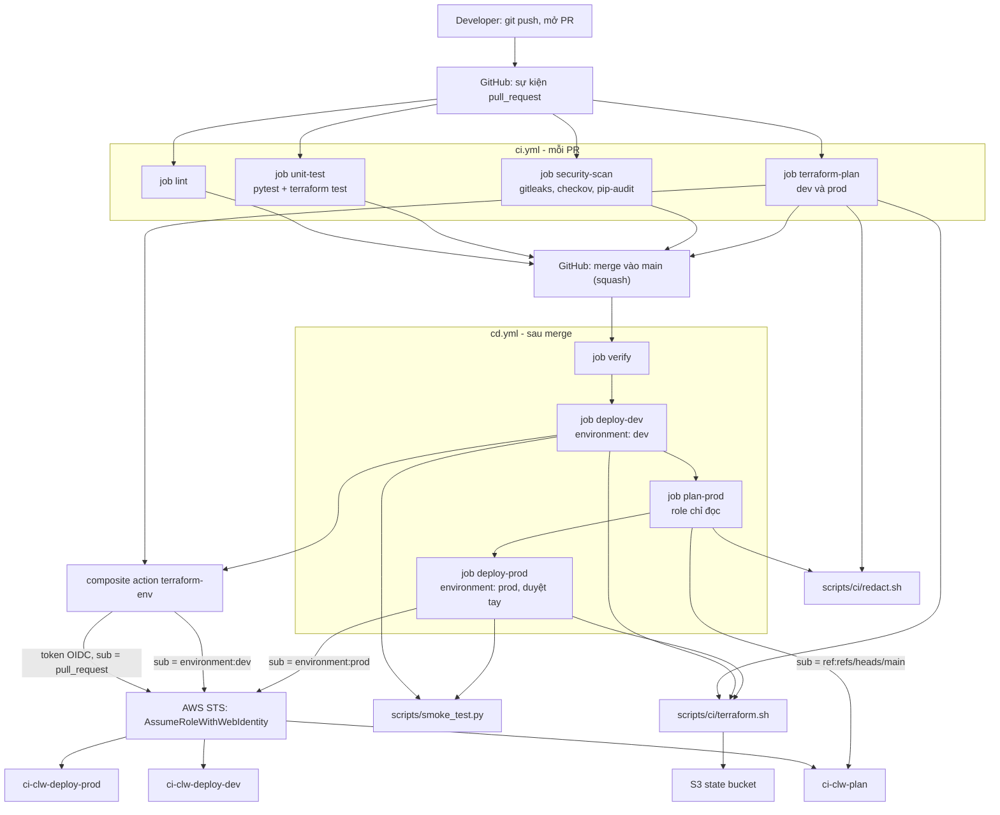

# Phase 5: Enterprise CI/CD Pipeline — Customer Logic Workflow

> **Phạm vi:** (1) OIDC trust giữa GitHub Actions và AWS, không dùng Access Key; (2) workflow **CI** cho Pull Request (lint, test, quét bảo mật, `terraform plan` đăng lên PR); (3) workflow **CD** khi merge vào `main` (deploy `dev`, smoke test, cổng duyệt tay, deploy `prod`); (4) script thiết lập GitHub Environments bằng `gh` CLI.
> **Điều kiện:** Phase 1 đến 4 đã xong, test xanh, repo đã đẩy lên GitHub (public) và branch protection đã bật (Phase 2).
> **Chi phí:** GitHub Actions miễn phí cho repo public; OIDC và IAM miễn phí; vài request S3. Dưới 0,05 USD/tháng thêm.
> **Tình trạng kiểm chứng:** YAML và Terraform chưa được chạy. Tôi chưa biết kết quả `checkov`, `actionlint` hay lần chạy đầu của pipeline; mục 9 là các bước kiểm chứng. Các action bên thứ ba dùng **tag phiên bản** chứ chưa ghim SHA (xem mục 12).

---

## 0. Đọc trước: các điều chỉnh với phần đã giao

| # | Điều chỉnh | Lý do |
|---|---|---|
| 1 | **Tên role CI phải là `ci-clw-*`, không phải `clw-*`** | Policy deploy (3A) cho phép sửa **mọi** role khớp `clw-*` (kể cả `iam:UpdateAssumeRolePolicy`). Nếu role CI tên `clw-*`, role deploy có thể tự sửa trust policy của chính nó hoặc của role `prod` để leo thang. Tên `ci-clw-*` nằm **ngoài** phạm vi đó |
| 2 | **`.checkov.yaml` thêm framework `github_actions` và thư mục `.github`** | Để CI quét luôn chính các workflow (mục 4.1 của bản vá) |
| 3 | **Lệnh `gitleaks` trong `make security` (Phase 2) chưa đúng ý** | Hook `gitleaks` của pre-commit chỉ quét phần *đang staged*, nên `pre-commit run gitleaks --all-files` không quét toàn bộ file. CI dùng `gitleaks-action`; ở local dùng lệnh gitleaks trực tiếp (bản vá 4.2) |

---

## 1. Quyết định thiết kế mới

| ADR | Quyết định | Lý do | Đánh đổi |
|---|---|---|---|
| **ADR-040** | **3 role OIDC riêng**: `ci-clw-plan` (chỉ đọc, cho PR), `ci-clw-deploy-dev` và `ci-clw-deploy-prod` (ghi, chỉ dùng được từ GitHub Environment tương ứng) | PR có thể sửa cả file workflow. Role của PR **chỉ đọc** nên PR độc hại cũng không thay đổi được hạ tầng | Thêm một policy "chỉ đọc" cần bảo trì (mục 4.3) |
| **ADR-041** | Trust policy ràng buộc **`aud` và `sub` chính xác**: `repo:<owner>/<repo>:pull_request`, `...:environment:dev`, `...:environment:prod` | Chỉ đúng repo, đúng ngữ cảnh mới assume được role; repo khác không dùng được | Phải đặt tên Environment đúng `dev` và `prod` |
| **ADR-042** | Role deploy gắn lại **đúng 3 policy deploy của 3A** (ADR-014); role `dev` có thêm `Deny` truy cập state của `prod` | Người và CI có quyền như nhau, đã được kiểm chứng ở local trước | Trong **một account**, tách dev và prod bằng IAM không tuyệt đối (xem mục 12) |
| **ADR-043** | **Không** upload file plan làm artifact. Plan hiển thị dạng text đã **che email và account ID**. Job `deploy-prod` **plan lại** rồi so **hash** với bản đã duyệt | Repo public: artifact tải được công khai, file plan chứa dữ liệu thật. Hash chặn trường hợp hạ tầng đổi giữa lúc duyệt và lúc apply | Hash có thể lệch vì lý do vô hại (khi đó chạy lại pipeline) |
| **ADR-044** | Email Ops lấy từ **secret `OPS_EMAIL`** (một địa chỉ), ghép thành JSON trong script | GitHub **tự che** giá trị secret trong log. Dùng danh sách JSON làm secret thì từng email không được che. Plan vẫn hiện email, nên có thêm bước che trong PR comment | Chỉ một email qua CI (đủ cho dự án này) |
| **ADR-045** | Dùng một **composite action** (`terraform-env`) cho phần chuẩn bị chung | Một nơi duy nhất cài Python, build layer, cài Terraform, lấy credential, tính tên bucket | Thêm một file |
| **ADR-046** | Smoke test viết bằng Python (`scripts/smoke_test.py`); `dev` chạy đầy đủ (gồm gửi sự kiện thật), `prod` chỉ chạy ca **không có tác dụng phụ** | Không tạo dữ liệu giả ở `prod` | `prod` không kiểm chứng đường 202 |

---

## 2. Cấu trúc file của Phase 5

```text
.github/
├── actions/
│   └── terraform-env/
│       └── action.yml                    # composite action dùng chung
└── workflows/
    ├── ci.yml                            # Pull Request
    └── cd.yml                            # merge vào main

infra/bootstrap/
├── variables.tf                          # thêm 2 biến (File 1)
├── oidc.tf                               # mới: OIDC provider, 3 role CI
├── iam_ci_plan.tf                        # mới: policy chỉ đọc cho PR
├── outputs.tf                            # thêm output (File 4)
└── bootstrap.secret.tfvars               # thêm github_repository

scripts/
├── ci/
│   ├── terraform.sh                      # chạy terraform trong CI
│   └── redact.sh                         # che email và account ID
├── smoke_test.py
└── setup-github.ps1                      # Environments, biến, secret
```

---

## 3. Dependency / Call Graph

### 3.1. Chuỗi CI/CD



> Ghi chú về `plan-prod`: job này không có `environment`, nên token OIDC của nó có `sub` dạng `repo:...:ref:refs/heads/main`, **không khớp** `...:pull_request`. Vì vậy trust policy của `ci-clw-plan` cần thêm một chủ thể `repo:<owner>/<repo>:ref:refs/heads/main` (đã có trong `oidc.tf`, File 2).

### 3.2. Contract Table

| Caller → Callee | Inputs / Tham số truyền | Outputs / Giá trị trả về | Vì sao có phụ thuộc này |
|---|---|---|---|
| GitHub (job) → AWS STS | Token OIDC với `aud = sts.amazonaws.com`, `sub` theo ngữ cảnh | Credential tạm thời (1 giờ) của role tương ứng | Không có Access Key lâu dài trong GitHub |
| Trust policy → token OIDC | Điều kiện `StringEquals` trên `aud` và `sub` | Cho phép hoặc `AccessDenied` | Chỉ đúng repo và đúng ngữ cảnh mới assume được |
| Composite action → `build_layer.py` | (không) | `.build/layer` | `archive_file` của Terraform cần thư mục này (3C) |
| Composite action → `aws sts` | Credential vừa lấy | `TF_STATE_BUCKET` ghi vào `GITHUB_ENV` | Tên bucket chứa account ID, không commit lên repo |
| `terraform.sh` → Terraform | Lệnh (`plan`/`apply`), môi trường, `-out`/tệp plan | Mã thoát và output | Một cách chạy duy nhất, cùng `-lock-timeout`, `-input=false` |
| `terraform.sh` → secret `OPS_EMAIL` | Biến môi trường `OPS_EMAIL` | `TF_VAR_ops_email_addresses` dạng JSON | Giữ subscription email Ops khi deploy qua CI (đóng điểm nợ ở 3B) |
| `terraform-plan` → `redact.sh` | Output thô của plan | Text đã che email và account ID | Repo public: comment PR ai cũng đọc được |
| `plan-prod` → `deploy-prod` | Output `plan_sha` (hash của plan đã che) | Chặn hoặc cho phép apply | Hạ tầng đổi sau khi duyệt thì không apply nhầm (ADR-043) |
| `deploy-*` → `smoke_test.py` | `--api-endpoint`, `--api-key-parameter`, `--mode` | Mã thoát 0 hoặc 1 | Deploy xong phải chứng minh hệ thống hoạt động |
| `setup-github.ps1` → `gh api` | Tên repo, ARN role (từ `terraform output`) | Environments, biến, secret | Không ClickOps cho GitHub |

### 3.3. Execution Trace

**Kịch bản 1 — Happy path: một thay đổi đi từ PR tới prod**

1. Bạn mở PR sửa một hàm Lambda. GitHub chạy `ci.yml`: 4 job song song (`lint`, `unit-test`, `security-scan`, `terraform-plan`), tên job khớp 4 status check trong branch protection (Phase 2).
2. Job `terraform-plan` xin token OIDC (`sub = repo:<owner>/<repo>:pull_request`), assume `ci-clw-plan` (chỉ đọc), chạy `terraform plan` cho `dev` và `prod`, che email/account ID rồi đăng một comment duy nhất (cập nhật lại ở các lần push sau).
3. Cả 4 check xanh, bạn merge (squash) vào `main`. GitHub chạy `cd.yml`.
4. `verify` chạy nhanh `ruff` và `pytest`. Xong thì `deploy-dev` chạy trong Environment `dev` (chỉ nhánh `main`): assume `ci-clw-deploy-dev` (`sub = ...:environment:dev`), `plan -out`, `apply`, rồi smoke test đầy đủ (401, 403, 400, 202, rồi 200 duplicate).
5. `plan-prod` (role chỉ đọc) lập kế hoạch cho `prod`, ghi bản đã che vào **Job Summary** và xuất hash.
6. `deploy-prod` **dừng chờ duyệt** (Environment `prod` có required reviewers). Bạn đọc plan trong Job Summary rồi bấm Approve.
7. Sau duyệt, `deploy-prod` assume `ci-clw-deploy-prod`, **plan lại**, so hash với bản đã duyệt, trùng thì `apply`, rồi smoke test an toàn (401, 403, 400).

**Kịch bản 2 — Error path**

1. **Test hoặc lint hỏng:** check đỏ, branch protection không cho merge.
2. **`checkov` hoặc `gitleaks` phát hiện vấn đề:** job `security-scan` đỏ, PR bị chặn.
3. **PR độc hại sửa workflow để chạy `terraform apply`:** token `pull_request` chỉ assume được `ci-clw-plan` (chỉ đọc), `apply` bị `AccessDenied`; không đụng được role deploy vì trust của chúng đòi `environment:dev/prod`.
4. **PR từ fork:** GitHub không cấp OIDC token và secret cho fork. Job `terraform-plan` có điều kiện `head.repo.full_name == github.repository` nên bị **skip** (check "skipped" không chặn PR).
5. **Workflow chạy từ nhánh khác `main`** (ví dụ `workflow_dispatch` trên nhánh tính năng): Environment `dev` và `prod` chỉ chấp nhận nhánh `main`, job không được chạy.
6. **`deploy-dev` thất bại ở smoke test:** pipeline dừng, `plan-prod` và `deploy-prod` **không chạy**. Hạ tầng `dev` đã đổi, bạn sửa lỗi rồi merge bản vá.
7. **Hạ tầng `prod` thay đổi sau khi duyệt** (hoặc plan lệch): hash không khớp, `deploy-prod` dừng với thông báo rõ, **không apply**. Chạy lại pipeline để lập và duyệt plan mới.
8. **Hai pipeline cùng deploy:** `concurrency` xếp hàng (`cancel-in-progress: false`) và khóa state S3 ngăn `apply` song song.
9. **Rollback:** `git revert` commit lỗi rồi merge, pipeline triển khai lại phiên bản trước (không có rollback tự động, xem mục 12).

---

## 4. Code: Terraform cho OIDC (bootstrap)

> **Lưu ý ADR-012:** các file này nằm ở `infra/bootstrap`, nên chỉ **phiên quản trị** (`clw-admin`) mới `apply` được. Role CI không tự sửa được quyền của chính nó.

### 4.1. Bản vá `.checkov.yaml` (thay thế bản ở Phase 2)

**Overview:** Thêm quét workflow GitHub Actions. Được `checkov` đọc ở hook `pre-push`, `make security` và job `security-scan`.

```yaml
directory:
  - infra
  - .github
framework:
  - terraform
  - github_actions
quiet: true
compact: true
download-external-modules: false
skip-check:
  # ADR-004: Lambda cố ý không đặt trong VPC để tránh chi phí NAT Gateway
  - CKV_AWS_117
  # Bỏ code signing cho Lambda: dự án portfolio, chưa có pipeline ký code
  - CKV_AWS_272
  # Retention log 1 năm trái với chính sách FinOps: 7 ngày (dev) và 30 ngày (prod)
  - CKV_AWS_338
  # Log group và biến môi trường Lambda dùng khóa AWS managed ở dev (ADR-006)
  - CKV_AWS_158
  - CKV_AWS_173
```

**Giải thích chi tiết:** thêm `.github` vào `directory` và `github_actions` vào `framework` để workflow cũng bị quét (ví dụ quyền `permissions` quá rộng, bước chạy lệnh không an toàn). Các `skip-check` giữ nguyên, mỗi dòng đã có lý do gắn với ADR.

### 4.2. Bản vá `Makefile`: lệnh `gitleaks` trong `security`

Cài gitleaks ở local (nếu `winget` không thấy ID này, dùng `winget search gitleaks`):

```powershell
winget install --id Gitleaks.Gitleaks -e
```

Trong `Makefile`, ở target `security`, thay dòng `pre-commit run gitleaks --all-files` bằng:

```make
> gitleaks dir . --config .gitleaks.toml --redact --no-banner
```

**Giải thích chi tiết:** hook `gitleaks` của pre-commit quét **phần staged** nên không phù hợp để quét cả cây thư mục. Lệnh `gitleaks dir` quét toàn bộ file hiện có (dùng cùng `.gitleaks.toml`), `--redact` che giá trị bí mật trong output. Hook pre-commit vẫn hữu ích cho từng commit.

### File 1: Bổ sung vào `infra/bootstrap/variables.tf` (thêm vào cuối file)

**Overview:** Hai biến điều khiển phần OIDC. Giá trị `github_repository` do bạn điền ở `bootstrap.secret.tfvars`.

```hcl
variable "github_repository" {
  description = "Repo GitHub theo dạng owner/repo được phép assume role CI qua OIDC. Để trống nếu chưa thiết lập CI/CD."
  type        = string
  default     = ""

  validation {
    condition     = var.github_repository == "" || can(regex("^[A-Za-z0-9_.-]+/[A-Za-z0-9_.-]+$", var.github_repository))
    error_message = "github_repository phải để trống hoặc có dạng owner/repo."
  }
}

variable "create_github_oidc_provider" {
  description = "Tạo OIDC provider của GitHub. Đặt false nếu account đã có sẵn provider này (mỗi account chỉ có một provider cho cùng URL)."
  type        = bool
  default     = true
}
```

Thêm vào `bootstrap.secret.tfvars` (file bị `.gitignore` chặn):

```hcl
github_repository = "ten-github-cua-ban/customer-logic-workflow"
```

**Giải thích chi tiết:**
- Mặc định rỗng: bootstrap vẫn chạy bình thường khi chưa dùng CI/CD (giống cách `sso_user_name` điều khiển phần SSO).
- Regex chặn giá trị sai dạng, nhất là ký tự lạ có thể làm sai điều kiện `sub` của trust policy.
- `create_github_oidc_provider`: AWS chỉ cho **một** provider cho mỗi URL trong một account. Nếu bạn đã dùng GitHub OIDC cho dự án khác, đặt `false` để tái sử dụng provider sẵn có.

### File 2: `infra/bootstrap/oidc.tf`

**Overview:** Tạo OIDC provider của GitHub, 3 role CI (`ci-clw-plan`, `ci-clw-deploy-dev`, `ci-clw-deploy-prod`) với trust policy chặt, đính policy phù hợp. Dùng `aws_iam_policy.deployer` (3A) và `aws_iam_policy.ci_plan` (File 3). Output ARN role đi vào `setup-github.ps1`.

```hcl
locals {
  manage_ci = var.github_repository != ""

  # Mỗi role CI chỉ được assume từ đúng một (hoặc hai) ngữ cảnh GitHub
  ci_role_subjects = {
    plan = [
      "repo:${var.github_repository}:pull_request",
      "repo:${var.github_repository}:ref:refs/heads/main",
    ]
    deploy-dev  = ["repo:${var.github_repository}:environment:dev"]
    deploy-prod = ["repo:${var.github_repository}:environment:prod"]
  }

  github_oidc_url = "https://token.actions.githubusercontent.com"
}

resource "aws_iam_openid_connect_provider" "github" {
  count = local.manage_ci && var.create_github_oidc_provider ? 1 : 0

  url            = local.github_oidc_url
  client_id_list = ["sts.amazonaws.com"]
}

data "aws_iam_openid_connect_provider" "github" {
  count = local.manage_ci && !var.create_github_oidc_provider ? 1 : 0

  url = local.github_oidc_url
}

locals {
  github_oidc_provider_arn = try(
    aws_iam_openid_connect_provider.github[0].arn,
    data.aws_iam_openid_connect_provider.github[0].arn,
    null,
  )

  ci_roles = { for name, subjects in local.ci_role_subjects : name => subjects if local.manage_ci }

  ci_deploy_attachments = {
    for pair in setproduct(["deploy-dev", "deploy-prod"], keys(aws_iam_policy.deployer)) :
    "${pair[0]}-${pair[1]}" => { role = pair[0], policy = pair[1] }
    if local.manage_ci
  }
}

data "aws_iam_policy_document" "ci_trust" {
  for_each = local.ci_roles

  statement {
    sid     = "GitHubOidcAssumeRole"
    actions = ["sts:AssumeRoleWithWebIdentity"]

    principals {
      type        = "Federated"
      identifiers = [local.github_oidc_provider_arn]
    }

    condition {
      test     = "StringEquals"
      variable = "token.actions.githubusercontent.com:aud"
      values   = ["sts.amazonaws.com"]
    }

    condition {
      test     = "StringEquals"
      variable = "token.actions.githubusercontent.com:sub"
      values   = each.value
    }
  }
}

resource "aws_iam_role" "ci" {
  for_each = local.ci_roles

  # Tên ci-clw-* nằm NGOÀI mẫu role/clw-* của policy deploy nên role CI không tự sửa được role CI
  name                 = "ci-${var.name_prefix}-${each.key}"
  description          = "Role OIDC cho GitHub Actions (${each.key}) của dự án ${var.project}."
  assume_role_policy   = data.aws_iam_policy_document.ci_trust[each.key].json
  max_session_duration = 3600
}

resource "aws_iam_role_policy_attachment" "ci_plan" {
  count = local.manage_ci ? 1 : 0

  role       = aws_iam_role.ci["plan"].name
  policy_arn = aws_iam_policy.ci_plan[0].arn
}

resource "aws_iam_role_policy_attachment" "ci_deploy" {
  for_each = local.ci_deploy_attachments

  role       = aws_iam_role.ci[each.value.role].name
  policy_arn = aws_iam_policy.deployer[each.value.policy].arn
}

# Role dev không được đọc hoặc ghi state của prod
data "aws_iam_policy_document" "ci_dev_guard" {
  statement {
    sid       = "DenyProdState"
    effect    = "Deny"
    actions   = ["s3:*"]
    resources = ["arn:aws:s3:::${var.name_prefix}-tfstate-*/envs/prod/*"]
  }
}

resource "aws_iam_role_policy" "ci_dev_guard" {
  count = local.manage_ci ? 1 : 0

  name   = "deny-prod-state"
  role   = aws_iam_role.ci["deploy-dev"].id
  policy = data.aws_iam_policy_document.ci_dev_guard.json
}
```

**Giải thích chi tiết:**
- **Trust policy ràng buộc hai điều kiện `StringEquals`:** `aud = sts.amazonaws.com` (token được tạo **cho AWS**) và `sub` **đúng chính xác** (ADR-041). Không dùng `StringLike` với ký tự đại diện, nên repo hay nhánh khác không thể dùng role này.
- **`ci-clw-plan` có hai `sub`:** `pull_request` (job PR) và `ref:refs/heads/main` (job `plan-prod` trong CD, không dùng Environment nên token mang `sub` theo nhánh). Cả hai đều chỉ nhận quyền **đọc**.
- **`ci-clw-deploy-dev/prod`:** `sub` dạng `environment:<tên>`, nên chỉ job đã **được GitHub duyệt vào Environment đó** (nhánh `main`, người duyệt cho `prod`) mới lấy được quyền ghi.
- **Tên role `ci-clw-*` (điều chỉnh số 1):** ngoài mẫu `role/clw-*` của policy deploy, nên policy deploy không tác động lên role CI (ngăn tự leo thang).
- `ci_deploy_attachments` dùng `setproduct` ghép 2 role deploy với 3 policy (`data`, `compute`, `iam-ops`) ra 6 attachment. Cùng 3 policy với `ClwDeployer` của bạn (ADR-042).
- **`ci_dev_guard`:** `Deny` toàn bộ `s3:*` trên state `prod`. Role dev không `plan` hay `apply` được `prod`. Đây là rào chắn mềm (xem giới hạn ở mục 12).
- `try(..., null)` chọn ARN provider được tạo hoặc provider có sẵn mà không lỗi ở nhánh không dùng.
- `max_session_duration = 3600`: credential hết hạn sau 1 giờ.
- Role **không** gắn permissions boundary: boundary ở 3A dành cho role workload; policy deploy đã giới hạn theo tiền tố và không ai ngoài bootstrap sửa được (xem checklist ở mục 11).

### File 3: `infra/bootstrap/iam_ci_plan.tf`

**Overview:** Policy **chỉ đọc** cho role `ci-clw-plan`. Cho phép `terraform plan` đọc cấu hình của đúng tài nguyên `clw-*`, đọc state, và ghi **duy nhất** file khóa `.tflock`. Được `oidc.tf` đính vào role plan.

```hcl
data "aws_iam_policy_document" "ci_plan" {
  count = local.manage_ci ? 1 : 0

  # --- State: đọc state và ghi duy nhất file khóa ---
  statement {
    sid       = "StateBucket"
    actions   = ["s3:ListBucket", "s3:GetBucketLocation"]
    resources = ["arn:aws:s3:::${var.name_prefix}-tfstate-*"]
  }

  statement {
    sid       = "ReadState"
    actions   = ["s3:GetObject"]
    resources = ["arn:aws:s3:::${var.name_prefix}-tfstate-*/envs/*/terraform.tfstate"]
  }

  statement {
    sid       = "StateLock"
    actions   = ["s3:GetObject", "s3:PutObject", "s3:DeleteObject"]
    resources = ["arn:aws:s3:::${var.name_prefix}-tfstate-*/envs/*/terraform.tfstate.tflock"]
  }

  # --- KMS ---
  statement {
    sid = "ReadProjectKeys"

    actions = [
      "kms:DescribeKey",
      "kms:GetKeyPolicy",
      "kms:GetKeyRotationStatus",
      "kms:ListResourceTags",
    ]

    resources = ["arn:aws:kms:${local.region_account}:key/*"]

    condition {
      test     = "StringEquals"
      variable = "aws:ResourceTag/Project"
      values   = [var.project]
    }
  }

  # ListAliases chỉ hỗ trợ resource "*"
  statement {
    sid       = "ListKmsAliases"
    actions   = ["kms:ListAliases"]
    resources = ["*"]
  }

  # --- Dữ liệu và nhắn tin ---
  statement {
    sid = "ReadDynamoDbTables"

    actions = [
      "dynamodb:DescribeTable",
      "dynamodb:DescribeTimeToLive",
      "dynamodb:DescribeContinuousBackups",
      "dynamodb:DescribeContributorInsights",
      "dynamodb:DescribeKinesisStreamingDestination",
      "dynamodb:DescribeTableReplicaAutoScaling",
      "dynamodb:ListTagsOfResource",
    ]

    resources = ["arn:aws:dynamodb:${local.region_account}:table/${var.name_prefix}-*"]
  }

  statement {
    sid       = "ReadSqsQueues"
    actions   = ["sqs:GetQueueAttributes", "sqs:GetQueueUrl", "sqs:ListQueueTags"]
    resources = ["arn:aws:sqs:${local.region_account}:${var.name_prefix}-*"]
  }

  statement {
    sid = "ReadSnsTopics"

    actions = [
      "sns:GetTopicAttributes",
      "sns:ListTagsForResource",
      "sns:GetSubscriptionAttributes",
      "sns:ListSubscriptionsByTopic",
    ]

    resources = ["arn:aws:sns:${local.region_account}:${var.name_prefix}-*"]
  }

  # --- Tính toán và API ---
  statement {
    sid = "ReadLambdaFunctions"

    actions = [
      "lambda:GetFunction",
      "lambda:GetFunctionConfiguration",
      "lambda:GetFunctionCodeSigningConfig",
      "lambda:GetFunctionConcurrency",
      "lambda:GetFunctionEventInvokeConfig",
      "lambda:GetFunctionRecursionConfig",
      "lambda:GetRuntimeManagementConfig",
      "lambda:GetPolicy",
      "lambda:GetAlias",
      "lambda:ListVersionsByFunction",
      "lambda:ListTags",
    ]

    resources = [
      "arn:aws:lambda:${local.region_account}:function:${var.name_prefix}-*",
      "arn:aws:lambda:${local.region_account}:function:${var.name_prefix}-*:*",
    ]
  }

  statement {
    sid       = "ReadLambdaEventSourceMappings"
    actions   = ["lambda:GetEventSourceMapping"]
    resources = ["arn:aws:lambda:${local.region_account}:event-source-mapping:*"]
  }

  statement {
    sid       = "ReadLambdaLayers"
    actions   = ["lambda:GetLayerVersion"]
    resources = ["arn:aws:lambda:${local.region_account}:layer:${var.name_prefix}-*:*"]
  }

  statement {
    sid       = "ReadHttpApis"
    actions   = ["apigateway:GET"]
    resources = ["arn:aws:apigateway:${var.aws_region}::/apis", "arn:aws:apigateway:${var.aws_region}::/apis/*", "arn:aws:apigateway:${var.aws_region}::/tags/*"]
  }

  statement {
    sid = "ReadEventBridge"

    actions = [
      "events:DescribeRule",
      "events:ListTargetsByRule",
      "events:ListTagsForResource",
      "events:DescribeEventBus",
    ]

    resources = [
      "arn:aws:events:${local.region_account}:rule/${var.name_prefix}-*",
      "arn:aws:events:${local.region_account}:rule/${var.name_prefix}-*/*",
      "arn:aws:events:${local.region_account}:event-bus/${var.name_prefix}-*",
    ]
  }

  # --- Log, IAM, giám sát ---
  statement {
    sid       = "ReadLogGroupTags"
    actions   = ["logs:ListTagsForResource", "logs:ListTagsLogGroup"]
    resources = ["arn:aws:logs:${local.region_account}:log-group:*"]
  }

  # DescribeLogGroups và DescribeResourcePolicies chỉ hỗ trợ resource "*"
  statement {
    sid       = "DescribeLogs"
    actions   = ["logs:DescribeLogGroups", "logs:DescribeResourcePolicies"]
    resources = ["*"]
  }

  statement {
    sid = "ReadWorkloadRoles"

    actions = [
      "iam:GetRole",
      "iam:GetRolePolicy",
      "iam:ListRolePolicies",
      "iam:ListAttachedRolePolicies",
      "iam:ListInstanceProfilesForRole",
      "iam:ListRoleTags",
    ]

    resources = ["arn:aws:iam::${local.account_id}:role/${var.name_prefix}-*"]
  }

  # DescribeAlarms chỉ hỗ trợ resource "*"
  statement {
    sid       = "DescribeAlarms"
    actions   = ["cloudwatch:DescribeAlarms"]
    resources = ["*"]
  }

  statement {
    sid       = "ReadMonitoringResources"
    actions   = ["cloudwatch:ListTagsForResource", "cloudwatch:GetDashboard", "budgets:ViewBudget", "budgets:ListTagsForResource"]
    resources = ["arn:aws:cloudwatch:*:${local.account_id}:alarm:${var.name_prefix}-*", "arn:aws:cloudwatch::${local.account_id}:dashboard/${var.name_prefix}-*", "arn:aws:budgets::${local.account_id}:budget/${var.name_prefix}-*"]
  }
}

resource "aws_iam_policy" "ci_plan" {
  count = local.manage_ci ? 1 : 0

  name        = "${var.name_prefix}-ci-plan"
  description = "Policy chỉ đọc cho role plan của CI (PR), dự án ${var.project}."
  policy      = data.aws_iam_policy_document.ci_plan[0].json
}
```

**Giải thích chi tiết:**
- **Chỉ có hành động đọc** (`Describe*`, `Get*`, `List*`), ngoại trừ **file khóa state** (`...tfstate.tflock`: `PutObject`, `DeleteObject`). `terraform plan` mặc định giữ khóa state, nên thiếu quyền này, plan sẽ lỗi. Quyền ghi bị **giới hạn đúng hậu tố `.tflock`**, nên role plan không sửa được file state thật.
- Danh sách hành động được lấy từ các API mà provider gọi khi **làm mới** (refresh) từng loại tài nguyên của 3B/3C; nó bám theo policy deploy ở 3A nhưng bỏ hết thao tác ghi.
- `ReadLogGroupTags` dùng `log-group:*` vì các hành động về tag của CloudWatch Logs có định dạng ARN khó giới hạn hơn tiền tố; chỉ là quyền **đọc tag**.
- Chỗ nào buộc dùng `"*"` đều có comment (không hỗ trợ giới hạn resource).
- **Rủi ro cần kiểm chứng:** nếu provider gọi thêm API đọc nào chưa liệt kê, `plan` ở PR sẽ lỗi `AccessDenied` kèm tên action. Thêm **đúng action đó** vào đây và chạy lại bootstrap bằng phiên quản trị (cùng quy trình ở mục 8 của tài liệu 3A).
- Ở Phase 6, khi thêm alarm, dashboard, budget, các quyền đọc đã có sẵn (`DescribeAlarms`, `GetDashboard`, `ViewBudget`).

### File 4: Bổ sung vào `infra/bootstrap/outputs.tf` (thêm vào cuối file)

**Overview:** Xuất ARN các role CI để `setup-github.ps1` đọc.

```hcl
output "ci_role_arns" {
  description = "ARN các role CI theo khóa plan, deploy-dev, deploy-prod (rỗng nếu github_repository để trống)."
  value       = { for name, role in aws_iam_role.ci : name => role.arn }
}

output "github_oidc_provider_arn" {
  description = "ARN OIDC provider của GitHub, null nếu chưa thiết lập CI/CD."
  value       = local.github_oidc_provider_arn
}
```

**Giải thích chi tiết:** ARN của role không phải bí mật (không thể dùng nếu không có token OIDC hợp lệ), nên lưu ở **GitHub Variables** thay vì Secrets.

---

## 5. Code: composite action và workflow

### File 5: `.github/actions/terraform-env/action.yml`

**Overview:** Phần chuẩn bị chung cho mọi job cần Terraform và AWS: cài Python, build layer, cài Terraform, lấy credential qua OIDC, tính tên bucket state. Được `ci.yml` (job `terraform-plan`) và `cd.yml` (3 job) gọi.

```yaml
name: Chuẩn bị môi trường Terraform
description: Cài Python, build layer, cài Terraform, lấy credential AWS qua OIDC và tính tên bucket state.

inputs:
  role-arn:
    description: ARN của IAM role để assume qua OIDC.
    required: true
  aws-region:
    description: Region AWS.
    required: false
    default: ap-southeast-1

runs:
  using: composite
  steps:
    - name: Cài Python
      uses: actions/setup-python@v5
      with:
        python-version: "3.12"
        cache: pip
        cache-dependency-path: src/requirements.txt

    - name: Build Lambda layer (arm64)
      shell: bash
      run: python scripts/build_layer.py

    - name: Cài Terraform
      uses: hashicorp/setup-terraform@v3
      with:
        terraform_version: "~> 1.10"
        terraform_wrapper: false

    - name: Lấy credential AWS qua OIDC
      uses: aws-actions/configure-aws-credentials@v4
      with:
        role-to-assume: ${{ inputs.role-arn }}
        aws-region: ${{ inputs.aws-region }}
        role-session-name: gha-${{ github.run_id }}

    - name: Chuẩn hóa thời gian sửa file để zip có hash ổn định
      shell: bash
      run: find src .build -exec touch -h -d "2020-01-01 00:00:00" {} +

    - name: Tính tên bucket state
      shell: bash
      run: |
        account_id="$(aws sts get-caller-identity --query Account --output text)"
        echo "TF_STATE_BUCKET=clw-tfstate-${account_id}-${AWS_REGION}" >> "$GITHUB_ENV"
```

**Giải thích chi tiết:**
- **`aws-actions/configure-aws-credentials`** đổi token OIDC của job lấy credential tạm của role (không có Access Key nào). Action này **tự che account ID** trong log. Job gọi phải có `permissions: id-token: write`.
- `terraform_wrapper: false`: tắt wrapper của `setup-terraform` để ta tự chuyển output qua shell (`>`) mà không bị chèn thêm dòng.
- `"~> 1.10"`: nhận Terraform 1.x từ 1.10 trở lên (khớp `required_version >= 1.10.0`).
- **Chuẩn hóa mtime (`touch -d`)**: file zip do `archive_file` tạo ra có thể phụ thuộc thời gian sửa file; mỗi lần checkout đều có mtime mới, nên hash sẽ đổi và Terraform tưởng code đổi. Đặt mtime cố định giúp `plan` không nhiễu. Bước này **vô hại** nếu provider đã tự chuẩn hóa.
- `TF_STATE_BUCKET` ghi vào `GITHUB_ENV` để các bước sau (`terraform.sh`) dùng. Công thức khớp `locals.tf` của bootstrap (`clw-tfstate-<account>-<region>`).
- **Điểm yếu đã biết:** `build_layer.py` cài `aws-lambda-powertools` theo khoảng phiên bản (`>=3.0,<4.0`), nên bản dựng ở `dev` và `prod` có thể khác nhau nếu có phiên bản mới ra giữa hai lần chạy. Cách khắc phục (file khóa phiên bản) nằm ở mục 12.

### File 6: `scripts/ci/terraform.sh`

**Overview:** Một cách duy nhất để chạy Terraform trong CI cho một môi trường. Được `ci.yml` và `cd.yml` gọi. Ghép biến `TF_VAR_ops_email_addresses` từ secret `OPS_EMAIL`.

```bash
#!/usr/bin/env bash
# Chạy Terraform cho một môi trường trong CI.
# Cách dùng: scripts/ci/terraform.sh <plan|apply> <dev|prod> [tham số Terraform...]
set -euo pipefail

if [[ $# -lt 2 ]]; then
  echo "Cách dùng: $0 <plan|apply> <dev|prod> [tham số Terraform...]" >&2
  exit 2
fi

command_name="$1"
environment_name="$2"
shift 2

case "${environment_name}" in
  dev | prod) ;;
  *)
    echo "Môi trường không hợp lệ: ${environment_name} (chỉ nhận dev hoặc prod)" >&2
    exit 2
    ;;
esac

: "${TF_STATE_BUCKET:?Thiếu TF_STATE_BUCKET (do action terraform-env đặt)}"
: "${OPS_EMAIL:?Thiếu secret OPS_EMAIL: thiếu thì apply sẽ xóa subscription email của đội Ops}"

export TF_VAR_ops_email_addresses="[\"${OPS_EMAIL}\"]"
export TF_IN_AUTOMATION=1

directory="infra/envs/${environment_name}"

terraform -chdir="${directory}" init -input=false -backend-config="bucket=${TF_STATE_BUCKET}" > /dev/null

case "${command_name}" in
  plan)
    terraform -chdir="${directory}" validate -no-color
    terraform -chdir="${directory}" plan -input=false -no-color -lock-timeout=120s "$@"
    ;;
  apply)
    terraform -chdir="${directory}" apply -input=false -no-color -lock-timeout=120s "$@"
    ;;
  *)
    echo "Lệnh không hợp lệ: ${command_name} (chỉ nhận plan hoặc apply)" >&2
    exit 2
    ;;
esac
```

**Giải thích chi tiết:**
- `set -euo pipefail`: dừng ngay khi có lỗi, biến chưa đặt, hoặc lỗi giữa chừng trong pipe.
- **Kiểm tra tham số** (`dev | prod`, `plan | apply`) trước khi chạy: không thể gọi nhầm một môi trường hay lệnh lạ.
- `: "${OPS_EMAIL:?...}"`: **bắt buộc** có secret. Thiếu thì dừng ngay, vì nếu truyền danh sách rỗng, `apply` sẽ **xóa** subscription email (điểm đã ghi nhớ từ 3B).
- Biến `TF_VAR_ops_email_addresses` được ghép tại chỗ: email vẫn là **giá trị của secret** nên GitHub che trong log (ADR-044).
- `init -input=false ... > /dev/null`: bớt nhiễu, **lỗi vẫn hiện** vì chỉ `stdout` bị bỏ.
- `-lock-timeout=120s`: nếu có tiến trình khác giữ khóa state, chờ tối đa 2 phút thay vì lỗi ngay.
- `apply` với file plan (`apply dev tfplan`) **không cần** `-auto-approve` (áp dụng đúng kế hoạch đã lưu, không hỏi lại).
- Kịch bản `apply` không có file plan **không dùng** trong pipeline này; các workflow luôn `plan -out` rồi `apply` đúng file đó.

### File 7: `scripts/ci/redact.sh`

**Overview:** Che email và account ID trong output của plan trước khi đăng lên PR hoặc Job Summary (repo public). Đọc từ stdin, ghi ra stdout.

```bash
#!/usr/bin/env bash
# Che email và account ID trong output của terraform plan. Đọc stdin, ghi stdout.
set -euo pipefail

sed -E \
  -e 's/[A-Za-z0-9._%+-]+@[A-Za-z0-9.-]+\.[A-Za-z]{2,}/[email-redacted]/g' \
  -e 's/(arn:aws[a-z-]*:[a-z0-9-]+:[a-z0-9-]*:)[0-9]{12}:/\1[account-redacted]:/g' \
  -e 's/(tfstate-)[0-9]{12}(-)/\1[account-redacted]\2/g'
```

**Giải thích chi tiết:**
- Ba quy tắc: email, account ID trong ARN, account ID trong tên bucket state.
- Plan **luôn** chứa email (endpoint subscription SNS nằm ngay trong địa chỉ resource) nên phải che trước khi công khai. Secret masking của GitHub chỉ che **log**, không che nội dung bạn tự đăng thành comment.
- Hàm che không hoàn hảo: nó **giảm** rò rỉ chứ không đảm bảo tuyệt đối. Nếu bạn sợ lộ thêm kiểu dữ liệu nào khác, thêm quy tắc `-e` tương ứng.
- Cũng dùng để tính **hash** ở `plan-prod` và `deploy-prod`, nên cả hai nơi phải che giống nhau.

### File 8: `.github/workflows/ci.yml`

**Overview:** Workflow chạy trên mỗi Pull Request vào `main`. Bốn job có `name` khớp bốn status check trong branch protection (Phase 2): `lint`, `unit-test`, `security-scan`, `terraform-plan`.

```yaml
name: CI

on:
  pull_request:
    branches: [main]

permissions:
  contents: read

concurrency:
  group: ci-${{ github.event.pull_request.number }}
  cancel-in-progress: true

jobs:
  lint:
    name: lint
    runs-on: ubuntu-24.04
    timeout-minutes: 15
    steps:
      - uses: actions/checkout@v4

      - uses: actions/setup-python@v5
        with:
          python-version: "3.12"
          cache: pip
          cache-dependency-path: requirements-dev.txt

      - name: Cài dependency
        run: pip install -r requirements-dev.txt

      - name: Ruff (lint)
        run: ruff check src tests scripts

      - name: Ruff (format)
        run: ruff format --check src tests scripts

      - uses: hashicorp/setup-terraform@v3
        with:
          terraform_version: "~> 1.10"

      - name: Terraform fmt
        run: terraform fmt -check -recursive infra

      - uses: terraform-linters/setup-tflint@v4

      - name: tflint
        run: python scripts/run_tflint.py

  unit-test:
    name: unit-test
    runs-on: ubuntu-24.04
    timeout-minutes: 20
    steps:
      - uses: actions/checkout@v4

      - uses: actions/setup-python@v5
        with:
          python-version: "3.12"
          cache: pip
          cache-dependency-path: requirements-dev.txt

      - name: Cài dependency
        run: pip install -r requirements-dev.txt

      - name: pytest (unit test, coverage từ 85%)
        run: python -m pytest -m "not integration"

      - uses: hashicorp/setup-terraform@v3
        with:
          terraform_version: "~> 1.10"

      - name: terraform test cho từng module
        run: |
          for module in infra/modules/*/; do
            terraform -chdir="${module}" init -backend=false -input=false
            terraform -chdir="${module}" test
          done

  security-scan:
    name: security-scan
    runs-on: ubuntu-24.04
    timeout-minutes: 20
    steps:
      - uses: actions/checkout@v4
        with:
          fetch-depth: 0

      - name: gitleaks (quét secret)
        uses: gitleaks/gitleaks-action@v2
        env:
          GITHUB_TOKEN: ${{ secrets.GITHUB_TOKEN }}

      - uses: actions/setup-python@v5
        with:
          python-version: "3.12"

      - name: Cài checkov và pip-audit
        run: pip install checkov pip-audit

      - name: checkov (IaC và GitHub Actions)
        run: checkov --config-file .checkov.yaml

      - name: pip-audit (lỗ hổng dependency)
        run: pip-audit -r src/requirements.txt

  terraform-plan:
    name: terraform-plan
    # PR từ fork không có OIDC token và secret nên bỏ qua
    if: github.event.pull_request.head.repo.full_name == github.repository
    runs-on: ubuntu-24.04
    timeout-minutes: 30
    permissions:
      contents: read
      id-token: write
      pull-requests: write
    steps:
      - uses: actions/checkout@v4

      - name: Chuẩn bị Terraform và credential (role chỉ đọc)
        uses: ./.github/actions/terraform-env
        with:
          role-arn: ${{ vars.AWS_PLAN_ROLE_ARN }}

      - name: Plan dev và prod
        id: plan
        env:
          OPS_EMAIL: ${{ secrets.OPS_EMAIL }}
        run: |
          set +e
          overall=0
          : > plan-report.md
          for environment_name in dev prod; do
            scripts/ci/terraform.sh plan "${environment_name}" > "plan-${environment_name}.raw.txt" 2>&1
            code=$?
            if [ "${code}" -ne 0 ]; then overall="${code}"; fi
            {
              echo "### Môi trường \`${environment_name}\` (mã thoát: ${code})"
              echo "<details><summary>Kết quả plan</summary>"
              echo
              echo '```'
              scripts/ci/redact.sh < "plan-${environment_name}.raw.txt" | tail -c 20000
              echo '```'
              echo "</details>"
              echo
            } >> plan-report.md
          done
          echo "status=${overall}" >> "$GITHUB_OUTPUT"

      - name: Đăng kết quả plan lên PR
        if: always() && hashFiles('plan-report.md') != ''
        uses: actions/github-script@v7
        with:
          script: |
            const fs = require('fs');
            const marker = '<!-- terraform-plan -->';
            const body = `${marker}\n## Kết quả \`terraform plan\`\n\n${fs.readFileSync('plan-report.md', 'utf8')}`;
            const { owner, repo } = context.repo;
            const issue_number = context.issue.number;
            const comments = await github.paginate(github.rest.issues.listComments, {
              owner,
              repo,
              issue_number,
            });
            const existing = comments.find((comment) => comment.body && comment.body.includes(marker));
            if (existing) {
              await github.rest.issues.updateComment({ owner, repo, comment_id: existing.id, body });
            } else {
              await github.rest.issues.createComment({ owner, repo, issue_number, body });
            }

      - name: Báo lỗi nếu plan thất bại
        if: steps.plan.outputs.status != '0'
        run: exit 1
```

**Giải thích chi tiết:**
- **`on: pull_request`** (không phải `pull_request_target`): workflow chạy với **mã của PR** nhưng **không** có secret cho fork, đúng mô hình an toàn.
- `permissions: contents: read` ở cấp workflow (tối thiểu); chỉ job `terraform-plan` được thêm `id-token: write` (lấy token OIDC) và `pull-requests: write` (đăng comment).
- `concurrency` theo số PR với `cancel-in-progress: true`: push mới hủy lần chạy cũ, tiết kiệm thời gian.
- **`unit-test`** chạy `pytest` (coverage tối thiểu 85%, `pyproject.toml`) **và** `terraform test` cho cả 8 module (bằng provider giả, không cần AWS).
- **`security-scan`:** `gitleaks-action` quét các commit của PR (`fetch-depth: 0` để có đủ lịch sử); `checkov` quét Terraform và workflow theo `.checkov.yaml`; `pip-audit` kiểm lỗ hổng dependency. Lưu ý: `gitleaks-action` miễn phí cho repo của tài khoản cá nhân, còn tổ chức (organization) cần license key.
- **`terraform-plan`:**
  - Dùng role **chỉ đọc** (`vars.AWS_PLAN_ROLE_ARN`).
  - Plan **cả `dev` lẫn `prod`** trong một job (để tên check là đúng `terraform-plan`, khớp branch protection; dùng matrix sẽ đổi tên check).
  - Output thô nằm trong file tạm trên runner, bản **đã che** mới được đưa vào comment; `tail -c 20000` giới hạn kích thước (comment tối đa 65.536 ký tự).
  - Comment được **cập nhật tại chỗ** nhờ chuỗi đánh dấu `<!-- terraform-plan -->`, tránh spam mỗi lần push.
  - Bước cuối `exit 1` nếu plan lỗi, sau khi đã đăng comment (để bạn thấy lý do).
- **`if: ... head.repo.full_name == github.repository`:** PR từ fork bị bỏ qua (check "skipped" không chặn merge).
- **Lưu ý Dependabot:** PR của Dependabot không nhận secret `OPS_EMAIL` của repo, nên job này sẽ lỗi ở bước kiểm tra biến. Giải pháp: thêm cùng secret trong mục **Dependabot** (script ở mục 6 đã làm việc này).

### File 9: `.github/workflows/cd.yml`

**Overview:** Workflow chạy khi merge vào `main`: `verify` → `deploy-dev` (kèm smoke test) → `plan-prod` → `deploy-prod` (chờ duyệt tay, kèm so hash plan và smoke test an toàn).

```yaml
name: CD

on:
  push:
    branches: [main]
  workflow_dispatch:

permissions:
  contents: read

# Xếp hàng các lần deploy, không hủy lần đang chạy
concurrency:
  group: cd-main
  cancel-in-progress: false

jobs:
  verify:
    name: verify
    runs-on: ubuntu-24.04
    timeout-minutes: 15
    steps:
      - uses: actions/checkout@v4

      - uses: actions/setup-python@v5
        with:
          python-version: "3.12"
          cache: pip
          cache-dependency-path: requirements-dev.txt

      - name: Cài dependency
        run: pip install -r requirements-dev.txt

      - name: Ruff
        run: ruff check src tests scripts

      - name: pytest
        run: python -m pytest -m "not integration"

  deploy-dev:
    name: deploy-dev
    needs: verify
    runs-on: ubuntu-24.04
    timeout-minutes: 45
    environment:
      name: dev
    permissions:
      contents: read
      id-token: write
    steps:
      - uses: actions/checkout@v4

      - name: Chuẩn bị Terraform và credential (role deploy dev)
        uses: ./.github/actions/terraform-env
        with:
          role-arn: ${{ vars.AWS_ROLE_ARN }}

      - name: Plan và apply dev
        env:
          OPS_EMAIL: ${{ secrets.OPS_EMAIL }}
        run: |
          scripts/ci/terraform.sh plan dev -out=tfplan
          scripts/ci/terraform.sh apply dev tfplan

      - name: Cài boto3 cho smoke test
        run: pip install boto3

      - name: Smoke test dev (đầy đủ)
        run: |
          api_endpoint="$(terraform -chdir=infra/envs/dev output -raw api_endpoint)"
          parameter_name="$(terraform -chdir=infra/envs/dev output -raw api_key_parameter_name)"
          python scripts/smoke_test.py \
            --api-endpoint "${api_endpoint}" \
            --api-key-parameter "${parameter_name}" \
            --mode full

  plan-prod:
    name: plan-prod
    needs: deploy-dev
    runs-on: ubuntu-24.04
    timeout-minutes: 30
    permissions:
      contents: read
      id-token: write
    outputs:
      plan_sha: ${{ steps.plan.outputs.plan_sha }}
    steps:
      - uses: actions/checkout@v4

      - name: Chuẩn bị Terraform và credential (role chỉ đọc)
        uses: ./.github/actions/terraform-env
        with:
          role-arn: ${{ vars.AWS_PLAN_ROLE_ARN }}

      - name: Lập kế hoạch prod để duyệt
        id: plan
        env:
          OPS_EMAIL: ${{ secrets.OPS_EMAIL }}
        run: |
          set +e
          scripts/ci/terraform.sh plan prod -out=tfplan > plan-prod.raw.txt 2>&1
          code=$?
          set -e
          scripts/ci/redact.sh < plan-prod.raw.txt > plan-prod.txt
          {
            echo "## Kế hoạch deploy prod (đã che email và account ID)"
            echo '```'
            tail -c 60000 plan-prod.txt
            echo '```'
          } >> "$GITHUB_STEP_SUMMARY"
          echo "plan_sha=$(sha256sum plan-prod.txt | cut -d' ' -f1)" >> "$GITHUB_OUTPUT"
          exit "${code}"

  deploy-prod:
    name: deploy-prod
    needs: plan-prod
    runs-on: ubuntu-24.04
    timeout-minutes: 45
    # Environment prod có required reviewers: job dừng chờ duyệt tay tại đây
    environment:
      name: prod
    permissions:
      contents: read
      id-token: write
    steps:
      - uses: actions/checkout@v4

      - name: Chuẩn bị Terraform và credential (role deploy prod)
        uses: ./.github/actions/terraform-env
        with:
          role-arn: ${{ vars.AWS_ROLE_ARN }}

      - name: Plan lại và đối chiếu với kế hoạch đã duyệt
        env:
          OPS_EMAIL: ${{ secrets.OPS_EMAIL }}
          EXPECTED_PLAN_SHA: ${{ needs.plan-prod.outputs.plan_sha }}
        run: |
          set +e
          scripts/ci/terraform.sh plan prod -out=tfplan > plan-prod.raw.txt 2>&1
          code=$?
          set -e
          scripts/ci/redact.sh < plan-prod.raw.txt > plan-prod.txt
          if [ "${code}" -ne 0 ]; then
            tail -n 50 plan-prod.txt
            echo "::error::Plan prod thất bại"
            exit "${code}"
          fi
          actual="$(sha256sum plan-prod.txt | cut -d' ' -f1)"
          if [ "${actual}" != "${EXPECTED_PLAN_SHA}" ]; then
            echo "::error::Kế hoạch prod đã thay đổi so với bản được duyệt. Hãy chạy lại pipeline để duyệt kế hoạch mới."
            exit 1
          fi

      - name: Apply prod
        env:
          OPS_EMAIL: ${{ secrets.OPS_EMAIL }}
        run: scripts/ci/terraform.sh apply prod tfplan

      - name: Cài boto3 cho smoke test
        run: pip install boto3

      - name: Smoke test prod (an toàn, không tạo dữ liệu)
        run: |
          api_endpoint="$(terraform -chdir=infra/envs/prod output -raw api_endpoint)"
          parameter_name="$(terraform -chdir=infra/envs/prod output -raw api_key_parameter_name)"
          python scripts/smoke_test.py \
            --api-endpoint "${api_endpoint}" \
            --api-key-parameter "${parameter_name}" \
            --mode safe
```

**Giải thích chi tiết:**
- **Chuỗi phụ thuộc `needs`:** `verify` → `deploy-dev` → `plan-prod` → `deploy-prod`. Smoke test `dev` hỏng thì **không có kế hoạch prod nào được lập**.
- **`environment`:** `deploy-dev` dùng Environment `dev` (giới hạn nhánh `main`), `deploy-prod` dùng Environment `prod` (có **required reviewers** và giới hạn nhánh `main`). Token OIDC của hai job này mang `sub = ...:environment:dev|prod`, khớp trust policy ở File 2.
- **`vars.AWS_ROLE_ARN`** là biến **cấp Environment** (mỗi Environment một role), `vars.AWS_PLAN_ROLE_ARN` là biến cấp repo. Cả hai do `setup-github.ps1` đặt.
- **Quy trình duyệt prod (ADR-043):** `plan-prod` (không có Environment, nên không phải chờ) ghi plan **đã che** vào Job Summary và xuất hash; `deploy-prod` dừng chờ duyệt, bạn đọc Job Summary rồi Approve; sau đó job **plan lại** và chỉ `apply` khi hash khớp.
- **Vì sao plan hai lần đều dùng `-out=tfplan`:** `-out` làm output có thêm vài dòng ("Saved the plan to..."). Dùng cùng cờ ở cả hai nơi để hash so sánh công bằng.
- `plan_sha` truyền qua biến môi trường `EXPECTED_PLAN_SHA` (không nhúng trực tiếp `${{ }}` vào lệnh shell) để tránh tiêm lệnh, dù giá trị chỉ là hash.
- **`concurrency: cd-main`, `cancel-in-progress: false`:** hai lần merge liên tiếp được **xếp hàng**, không hủy lần đang deploy dở (hủy giữa chừng `apply` là rủi ro lớn); khóa state S3 cũng ngăn `apply` song song.
- **Smoke test `prod` ở chế độ `safe`:** chỉ gửi các request **không có tác dụng phụ** (thiếu khóa, sai khóa, khóa đúng với body sai), ADR-046.
- **Chưa có rollback tự động** (canary, alias, CodeDeploy): nêu rõ ở mục 12.

---

## 6. Code: smoke test và thiết lập GitHub

### File 10: `scripts/smoke_test.py`

**Overview:** Kiểm tra API **thật** sau khi deploy. Được `cd.yml` gọi ở `deploy-dev` (chế độ `full`) và `deploy-prod` (chế độ `safe`). Đọc API key từ SSM bằng role deploy (đã có quyền `ssm:GetParameter` ở 3A) và gọi `POST /events`.

```python
"""Smoke test cho API thật sau khi deploy: kiểm tra xác thực, validate, idempotency."""

from __future__ import annotations

import argparse
import json
import sys
import urllib.error
import urllib.request
import uuid
from dataclasses import dataclass
from datetime import UTC, datetime
from typing import Any

import boto3

REQUEST_TIMEOUT_SECONDS = 20


@dataclass(frozen=True)
class Result:
    name: str
    expected: int
    actual: int

    @property
    def passed(self) -> bool:
        return self.expected == self.actual


def post(
    url: str,
    headers: dict[str, str],
    body: dict[str, Any] | None,
) -> tuple[int, dict[str, Any]]:
    """Gửi POST JSON, trả về (mã HTTP, body đã parse). Không ném lỗi với mã 4xx/5xx."""
    if not url.startswith("https://"):
        raise ValueError("Chỉ cho phép gọi URL https")

    request = urllib.request.Request(
        url,
        data=json.dumps(body if body is not None else {}).encode("utf-8"),
        method="POST",
        headers={"content-type": "application/json", **headers},
    )
    try:
        with urllib.request.urlopen(request, timeout=REQUEST_TIMEOUT_SECONDS) as response:  # noqa: S310
            return response.status, parse_json(response.read())
    except urllib.error.HTTPError as error:
        return error.code, parse_json(error.read())


def parse_json(raw: bytes) -> dict[str, Any]:
    try:
        parsed = json.loads(raw)
    except ValueError:
        return {}
    return parsed if isinstance(parsed, dict) else {}


def build_event() -> dict[str, Any]:
    return {
        "event_id": str(uuid.uuid4()),
        "event_type": "order.created",
        "severity": "info",
        "customer_id": "smoke-test",
        "occurred_at": datetime.now(UTC).strftime("%Y-%m-%dT%H:%M:%SZ"),
        "payload": {"order_id": f"smoke-{uuid.uuid4().hex[:8]}"},
    }


def read_api_key(parameter_name: str) -> str:
    response = boto3.client("ssm").get_parameter(Name=parameter_name, WithDecryption=True)
    return str(response["Parameter"]["Value"])


def run(api_endpoint: str, parameter_name: str, mode: str) -> list[Result]:
    url = f"{api_endpoint.rstrip('/')}/events"
    api_key = read_api_key(parameter_name)
    good_headers = {"x-api-key": api_key}
    results: list[Result] = []

    status, _ = post(url, {}, build_event())
    results.append(Result("thiếu API key bị từ chối (401)", 401, status))

    status, _ = post(url, {"x-api-key": "khoa-sai"}, build_event())
    results.append(Result("API key sai bị từ chối (403)", 403, status))

    status, _ = post(url, good_headers, {})
    results.append(Result("sự kiện không hợp lệ bị từ chối (400)", 400, status))

    if mode == "full":
        event = build_event()

        status, _ = post(url, good_headers, event)
        results.append(Result("sự kiện hợp lệ được nhận (202)", 202, status))

        status, body = post(url, good_headers, event)
        results.append(Result("gửi lại cùng event_id được phát lại (200)", 200, status))
        is_duplicate = int(body.get("duplicate") is True)
        results.append(Result("phản hồi trùng có duplicate = true", 1, is_duplicate))

    return results


def main() -> int:
    parser = argparse.ArgumentParser(description="Smoke test cho API Customer Logic Workflow")
    parser.add_argument("--api-endpoint", required=True)
    parser.add_argument("--api-key-parameter", required=True)
    parser.add_argument("--mode", choices=["full", "safe"], default="safe")
    args = parser.parse_args()

    results = run(args.api_endpoint, args.api_key_parameter, args.mode)

    for result in results:
        marker = "OK  " if result.passed else "LỖI"
        print(f"[{marker}] {result.name}: kỳ vọng {result.expected}, nhận {result.actual}")

    failed = [result for result in results if not result.passed]
    if failed:
        print(f"{len(failed)}/{len(results)} kiểm tra thất bại")
        return 1

    print(f"Tất cả {len(results)} kiểm tra đều đạt")
    return 0


if __name__ == "__main__":
    sys.exit(main())
```

**Giải thích chi tiết:**
- **Không bao giờ in API key**: chỉ in tên kiểm tra và mã HTTP.
- Chế độ `safe` (prod) gồm 3 ca không tác dụng phụ: **401** (thiếu header, API Gateway chặn trước khi gọi authorizer), **403** (khóa sai, authorizer từ chối), **400** (khóa đúng nhưng body `{}`: chứng minh authorizer cho qua và ingest validate, **không publish**).
- Chế độ `full` (dev) thêm **202** (nhận), rồi gửi lại **cùng `event_id`** để kiểm tra **200** và `duplicate = true` (idempotency thật trên DynamoDB). Sự kiện smoke dùng `customer_id = smoke-test`, không có email nên `notifier` sẽ ghi một dòng `FAILED no_recipient` rồi hết hạn sau 30 ngày (vô hại).
- `post` kiểm tra URL bắt đầu bằng `https://` trước khi gọi; `# noqa: S310` là chủ ý vì `urlopen` cảnh báo scheme tùy ý, mà ta đã chặn.
- Thoát với mã `1` khi có kiểm tra thất bại để GitHub đánh dấu job đỏ.
- Cần `boto3` (đã cài ở bước riêng trong workflow) và quyền `ssm:GetParameter` trên `/clw/<env>/api-key`: role deploy có quyền này nhờ policy `data` của 3A. Khóa phải **đã được tạo** bằng CLI (3C mục 7.6) cho cả `dev` lẫn `prod` **trước** lần deploy đầu tiên.

### File 11: `scripts/setup-github.ps1`

**Overview:** Thiết lập phần GitHub bằng `gh` CLI (không ClickOps): hai Environment (`dev`, `prod`), giới hạn nhánh `main`, người duyệt cho `prod`, các biến chứa ARN role và secret `OPS_EMAIL`. Chạy **một lần** sau khi bootstrap đã `apply` phần OIDC. Đọc ARN từ `terraform output` của bootstrap.

```powershell
<#
.SYNOPSIS
  Thiết lập GitHub Environments, biến và secret cho CI/CD bằng gh CLI.
.PARAMETER Repo
  Tên repo dạng owner/repo.
.PARAMETER BootstrapDir
  Thư mục bootstrap để đọc output ARN role (mặc định infra/bootstrap).
.NOTES
  Cần: gh đã đăng nhập (gh auth login), terraform, và bootstrap đã apply với github_repository.
#>
param(
  [Parameter(Mandatory = $true)]
  [string]$Repo,

  [string]$BootstrapDir = "infra/bootstrap"
)

$ErrorActionPreference = "Stop"

function Invoke-Gh {
  param([string[]]$Arguments, [string]$StdIn = $null, [switch]$AllowFailure)

  if ($null -ne $StdIn) {
    $StdIn | & gh @Arguments
  } else {
    & gh @Arguments
  }

  if ($LASTEXITCODE -ne 0 -and -not $AllowFailure) {
    throw "Lệnh gh thất bại: gh $($Arguments -join ' ')"
  }
}

Write-Host "Đọc ARN role từ output của bootstrap..."
$rolesJson = terraform -chdir=$BootstrapDir output -json ci_role_arns
if ($LASTEXITCODE -ne 0) { throw "Không đọc được output ci_role_arns. Bootstrap đã apply với github_repository chưa?" }
$roles = $rolesJson | ConvertFrom-Json

foreach ($key in "plan", "deploy-dev", "deploy-prod") {
  if (-not $roles.$key) { throw "Thiếu role '$key' trong output. Kiểm tra github_repository trong bootstrap.secret.tfvars." }
}

$userId = [int64](& gh api user --jq .id)
if ($LASTEXITCODE -ne 0) { throw "Không lấy được thông tin người dùng GitHub." }

# Environment dev: chỉ cho phép nhánh main
$devBody = @{
  deployment_branch_policy = @{ protected_branches = $false; custom_branch_policies = $true }
} | ConvertTo-Json -Depth 5
Invoke-Gh -Arguments @("api", "--method", "PUT", "repos/$Repo/environments/dev", "--input", "-") -StdIn $devBody

# Environment prod: chỉ nhánh main, cần người duyệt (bạn). Đặt prevent_self_review = true khi có đồng đội.
$prodBody = @{
  prevent_self_review      = $false
  reviewers                = @(@{ type = "User"; id = $userId })
  deployment_branch_policy = @{ protected_branches = $false; custom_branch_policies = $true }
} | ConvertTo-Json -Depth 5
Invoke-Gh -Arguments @("api", "--method", "PUT", "repos/$Repo/environments/prod", "--input", "-") -StdIn $prodBody

foreach ($environment in "dev", "prod") {
  Invoke-Gh -AllowFailure -Arguments @(
    "api", "--method", "POST",
    "repos/$Repo/environments/$environment/deployment-branch-policies",
    "-f", "name=main", "-f", "type=branch"
  )
}

# Biến (không phải secret): ARN role không dùng được nếu thiếu token OIDC hợp lệ
Invoke-Gh -Arguments @("variable", "set", "AWS_PLAN_ROLE_ARN", "--repo", $Repo, "--body", $roles.plan)
Invoke-Gh -Arguments @("variable", "set", "AWS_ROLE_ARN", "--env", "dev", "--repo", $Repo, "--body", $roles."deploy-dev")
Invoke-Gh -Arguments @("variable", "set", "AWS_ROLE_ARN", "--env", "prod", "--repo", $Repo, "--body", $roles."deploy-prod")

Write-Host ""
Write-Host "Tiếp theo gh sẽ hỏi giá trị secret OPS_EMAIL (email đội Ops). Gõ email rồi nhấn Enter."
Invoke-Gh -Arguments @("secret", "set", "OPS_EMAIL", "--repo", $Repo)
Write-Host "Đặt cùng secret cho Dependabot (để PR của Dependabot cũng chạy được terraform-plan)..."
Invoke-Gh -Arguments @("secret", "set", "OPS_EMAIL", "--repo", $Repo, "--app", "dependabot")

Write-Host ""
Write-Host "Hoàn tất. Kiểm tra: gh variable list --repo $Repo ; gh api repos/$Repo/environments"
```

**Giải thích chi tiết:**
- **Environment `dev` và `prod` giới hạn nhánh `main`** (`custom_branch_policies = true` cộng chính sách nhánh `main`): job chạy từ nhánh khác **không** vào được Environment, nên không lấy được role deploy. Đây là lớp bảo vệ bổ sung cho điều kiện `sub` của trust policy.
- **`prod` có `reviewers` là bạn**: job `deploy-prod` dừng chờ bạn duyệt. `prevent_self_review = false` vì dự án một người (nếu `true`, người kích hoạt không tự duyệt được và pipeline sẽ **kẹt**). Có đồng đội thì đặt `true`.
- Chính sách nhánh được tạo bằng lệnh riêng và cho phép lỗi (`-AllowFailure`) vì chạy lại script sẽ báo "đã tồn tại" (script có thể chạy lại).
- Secret `OPS_EMAIL` **không bao giờ đi qua tham số dòng lệnh hay chat**: `gh secret set` không kèm `--body` sẽ **hỏi bạn nhập** giá trị. Cùng giá trị được đặt cho Dependabot.
- ARN lấy bằng `terraform output` của bootstrap: không cần gõ tay, không sai.
- Trên Windows PowerShell 5.1, `ConvertTo-Json` giữ mảng một phần tử (`reviewers`) đúng dạng khi nó nằm trong hashtable.

---

## 7. Hướng dẫn thực hiện (PowerShell)

### 7.1. Tạo file và áp dụng bản vá

Tạo các file ở mục 4 đến 6 và áp dụng bản vá ở mục 4.1, 4.2 (`.checkov.yaml`, `Makefile`). Cấp quyền thực thi cho script bash (trên Windows, Git ghi nhận bit này):

```powershell
git update-index --chmod=+x scripts/ci/terraform.sh scripts/ci/redact.sh
```

> Nếu lệnh trên báo chưa có file trong index, chạy `git add scripts/ci/terraform.sh scripts/ci/redact.sh` trước rồi chạy lại.

### 7.2. Apply phần OIDC bằng phiên quản trị

Điền `github_repository` vào `bootstrap.secret.tfvars` (ví dụ `"ten-ban/customer-logic-workflow"`), rồi:

```powershell
$env:AWS_PROFILE = "clw-admin"
aws sso login --profile clw-admin
terraform -chdir=infra/bootstrap init
terraform -chdir=infra/bootstrap validate
terraform -chdir=infra/bootstrap plan -var-file=bootstrap.secret.tfvars -out=tfplan
```

Kế hoạch mong đợi: **thêm** 1 OIDC provider, 3 role `ci-clw-*`, 1 policy `clw-ci-plan`, 7 attachment (1 plan, 6 deploy), 1 inline policy cho role dev. **Không** có `destroy` hay thay đổi bucket/policy cũ.

```powershell
terraform -chdir=infra/bootstrap apply tfplan
terraform -chdir=infra/bootstrap output ci_role_arns
Remove-Item Env:AWS_PROFILE
```

Nếu `plan` báo OIDC provider đã tồn tại: đặt `create_github_oidc_provider = false` trong `bootstrap.secret.tfvars`.

### 7.3. Thiết lập GitHub

```powershell
gh auth login
.\scripts\setup-github.ps1 -Repo "ten-ban/customer-logic-workflow"
```

Kiểm tra (thay `owner/repo`):

```powershell
gh variable list --repo owner/repo
gh api repos/owner/repo/environments --jq ".environments[].name"
```

### 7.4. Tạo API key cho prod (một lần, trước lần deploy prod đầu tiên)

Cách làm giống 3C mục 7.6, với tên `/clw/prod/api-key` (dùng profile `clw-dev` có quyền `ssm:PutParameter` trên `/clw/*`):

```powershell
$bytes = New-Object byte[] 32
[System.Security.Cryptography.RandomNumberGenerator]::Create().GetBytes($bytes)
$apiKey = [Convert]::ToBase64String($bytes)
aws ssm put-parameter --name "/clw/prod/api-key" --type SecureString --value $apiKey --profile clw-dev
```

### 7.5. Chạy thử qua một Pull Request

```powershell
git checkout -b chore/test-pipeline
git commit --allow-empty -m "chore: kiểm tra pipeline CI"
git push -u origin chore/test-pipeline
gh pr create --fill
```

Trên trang PR bạn phải thấy 4 check: `lint`, `unit-test`, `security-scan`, `terraform-plan`, và một comment kết quả plan (đã che email). Khi cả 4 xanh, merge (squash) để kích hoạt CD; theo dõi bằng:

```powershell
gh run list --workflow=cd.yml --limit 3
gh run watch
```

Khi tới `deploy-prod`, GitHub sẽ yêu cầu duyệt: mở **Job Summary** của `plan-prod` để đọc kế hoạch rồi bấm **Review deployments → Approve**.

---

## 8. Lệnh xác minh (fmt, validate, plan, security scan)

```powershell
terraform fmt -recursive infra
terraform fmt -check -recursive infra
terraform -chdir=infra/bootstrap init -backend=false
terraform -chdir=infra/bootstrap validate
python scripts/run_tflint.py
checkov --config-file .checkov.yaml
```

Kiểm tra cú pháp workflow (tùy chọn nhưng nên làm):

```powershell
winget install --id rhysd.actionlint -e
actionlint
```

Kiểm tra script bash trong Git Bash:

```bash
bash -n scripts/ci/terraform.sh
bash -n scripts/ci/redact.sh
printf 'lien he: ops@example.com arn:aws:sns:ap-southeast-1:123456789012:clw-dev-topic\n' | scripts/ci/redact.sh
```

Dòng cuối phải in `lien he: [email-redacted] arn:aws:sns:ap-southeast-1:[account-redacted]:clw-dev-topic`.

Kiểm tra negative (khuyến nghị, **kỳ vọng thất bại**): tạo nhánh tạm có thêm một bước `aws sns create-topic --name clw-test-denied` vào job `terraform-plan` của `ci.yml`; job phải báo `AccessDenied`, chứng minh role PR **chỉ đọc**. Sau đó **bỏ** nhánh này.

**Về `checkov`:** tôi chưa chạy được. Policy `ci_plan` và các workflow có thể làm một số check báo. Hãy gửi kết quả để xử lý từng mục (sửa hoặc skip kèm lý do, không skip hàng loạt).

---

## 9. Checklist xác minh Phase 5

| # | Kiểm tra | Kết quả mong đợi |
|---|---|---|
| 1 | `terraform -chdir=infra/bootstrap plan` | Chỉ thêm tài nguyên OIDC và role, không `destroy` |
| 2 | `terraform -chdir=infra/bootstrap output ci_role_arns` | 3 ARN: `plan`, `deploy-dev`, `deploy-prod` (tên `ci-clw-*`) |
| 3 | `gh variable list` | Có `AWS_PLAN_ROLE_ARN` |
| 4 | `gh api repos/.../environments` | Có `dev` và `prod`; `prod` có reviewer |
| 5 | PR thử | 4 check xanh, đúng tên khớp branch protection |
| 6 | Comment plan trên PR | Có kết quả `dev` và `prod`, **không** thấy email hay account ID thật |
| 7 | Push thêm vào PR | Comment được **cập nhật**, không tạo thêm |
| 8 | Merge, `deploy-dev` | Apply xong, smoke test `full` đạt (5 dòng `OK`) |
| 9 | `plan-prod` | Job Summary có plan đã che |
| 10 | `deploy-prod` | **Dừng chờ duyệt**; sau Approve: hash khớp, apply, smoke `safe` đạt |
| 11 | Chạy `workflow_dispatch` từ nhánh khác `main` | Environment từ chối, job không chạy |
| 12 | Thử bước `aws sns create-topic` trong job plan (negative) | `AccessDenied` |
| 13 | AWS: `aws iam list-roles --query "Roles[?starts_with(RoleName,'ci-clw')].RoleName" --profile clw-admin` | 3 role |
| 14 | AWS: `aws iam get-role --role-name ci-clw-deploy-prod --query Role.AssumeRolePolicyDocument --profile clw-admin` | `sub` chính xác `repo:...:environment:prod`, không có ký tự đại diện |
| 15 | `git status` | Không có `.build/`, `tfplan`, `*.secret.*` |

---

## 10. Chi phí và Teardown của Phase 5

- **Chi phí:** GitHub Actions miễn phí cho repo public (nếu chuyển sang private, tính theo phút miễn phí của gói). OIDC provider, IAM role, policy miễn phí. Mỗi lần chạy CI/CD tốn vài request S3/Lambda/API Gateway, không đáng kể.
- **Teardown phần CI/CD:**

```powershell
$env:AWS_PROFILE = "clw-admin"
terraform -chdir=infra/bootstrap destroy -var-file=bootstrap.secret.tfvars -var="force_destroy_state_bucket=true"
Remove-Item Env:AWS_PROFILE
```

Lệnh trên (đã nêu ở 3A) xóa **cả** role CI và OIDC provider. Nếu chỉ muốn gỡ CI/CD mà giữ phần còn lại, đặt `github_repository = ""` trong `bootstrap.secret.tfvars` rồi `apply`.

Dọn phía GitHub (thay `owner/repo`):

```powershell
gh api --method DELETE repos/owner/repo/environments/dev
gh api --method DELETE repos/owner/repo/environments/prod
gh variable delete AWS_PLAN_ROLE_ARN --repo owner/repo
gh secret delete OPS_EMAIL --repo owner/repo
gh secret delete OPS_EMAIL --repo owner/repo --app dependabot
```

> **Thứ tự teardown toàn dự án** (nhắc lại): `destroy` `prod` và `dev` **qua pipeline hoặc local trước**, rồi mới `destroy` bootstrap sau cùng. Nếu xóa role CI trước, pipeline không còn quyền để xóa hạ tầng; lúc đó dùng profile `clw-dev` (ClwDeployer) ở local.

---

## 11. Rà soát checklist cho Phase 5 (đối chiếu `enterprise-checklist.md`)

### 11.1. Mục CI/CD và DevSecOps

| Hạng mục | Trạng thái | Bằng chứng / Ghi chú |
|---|---|---|
| **Branch Protection** (khóa `main`, cấm push trực tiếp, ≥ 1 approval) | ✅ / ⚠️ | Có từ Phase 2, 4 status check khớp tên job. Số approval là 0 nếu làm một mình (`-Reviews 0`), đặt lại 1 khi có đồng đội |
| **Linting tự động** (`terraform fmt -check`, `tflint`, ruff) | ✅ | Job `lint` |
| **IaC scan** chặn PR | ✅ | `checkov` trong `security-scan`; job đỏ thì PR không merge được (kết quả thực tế chờ bạn gửi) |
| **Secret scanning** | ✅ | `gitleaks-action` ở CI, hook pre-commit ở local. Nên bật thêm GitHub Secret Scanning ở Settings (repo public có sẵn) |
| **Dependency scan** | ✅ | `pip-audit` và Dependabot |
| **Plan preview** đăng lên PR | ✅ | Comment `terraform plan` (đã che dữ liệu nhạy cảm) |
| **OIDC với `sub` chặt** | ✅ | `aud` và `sub` bằng chính xác, 3 role riêng |
| **Zero static credentials** | ✅ | Không Access Key nào trong GitHub |
| **Remote state + locking** | ✅ | S3 `use_lockfile`, `-lock-timeout=120s` |
| **Environment promotion**: auto `dev` → smoke test → **approval** → `prod` | ✅ | `cd.yml` với Environment `prod` có reviewers và so hash plan |
| **Safe rollouts** (canary/blue-green, Lambda alias + CodeDeploy, auto-rollback bằng alarm) | ❌ **Chưa có** | Rollback hiện là `git revert` rồi chạy lại pipeline. Xem mục 12 |
| **Permissions Boundary** cho role deploy CI | ⚠️ | Không gắn boundary cho role CI (boundary ở 3A dành cho workload). Giảm thiểu: 3 role tách quyền, role plan chỉ đọc, tên `ci-clw-*` ngoài phạm vi policy deploy, không ai ngoài bootstrap sửa được quyền của role CI |

### 11.2. Mục IAM và bảo mật liên quan

| Hạng mục | Trạng thái | Ghi chú |
|---|---|---|
| Least privilege cho role CI | ✅ / ⚠️ | Role plan chỉ đọc. Role deploy có quyền như `ClwDeployer`, kèm vài `"*"` có lý do (3A). Chưa kiểm chứng bằng chạy thật |
| Confused deputy | ✅ | Trust policy đòi `aud` **và** `sub` chính xác |
| Không `AdministratorAccess` | ✅ | Không role CI nào gắn |
| Tách quyền dev và prod | ⚠️ | Một account: tách bằng state, Environment và `Deny` state prod ở role dev, **không phải** ranh giới IAM tuyệt đối |

---

## 12. Rủi ro và giới hạn còn lại (cần bạn biết)

1. **Chưa chạy thật:** YAML, script, Terraform chưa được chạy. Lần chạy đầu của pipeline rất có thể lộ một vài lỗi nhỏ (quyền đọc thiếu ở `ci_plan`, cú pháp). Hãy gửi log lỗi, tôi sẽ sửa.
2. **Action bên thứ ba ghim bằng tag, chưa ghim SHA.** Chuẩn doanh nghiệp là ghim `uses:` theo commit SHA đầy đủ (và để Dependabot cập nhật). Tôi không tự biết SHA hiện hành nên không điền để tránh sai. Hãy dùng công cụ ghim (ví dụ `pinact` hoặc `ratchet`) rồi commit kết quả.
3. **Bản dựng chưa tái lập hoàn toàn:** `src/requirements.txt` dùng khoảng phiên bản, nên `dev` và `prod` có thể ra layer khác nhau nếu có bản mới giữa hai lần chạy. **Nên** tạo file khóa phiên bản (ví dụ `uv pip compile src/requirements.txt -o src/requirements.lock --generate-hashes`) rồi cho `build_layer.py` cài từ file đó. Tôi chưa làm vì cần chọn công cụ khóa; nếu bạn đồng ý, đây là việc nên làm ở Phase 6.
4. **Chưa có rollback tự động.** Canary bằng Lambda alias và CodeDeploy kèm alarm tự động rollback là phần checklist còn thiếu. Nó cần alarm của Phase 6 làm điều kiện, nên đề xuất làm **sau Phase 6**.
5. **Hash plan có thể lệch vì lý do vô hại** (ví dụ output refresh thay đổi). Khi đó `deploy-prod` dừng an toàn; chạy lại pipeline để duyệt kế hoạch mới.
6. **Dev và prod chung một account.** Một phiên deploy bị chiếm vẫn có thể gọi API AWS trực tiếp trên tài nguyên `clw-prod-*` (policy theo tiền tố `clw-*`). Muốn tách tuyệt đối, dùng **hai account** riêng (AWS Organizations) hoặc tiền tố khác nhau trong policy của mỗi role (`clw-dev-*` và `clw-prod-*`).
7. **Email trong plan:** đã che ở comment và Job Summary, nhưng log thô của runner vẫn hiện email (được GitHub che theo secret). Nếu cần chặt hơn, dùng địa chỉ hộp thư nhóm thay vì email cá nhân.
8. **`gitleaks-action` cần license key** nếu repo thuộc tổ chức (organization). Dự án cá nhân thì miễn phí.

---

## 13. Sản phẩm bàn giao Phase 5

- Terraform cho OIDC: provider, 3 role CI (`plan` chỉ đọc, `deploy-dev`, `deploy-prod`) với trust policy chặt, policy chỉ đọc cho plan, output ARN.
- Composite action `terraform-env`, workflow `ci.yml` (4 job khớp branch protection), `cd.yml` (dev, plan prod, duyệt tay, prod) và 3 script (`terraform.sh`, `redact.sh`, `smoke_test.py`).
- `setup-github.ps1`: Environments, giới hạn nhánh, người duyệt, biến và secret bằng `gh` CLI.
- 3 điều chỉnh với phần cũ (tên role `ci-clw-*`, `.checkov.yaml`, lệnh `gitleaks`).
- Đồ thị chuỗi CI/CD, bảng contract, trace happy/error path, checklist xác minh, teardown.
- **Rà soát checklist Phase 5** kèm danh sách rủi ro còn lại (đặc biệt: chưa ghim SHA, chưa khóa phiên bản dependency, chưa có rollback tự động).

**Phase 6 tiếp theo:** CloudWatch Dashboard, log retention, alarm (5xx, throttling, DLQ có message, lỗi Lambda, **Billing/Budget alarm**) gửi qua SNS `ops-alerts`, X-Ray tracing, runbook cho 3 sự cố hàng đầu, teardown toàn dự án, và **rà soát checklist cuối cùng**. Nếu bạn muốn, tôi cũng làm luôn file khóa phiên bản dependency (mục 12.3) ở phase này.
