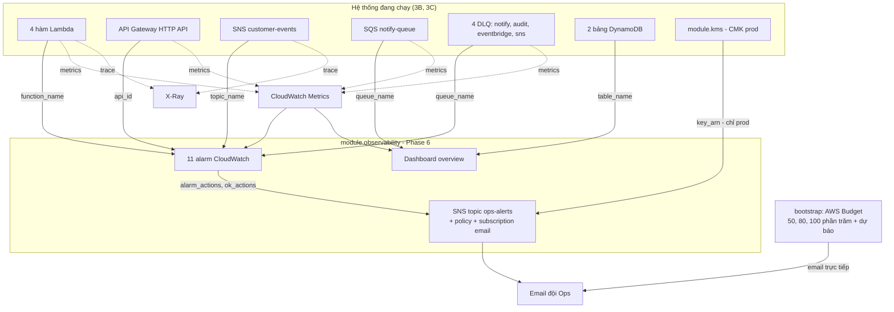

# Phase 6: Observability, Operations & Teardown — Customer Logic Workflow

> **Phạm vi:** (1) giám sát và cảnh báo: SNS `ops-alerts`, CloudWatch Alarm, Dashboard, **Budget** chi phí; (2) truy vết X-Ray; (3) **Runbook** cho 3 sự cố hàng đầu; (4) **teardown** toàn bộ dự án; (5) **rà soát checklist cuối cùng** cho cả dự án.
> **Điều kiện:** Phase 1 đến 5 đã xong và pipeline đã deploy ít nhất `dev`.
> **Chi phí tăng thêm:** alarm CloudWatch miễn phí 10 alarm/tháng cho cả account, mỗi alarm thừa ≈ 0,10 USD/tháng. Thiết kế có 11 alarm mỗi môi trường, nên `dev` + `prod` ≈ **1,2 USD/tháng** (tắt được bằng `enable_alarms = false`). Dashboard (≤ 50 metric, 3 dashboard đầu), SNS email (1.000 thông báo đầu), X-Ray (100.000 trace đầu) và 2 Budget đầu đều miễn phí.
> **Tình trạng kiểm chứng:** Terraform và PowerShell chưa được chạy. Mục 11 là các bước kiểm chứng; mục 14 liệt kê rõ những điểm tôi chưa chắc.

---

## 0. Điều chỉnh với phần đã giao

| # | Điều chỉnh | Lý do |
|---|---|---|
| 1 | **Billing alarm của CloudWatch được thay bằng AWS Budgets** | Billing alarm phải đặt ở `us-east-1`, cần bật "Receive Billing Alerts" thủ công trong console (ClickOps), chỉ báo theo số tiền cố định. Budgets cấu hình hoàn toàn bằng IaC, có ngưỡng **50%, 80%, 100%** (đúng checklist) và cả **cảnh báo dự báo** |
| 2 | **Budget đặt ở `bootstrap`, không đặt ở từng môi trường** | Chi phí là cấp **account**; đặt ở hai môi trường sẽ tạo hai Budget trùng nhau và tính phí Budget thứ 3 trở đi |
| 3 | **Topic `ops-alerts` của `dev` không mã hóa** | CloudWatch Alarm **không publish được** vào topic mã hóa bằng khóa AWS managed (`aws/sns`), vì không sửa được key policy của khóa đó. Nội dung cảnh báo không chứa dữ liệu cá nhân. `prod` dùng CMK và key policy cho phép CloudWatch |
| 4 | **Thêm `cloudwatch.amazonaws.com` vào `service_principals` của module `kms`** | Cần để CloudWatch publish vào topic `ops-alerts` mã hóa bằng CMK ở `prod` |

---

## 1. Quyết định thiết kế mới

| ADR | Quyết định | Lý do | Đánh đổi |
|---|---|---|---|
| **ADR-047** | Module `observability` đóng gói topic `ops-alerts`, alarm và dashboard. Nó **chỉ đọc** thông tin từ các module khác, không module nào phụ thuộc vào nó | Gỡ hoặc đổi giám sát không ảnh hưởng hệ thống chạy | Nhận nhiều tham số tên tài nguyên |
| **ADR-048** | Alarm tập trung vào **triệu chứng ảnh hưởng người dùng**: lỗi Lambda, 5xx của API, **bất kỳ message nào trong DLQ**, SNS gửi thất bại, throttle của `notifier` | Ít alarm, mỗi alarm đều đáng hành động (tránh "mệt mỏi cảnh báo") | Không có cảnh báo về độ trễ hay mức dùng tài nguyên |
| **ADR-049** | Ngưỡng DLQ là **> 0**: có message là cảnh báo | DLQ là nơi chứa sự kiện **đã mất khả năng tự xử lý**; mỗi cái đều cần người xem | Có thể ồn nếu có sự kiện sai định dạng thường xuyên |
| **ADR-050** | Giữ **X-Ray bằng Powertools Tracer**, không chuyển sang OpenTelemetry | Đã bật sẵn, gần như miễn phí ở quy mô này, tích hợp Lambda/SNS sẵn có. Thêm **annotation** `event_id` để tìm trace theo sự kiện | HTTP API không hỗ trợ X-Ray nên trace bắt đầu từ Lambda |
| **ADR-051** | Runbook dùng phiên **`clw-admin`** cho các thao tác đọc log, đọc DLQ, redrive | `ClwDeployer` chỉ quản lý hạ tầng, không đọc dữ liệu (đúng Least Privilege) | Lộ ra việc thiếu một vai trò **operator** riêng (xem mục 14) |
| **ADR-052** | Budget mặc định **10 USD/tháng**, cảnh báo qua **email trực tiếp** (không qua SNS) | Đơn giản, không phụ thuộc khóa KMS hay topic | Chỉ cảnh báo, không tự động chặn chi tiêu |

---

## 2. Cấu trúc file của Phase 6

```text
infra/
├── bootstrap/
│   ├── variables.tf                       # thêm 2 biến (File 1)
│   ├── budget.tf                          # mới (File 2)
│   └── bootstrap.secret.tfvars            # thêm budget_alert_emails
├── modules/
│   └── observability/
│       ├── versions.tf  variables.tf  main.tf  outputs.tf
│       └── tests/observability.tftest.hcl
└── envs/
    ├── dev/
    │   ├── observability.tf               # mới (File 8)
    │   ├── main.tf                        # sửa module kms (bản vá)
    │   ├── variables.tf                   # thêm 2 biến (File 9)
    │   ├── outputs.tf                     # thêm 2 output (File 10)
    │   └── terraform.tfvars               # thêm giá trị (File 11)
    └── prod/                              # observability.tf, main.tf, variables.tf, outputs.tf giống dev
src/ingest/ingest_app/entrypoint.py        # thêm annotation X-Ray (bản vá)
```

---

## 3. Dependency / Call Graph

### 3.1. Module `observability` trong tổng thể



### 3.2. Contract Table

| Caller → Callee | Inputs / Tham số truyền | Outputs / Giá trị trả về | Vì sao có phụ thuộc này |
|---|---|---|---|
| `observability.tf` → `module.observability` | Tên hàm, `api_id`, tên topic/queue/DLQ/bảng, `kms_master_key_id`, `ops_email_addresses`, `enable_alarms` | `ops_topic_arn`, `dashboard_name`, `alarm_names` | Một nơi duy nhất mô tả giám sát |
| `module.observability` → `aws_cloudwatch_metric_alarm` | `namespace`, `metric_name`, `dimensions`, `threshold` | Alarm có `alarm_actions` | Mỗi triệu chứng một alarm (ADR-048) |
| Alarm → SNS `ops-alerts` | Sự kiện đổi trạng thái (`ALARM` và `OK`) | Email đội Ops | Người vận hành biết có sự cố và khi nào hết |
| CloudWatch → topic `ops-alerts` | Quyền `sns:Publish` | (không) | Topic policy chỉ cho **alarm của dự án** (`aws:SourceArn` khớp `alarm:clw-*`) publish |
| CloudWatch → khóa CMK | `kms:GenerateDataKey*`, `kms:Decrypt` | (không) | Chỉ cần ở `prod` khi topic mã hóa bằng CMK |
| `bootstrap/budget.tf` → AWS Budgets | `limit_amount`, ngưỡng, `budget_alert_emails` | Budget `clw-monthly-cost` | Chi phí cấp account, ngoài vòng đời của từng môi trường |
| Ingest → X-Ray | `tracer.put_annotation(event_id, event_type)` | Annotation lập chỉ mục được | Tìm toàn bộ trace của một sự kiện cụ thể |

### 3.3. Execution Trace

**Kịch bản 1 — Happy path: một sự cố đến tay người vận hành**

1. Một message vào `notify_dlq` (sự kiện lỗi sau 3 lần xử lý). CloudWatch lấy metric `ApproximateNumberOfMessagesVisible = 1` mỗi phút.
2. Sau tối đa một chu kỳ 5 phút, alarm `clw-dev-notify-dlq-messages` chuyển `OK` thành `ALARM`.
3. Alarm gọi `alarm_actions`: CloudWatch publish vào `clw-dev-ops-alerts`. Topic policy kiểm tra `aws:SourceArn` khớp `alarm:clw-dev-*` rồi chấp nhận.
4. SNS gửi email tới đội Ops: "ALARM: clw-dev-notify-dlq-messages".
5. Người vận hành mở Dashboard `clw-dev-overview` (widget DLQ), rồi làm theo **Runbook 1** (mục 7).
6. Sau khi xử lý và DLQ rỗng, alarm trở lại `OK` và gửi thêm một email "OK".

**Kịch bản 2 — Error path**

1. **Email chưa xác nhận:** subscription ở `PendingConfirmation`, **không có email nào đến** dù alarm đã kêu. Kiểm tra bằng `aws sns list-subscriptions-by-topic` (cột `SubscriptionArn` là `PendingConfirmation`).
2. **`prod`: key policy không cho CloudWatch dùng CMK:** alarm vào trạng thái `ALARM` nhưng `alarm_actions` thất bại (không có email). Xem `aws cloudwatch describe-alarm-history --history-item-type Action` (mục 7, kiểm tra riêng).
3. **Topic policy sai điều kiện `aws:SourceArn`:** SNS từ chối publish của CloudWatch; hiện tượng giống mục 2.
4. **Alarm "lặng" vì thiếu dữ liệu:** các alarm dùng `treat_missing_data = notBreaching` nên khi hàm không được gọi (không có metric) alarm ở `OK`, không báo giả.
5. **Budget vượt ngưỡng:** email gửi **trực tiếp** từ AWS Budgets (không qua SNS), nên vẫn hoạt động ngay cả khi `ops-alerts` hỏng.

---

## 4. Code: Budget (bootstrap)

### File 1: Bổ sung vào `infra/bootstrap/variables.tf` (thêm vào cuối file)

**Overview:** Hai biến điều khiển Budget. Giá trị email do bạn điền ở `bootstrap.secret.tfvars`.

```hcl
variable "budget_alert_emails" {
  description = "Danh sách email nhận cảnh báo chi phí. Để trống nếu không muốn tạo Budget."
  type        = list(string)
  default     = []

  validation {
    condition     = alltrue([for e in var.budget_alert_emails : can(regex("^[^@\\s]+@[^@\\s]+\\.[^@\\s]+$", e))])
    error_message = "Mỗi phần tử của budget_alert_emails phải là địa chỉ email hợp lệ."
  }
}

variable "monthly_budget_usd" {
  description = "Hạn mức chi phí hằng tháng (USD) của cả account, làm mốc cho các ngưỡng 50%, 80%, 100%."
  type        = number
  default     = 10

  validation {
    condition     = var.monthly_budget_usd > 0
    error_message = "monthly_budget_usd phải lớn hơn 0."
  }
}
```

Thêm vào `bootstrap.secret.tfvars` (file bị `.gitignore` chặn):

```hcl
budget_alert_emails = ["email-cua-ban@example.com"]
```

**Giải thích chi tiết:**
- Mặc định rỗng: bootstrap vẫn chạy bình thường mà không tạo Budget (giống cách `sso_user_name` và `github_repository` điều khiển các phần tùy chọn).
- Hạn mức **10 USD** gấp khoảng 10 lần ước tính `dev` (0 đến 1 USD) và vừa với `prod` ở mức tải thấp. Hãy chỉnh theo thực tế của bạn.
- Email **chỉ nằm ở file `.secret.tfvars`**, không vào repo.

### File 2: `infra/bootstrap/budget.tf`

**Overview:** Tạo một AWS Budget theo tháng cho cả account với 4 thông báo: 50%, 80%, 100% chi phí **thực tế** và 100% chi phí **dự báo**. Do admin `apply` ở bootstrap.

```hcl
resource "aws_budgets_budget" "monthly" {
  count = length(var.budget_alert_emails) > 0 ? 1 : 0

  name         = "${var.name_prefix}-monthly-cost"
  budget_type  = "COST"
  limit_amount = tostring(var.monthly_budget_usd)
  limit_unit   = "USD"
  time_unit    = "MONTHLY"

  dynamic "notification" {
    for_each = [50, 80, 100]

    content {
      comparison_operator        = "GREATER_THAN"
      threshold                  = notification.value
      threshold_type             = "PERCENTAGE"
      notification_type          = "ACTUAL"
      subscriber_email_addresses = var.budget_alert_emails
    }
  }

  notification {
    comparison_operator        = "GREATER_THAN"
    threshold                  = 100
    threshold_type             = "PERCENTAGE"
    notification_type          = "FORECASTED"
    subscriber_email_addresses = var.budget_alert_emails
  }
}
```

**Giải thích chi tiết:**
- **Ngưỡng 50, 80, 100% của chi phí thực tế**: đúng yêu cầu của checklist ("Budget Alerts ở 50%, 80%, 100%").
- **Cảnh báo dự báo 100%**: AWS dự đoán cuối tháng sẽ vượt hạn mức thì báo **sớm**, trước khi tiền đã tiêu hết.
- Tên `clw-monthly-cost` khớp mẫu `budget/clw-*` của policy deploy (3A). Dù vậy, vì Budget do bootstrap quản lý, role CI không cần đụng tới nó.
- Gửi **email trực tiếp** (ADR-052): không phụ thuộc topic SNS, khóa KMS hay Lambda, nên vẫn báo được khi các thành phần khác hỏng.
- **Giới hạn cần biết:** dữ liệu chi phí của AWS có độ trễ (thường vài giờ), nên Budget **không phải** công cụ phản ứng tức thời. Nó cũng **chỉ cảnh báo**, không tự động ngắt dịch vụ.
- AWS miễn phí 2 Budget đầu tiên của mỗi account; dự án chỉ dùng 1.

---

## 5. Code: module `observability`

### File 3: `infra/modules/observability/versions.tf`

**Overview:** Giống `versions.tf` của các module `iam`, `apigw`, `eventbridge` (không cần provider `archive`).

```hcl
terraform {
  required_version = ">= 1.10.0"

  required_providers {
    aws = {
      source  = "hashicorp/aws"
      version = "~> 6.0"
    }
  }
}
```

**Giải thích chi tiết:** giữ đồng nhất phiên bản với root và các module khác. Có thể sao chép nhanh: `Copy-Item infra\modules\kms\versions.tf infra\modules\observability\versions.tf` sau khi tạo thư mục.

### File 4: `infra/modules/observability/variables.tf`

**Overview:** Đầu vào của module. Root truyền **tên** các tài nguyên cần giám sát (lấy từ output của module khác).

```hcl
variable "name_prefix" {
  description = "Tiền tố tên môi trường, ví dụ clw-dev. Tên alarm, topic và dashboard đều bắt đầu bằng tiền tố này."
  type        = string
}

variable "aws_region" {
  description = "Region của các tài nguyên được giám sát."
  type        = string
}

variable "kms_master_key_id" {
  description = "ARN CMK để mã hóa topic ops-alerts (prod). null nghĩa là không mã hóa (dev), xem điều chỉnh số 3."
  type        = string
  default     = null
}

variable "ops_email_addresses" {
  description = "Danh sách email đội vận hành nhận cảnh báo (mỗi email phải bấm xác nhận)."
  type        = list(string)
  default     = []

  validation {
    condition     = alltrue([for e in var.ops_email_addresses : can(regex("^[^@\\s]+@[^@\\s]+\\.[^@\\s]+$", e))])
    error_message = "Mỗi phần tử của ops_email_addresses phải là địa chỉ email hợp lệ."
  }
}

variable "enable_alarms" {
  description = "Có tạo alarm hay không. Mỗi alarm vượt hạn mức miễn phí tốn khoảng 0,10 USD mỗi tháng."
  type        = bool
  default     = true
}

variable "api_5xx_threshold" {
  description = "Số lỗi 5xx trong 5 phút làm alarm API kêu."
  type        = number
  default     = 5

  validation {
    condition     = var.api_5xx_threshold >= 1
    error_message = "api_5xx_threshold phải lớn hơn hoặc bằng 1."
  }
}

variable "api_id" {
  description = "ID của HTTP API (dimension ApiId của metric)."
  type        = string
}

variable "customer_events_topic_name" {
  description = "Tên SNS topic customer-events (dimension TopicName của metric)."
  type        = string
}

variable "notify_queue_name" {
  description = "Tên queue notify (dimension QueueName của metric)."
  type        = string
}

variable "lambda_function_names" {
  description = "Tên 4 hàm Lambda theo khóa authorizer, ingest, notifier, audit."
  type        = map(string)
}

variable "dlq_names" {
  description = "Tên các DLQ theo khóa notify, audit, eventbridge, sns."
  type        = map(string)
}

variable "table_names" {
  description = "Tên các bảng DynamoDB theo khóa idempotency, delivery_log."
  type        = map(string)
}
```

**Giải thích chi tiết:**
- Module nhận **tên**, không nhận ARN: metric CloudWatch được định danh bằng tên tài nguyên (dimension), nên không cần ARN.
- Dùng `map(string)` với **khóa cố định** (do root khai báo) để `for_each` biết khóa lúc plan, còn giá trị (tên tài nguyên chưa tạo) có thể chưa biết.
- `kms_master_key_id` mặc định `null`: không mã hóa theo mặc định, đúng điều chỉnh số 3.

### File 5: `infra/modules/observability/main.tf`

**Overview:** Tạo topic `ops-alerts` (policy, subscription email), 11 alarm CloudWatch và dashboard `overview`. Nhận tên tài nguyên từ root; output `ops_topic_arn` dùng để kiểm tra.

```hcl
data "aws_caller_identity" "current" {}

locals {
  account_id = data.aws_caller_identity.current.account_id

  lambda_names    = values(var.lambda_function_names)
  dlq_queue_names = values(var.dlq_names)
  table_name_list = values(var.table_names)
}

# ---------------------------------------------------------------------------
# Topic nhận cảnh báo của đội vận hành
# ---------------------------------------------------------------------------
resource "aws_sns_topic" "ops_alerts" {
  #checkov:skip=CKV_AWS_26:CloudWatch Alarm không publish được vào topic mã hóa bằng khóa AWS managed; nội dung cảnh báo không chứa dữ liệu cá nhân. Prod truyền CMK qua kms_master_key_id

  name              = "${var.name_prefix}-ops-alerts"
  kms_master_key_id = var.kms_master_key_id
}

data "aws_iam_policy_document" "ops_alerts" {
  statement {
    sid       = "AllowProjectAlarmsToPublish"
    actions   = ["sns:Publish"]
    resources = [aws_sns_topic.ops_alerts.arn]

    principals {
      type        = "Service"
      identifiers = ["cloudwatch.amazonaws.com"]
    }

    condition {
      test     = "StringEquals"
      variable = "aws:SourceAccount"
      values   = [local.account_id]
    }

    condition {
      test     = "ArnLike"
      variable = "aws:SourceArn"
      values   = ["arn:aws:cloudwatch:${var.aws_region}:${local.account_id}:alarm:${var.name_prefix}-*"]
    }
  }

  statement {
    sid       = "DenyInsecureTransport"
    effect    = "Deny"
    actions   = ["sns:Publish", "sns:Subscribe"]
    resources = [aws_sns_topic.ops_alerts.arn]

    principals {
      type        = "*"
      identifiers = ["*"]
    }

    condition {
      test     = "Bool"
      variable = "aws:SecureTransport"
      values   = ["false"]
    }
  }
}

resource "aws_sns_topic_policy" "ops_alerts" {
  arn    = aws_sns_topic.ops_alerts.arn
  policy = data.aws_iam_policy_document.ops_alerts.json
}

resource "aws_sns_topic_subscription" "ops_email" {
  for_each = toset(var.ops_email_addresses)

  topic_arn = aws_sns_topic.ops_alerts.arn
  protocol  = "email"
  endpoint  = each.value
}

# ---------------------------------------------------------------------------
# Alarm: mỗi triệu chứng ảnh hưởng người dùng một alarm (ADR-048)
# ---------------------------------------------------------------------------
resource "aws_cloudwatch_metric_alarm" "lambda_errors" {
  for_each = { for key, name in var.lambda_function_names : key => name if var.enable_alarms }

  alarm_name          = "${var.name_prefix}-${each.key}-errors"
  alarm_description   = "Hàm Lambda ${each.key} có lỗi. Làm theo Runbook 2 (lỗi và 5xx)."
  namespace           = "AWS/Lambda"
  metric_name         = "Errors"
  dimensions          = { FunctionName = each.value }
  statistic           = "Sum"
  period              = 300
  evaluation_periods  = 1
  threshold           = 0
  comparison_operator = "GreaterThanThreshold"
  treat_missing_data  = "notBreaching"
  alarm_actions       = [aws_sns_topic.ops_alerts.arn]
  ok_actions          = [aws_sns_topic.ops_alerts.arn]
}

resource "aws_cloudwatch_metric_alarm" "lambda_throttles" {
  for_each = { for key, name in var.lambda_function_names : key => name if var.enable_alarms && key == "notifier" }

  alarm_name          = "${var.name_prefix}-${each.key}-throttles"
  alarm_description   = "Hàm Lambda ${each.key} bị throttle. Làm theo Runbook 3 (throttle và tồn đọng)."
  namespace           = "AWS/Lambda"
  metric_name         = "Throttles"
  dimensions          = { FunctionName = each.value }
  statistic           = "Sum"
  period              = 300
  evaluation_periods  = 1
  threshold           = 0
  comparison_operator = "GreaterThanThreshold"
  treat_missing_data  = "notBreaching"
  alarm_actions       = [aws_sns_topic.ops_alerts.arn]
  ok_actions          = [aws_sns_topic.ops_alerts.arn]
}

resource "aws_cloudwatch_metric_alarm" "api_5xx" {
  count = var.enable_alarms ? 1 : 0

  alarm_name          = "${var.name_prefix}-api-5xx"
  alarm_description   = "API Gateway trả lỗi 5xx. Làm theo Runbook 2 (lỗi và 5xx)."
  namespace           = "AWS/ApiGateway"
  metric_name         = "5xx"
  dimensions          = { ApiId = var.api_id }
  statistic           = "Sum"
  period              = 300
  evaluation_periods  = 1
  threshold           = var.api_5xx_threshold
  comparison_operator = "GreaterThanOrEqualToThreshold"
  treat_missing_data  = "notBreaching"
  alarm_actions       = [aws_sns_topic.ops_alerts.arn]
  ok_actions          = [aws_sns_topic.ops_alerts.arn]
}

resource "aws_cloudwatch_metric_alarm" "dlq_messages" {
  for_each = { for key, name in var.dlq_names : key => name if var.enable_alarms }

  alarm_name          = "${var.name_prefix}-${each.key}-dlq-messages"
  alarm_description   = "DLQ ${each.key} có message chưa xử lý. Làm theo Runbook 1 (DLQ có message)."
  namespace           = "AWS/SQS"
  metric_name         = "ApproximateNumberOfMessagesVisible"
  dimensions          = { QueueName = each.value }
  statistic           = "Maximum"
  period              = 300
  evaluation_periods  = 1
  threshold           = 0
  comparison_operator = "GreaterThanThreshold"
  treat_missing_data  = "notBreaching"
  alarm_actions       = [aws_sns_topic.ops_alerts.arn]
  ok_actions          = [aws_sns_topic.ops_alerts.arn]
}

resource "aws_cloudwatch_metric_alarm" "sns_failed" {
  count = var.enable_alarms ? 1 : 0

  alarm_name          = "${var.name_prefix}-sns-delivery-failed"
  alarm_description   = "SNS gửi thông báo thất bại (kể cả email). Làm theo Runbook 3."
  namespace           = "AWS/SNS"
  metric_name         = "NumberOfNotificationsFailed"
  dimensions          = { TopicName = var.customer_events_topic_name }
  statistic           = "Sum"
  period              = 300
  evaluation_periods  = 1
  threshold           = 0
  comparison_operator = "GreaterThanThreshold"
  treat_missing_data  = "notBreaching"
  alarm_actions       = [aws_sns_topic.ops_alerts.arn]
  ok_actions          = [aws_sns_topic.ops_alerts.arn]
}

# ---------------------------------------------------------------------------
# Dashboard tổng quan
# ---------------------------------------------------------------------------
locals {
  alarm_arns = concat(
    [for alarm in aws_cloudwatch_metric_alarm.lambda_errors : alarm.arn],
    [for alarm in aws_cloudwatch_metric_alarm.lambda_throttles : alarm.arn],
    [for alarm in aws_cloudwatch_metric_alarm.api_5xx : alarm.arn],
    [for alarm in aws_cloudwatch_metric_alarm.dlq_messages : alarm.arn],
    [for alarm in aws_cloudwatch_metric_alarm.sns_failed : alarm.arn],
  )

  base_widgets = [
    {
      type   = "metric"
      x      = 0
      y      = 0
      width  = 12
      height = 6
      properties = {
        title   = "API Gateway: request, 4xx, 5xx, độ trễ p95"
        region  = var.aws_region
        view    = "timeSeries"
        stacked = false
        period  = 300
        metrics = [
          ["AWS/ApiGateway", "Count", "ApiId", var.api_id, { stat = "Sum", label = "Request" }],
          ["AWS/ApiGateway", "4xx", "ApiId", var.api_id, { stat = "Sum", label = "4xx" }],
          ["AWS/ApiGateway", "5xx", "ApiId", var.api_id, { stat = "Sum", label = "5xx" }],
          ["AWS/ApiGateway", "Latency", "ApiId", var.api_id, { stat = "p95", label = "Độ trễ p95", yAxis = "right" }],
        ]
      }
    },
    {
      type   = "metric"
      x      = 12
      y      = 0
      width  = 12
      height = 6
      properties = {
        title   = "Lambda: lỗi"
        region  = var.aws_region
        view    = "timeSeries"
        stacked = false
        period  = 300
        metrics = [for name in local.lambda_names : ["AWS/Lambda", "Errors", "FunctionName", name, { stat = "Sum", label = name }]]
      }
    },
    {
      type   = "metric"
      x      = 0
      y      = 6
      width  = 12
      height = 6
      properties = {
        title   = "Lambda: throttle"
        region  = var.aws_region
        view    = "timeSeries"
        stacked = false
        period  = 300
        metrics = [for name in local.lambda_names : ["AWS/Lambda", "Throttles", "FunctionName", name, { stat = "Sum", label = name }]]
      }
    },
    {
      type   = "metric"
      x      = 12
      y      = 6
      width  = 12
      height = 6
      properties = {
        title   = "Lambda: thời lượng p95 (ms)"
        region  = var.aws_region
        view    = "timeSeries"
        stacked = false
        period  = 300
        metrics = [for name in local.lambda_names : ["AWS/Lambda", "Duration", "FunctionName", name, { stat = "p95", label = name }]]
      }
    },
    {
      type   = "metric"
      x      = 0
      y      = 12
      width  = 12
      height = 6
      properties = {
        title   = "Queue notify: tồn đọng và tuổi message cũ nhất"
        region  = var.aws_region
        view    = "timeSeries"
        stacked = false
        period  = 300
        metrics = [
          ["AWS/SQS", "ApproximateNumberOfMessagesVisible", "QueueName", var.notify_queue_name, { stat = "Maximum", label = "Message đang chờ" }],
          ["AWS/SQS", "ApproximateAgeOfOldestMessage", "QueueName", var.notify_queue_name, { stat = "Maximum", label = "Tuổi message cũ nhất (giây)", yAxis = "right" }],
        ]
      }
    },
    {
      type   = "metric"
      x      = 12
      y      = 12
      width  = 12
      height = 6
      properties = {
        title   = "DLQ: message đang chờ xử lý"
        region  = var.aws_region
        view    = "timeSeries"
        stacked = false
        period  = 300
        metrics = [for name in local.dlq_queue_names : ["AWS/SQS", "ApproximateNumberOfMessagesVisible", "QueueName", name, { stat = "Maximum", label = name }]]
      }
    },
    {
      type   = "metric"
      x      = 0
      y      = 18
      width  = 12
      height = 6
      properties = {
        title   = "SNS customer-events: đã publish, đã gửi, thất bại"
        region  = var.aws_region
        view    = "timeSeries"
        stacked = false
        period  = 300
        metrics = [
          ["AWS/SNS", "NumberOfMessagesPublished", "TopicName", var.customer_events_topic_name, { stat = "Sum", label = "Đã publish" }],
          ["AWS/SNS", "NumberOfNotificationsDelivered", "TopicName", var.customer_events_topic_name, { stat = "Sum", label = "Đã gửi" }],
          ["AWS/SNS", "NumberOfNotificationsFailed", "TopicName", var.customer_events_topic_name, { stat = "Sum", label = "Thất bại" }],
        ]
      }
    },
    {
      type   = "metric"
      x      = 12
      y      = 18
      width  = 12
      height = 6
      properties = {
        title   = "DynamoDB: dung lượng đọc và ghi đã dùng"
        region  = var.aws_region
        view    = "timeSeries"
        stacked = false
        period  = 300
        metrics = concat(
          [for name in local.table_name_list : ["AWS/DynamoDB", "ConsumedWriteCapacityUnits", "TableName", name, { stat = "Sum", label = "${name} ghi" }]],
          [for name in local.table_name_list : ["AWS/DynamoDB", "ConsumedReadCapacityUnits", "TableName", name, { stat = "Sum", label = "${name} đọc" }]],
        )
      }
    },
  ]

  alarm_widgets = length(local.alarm_arns) > 0 ? [
    {
      type   = "alarm"
      x      = 0
      y      = 24
      width  = 24
      height = 6
      properties = {
        title  = "Trạng thái các alarm"
        alarms = local.alarm_arns
      }
    },
  ] : []
}

resource "aws_cloudwatch_dashboard" "overview" {
  dashboard_name = "${var.name_prefix}-overview"

  dashboard_body = jsonencode({
    widgets = concat(local.base_widgets, local.alarm_widgets)
  })
}
```

**Giải thích chi tiết:**
- **Topic `ops-alerts`:** `kms_master_key_id = null` ở `dev` (xem điều chỉnh số 3). Dòng `#checkov:skip` ghi lý do rõ ràng.
- **Topic policy** chỉ cho **dịch vụ CloudWatch** publish, với **hai điều kiện**: `aws:SourceAccount` (đúng account này) và `aws:SourceArn` khớp `alarm:<name_prefix>-*` (chỉ alarm của đúng môi trường này), chống confused deputy. Statement thứ hai cấm truy cập không HTTPS.
- **11 alarm** (tối đa mỗi môi trường): 4 lỗi Lambda, 1 throttle `notifier`, 1 API 5xx, 4 DLQ, 1 SNS gửi thất bại (ADR-048).
  - `treat_missing_data = "notBreaching"`: không có dữ liệu (hàm chưa được gọi) thì coi như **không có sự cố**, tránh báo động giả ở môi trường ít tải.
  - `period = 300`, `evaluation_periods = 1`: phát hiện trong tối đa một chu kỳ 5 phút.
  - Lỗi Lambda: ngưỡng `> 0`, vì mọi lỗi đều đáng xem ở quy mô này (tăng ngưỡng khi tải lớn).
  - DLQ: `Maximum` của `ApproximateNumberOfMessagesVisible` **> 0** (ADR-049).
  - `alarm_actions` và `ok_actions` cùng trỏ vào topic: bạn nhận email khi **có** sự cố và khi **hết** sự cố.
- **Chỉ `notifier` có alarm throttle:** các hàm khác gọi đồng bộ hoặc ít tải; throttle của `notifier` dẫn tới **message tồn đọng** nên đáng báo (và đây cũng là cách phát hiện vòng lặp bất thường, ADR-025).
- **Dashboard:** 8 widget số liệu (29 đường metric, dưới ngưỡng 50 để miễn phí) cộng một widget **trạng thái alarm** (chỉ khi có alarm). Layout 2 cột × 4 hàng.
- Độ chính xác dimension `ApiId` của HTTP API: nếu widget API trống, vào CloudWatch → Metrics → ApiGateway để xem bộ dimension thực tế của tài khoản bạn (mục 14).
- `for_each` dùng dạng `{ for ... if ... }` (đã dùng ở 3A) để khóa xác định lúc plan.

### File 6: `infra/modules/observability/outputs.tf`

**Overview:** Xuất thông tin để kiểm tra và dùng ở runbook.

```hcl
output "ops_topic_arn" {
  description = "ARN topic ops-alerts nhận cảnh báo của CloudWatch."
  value       = aws_sns_topic.ops_alerts.arn
}

output "dashboard_name" {
  description = "Tên dashboard tổng quan của môi trường."
  value       = aws_cloudwatch_dashboard.overview.dashboard_name
}

output "alarm_names" {
  description = "Tên tất cả alarm đã tạo (rỗng nếu enable_alarms = false)."
  value = concat(
    [for alarm in aws_cloudwatch_metric_alarm.lambda_errors : alarm.alarm_name],
    [for alarm in aws_cloudwatch_metric_alarm.lambda_throttles : alarm.alarm_name],
    [for alarm in aws_cloudwatch_metric_alarm.api_5xx : alarm.alarm_name],
    [for alarm in aws_cloudwatch_metric_alarm.dlq_messages : alarm.alarm_name],
    [for alarm in aws_cloudwatch_metric_alarm.sns_failed : alarm.alarm_name],
  )
}
```

**Giải thích chi tiết:** `alarm_names` giúp runbook và script kiểm tra liệt kê đủ alarm. Không output nào chứa secret.

### File 7: `infra/modules/observability/tests/observability.tftest.hcl`

**Overview:** Test module bằng provider giả (không cần AWS).

```hcl
mock_provider "aws" {}

variables {
  name_prefix                = "clw-test"
  aws_region                 = "ap-southeast-1"
  api_id                     = "abc123"
  customer_events_topic_name = "clw-test-customer-events"
  notify_queue_name          = "clw-test-notify"
  ops_email_addresses        = ["ops@example.com"]

  lambda_function_names = {
    authorizer = "clw-test-authorizer"
    ingest     = "clw-test-ingest"
    notifier   = "clw-test-notifier"
    audit      = "clw-test-audit"
  }

  dlq_names = {
    notify      = "clw-test-notify-dlq"
    audit       = "clw-test-audit-dlq"
    eventbridge = "clw-test-eventbridge-dlq"
    sns         = "clw-test-sns-dlq"
  }

  table_names = {
    idempotency  = "clw-test-idempotency"
    delivery_log = "clw-test-delivery-log"
  }
}

run "alarms_cover_every_failure_mode" {
  command = plan

  assert {
    condition     = length(aws_cloudwatch_metric_alarm.lambda_errors) == 4
    error_message = "Mỗi hàm Lambda phải có một alarm lỗi."
  }

  assert {
    condition     = length(aws_cloudwatch_metric_alarm.lambda_throttles) == 1
    error_message = "Chỉ notifier có alarm throttle."
  }

  assert {
    condition     = length(aws_cloudwatch_metric_alarm.dlq_messages) == 4
    error_message = "Mỗi DLQ phải có một alarm."
  }

  assert {
    condition     = length(aws_cloudwatch_metric_alarm.api_5xx) == 1 && length(aws_cloudwatch_metric_alarm.sns_failed) == 1
    error_message = "Phải có alarm 5xx của API và alarm SNS gửi thất bại."
  }

  assert {
    condition     = alltrue([for alarm in aws_cloudwatch_metric_alarm.dlq_messages : alarm.threshold == 0])
    error_message = "Mọi alarm DLQ phải kêu khi có bất kỳ message nào (ngưỡng 0)."
  }

  assert {
    condition     = aws_cloudwatch_metric_alarm.lambda_errors["ingest"].alarm_name == "clw-test-ingest-errors"
    error_message = "Tên alarm phải có dạng <name_prefix>-<hàm>-errors."
  }
}

run "disabled_alarms_create_none_but_dashboard_remains" {
  command = plan

  variables {
    enable_alarms = false
  }

  assert {
    condition = (
      length(aws_cloudwatch_metric_alarm.lambda_errors) == 0 &&
      length(aws_cloudwatch_metric_alarm.lambda_throttles) == 0 &&
      length(aws_cloudwatch_metric_alarm.dlq_messages) == 0 &&
      length(aws_cloudwatch_metric_alarm.api_5xx) == 0 &&
      length(aws_cloudwatch_metric_alarm.sns_failed) == 0
    )
    error_message = "enable_alarms = false thì không được tạo alarm nào."
  }

  assert {
    condition     = length(jsondecode(aws_cloudwatch_dashboard.overview.dashboard_body).widgets) == 8
    error_message = "Không có alarm thì dashboard chỉ có 8 widget số liệu (không có widget trạng thái alarm)."
  }
}

run "topic_is_unencrypted_without_cmk" {
  command = plan

  assert {
    condition     = aws_sns_topic.ops_alerts.kms_master_key_id == null
    error_message = "Không truyền CMK thì topic ops-alerts không được mã hóa."
  }
}

run "topic_uses_cmk_when_provided" {
  command = plan

  variables {
    kms_master_key_id = "arn:aws:kms:ap-southeast-1:123456789012:key/11111111-2222-3333-4444-555555555555"
  }

  assert {
    condition     = aws_sns_topic.ops_alerts.kms_master_key_id == var.kms_master_key_id
    error_message = "Truyền CMK thì topic phải dùng đúng khóa đó."
  }
}

run "rejects_invalid_email" {
  command = plan

  variables {
    ops_email_addresses = ["khong-phai-email"]
  }

  expect_failures = [var.ops_email_addresses]
}
```

**Giải thích chi tiết:**
- Bài 1 khóa **phạm vi giám sát**: đủ 4 alarm lỗi, 1 throttle, 4 DLQ, 1 API 5xx, 1 SNS; mọi DLQ có ngưỡng 0. Xóa một alarm sẽ làm test hỏng.
- Bài 2 kiểm tra công tắc `enable_alarms` và rằng dashboard vẫn còn. Chỉ kiểm nội dung dashboard khi **tắt** alarm, vì khi bật alarm thì ARN alarm chưa biết lúc plan nên không đọc được nội dung dashboard.
- Bài 3 và 4 kiểm tra logic mã hóa theo môi trường (ADR-006 và điều chỉnh số 3).

---

## 6. Code: nối dây ở root và các bản vá

### File 8: `infra/envs/dev/observability.tf`

**Overview:** Gọi module `observability` với tên các tài nguyên từ 3B và 3C. Không module nào khác phụ thuộc vào nó.

```hcl
module "observability" {
  source = "../../modules/observability"

  name_prefix                = local.name_prefix
  aws_region                 = var.aws_region
  kms_master_key_id          = var.use_cmk ? module.kms.key_arn : null
  ops_email_addresses        = var.ops_email_addresses
  enable_alarms              = var.enable_alarms
  api_5xx_threshold          = var.api_5xx_alarm_threshold
  api_id                     = module.apigw.api_id
  customer_events_topic_name = module.sns.topic_name
  notify_queue_name          = module.notify_queue.queue_name

  lambda_function_names = {
    authorizer = module.lambda_authorizer.function_name
    ingest     = module.lambda_ingest.function_name
    notifier   = module.lambda_notifier.function_name
    audit      = module.lambda_audit.function_name
  }

  dlq_names = {
    notify      = module.notify_dlq.queue_name
    audit       = module.audit_dlq.queue_name
    eventbridge = module.eventbridge_dlq.queue_name
    sns         = module.sns_dlq.queue_name
  }

  table_names = {
    idempotency  = module.idempotency_table.table_name
    delivery_log = module.delivery_log_table.table_name
  }
}
```

**Giải thích chi tiết:** `kms_master_key_id` là CMK ở `prod` và `null` ở `dev` (điều chỉnh số 3). Toàn bộ tên đến từ **output của module khác**, nên không có tên nào bị gõ tay (không lệch khi đổi `name_prefix`).

### Bản vá `infra/envs/dev/main.tf`: thêm CloudWatch vào khóa KMS

Trong module `kms`, đổi dòng `service_principals` thành:

```hcl
  service_principals = ["sns.amazonaws.com", "cloudwatch.amazonaws.com"]
```

**Giải thích chi tiết:** ở `prod`, CloudWatch cần quyền `kms:GenerateDataKey*` và `kms:Decrypt` trên CMK để publish vào topic `ops-alerts` đã mã hóa. Điều kiện `aws:SourceAccount` của key policy (3B) vẫn áp dụng. Ở `dev` không có CMK nên thay đổi này không có tác dụng.

### File 9: Bổ sung vào `infra/envs/dev/variables.tf` (thêm vào cuối file)

**Overview:** Hai biến điều khiển giám sát.

```hcl
variable "enable_alarms" {
  description = "Có tạo alarm CloudWatch hay không (mỗi alarm vượt hạn mức miễn phí tốn khoảng 0,10 USD/tháng)."
  type        = bool
  default     = true
}

variable "api_5xx_alarm_threshold" {
  description = "Số lỗi 5xx trong 5 phút làm alarm API Gateway kêu."
  type        = number
  default     = 5
}
```

**Giải thích chi tiết:** việc kiểm tra giá trị hợp lệ nằm ở module (`validation`), root truyền thẳng xuống.

### File 10: Bổ sung vào `infra/envs/dev/outputs.tf` (thêm vào cuối file)

**Overview:** Hai output cho runbook.

```hcl
output "ops_alerts_topic_arn" {
  description = "ARN topic ops-alerts nhận cảnh báo của CloudWatch."
  value       = module.observability.ops_topic_arn
}

output "dashboard_name" {
  description = "Tên CloudWatch Dashboard tổng quan của môi trường."
  value       = module.observability.dashboard_name
}
```

**Giải thích chi tiết:** `dashboard_name` dùng để mở nhanh dashboard theo runbook; không chứa secret.

### File 11: Cập nhật `terraform.tfvars` của `dev` và `prod`

**Overview:** Thêm giá trị cho hai biến mới vào cuối mỗi file.

`infra/envs/dev/terraform.tfvars` (thêm cuối file):

```hcl
enable_alarms           = true
api_5xx_alarm_threshold = 5
```

`infra/envs/prod/terraform.tfvars` (thêm cuối file):

```hcl
enable_alarms           = true
api_5xx_alarm_threshold = 5
```

**Giải thích chi tiết:** `dev` bật alarm để bạn kiểm chứng giám sát; khi không dùng nữa đặt `false` để về chi phí 0. Với `prod`, cân nhắc đặt ngưỡng 5xx thấp hơn khi lượng tải ổn định.

### Bản vá ingest: annotation X-Ray để tìm trace theo sự kiện

Trong `src/ingest/ingest_app/entrypoint.py`, hàm `_process`, ngay sau khối `logger.append_keys(...)` thêm hai dòng:

```python
    tracer.put_annotation(key="event_id", value=str(parsed.event_id))
    tracer.put_annotation(key="event_type", value=parsed.event_type.value)
```

**Giải thích chi tiết:** annotation của X-Ray được **lập chỉ mục**, nên bạn lọc trace bằng biểu thức `annotation.event_id = "<uuid>"` (xem Runbook 2). Annotation **không** chứa dữ liệu cá nhân (chỉ `event_id` là UUID và loại sự kiện). Khi tracing bị tắt trong unit test, lệnh này không làm gì, nên không cần đổi test.

---

## 7. Runbook vận hành

> **Quy ước:** các lệnh dưới đây dùng profile `clw-admin` (ADR-051) vì `ClwDeployer` cố ý không đọc log hay message. Thay `dev` bằng `prod` cho môi trường tương ứng. Thay `<...>` bằng giá trị thật.

### 7.0. Công cụ dùng chung

Xem alarm đang kêu:

```powershell
aws cloudwatch describe-alarms --alarm-name-prefix clw-dev --state-value ALARM --query "MetricAlarms[].[AlarmName,StateReason]" --output table --profile clw-admin
```

Mở dashboard (tên lấy từ `terraform output dashboard_name`), vào: CloudWatch → Dashboards → `clw-dev-overview`.

Tìm mọi dòng log của **một sự kiện** (CloudWatch Logs Insights), thay `<EVENT_ID>`:

```powershell
$start = [DateTimeOffset]::UtcNow.AddHours(-3).ToUnixTimeSeconds()
$end = [DateTimeOffset]::UtcNow.ToUnixTimeSeconds()
$query = 'fields @timestamp, @log, level, message | filter event_id = "<EVENT_ID>" | sort @timestamp asc'
$queryId = aws logs start-query --log-group-names /aws/lambda/clw-dev-ingest /aws/lambda/clw-dev-notifier /aws/lambda/clw-dev-audit --start-time $start --end-time $end --query-string $query --query queryId --output text --profile clw-admin
aws logs get-query-results --query-id $queryId --profile clw-admin
```

> Chờ vài giây rồi chạy lại `get-query-results` cho tới khi `status` là `Complete`.

Tìm trace X-Ray của một sự kiện: vào CloudWatch → X-Ray traces → **Traces**, lọc bằng `annotation.event_id = "<EVENT_ID>"` (cần bản vá annotation ở mục 6).

### 7.1. Runbook 1: DLQ có message (alarm `*-dlq-messages`)

**Triệu chứng:** alarm `clw-<env>-notify-dlq-messages`, `...-audit-dlq-messages`, `...-eventbridge-dlq-messages` hoặc `...-sns-dlq-messages` kêu; widget "DLQ" trên dashboard > 0.

**Ý nghĩa của từng DLQ:**

| DLQ | Nghĩa là | Nguyên nhân thường gặp |
|---|---|---|
| `notify-dlq` | `notifier` xử lý một message lỗi 3 lần | Message sai hợp đồng (JSON hỏng), DynamoDB lỗi tạm thời kéo dài, lỗi code |
| `audit-dlq` | `audit` lỗi sau 2 lần retry | Message lạ trên topic, DynamoDB lỗi, thiếu quyền |
| `eventbridge-dlq` | EventBridge không gọi được `ingest` | Sự kiện nội bộ sai hợp đồng (`ingest` ném lỗi), `ingest` lỗi hoặc throttle |
| `sns-dlq` | SNS không gửi được vào subscription SQS hoặc Lambda | Queue policy bị đổi, queue bị xóa, Lambda không có permission |

**Tác động:** sự kiện chưa được xử lý xong. Message **không mất**: giữ 14 ngày trong DLQ.

**Chẩn đoán:**

1. Xác định DLQ nào và số message:

```powershell
aws sqs get-queue-attributes --queue-url (aws sqs get-queue-url --queue-name clw-dev-notify-dlq --query QueueUrl --output text --profile clw-admin) --attribute-names ApproximateNumberOfMessages --profile clw-admin
```

2. Xem nội dung (không làm message biến mất: `--visibility-timeout 0`). **Cẩn thận:** nội dung có thể chứa email khách hàng, không dán vào chat, ticket hay log:

```powershell
$queueUrl = aws sqs get-queue-url --queue-name clw-dev-notify-dlq --query QueueUrl --output text --profile clw-admin
aws sqs receive-message --queue-url $queueUrl --max-number-of-messages 5 --visibility-timeout 0 --attribute-names All --message-attribute-names All --profile clw-admin
```

3. Lấy `event_id` từ message rồi tra log theo mục 7.0 để biết **lỗi gì**.
4. Phân loại: **lỗi tạm thời** (DynamoDB, mạng) hay **message hỏng vĩnh viễn** (sai hợp đồng).

**Khắc phục:**

- **Lỗi tạm thời, nguyên nhân đã hết:** chuyển message về queue gốc để xử lý lại (redrive):

```powershell
$dlqArn = aws sqs get-queue-attributes --queue-url $queueUrl --attribute-names QueueArn --query Attributes.QueueArn --output text --profile clw-admin
aws sqs start-message-move-task --source-arn $dlqArn --profile clw-admin
aws sqs list-message-move-tasks --source-arn $dlqArn --profile clw-admin
```

- **Lỗi code:** sửa, merge và để pipeline deploy, **rồi mới** redrive (nếu redrive trước, message lại vào DLQ).
- **Message hỏng vĩnh viễn:** lưu bằng chứng cần thiết (không lưu PII), rồi xóa message khỏi DLQ bằng `aws sqs purge-queue` **chỉ khi chắc chắn** không cần (thao tác không hoàn tác):

```powershell
aws sqs purge-queue --queue-url $queueUrl --profile clw-admin
```

**Xác minh:** DLQ về 0, alarm trở lại `OK` (có email "OK"), bảng `delivery_log` có dòng `notify#SENT` cho `event_id` đã redrive.

**Phòng ngừa:** nếu cùng một kiểu message hỏng lặp lại, sửa nguồn gửi (producer) hoặc siết validate ở `ingest`.

### 7.2. Runbook 2: Lỗi Lambda và 5xx (alarm `*-errors`, `*-api-5xx`)

**Triệu chứng:** alarm `clw-<env>-ingest-errors`, `...-api-5xx` hoặc `...-<hàm>-errors` kêu; client nhận `500/502/503`; widget "Lambda: lỗi" và "API Gateway 5xx" tăng.

**Tác động:** `ingest` lỗi nghĩa là sự kiện mới **không được nhận** (client nhận `503` hoặc `500` và nên gửi lại với **cùng `event_id`**, nhờ idempotency nên không sợ trùng).

**Chẩn đoán:**

1. Có vừa deploy không? Xem `gh run list --workflow=cd.yml --limit 5`. Lỗi bắt đầu ngay sau deploy thì rất có thể do bản mới.
2. Xem log lỗi gần nhất của hàm:

```powershell
aws logs tail /aws/lambda/clw-dev-ingest --since 30m --filter-pattern "ERROR" --profile clw-admin
```

3. Phân loại theo thông điệp:

| Dấu hiệu trong log | Nguyên nhân thường gặp | Hướng xử lý |
|---|---|---|
| `Không publish được` hoặc `PublishError` | SNS lỗi hoặc `AccessDenied` (policy hoặc khóa KMS sai) | Kiểm tra IAM role `ingest` và key policy (`prod`); xem trạng thái dịch vụ AWS |
| `IdempotencyPersistenceLayerError` | DynamoDB lỗi hoặc thiếu quyền | Kiểm tra bảng `idempotency` và quyền của role |
| `ConfigurationError: Thiếu biến môi trường` | Deploy làm mất biến | Kiểm tra `terraform plan` cho `environment_variables` |
| `ImportError` hoặc `ModuleNotFoundError` | Layer lỗi (thiếu dependency) | Xem `scripts/build_layer.py`; build lại layer và deploy |
| `Task timed out` | Quá 10 giây | Xem phụ thuộc chậm (SNS, DynamoDB); cân nhắc tăng `timeout` |

4. Tìm trace của một yêu cầu lỗi theo mục 7.0 để thấy **bước nào chậm hoặc lỗi**.

**Khắc phục:**

- **Do bản mới vừa deploy:** rollback bằng cách revert rồi để pipeline triển khai lại:

```powershell
git checkout main
git pull
git revert --no-edit <COMMIT_LOI>
git push origin HEAD
```

> Nếu `main` có branch protection, hãy tạo nhánh, mở PR cho commit revert và merge như bình thường.

- **Do phụ thuộc AWS lỗi:** chờ AWS phục hồi; client nên **retry với cùng `event_id`**. Các sự kiện từ EventBridge đã có retry riêng và DLQ.
- **Khẩn cấp ở `dev`, không đợi pipeline:** `terraform apply` ở local bằng profile `clw-dev` từ commit trước đó (`git checkout <COMMIT_TOT>` rồi `make tf-plan` và `terraform -chdir=infra/envs/dev apply`). **Không** làm vậy ở `prod` nếu tránh được; dùng pipeline để có duyệt và hash.

**Xác minh:** alarm về `OK`; `curl` thử qua `scripts/smoke_test.py --mode safe`; log không còn `ERROR` mới.

**Phòng ngừa:** thêm test tái hiện lỗi vào bộ unit test trước khi sửa (Phase 4).

### 7.3. Runbook 3: Throttle và tồn đọng (alarm `notifier-throttles`, `sns-delivery-failed`; hoặc `429` ở API)

**Triệu chứng:** alarm `clw-<env>-notifier-throttles` hoặc `...-sns-delivery-failed` kêu; client nhận `429`; widget "Queue notify" cho thấy message đang chờ hoặc tuổi message cũ nhất **tăng liên tục**.

**Tác động:** thông báo tới khách **trễ** (không mất: message vẫn ở trong queue tối đa 4 ngày).

**Chẩn đoán:**

1. Phân biệt ba nguồn throttle:

| Nguồn | Dấu hiệu | Nguyên nhân |
|---|---|---|
| **API Gateway** | Client nhận `429`; `4xx` tăng | Vượt `api_throttling_rate_limit` (mặc định 50 req/s) hoặc burst 200 |
| **Lambda `notifier`** | Alarm `notifier-throttles`; metric `Throttles` tăng | Hết hạn mức concurrency của account hoặc `maximum_concurrency` của event source mapping quá thấp |
| **SNS gửi thất bại** | Alarm `sns-delivery-failed` | Email bị từ chối (hộp thư đầy, đã hủy đăng ký), hoặc subscription SQS và Lambda lỗi |

2. Kiểm tra hạn mức Lambda của account:

```powershell
aws lambda get-account-settings --query "AccountLimit.[ConcurrentExecutions,UnreservedConcurrentExecutions]" --profile clw-admin
```

3. Với `sns-delivery-failed`: xem trạng thái subscription (có `PendingConfirmation` hay không):

```powershell
aws sns list-subscriptions-by-topic --topic-arn (terraform -chdir=infra/envs/dev output -raw sns_topic_arn) --query "Subscriptions[].[Protocol,SubscriptionArn]" --output table --profile clw-admin
```

**Khắc phục:**

- **Tồn đọng ở `notify`, `notifier` bị throttle:** tăng `notifier_max_concurrency` trong `terraform.tfvars` (rồi đi qua PR và pipeline). Nếu account chỉ có hạn mức 10 concurrent, hãy **xin tăng hạn mức** (Service Quotas) trước, vì tăng quá số này sẽ vẫn bị throttle.
- **API `429` do tải thật tăng:** tăng `api_throttling_rate_limit` và `api_throttling_burst_limit` (qua PR). Nếu nghi ngờ bị lạm dụng, **xoay API key** (tạo khóa mới trong SSM, chờ tối đa 10 phút do cache) thay vì nới giới hạn.
- **Email thất bại:** xác nhận lại subscription (`PendingConfirmation` thì gửi lại bằng cách `apply` lại hoặc xóa và tạo lại), hoặc đổi địa chỉ nhận.
- **Vòng lặp bất thường** (Lambda tự kích hoạt chính nó, concurrency tăng vọt): dừng ngay nguồn kích hoạt bằng cách đặt `notifier_max_concurrency = 2` qua PR khẩn, và nếu cần tạm **tắt event source mapping**:

```powershell
aws lambda list-event-source-mappings --function-name clw-dev-notifier --query "EventSourceMappings[].UUID" --output text --profile clw-admin
aws lambda update-event-source-mapping --uuid <UUID> --no-enabled --profile clw-admin
```

> Khi tắt thủ công, Terraform sẽ thấy sai lệch ở lần `plan` kế tiếp: bật lại bằng lệnh `--enabled` sau khi xử lý xong.

**Xác minh:** message đang chờ trên `notify` giảm về 0, tuổi message cũ nhất giảm, alarm `OK`.

**Phòng ngừa:** theo dõi widget "Queue notify" khi tải tăng; đặt `maximum_concurrency` theo hạn mức thực của account.

### 7.4. Kiểm tra kênh cảnh báo hoạt động (nên làm sau mỗi lần dựng môi trường)

Ép một alarm sang `ALARM` để xác nhận email đến (alarm sẽ tự quay về trạng thái đúng ở lần đánh giá kế tiếp):

```powershell
aws cloudwatch set-alarm-state --alarm-name clw-dev-notify-dlq-messages --state-value ALARM --state-reason "Kiem tra kenh canh bao" --profile clw-admin
```

Nếu **không có email** sau vài phút, xem lịch sử hành động (thất bại ở đây cho biết topic policy hoặc khóa KMS sai):

```powershell
aws cloudwatch describe-alarm-history --alarm-name clw-dev-notify-dlq-messages --history-item-type Action --max-records 5 --profile clw-admin
```

---

## 8. Truy vết (X-Ray)

| Thành phần | Trạng thái | Ghi chú |
|---|---|---|
| Lambda (4 hàm) | **Active** (3C) | Tracer của Powertools; `capture_method` tạo subsegment cho SNS, DynamoDB, SSM |
| SNS `customer-events` | **Active** (3B) | Trace đi xuyên từ `ingest` qua SNS tới Lambda `audit` và SQS |
| API Gateway HTTP API | **Không hỗ trợ X-Ray** | Trace bắt đầu từ Lambda `ingest`; dùng `correlation_id` (request ID) trong log để nối với access log của API |
| Annotation | `event_id`, `event_type` (bản vá mục 6) | Lọc trace theo sự kiện |
| Sampling | Mặc định của X-Ray (1 request/giây + 5%) | Ở quy mô thấp, gần như mọi trace đều được ghi |

**Xem trace:** CloudWatch → X-Ray traces → Trace map (bản đồ phụ thuộc) và Traces (từng trace; lọc theo annotation). Dịch vụ lưu trace **30 ngày**.

**Chi phí:** 100.000 trace ghi và 1.000.000 trace đọc miễn phí mỗi tháng; ngoài ra khoảng 5 USD cho mỗi triệu trace. Ở quy mô dự án thì miễn phí.

**Tại sao không dùng OpenTelemetry (ADR-050):** cần thêm collector hoặc layer ADOT và cấu hình, mà X-Ray đã đủ cho nhu cầu. Nếu sau này cần gửi trace sang nền tảng khác, thay `Tracer` bằng OpenTelemetry là việc ở tầng `common/observability.py`.

---

## 9. Hướng dẫn thực hiện (PowerShell)

### 9.1. Tạo file và đồng bộ `prod`

Tạo các file ở mục 4 đến 6, áp dụng các bản vá. Sao chép sang `prod`:

```powershell
New-Item -ItemType Directory -Force infra\modules\observability\tests | Out-Null
foreach ($f in "observability.tf", "main.tf", "variables.tf", "outputs.tf") {
  Copy-Item "infra\envs\dev\$f" "infra\envs\prod\$f" -Force
}
```

Sau đó thêm hai dòng giá trị vào `infra/envs/prod/terraform.tfvars` (File 11).

### 9.2. Áp dụng Budget (bootstrap, cần phiên quản trị)

Điền `budget_alert_emails` vào `bootstrap.secret.tfvars`, rồi:

```powershell
$env:AWS_PROFILE = "clw-admin"
aws sso login --profile clw-admin
terraform -chdir=infra/bootstrap plan -var-file=bootstrap.secret.tfvars -out=tfplan
```

Kế hoạch mong đợi: **thêm** 1 `aws_budgets_budget`, không có thay đổi hay `destroy` khác.

```powershell
terraform -chdir=infra/bootstrap apply tfplan
Remove-Item Env:AWS_PROFILE
```

### 9.3. Deploy giám sát qua pipeline

Mở PR (nhánh mới), kiểm tra 4 check và comment plan (mong đợi: **thêm** topic, policy, subscription, 11 alarm, 1 dashboard cho mỗi môi trường), merge, rồi duyệt `deploy-prod` như Phase 5. Hoặc thử ở `dev` bằng local:

```powershell
$env:AWS_PROFILE = "clw-dev"
terraform -chdir=infra/envs/dev plan
terraform -chdir=infra/envs/dev apply
Remove-Item Env:AWS_PROFILE
```

Sau `apply`, **xác nhận email**: mỗi môi trường tạo thêm một subscription cho topic `ops-alerts`, nên sẽ có thêm **một email xác nhận mỗi môi trường** (ngoài email của topic `customer-events`). Bấm link trong từng email.

---

## 10. Teardown toàn bộ dự án

> **Thứ tự bắt buộc:** `prod`, rồi `dev`, rồi GitHub, rồi bootstrap sau cùng. Nếu xóa bootstrap trước, bạn mất bucket state và role để xóa các môi trường.

### 10.1. Xóa `prod`

1. Tắt chống xóa nhầm: sửa `infra/envs/prod/terraform.tfvars` thành `enable_deletion_protection = false`, merge và để pipeline `apply` (hoặc chạy local).
2. Hủy:

```powershell
$env:AWS_PROFILE = "clw-dev"
aws sso login --profile clw-dev
terraform -chdir=infra/envs/prod init -backend-config="bucket=clw-tfstate-$(aws sts get-caller-identity --query Account --output text)-ap-southeast-1"
terraform -chdir=infra/envs/prod destroy
aws ssm delete-parameter --name "/clw/prod/api-key"
Remove-Item Env:AWS_PROFILE
```

> CMK của `prod` **không bị xóa ngay**: chuyển sang chờ xóa 30 ngày (không tính phí trong thời gian này, có thể hủy lịch xóa nếu nhỡ tay).

> `ops_email_addresses` có giá trị mặc định rỗng nên `terraform destroy` không cần truyền email; việc hủy cũng xóa luôn các subscription email.

### 10.2. Xóa `dev`

```powershell
$env:AWS_PROFILE = "clw-dev"
terraform -chdir=infra/envs/dev init -backend-config="bucket=clw-tfstate-$(aws sts get-caller-identity --query Account --output text)-ap-southeast-1"
terraform -chdir=infra/envs/dev destroy
aws ssm delete-parameter --name "/clw/dev/api-key"
Remove-Item Env:AWS_PROFILE
```

### 10.3. Dọn GitHub

```powershell
gh api --method DELETE repos/owner/repo/environments/dev
gh api --method DELETE repos/owner/repo/environments/prod
gh variable delete AWS_PLAN_ROLE_ARN --repo owner/repo
gh secret delete OPS_EMAIL --repo owner/repo
gh secret delete OPS_EMAIL --repo owner/repo --app dependabot
```

### 10.4. Xóa bootstrap (phiên quản trị)

```powershell
$env:AWS_PROFILE = "clw-admin"
terraform -chdir=infra/bootstrap destroy -var-file=bootstrap.secret.tfvars -var="force_destroy_state_bucket=true"
Remove-Item Env:AWS_PROFILE
```

Lệnh này xóa bucket state (mọi phiên bản), boundary, 3 policy deploy, permission set, OIDC provider, 3 role CI và Budget.

### 10.5. Kiểm tra không còn gì bị tính tiền

Liệt kê mọi tài nguyên còn mang tag dự án (cần quyền đọc tag, dùng `clw-admin`):

```powershell
aws resourcegroupstaggingapi get-resources --tag-filters Key=Project,Values=customer-logic-workflow --query "ResourceTagMappingList[].ResourceARN" --output text --profile clw-admin
```

Kết quả mong đợi: rỗng, hoặc chỉ còn **khóa KMS đang chờ xóa**. Kiểm tra thêm những thứ có thể sót (không phải lúc nào cũng có tag):

```powershell
aws logs describe-log-groups --log-group-name-prefix /aws/lambda/clw --query "logGroups[].logGroupName" --output text --profile clw-admin
aws logs describe-log-groups --log-group-name-prefix /aws/apigateway/clw --query "logGroups[].logGroupName" --output text --profile clw-admin
aws ssm describe-parameters --parameter-filters "Key=Name,Option=BeginsWith,Values=/clw/" --query "Parameters[].Name" --output text --profile clw-admin
aws iam list-open-id-connect-providers --profile clw-admin
```

Cuối cùng xem **Billing → Bills** của AWS sau 1 đến 2 ngày để chắc chắn không còn khoản phát sinh (dữ liệu chi phí có độ trễ).

### 10.6. Dọn máy local

```powershell
make emulator-down
docker rmi aws-emulator
Remove-Item -Recurse -Force .build, .venv
Remove-Item -Recurse -Force "$env:USERPROFILE\.aws\emulator"
```

> `Remove-Item` cuối chỉ xóa thư mục con `emulator`, **không** đụng tới `~/.aws/config` hay `~/.aws/sso` (profile SSO của bạn).

---

## 11. Lệnh xác minh (fmt, validate, test, plan, security scan)

```powershell
terraform fmt -recursive infra
terraform fmt -check -recursive infra
terraform -chdir=infra/modules/observability init -backend=false
terraform -chdir=infra/modules/observability validate
terraform -chdir=infra/modules/observability test
python scripts/run_tflint.py
checkov --config-file .checkov.yaml
python -m pytest -m "not integration"
```

Mong đợi: `terraform test` của `observability` đạt **5 bài** (tổng cả dự án: 29 bài cho 9 module). Nếu `ruff` hoặc `pytest` phàn nàn sau khi thêm annotation, chạy `ruff format src tests scripts`.

**Về `checkov`:** tôi chưa chạy được. Dự kiến sẽ báo thêm vì topic `ops-alerts` ở `dev` không mã hóa (đã skip có lý do) và có thể thêm vài check về alarm hoặc Budget. Hãy gửi kết quả để xử lý.

---

## 12. Checklist xác minh Phase 6

| # | Kiểm tra | Kết quả mong đợi |
|---|---|---|
| 1 | `terraform test` ở `observability` | 5 bài pass |
| 2 | `terraform plan` ở `dev` | Thêm: 1 topic, policy, subscription, 11 alarm, 1 dashboard; không `destroy` |
| 3 | `terraform -chdir=infra/bootstrap plan` | Chỉ thêm 1 Budget |
| 4 | Xác nhận email `ops-alerts` | `aws sns list-subscriptions-by-topic` không còn `PendingConfirmation` |
| 5 | Mở dashboard `clw-dev-overview` | 8 widget số liệu, 1 widget trạng thái alarm, có dữ liệu sau khi gọi API vài lần |
| 6 | `aws cloudwatch describe-alarms --alarm-name-prefix clw-dev --query "length(MetricAlarms)" --profile clw-admin` | `11` |
| 7 | Mục 7.4: `set-alarm-state` ALARM | **Nhận được email** cảnh báo |
| 8 | Gửi một sự kiện hợp lệ rồi tìm trace theo `annotation.event_id` | Thấy trace đi qua `ingest`, SNS, `audit` |
| 9 | Chạy truy vấn Logs Insights ở mục 7.0 với `event_id` đó | Có dòng log của `ingest` và `notifier`, **không** có `payload` hay email đầy đủ |
| 10 | Budget: `aws budgets describe-budgets --account-id <ACCOUNT_ID> --profile clw-admin` | Có `clw-monthly-cost` với 4 thông báo |
| 11 | `prod`: thử `set-alarm-state` | Có email (nếu không, xem `describe-alarm-history` ở mục 7.4: đây là điểm tôi chưa chắc, xem mục 14) |
| 12 | `git status` | Không thấy `.secret.*`, `tfplan`, `.build/` |

---

## 13. Chi phí của Phase 6

| Hạng mục | Ước tính |
|---|---|
| Alarm: 11 mỗi môi trường, 10 miễn phí cho cả account | `dev` + `prod` ≈ **1,2 USD/tháng**; `dev` riêng ≈ 0,1 USD |
| Dashboard (8 widget, 29 metric) | 0 (3 dashboard đầu miễn phí) |
| SNS `ops-alerts` (email) | 0 (1.000 email đầu miễn phí) |
| AWS Budgets (1 Budget) | 0 (2 Budget đầu miễn phí) |
| X-Ray | 0 ở quy mô này |
| Log (đã tính ở 3C) | không đổi |

**Tổng chi phí cả dự án (ước tính, kiểm tra lại bằng AWS Pricing Calculator):** `dev` ≈ 0 đến 1,5 USD/tháng; `dev` + `prod` ở tải thấp ≈ **10 đến 22 USD/tháng**. Tắt hết bằng teardown (mục 10) thì về 0.

---

## 14. Rủi ro và điểm chưa kiểm chứng

1. **Dimension của metric HTTP API:** tôi dùng `ApiId`. Nếu widget hay alarm API trống dù có lưu lượng, vào CloudWatch → Metrics → ApiGateway, xem bộ dimension thực tế (có thể cần thêm `Stage`) rồi báo tôi để sửa.
2. **CloudWatch publish vào topic mã hóa bằng CMK (`prod`):** key policy cho phép `cloudwatch.amazonaws.com` kèm điều kiện `aws:SourceAccount`. Tôi **chưa chắc** CloudWatch luôn gửi điều kiện này. Nếu `describe-alarm-history` ở `prod` báo lỗi hành động, bỏ điều kiện `aws:SourceAccount` cho riêng statement dịch vụ CloudWatch hoặc dùng topic không mã hóa cho `ops-alerts` ở `prod`.
3. **Alarm email có thể ồn ở `dev`:** ngưỡng "lỗi > 0" nhạy. Nếu quá ồn, tăng ngưỡng hoặc đặt `enable_alarms = false`.
4. **Vai trò operator:** runbook phải dùng `clw-admin` (quyền rất rộng) để đọc log, DLQ, redrive. Chuẩn doanh nghiệp là thêm một **permission set `ClwOperator`** chỉ đọc log, metric, trace và `sqs:ReceiveMessage`, `sqs:StartMessageMoveTask` trên `clw-*`. Chưa làm ở đây; nên làm tiếp.
5. **Chưa có alarm về độ trễ hay độ tuổi message:** chỉ có widget trên dashboard. Nên thêm alarm `ApproximateAgeOfOldestMessage` khi có dữ liệu tải thật.
6. **Budget chỉ cảnh báo, độ trễ dữ liệu chi phí vài giờ:** không phải cơ chế chặn chi tiêu tức thời.
7. **Policy deploy và `ci_plan`:** các hành động cho alarm, dashboard đã có sẵn từ 3A và Phase 5 nhưng chưa được kiểm chứng bằng `apply` thật. Nếu gặp `AccessDenied`, thêm đúng action vào policy (quy trình ở mục 8 của tài liệu 3A).

---

## 15. Rà soát checklist cuối cùng (toàn dự án, đối chiếu `enterprise-checklist.md`)

### 15.1. Well-Architected

| Hạng mục | Trạng thái | Bằng chứng và ghi chú |
|---|---|---|
| **100% IaC, không ClickOps** | ✅ | Terraform cho mọi tài nguyên AWS, `gh` CLI cho GitHub. Ngoại lệ có tài liệu: bật IAM Identity Center (3A), API key SSM bằng CLI (ADR-024) |
| **Standardized Tagging** | ✅ | `default_tags` 5 tag ở mọi provider |
| **Structured Logging JSON** | ✅ | Lambda `log_format = JSON` + Powertools (`correlation_id`, `event_id`, `event_type`); không log `payload` hay PII |
| **Operational Runbooks** | ✅ | 3 runbook ở mục 7 (DLQ, lỗi/5xx, throttle) cùng công cụ chung và kiểm tra kênh cảnh báo |
| **Encryption at rest** | ✅ | SNS, SQS, DynamoDB, S3 state; `prod` dùng CMK có rotation. Ngoại lệ: topic `ops-alerts` ở `dev` (có lý do) |
| **Encryption in transit TLS 1.2+** | ✅ | HTTP API chỉ HTTPS; `Deny aws:SecureTransport=false` trên topic, queue, bucket |
| **Network isolation (Private Subnet)** | ⚠️ | Không VPC (ADR-004). Rủi ro còn lại: Lambda có đường ra Internet, được giảm bằng IAM Least Privilege và không có code gọi ra ngoài |
| **Secrets Management** | ✅ | API key ở SSM SecureString, ngoài state; không secret trong code, IaC hay log; CI dùng OIDC |
| **Edge Protection (WAF)** | ⚠️ | Chưa có WAF (ADR-005). Throttling ở stage thay thế. **Cần thêm WAF nếu mở API cho công chúng ở `prod`** |
| **Multi-AZ** | ✅ | Toàn bộ dịch vụ managed tự đa AZ |
| **Asynchronous decoupling** | ✅ | SNS, SQS, EventBridge |
| **DLQ cho mọi async trigger** | ✅ / ⚠️ | 4 DLQ có alarm. Ngoại lệ: subscription email không hỗ trợ DLQ, được bù bằng alarm `sns-delivery-failed` |
| **Idempotency và retry** | ✅ | Idempotency theo `event_id`; retry có backoff và jitter; `maxReceiveCount` |
| **Backup (PITR)** | ⚠️ | Bật ở `prod`; tắt ở `dev` (đã ghi lý do). S3 state có versioning |
| **ARM64** | ✅ | `architectures = ["arm64"]` |
| **Caching** | ✅ | Authorizer cache 300 giây, SSM cache 300 giây |
| **Dev scale-down (FinOps)** | ✅ | Serverless, on-demand; dev không CMK, không WAF, không NAT |
| **Log retention** | ✅ | 7 ngày dev, 30 ngày prod; validation chặn "vĩnh viễn" |
| **Storage lifecycle** | ✅ | S3 state xóa phiên bản cũ sau 90 ngày; TTL cho bảng DynamoDB |
| **Budget Alerts 50/80/100%** | ✅ | AWS Budget cùng cảnh báo dự báo (Phase 6, ADR-052) |
| **Managed & serverless first, scale-to-zero** | ✅ | Toàn bộ serverless |

### 15.2. IAM và Security Hardening

| Hạng mục | Trạng thái | Ghi chú |
|---|---|---|
| **Zero static credentials** | ✅ | SSO cho người, OIDC cho CI |
| **Không AdministratorAccess/PowerUserAccess cho workload** | ✅ | Chỉ policy tự viết; `clw-admin` chỉ dùng cho bootstrap và vận hành khẩn |
| **Least privilege** | ⚠️ | Role Lambda: không `*` ngoài X-Ray. Policy deploy và plan: một số `*` bắt buộc đã comment. **Chưa kiểm chứng bằng chạy thật** |
| **Confused deputy** | ✅ | `aws:SourceArn`/`SourceAccount` trên queue policy, `lambda_permission`, topic policy, key policy, trust policy OIDC |
| **S3 baseline** | ✅ | Bucket state: 4 cờ block public access |
| **Permissions Boundary** | ✅ / ⚠️ | Role workload có boundary bắt buộc. Role CI không có (đã giải thích, mục 11 tài liệu Phase 5) |

### 15.3. CI/CD và DevSecOps

| Hạng mục | Trạng thái | Ghi chú |
|---|---|---|
| Branch protection | ✅ / ⚠️ | Có; số approval là 0 nếu làm một mình |
| Lint, IaC scan, secret scan, dependency scan | ✅ | `ruff`, `tflint`, `checkov`, `gitleaks`, `pip-audit`, Dependabot |
| Plan preview trên PR | ✅ | Đã che email và account ID |
| OIDC với `sub` chặt | ✅ | 3 role riêng; role PR chỉ đọc |
| Remote state + locking | ✅ | S3 `use_lockfile` |
| Environment promotion (dev → smoke → approval → prod) | ✅ | Kèm so hash plan |
| **Safe rollouts (canary/blue-green, auto-rollback)** | ❌ | **Chưa có.** Rollback hiện là `git revert` (Runbook 2). Hạ tầng alarm giờ đã sẵn, nên có thể làm tiếp bằng Lambda alias và CodeDeploy với alarm làm điều kiện rollback |

### 15.4. Kết luận audit

- **Không có lỗ hổng bảo mật ở mức thiết kế.** Các ngoại lệ (VPC, WAF, PITR ở dev, DLQ email, topic không mã hóa ở dev, role CI không boundary) đều có ADR hoặc giải thích kèm giảm thiểu.
- **Nhưng "sẵn sàng production" chưa đồng nghĩa với "đã kiểm chứng".** Toàn bộ code của dự án **chưa được chạy**: không có `terraform apply`, `pytest`, `checkov`, hay pipeline nào đã chạy ở phía tôi. Rủi ro lớn nhất là policy IAM thiếu quyền (sẽ lộ ra `AccessDenied` ở lần chạy đầu) và các API Powertools theo hiểu biết về bản 3.x.
- **Backlog ưu tiên (theo thứ tự tôi khuyên):**
  1. Chạy toàn bộ checklist xác minh, gửi lỗi để sửa (đặc biệt `checkov`, `terraform test`, `pytest`, lần chạy đầu của pipeline).
  2. Ghim các GitHub Actions theo SHA và tạo file khóa phiên bản dependency (mục 16).
  3. Thêm permission set `ClwOperator` để runbook không phải dùng `clw-admin`.
  4. Canary rollout bằng Lambda alias và CodeDeploy.
  5. Nếu mở API công khai ở `prod`: thêm WAF và cân nhắc tách `prod` sang account riêng.
  6. Thay `SimulatedNotificationSender` bằng SES khi cần gửi thông báo thật (cần cập nhật boundary và policy).

---

## 16. Phụ lục (tùy chọn): file khóa phiên bản dependency

Mục tiêu: `dev` và `prod` luôn dùng đúng cùng phiên bản thư viện trong layer (đóng nốt điểm 12.3 của Phase 5). Cần cài công cụ `uv` (chưa kiểm chứng trên máy bạn):

```powershell
pipx install uv
uv pip compile src/requirements.txt --universal --python-version 3.12 --generate-hashes -o src/requirements-lock.txt
```

Trong `scripts/build_layer.py`, thay hàm `install_dependencies` bằng:

```python
LOCK_FILE = ROOT / "src" / "requirements-lock.txt"


def install_dependencies() -> int:
    """Cài dependency bản dựng sẵn cho Lambda arm64; dùng file khóa (có hash) nếu có."""
    use_lock = LOCK_FILE.exists()
    command = [
        sys.executable,
        "-m",
        "pip",
        "install",
        "--requirement",
        str(LOCK_FILE if use_lock else REQUIREMENTS),
        "--target",
        str(PYTHON_DIR),
        "--platform",
        "manylinux2014_aarch64",
        "--python-version",
        "3.12",
        "--implementation",
        "cp",
        "--only-binary=:all:",
        "--upgrade",
        "--no-compile",
    ]
    if use_lock:
        command.append("--require-hashes")
    return subprocess.run(command, check=False).returncode
```

Trong job `security-scan` của `ci.yml`, đổi `pip-audit -r src/requirements.txt` thành `pip-audit -r src/requirements-lock.txt` (và làm tương tự cho `make security`). **Commit** file khóa; Dependabot sẽ đề xuất nâng cấp từng phiên bản qua PR. Nếu `pip` báo không khớp hash, chạy lại lệnh `uv pip compile` và báo tôi lỗi cụ thể.

---

## 17. Sản phẩm bàn giao Phase 6 (và toàn bộ dự án)

- Module `observability` (topic `ops-alerts`, 11 alarm, dashboard tổng quan) với 5 bài test; Budget 50/80/100% và dự báo ở bootstrap.
- Bản vá X-Ray annotation, khóa KMS cho CloudWatch, file khóa dependency (tùy chọn).
- 3 runbook (DLQ, lỗi và 5xx, throttle và tồn đọng) kèm lệnh PowerShell cụ thể; cách kiểm tra kênh cảnh báo.
- Quy trình teardown theo thứ tự, kèm kiểm tra không còn gì bị tính tiền.
- **Rà soát checklist cuối cùng cho cả dự án** với backlog ưu tiên.

**Toàn bộ 6 phase đã hoàn tất về mặt thiết kế và mã nguồn.** Bước tiếp theo thực sự là **chạy thật và sửa lỗi**: bắt đầu từ Phase 2 (môi trường local) và đi lần lượt, gửi cho tôi mọi thông báo lỗi để chỉnh.
